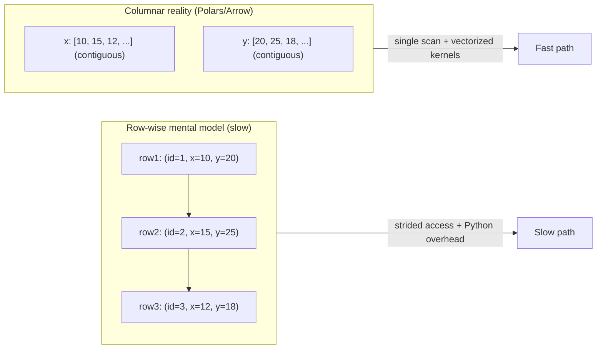
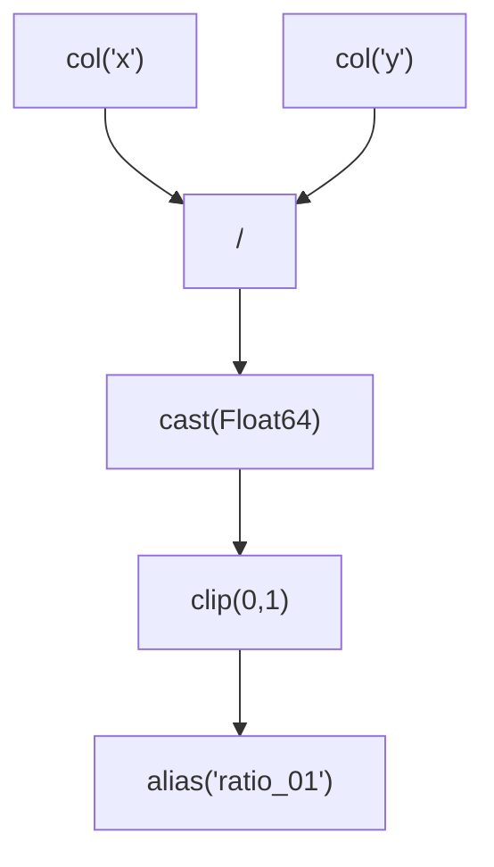

# Module 01: Polars First Principles — The Columnar Contract and Expression Calculus

## Version & scope contract

This module assumes **Polars 1.0+ (Python bindings)**. Polars evolves quickly; always verify the runtime version in any new environment:

```python
import polars as pl
print(pl.__version__)
```

Scope is **single-node analytics** using **DataFrame (eager)** and **LazyFrame (lazy)**. Distributed, streaming, and multi-node execution are out of scope.

---

## Table of contents

1. **Core 01 — Columnar Contract:** DataFrame vs Series, Copies vs Views, Eager vs Lazy
2. **Core 02 — Expression Calculus + Control Flow Inside the Engine**
3. **Core 03 — Transform Patterns That Scale (and Compose)**
4. **Core 04 — Types as Performance:** Schema Discipline + Categorical Strategy
5. **Core 05 — Ingestion for the Optimizer:** Pushdown as a Skill

**Appendix**
A. Plan Reading Primer (5 failure signatures + exact refactors)
B. Minimal lab configuration
C. Patterns / anti-patterns checklist
D. Mastery exercises (with actionable datasets)

---

# Core 01 — Columnar Contract: DataFrame vs Series, Copies vs Views, Eager vs Lazy

## Learning objectives

By the end of this core you can:

* explain why **the column (Series)** is the compute unit,
* predict why row-wise logic becomes slow (and when it is unavoidable),
* reason about memory behavior without folklore (“copy vs see-through views”),
* choose eager or lazy deliberately and defensibly.

---

## 1. What Polars is, operationally

Polars is a **columnar execution engine**. You do not program it by “iterating a table.” You program it by **declaring transformations over columns**, which the engine executes over contiguous buffers (Arrow-style layout).

In Polars:

* A **Series** is a typed column: values stored contiguously, plus an optional null bitmap.
* A **DataFrame** is a schema + a set of aligned Series (same row count).

The key consequence is not academic: if you can express your logic as column expressions, Polars can fuse, vectorize, and parallelize it. If you express your logic as per-row Python control flow, you force repeated Python↔engine boundary crossings and lose most of what makes Polars fast.

---

## 2. Why row-wise thinking is the primary slowdown

When you compute something like `sum(x)`, a columnar engine wants to scan the `x` buffer once. A row-wise loop tends to do three expensive things at once: (i) pointer-chase across memory, (ii) allocate Python objects, (iii) cross the Python boundary repeatedly.

### Row-wise vs columnar layout (diagram)



### Concrete demonstration (with expected output)

```python
import polars as pl

df = pl.DataFrame({"id": [1, 2, 3], "x": [10, 15, 12], "y": [20, 25, 18]})
out = df.select(pl.col("x").sum().alias("x_sum"))
print(out)
```

Expected:

```
shape: (1, 1)
┌───────┐
│ x_sum │
│ ---   │
│ i64   │
╞═══════╡
│ 37    │
└───────┘
```

### Make the performance claim tangible (micro-benchmark)

This is not about “benchmarking for sport.” It is about training your intuition.

```python
import time
import polars as pl

n = 2_000_000
df = pl.DataFrame({"x": pl.int_range(0, n, eager=True)})

t0 = time.perf_counter()
df.select(pl.col("x").sum())
t1 = time.perf_counter()

# DO NOT do this in production; this is a didactic contrast.
x_list = df["x"].to_list()
t2 = time.perf_counter()
s = 0
for v in x_list:
    s += v
t3 = time.perf_counter()

print(f"Polars sum: {t1 - t0:.4f}s")
print(f"Python loop: {t3 - t2:.4f}s")
```

What to notice:

* The Polars path stays inside the engine and streams one buffer.
* The Python loop is dominated by interpreter overhead, even though the arithmetic is trivial.

---

## 3. Copies vs views: a disciplined model (not guesswork)

Polars is *logically immutable*: operations return new frames. But internally, Polars can **share underlying buffers** when safe. Therefore:

* “New DataFrame” does not imply “full copy.”
* “Fast” does not imply “zero-copy always.”

### Safe operational model

* **Inside Polars**: unchanged columns are typically reused; new columns allocate new buffers.
* **Boundary crossings** (pandas/NumPy/Python objects): assume allocations unless you explicitly choose Arrow-backed paths and verify.

```python
import polars as pl

df = pl.DataFrame({"x": [1, 2, None], "s": ["a", "b", "c"]})
arrow_table = df.to_arrow()
pandas_df = df.to_pandas(use_pyarrow_extension_array=True)
```

Professional practice: keep data in Polars/Arrow for the analytical core; convert only at ingestion/output edges.

---

## 4. Schema-first discipline (why it is non-negotiable)

Columnar engines reward stable schemas. If your dtypes drift due to inference (CSV being the usual culprit), you pay in:

* extra casts and allocations,
* blocked pushdown opportunities,
* subtle correctness failures (especially around nulls).

The right posture is: **schemas are part of the contract**. Declare them early, cast once, validate invariants.

---

## 5. Eager vs lazy: two execution modes over the same expression language

Polars has one expression language but two execution regimes:

### 5.1 Eager (`DataFrame`)

Eager mode executes immediately. It is ideal for:

* interactive exploration,
* small datasets where planning overhead would dominate,
* quick sanity checks of a transform.

### 5.2 Lazy (`LazyFrame`)

Lazy mode builds a query plan, optimizes globally, and executes once at `.collect()`. This is the default for professional pipelines because it unlocks:

* predicate/projection pushdown,
* operation reordering,
* elimination of unused work,
* more efficient physical algorithms.

**Reference lazy pipeline**

```python
import polars as pl

lf = (
    pl.scan_parquet("data/*.parquet")
      .select(["key", "value"])
      .filter(pl.col("value") > 0)
      .group_by("key")
      .agg(pl.col("value").mean().alias("value_mean"))
)

print(lf.explain(optimized=True))
out = lf.collect()
```

Recap: treat eager as a REPL tool; treat lazy as your pipeline language.

---

# Core 02 — Expression Calculus + Control Flow Inside the Engine

## Learning objectives

By the end of this core you can:

* read and write expression trees fluently (`col`, `lit`, chaining, `cast`, `alias`),
* implement branching inside the engine (`when/then/otherwise`, `coalesce`, `clip`, `is_in`),
* handle null semantics correctly (three-valued logic) and write safe filters.

---

## 1. Expressions are declarative programs

A `pl.Expr` is not a value; it is a program fragment that describes how to compute a column.

```python
import polars as pl

ratio_01 = (
    (pl.col("x").cast(pl.Float64) / pl.col("y"))
      .clip(0.0, 1.0)
      .alias("ratio_01")
)
```

Nothing executes when you define `ratio_01`. Execution happens when the frame executes (immediately in eager, at `collect()` in lazy).

### Expression tree visualization (diagram)



What to notice:

* You are constructing a graph of operations.
* The optimizer can fuse and reorder parts of this graph when safe.

---

## 2. Control flow inside the engine (no Python branching)

### 2.1 `when().then().otherwise()`

```python
import polars as pl

df = pl.DataFrame({"x": [1, 2, 3, 4], "y": [0, 2, 0, 4]})

out = df.with_columns(
    pl.when(pl.col("y") != 0)
      .then(pl.col("x") / pl.col("y"))
      .otherwise(None)
      .alias("safe_div")
)

print(out)
```

Expected:

```
shape: (4, 3)
┌─────┬─────┬──────────┐
│ x   ┆ y   ┆ safe_div │
│ --- ┆ --- ┆ ---      │
│ i64 ┆ i64 ┆ f64      │
╞═════╪═════╪══════════╡
│ 1   ┆ 0   ┆ null     │
│ 2   ┆ 2   ┆ 1.0      │
│ 3   ┆ 0   ┆ null     │
│ 4   ┆ 4   ┆ 1.0      │
└─────┴─────┴──────────┘
```

**Critical semantic rule:** do not assume Python short-circuit evaluation. Write branches that are safe, or pre-clean inputs before applying risky operations.

### 2.2 `coalesce`, `clip`, `is_in`: the practical branching toolkit

These functions encode “if missing then default,” “if out of range clamp,” and “membership checks” without leaving the engine.

```python
import polars as pl

df = pl.DataFrame({"score": [0.2, None, 1.4], "grp": ["a", "b", "c"]})

out = df.with_columns(
    pl.coalesce([pl.col("score"), pl.lit(0.0)])
      .clip(0.0, 1.0)
      .alias("score_01"),
    pl.col("grp").is_in(["a", "c"]).alias("grp_is_ac"),
)

print(out)
```

---

## 3. Null semantics: three-valued logic and correctness-first filters

Polars uses SQL-style null semantics. A boolean expression can be `True`, `False`, or `Null`. `filter` keeps rows only where the predicate is `True`.

```python
import polars as pl

df = pl.DataFrame({"x": [1, None, 3]})
print(df.filter(pl.col("x") > 2))
```

Expected:

```
shape: (1, 1)
┌─────┐
│ x   │
│ --- │
│ i64 │
╞═════╡
│ 3   │
└─────┘
```

If your intent is “keep nulls too,” encode it:

```python
df.filter((pl.col("x") > 2) | pl.col("x").is_null())
```

A brief comparison worth remembering:

* pandas often coerces missingness into `NaN` and mixed dtypes, which can make “it runs” easier but correctness subtler.
* Polars keeps null semantics explicit and consistent. It forces you to decide what missingness means—this is a correctness feature, not a nuisance.

---

# Core 03 — Transform Patterns That Scale (and Compose)

## Learning objectives

By the end of this core you can:

* choose between `select`, `with_columns`, and `with_columns_seq`,
* use selectors to write schema-resilient transforms,
* structure reusable pipeline stages with `pipe`,
* avoid accidental materialization and “one-off” intermediates.

---

## 1. `select` vs `with_columns` vs `with_columns_seq`

### 1.1 `select`: define the output schema

Use `select` when you can state exactly what you want in the result. This is the strongest “reduce width early” signal.

```python
import polars as pl
df = pl.DataFrame({"id": [1, 2, 3], "x": [10, 15, 12], "y": [20, 25, 18]})

out = df.select([
    pl.col("id"),
    (pl.col("x") + pl.col("y")).alias("s"),
])
print(out)
```

### 1.2 `with_columns`: add/replace while keeping others

Use `with_columns` for enrichment. Independent expressions can be scheduled in parallel.

```python
out = df.with_columns((pl.col("x") + pl.col("y")).alias("s"))
print(out)
```

### 1.3 `with_columns_seq`: sequential evaluation (rare, but not imaginary)

This exists because sometimes you have **a very large number of tiny expressions** where parallel scheduling overhead can dominate. You should not reach for it without measurement, but you should know what it does.

Minimal demonstration:

```python
import polars as pl

df = pl.DataFrame({"a": [1]})

exprs = [pl.lit(i).alias(f"c{i}") for i in range(2000)]

# Parallel scheduling (default)
_ = df.with_columns(exprs)

# Forced sequential evaluation
_ = df.with_columns_seq(exprs)
```

What to notice:

* The correctness is the same.
* The performance difference (if any) depends on machine, expression cost, and count. This is an optimization knob, not a style choice.

### 1.4 Dependency ordering: stage explicitly

If column B depends on column A created in the same “step,” stage it. This is robust and communicates intent.

```python
lf = lf.with_columns(temp = pl.col("a") + pl.col("b"))
lf = lf.with_columns(final = pl.col("temp") * 2)
```

---

## 2. Selectors: transform by intent, not by brittle lists

Selectors allow you to say “all numeric columns” or “all string columns,” which is how you keep pipelines stable under schema evolution.

```python
import polars as pl
import polars.selectors as cs

df = pl.DataFrame({"a": [1, 2], "b": [3.0, 4.0], "s": [" X ", "Y "]})

out = df.with_columns(
    cs.numeric().cast(pl.Float32),
    cs.string().str.strip_chars().str.to_lowercase(),
)

print(out)
print(out.dtypes)
```

---

## 3. Struct/list-safe transforms: preserve structure until you must flatten

Nested types (struct/list) are first-class. The right approach is:

* validate and clean while nested,
* explode/unnest only when the downstream operation truly requires rows.

This avoids width explosion and preserves meaning.

---

## 4. `pipe`: composable transforms that remain lazy

`pipe` turns pipelines into named stages that are testable and readable without breaking laziness.

```python
import polars as pl

def project_core(lf: pl.LazyFrame) -> pl.LazyFrame:
    return lf.select(["sample_id", "key", "value"])

def engineer(lf: pl.LazyFrame) -> pl.LazyFrame:
    return lf.with_columns(pl.col("value").log1p().alias("value_log1p"))

lf = (
    pl.scan_parquet("data/*.parquet")
      .pipe(project_core)
      .pipe(engineer)
      .filter(pl.col("value_log1p") > 0)
)

out = lf.collect()
```

A stage should be pure and should never call `collect()` internally.

---

# Core 04 — Types as Performance: Schema Discipline + Categorical Strategy

## Learning objectives

By the end of this core you can:

* explain why dtype choices shape performance and correctness,
* enforce schemas at I/O boundaries,
* decide when categorical is a win vs a maintenance hazard.

---

## 1. Types are not metadata; they shape execution

Dtypes determine memory layout, available vectorized kernels, and algorithm choices for joins/group_by. High-impact types to treat deliberately:

* datetime/duration,
* decimal (exactness),
* categorical/enum,
* struct/list.

---

## 2. Parse vs cast: do work once at ingestion

Parsing is expensive and ambiguous (text → type). Casting is a controlled conversion (type → type). Professional pipelines parse into the right dtypes at the boundary.

```python
import polars as pl

lf = pl.scan_csv(
    "data.csv",
    schema_overrides={
        "sample_id": pl.String,
        "timestamp": pl.Datetime,
        "value": pl.Float64,
    },
)
```

---

## 3. Categorical vs string: power with obligations

Categorical can reduce memory and speed up joins/grouping **when cardinality is low and stable**. It is harmful when cardinality is high or categories are unbounded.

Use categorical when:

* the column is a frequent join/group key,
* cardinality is low relative to row count,
* categories are stable across partitions.

Avoid it when:

* values are near-unique identifiers,
* new categories arrive continuously,
* you cannot control category hygiene across files.

Treat categorical conversion as a measured optimization backed by data profiling, not as a default trick.

---

# Core 05 — Ingestion for the Optimizer: Pushdown as a Skill

## Learning objectives

By the end of this core you can:

* choose `scan_*` vs `read_*` correctly,
* order operations to enable predicate/projection pushdown,
* verify optimization by inspecting plans.

---

## 1. `scan_*` vs `read_*`

* `read_*` loads eagerly; good for interactive checks.
* `scan_*` declares a lazy source; good for pipelines, because it enables optimizer pushdown and global rewrites.

Default to `scan_*` for non-trivial work.

---

## 2. Pushdown: what it is and what blocks it

Pushdown is the optimizer’s ability to read less data:

* **projection pushdown**: read only needed columns,
* **predicate pushdown**: apply filters as early as possible, sometimes skipping entire row groups/partitions (especially in Parquet).

To enable pushdown, you must maintain ordering discipline:

1. `select` early (reduce width)
2. `filter` early (reduce rows)
3. postpone heavy transforms until after reductions
4. avoid Python UDFs and other black boxes before scan/filter/projection

Reference pattern:

```python
import polars as pl

lf = (
    pl.scan_parquet("data/*.parquet")
      .select(["key", "value"])
      .filter(pl.col("value") > 0)
      .with_columns(...)  # enrich after reduction
)
```

---

## 3. Verification: `explain()` is mandatory evidence

```python
print(lf.explain(optimized=True))
```

Your intent must be visible in the plan. If filters/projections are far above the scan, reorder or remove blockers.

---

# Appendix A — Plan Reading Primer (5 failure signatures + exact refactors)

Print both views:

```python
print(lf.explain(optimized=False))
print(lf.explain(optimized=True))
```

Read bottom→up.

### A1) Blocked pushdown

**Plan smell:** scan reads many columns; filter/projection applied later.
**Fix:** move `select`/`filter` earlier; avoid UDFs/opaque transforms before them.

### A2) Early materialization

**Plan smell:** pipeline splits or repeats because of mid `.collect()` or conversion.
**Fix:** keep everything lazy; collect once at the end.

### A3) Width explosion

**Plan smell:** join/group/sort operates on a wide schema.
**Fix:** `select` keys + minimal payload before expensive ops.

### A4) Accidental sort

**Plan smell:** `SORT` appears without strict need.
**Fix:** remove; or sort late and narrow for determinism only when required.

### A5) Python UDF boundary

**Plan smell:** plan includes Python apply/map boundary.
**Fix:** rewrite as expressions; join-as-map; batch UDF only as last resort.

---

# Appendix B — Minimal lab configuration

```python
import polars as pl
pl.Config.set_tbl_rows(20)
pl.Config.set_tbl_cols(12)
pl.Config.set_fmt_str_lengths(60)
```

---

# Appendix C — Patterns / anti-patterns checklist

**Defaults**

* `scan_*` + lazy; `collect()` once
* early `select` and `filter`
* expression-only transforms
* explicit schemas at I/O boundaries
* inspect optimized plans for evidence

**Treat as defects**

* row-wise loops
* per-element Python UDFs as default
* mid-pipeline materialization
* wide intermediates through join/group/sort
* implicit null semantics

---

# Appendix D — Mastery exercises (actionable)

Use any medium-sized Parquet dataset (NYC taxi Parquet is a common choice) or generate synthetic data if needed.

1. Rewrite a row-loop feature computation into pure expressions.
2. Create a filter predicate that yields nulls; demonstrate dropped rows; fix it explicitly.
3. Build the same pipeline with `read_parquet` vs `scan_parquet`; compare `explain()` output.
4. Construct a join with many unused columns; refactor to project before join; verify plan and memory profile.
5. Replace a Python dict-lookup UDF with a join-as-map; verify the Python boundary disappears from the plan.

---

## Closing recap

If you take only one professional habit from this module, make it this: **write in expressions, stay lazy, reduce early, enforce schema, and verify with `explain()`**. That combination is what makes Polars not just fast, but reliable.
