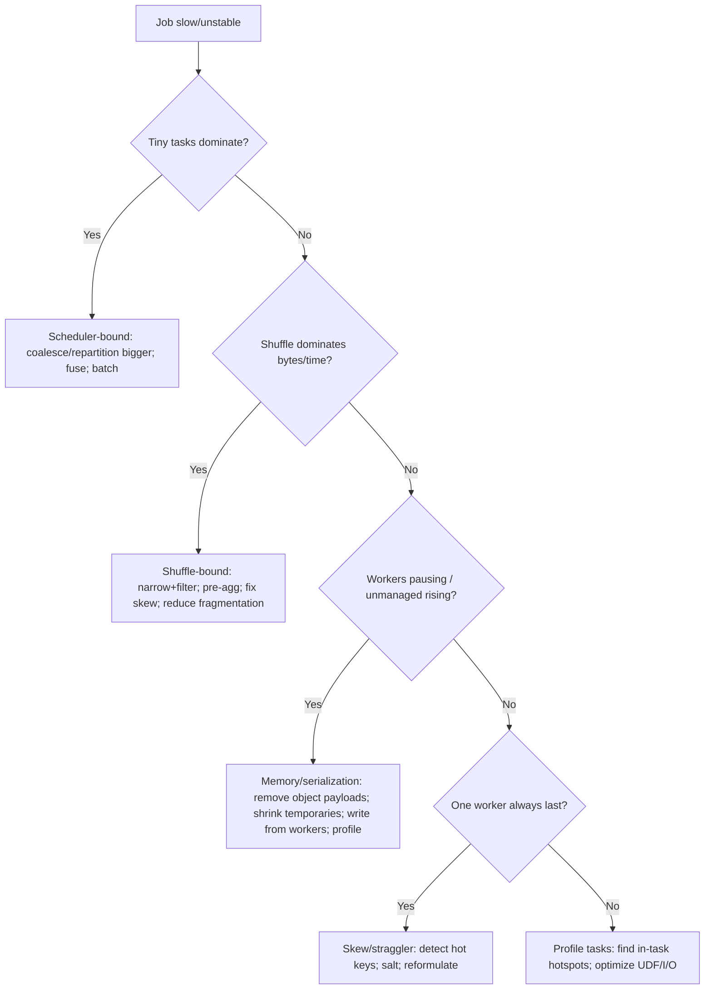

# Module 03: Production Dask — Distributed Runtime, Diagnostics, and Deployment

> **Version & scope contract**
>* **Scope:** Production Dask for scalable analytics and engineered pipelines (DataFrame/Array/Bag + `dask.distributed`).
>* **Validity:** Mechanisms and patterns hold for modern Dask (≈2024+). **Verify exact defaults and API names in your installed version** before copying configs verbatim (especially memory + shuffle + plugin registration).

## Table of Contents

* [0. Orientation](#0-orientation)
* [Core 1 — Distributed Runtime](#core-1--distributed-runtime-client-workers-futures-orchestration)
* [Core 2 — Memory, Spilling, Survival Engineering](#core-2--memory-spilling-survival-engineering)
* [Core 3 — Diagnostics: Read the Dashboard Like an Engineer](#core-3--diagnostics-read-the-dashboard-like-an-engineer)
* [Core 4 — Deployment: Local → HPC → Kubernetes → Gateway](#core-4--deployment-local--hpc--kubernetes--gateway)
* [Core 5 — Engineering Practice](#core-5--engineering-practice-contracts-testing-when-not-to-use-dask)
* [Appendix A — Reference Configuration Template](#appendix-a--reference-configuration-template-explicit-verify-version-defaults)
* [Appendix B — Diagnostic Decision Tree](#appendix-b--diagnostic-decision-tree)
* [Appendix C — Exercises](#appendix-c--exercises-synthesis)
* [Further Reading (Official Docs Map)](#further-reading-official-docs-map)

---

## 0. Orientation

Modules 01–02 taught you how Dask jobs *become slow or unstable*: too many tasks, shuffles, skew, schema drift, and memory amplification. Module 03 is the operational layer:

* **Control plane:** collections vs futures (and mixing them without fighting the optimizer)
* **Survivability:** memory semantics, spilling limits, retries/cancellation, bounded in-flight work
* **Evidence:** turning “it’s slow” into a reproducible diagnosis from dashboard + reports
* **Deployment:** configurations that actually run on HPC/Kubernetes and don’t implode under shuffle load
* **Engineering:** contracts, tests, decision boundaries

---

# Core 1 — Distributed Runtime: Client, Workers, Futures, Orchestration

## 1.1 Graph-first runtime model (what runs where)

* **Client** builds graphs and submits work.
* **Scheduler** owns global state (dependencies, placement, priorities).
* **Workers** execute tasks, hold intermediate results, and exchange data (including shuffle transfers).

### Minimal cluster (copy/paste runnable)

```python
from dask.distributed import Client, LocalCluster

cluster = LocalCluster(
    n_workers=4,
    threads_per_worker=1,
    processes=True,
    memory_limit="4GiB",
    dashboard_address=":8787",
)
client = Client(cluster)
client
```

**Default stance:** `processes=True, threads_per_worker=1` unless you *measure* that threads improve throughput without GIL/BLAS oversubscription.

## 1.2 Threads vs processes: the only decision rule that survives production

* **CPU-bound Python / object-heavy UDFs:** prefer **processes** (threads contend on the GIL).
* **I/O-bound tasks:** threads can help hide latency (measure; avoid unbounded concurrency).
* **Vectorized NumPy/BLAS:** threads can help *if* you control BLAS threads (avoid nested oversubscription).

Production optimization is not “threads good/bad”; it’s **contention control**.

---

## 1.3 Futures are an orchestration tool, not a replacement for collections

* **Collections** (DataFrame/Array/Bag) give you **declarative** planning and graph optimizations.
* **Futures** give you **imperative** control: streaming, backpressure, irregular DAGs, external tools, explicit failure handling.

**Relationship:** collections ultimately lower into tasks that run as futures on workers; futures just expose that control plane directly.

---

## 1.4 Futures patterns (progressive, production-grade)

### 1.4.1 Submit basics + `wait` + `gather`

```python
from dask.distributed import Client, LocalCluster, wait

def heavy(i: int) -> int:
    return i * i

cluster = LocalCluster(n_workers=4, threads_per_worker=1, processes=True, memory_limit="2GiB")
client = Client(cluster)

futs = [client.submit(heavy, i, pure=True) for i in range(100)]
wait(futs)
vals = client.gather(futs)
print(vals[:5])
```

**Notes**

* `pure=True` enables deduplication for deterministic functions.
* Keep arguments small; pass references/paths, not giant Python objects.

### 1.4.2 Failure-aware gathering (don’t let one shard kill the run)

```python
from dask.distributed import Client, LocalCluster, as_completed

def maybe_fail(i: int) -> int:
    if i % 17 == 0:
        raise ValueError(f"bad shard: {i}")
    return i

cluster = LocalCluster(n_workers=2, threads_per_worker=1, processes=True, memory_limit="1GiB")
client = Client(cluster)

futs = [client.submit(maybe_fail, i, pure=False) for i in range(100)]

ok = []
errors = []
for fut, res in as_completed(futs, with_results=True):
    if fut.status == "error":
        errors.append(repr(fut.exception()))
    else:
        ok.append(res)

print("ok:", len(ok), "errors:", len(errors))
print("sample error:", errors[0] if errors else None)
```

### 1.4.3 Cancellation (cluster hygiene)

```python
from dask.distributed import Client, LocalCluster

def slow(x: int) -> int:
    import time
    time.sleep(5)
    return x

cluster = LocalCluster(n_workers=1, threads_per_worker=1, processes=True, memory_limit="1GiB")
client = Client(cluster)

fut = client.submit(slow, 1)
client.cancel(fut)

print("status:", fut.status)
```

---

## 1.5 Bounded concurrency with distributed primitives (Semaphore)

Real pipelines often must cap concurrency (APIs, databases, rate limits). Use a **Semaphore** to prevent “1000 concurrent requests because the cluster can.”

```python
from dask.distributed import Client, LocalCluster, Semaphore, as_completed

def call_external(i: int) -> int:
    # simulate rate-limited work
    import time
    time.sleep(0.1)
    return i

cluster = LocalCluster(n_workers=4, threads_per_worker=1, processes=True, memory_limit="1GiB")
client = Client(cluster)

sem = Semaphore(max_leases=8, name="rate-limit")  # 8 in-flight tasks, cluster-wide

futs = []
for i in range(200):
    sem.acquire()  # blocks client-side submission beyond the cap
    fut = client.submit(call_external, i, pure=False)
    fut.add_done_callback(lambda _: sem.release())
    futs.append(fut)

out = []
for fut, res in as_completed(futs, with_results=True):
    out.append(res)

print(len(out))
```

(Other primitives—`Lock`, `Event`, `Queue`, `Variable`—live in the same distributed API surface and are for coordination, not performance.)

---

## 1.6 Scheduling controls you must teach (resources, priorities, retries)

### A) Prioritize “interactive” over “backfill”

```python
from dask.distributed import Client, LocalCluster

cluster = LocalCluster(n_workers=2, threads_per_worker=1, processes=True, memory_limit="1GiB")
client = Client(cluster)

def work(tag: str, n: int) -> str:
    import time
    time.sleep(0.01)
    return tag

# Backfill: low priority
backfill = [client.submit(work, "backfill", i, priority=0) for i in range(500)]

# Interactive: high priority
interactive = [client.submit(work, "interactive", i, priority=1000) for i in range(10)]

print(client.gather(interactive))
```

Priority semantics and work ordering are part of the distributed scheduling model.

### B) Constrain placement with worker resources

```python
from dask.distributed import Client, LocalCluster

cluster = LocalCluster(n_workers=2, threads_per_worker=1, processes=True, memory_limit="1GiB")
client = Client(cluster)

def gpu_like(x: int) -> int:
    return x

# This assumes workers were started with resource tags (e.g., GPU=1 on some workers).
fut = client.submit(gpu_like, 1, resources={"GPU": 1})
print(fut.result())
```

Resources/constraints are first-class scheduling controls. ([Dask Distributed][1])

### C) Collections: annotate resources/priority around a stage boundary

(Use when mixing heavy ETL + model scoring + expensive shuffles.)

```python
import numpy as np
import pandas as pd
import dask
import dask.dataframe as dd
from dask.distributed import Client, LocalCluster

cluster = LocalCluster(n_workers=2, threads_per_worker=1, processes=True, memory_limit="2GiB")
client = Client(cluster)

pdf = pd.DataFrame({"k": np.random.randint(0, 10_000, size=500_000), "v": np.random.randn(500_000)})
ddf = dd.from_pandas(pdf, npartitions=50)

with dask.annotate(priority=100):  # prioritize this stage
    out = ddf.groupby("k").v.sum()

print(out.compute().head())
```

---

## 1.7 Serialization toolbox (what to do beyond “avoid object dtype”)

**You pay serialization cost** when:

* passing large arguments to tasks,
* returning large results,
* doing worker↔worker transfers (shuffle, broadcast/scatter).

**Operational rules**

1. **Pass references** (paths/keys/URIs), load on worker.
2. **Write big outputs from workers**; don’t `gather()` multi-GB results to the client.
3. Track serialization/transfer cost in diagnostics (Task Stream + Profile + bandwidth).

If you truly need custom domain objects, use Dask’s serializer hooks (keep payloads small and stable). (See distributed serialization docs.) ([Dask Kubernetes Operator][2])

---

## 1.8 Worker lifecycle hooks (WorkerPlugin)

Use plugins to:

* preload models,
* set env vars (BLAS threads, GPU init),
* register metrics/logging hooks,
* enforce per-worker initialization deterministically.

```python
from dask.distributed import Client, LocalCluster
from distributed.diagnostics.plugin import WorkerPlugin

class InitPlugin(WorkerPlugin):
    def setup(self, worker):
        # Example: pin internal libs to 1 thread to avoid oversubscription
        import os
        os.environ.setdefault("OMP_NUM_THREADS", "1")
        os.environ.setdefault("MKL_NUM_THREADS", "1")

cluster = LocalCluster(n_workers=2, threads_per_worker=1, processes=True, memory_limit="1GiB")
client = Client(cluster)

# API name may differ by version; verify in your installed Dask.
client.register_worker_plugin(InitPlugin(), name="init")
```

---

# Core 2 — Memory, Spilling, Survival Engineering

## 2.1 Managed vs unmanaged memory (why spilling is not a safety net)

* **Managed memory:** task results held in the worker’s data store (trackable/spillable).
* **Unmanaged memory:** everything else (temporary arrays, Python object graphs, library buffers, “recent” allocations).

Spilling mainly reduces **managed** pressure; unmanaged spikes can still trigger pausing/termination. ([Dask Distributed][3])

## 2.2 Thresholds are configuration, not a “lifecycle story”

Key knobs (names/semantics are stable in distributed config):

* `distributed.worker.memory.target`
* `distributed.worker.memory.spill`
* `distributed.worker.memory.pause`
* `distributed.worker.memory.terminate`

These thresholds are **reactions** under noisy measurement, not a linear pipeline. ([Dask Distributed][3])

## 2.3 Common production failure modes (and what actually fixes them)

### A) Shuffle buffer amplification

**Signature:** memory rises sharply during shuffle; long tail; a few workers near pause/terminate.
**Fix order:** narrow → filter → pre-aggregate → reduce fragmentation → mitigate skew.

### B) Serialization bloat / object dtype payloads

**Signature:** network high, CPU low, unmanaged memory climbs, tasks dominated by transfer.
**Fix:** remove object payloads; pass references; write from workers; simplify outputs.

### C) Runaway graphs + recomputation

**Signature:** repeated upstream stages, huge graphs, slow scheduler progress.
**Fix:** persist explicit stage boundaries; reduce task count; avoid non-fusible UDF chains where possible.

---

# Core 3 — Diagnostics: Read the Dashboard Like an Engineer

The dashboard is the evidence layer; treat it as required instrumentation. (See diagnosing performance docs.) ([Dask Distributed][4])

## 3.1 Panel → question mapping

* **Task Stream:** task granularity, phases, long tail/stragglers.
* **Workers / Memory:** managed vs unmanaged pressure; pausing/restarts.
* **Shuffle:** bytes moved, blocked exchanges, straggler destinations.
* **Graph:** task count/layers; graph blow-up; repeated work.
* **Profile:** inside-task hotspots (Python vs NumPy vs I/O).

## 3.2 Programmatic diagnostics (CI artifacts + incident reports)

### Performance report (shareable artifact)

```python
import numpy as np
import pandas as pd
import dask.dataframe as dd
from dask.distributed import Client, LocalCluster, performance_report

cluster = LocalCluster(n_workers=2, threads_per_worker=1, processes=True, memory_limit="2GiB")
client = Client(cluster)

pdf = pd.DataFrame({"k": np.random.randint(0, 10_000, 1_000_000), "v": np.random.randn(1_000_000)})
ddf = dd.from_pandas(pdf, npartitions=100)

with performance_report(filename="dask-report.html"):
    res = ddf.groupby("k").v.sum().compute()

print(res.head())
```

### Task stream + worker logs (quick forensic dump)

```python
from dask.distributed import Client, LocalCluster

cluster = LocalCluster(n_workers=2, threads_per_worker=1, processes=True, memory_limit="1GiB")
client = Client(cluster)

ts = client.get_task_stream(count=2000)
logs = client.get_worker_logs(n=50)

print("task_stream_rows:", len(ts))
print("workers_with_logs:", len(logs))
```

---

## 3.3 Worked incident (with explicit before/after metrics)

**Incident:** “Groupby stalls near end; memory spikes; one worker always last.”

**Before (what you record)**

* wall time
* shuffle bytes (Shuffle panel)
* peak worker memory (Workers panel)
* task count (Graph / task stream density)
* long-tail ratio (slowest task time / median task time)

**Root cause pattern**

1. wide shuffle payload
2. skewed key causing straggler destinations
3. fragmented partitions causing too many exchange fragments

**Fix (apply in order; re-measure each)**

1. project columns
2. filter rows (if valid)
3. local pre-aggregation
4. salt only if skew persists
5. repartition once (post-projection) to sane MiB sizes

This is the production loop: **observe → change one major lever → re-measure**.

---

# Core 4 — Deployment: Local → HPC → Kubernetes → Gateway

## 4.1 Local (production simulator)

Use LocalCluster to validate performance, memory behavior, and shuffles before deploying.

## 4.2 HPC / SLURM (dask-jobqueue template)

```python
from dask.distributed import Client
from dask_jobqueue import SLURMCluster

cluster = SLURMCluster(
    queue="normal",
    account="YOUR_ACCOUNT",
    cores=4,
    processes=4,
    memory="16GiB",
    walltime="02:00:00",
    local_directory="/scratch/$USER/dask-spill",
)

cluster.scale(jobs=10)                 # deterministic
# cluster.adapt(minimum_jobs=2, maximum_jobs=50)  # bounded elasticity

client = Client(cluster)
client
```

**Adaptive safety:** set non-zero minimums; avoid aggressive scale-down during heavy shuffles.

## 4.3 Kubernetes (Operator / `KubeCluster`)

```python
from dask.distributed import Client
from dask_kubernetes.operator import KubeCluster, make_cluster_spec

spec = make_cluster_spec(name="prod", n_workers=2)
# Example: force SSD nodes
spec["spec"]["worker"]["spec"]["nodeSelector"] = {"disktype": "ssd"}

cluster = KubeCluster(custom_cluster_spec=spec)
cluster.scale(20)

client = Client(cluster)
client
```

Operator-based deployment is the modern K8s path. ([Dask Kubernetes Operator][2])

## 4.4 Gateway (multi-tenant control plane)

If you operate in shared environments, a gateway layer typically provides auth/quota and user-managed clusters. Keep this as an architectural option; don’t hand-roll multi-tenant scheduling in notebooks.

---

# Core 5 — Engineering Practice: Contracts, Testing, When Not to Use Dask

## 5.1 Contracts to enforce (or production will enforce them for you)

* **Determinism / idempotence at I/O edges** (retries happen).
* **Schema contracts** at UDF boundaries (`meta`, stable columns/dtypes).
* **Resource contracts** (partition sizing, bounded concurrency, memory thresholds).
* **No giant client gathers** (worker writes; client coordinates).

## 5.2 Test strategy that scales

* Unit test partition functions on pandas inputs.
* Minimal distributed integration test on LocalCluster (2 workers).
* CI artifact: generate `dask-report.html` for a representative workload and diff key metrics over time.

## 5.3 When not to use Dask (decision matrix)

| Requirement   | Dask is a good fit when…                      | Prefer something else when…                           |
| ------------- | --------------------------------------------- | ----------------------------------------------------- |
| Latency       | seconds/minutes acceptable                    | sub-second interactive queries (DuckDB/Polars)        |
| Work shape    | mostly partition-local + limited global steps | constant all-to-all shuffles dominate                 |
| Data size     | larger-than-RAM or cluster required           | fits comfortably in RAM                               |
| Serving/state | batch analytics                               | online actor-style systems (Ray)                      |
| Ecosystem     | Python-first pipeline                         | SQL-first warehouse/engine workflows (Spark/Trino/DB) |

---

## Appendix A — Reference configuration template (explicit; verify version defaults)

### A.1 Worker memory thresholds (template, not “defaults”)

```yaml
distributed:
  worker:
    memory:
      target: 0.60
      spill: 0.70
      pause: 0.80
      terminate: 0.95
```

Meaning and behavior are defined in worker memory management docs. ([Dask Distributed][3])

### A.2 “Process isolation” LocalCluster baseline

```python
from dask.distributed import LocalCluster

cluster = LocalCluster(
    n_workers=8,
    threads_per_worker=1,
    processes=True,
    memory_limit="4GiB",
    local_directory="/tmp/dask-spill",
)
```

---

## Appendix B — Diagnostic decision tree



---

## Appendix C — Exercises (synthesis)

1. **Two-plane pipeline:** DataFrame ETL → `persist()` → futures stage (streamed writes); prove recomputation disappears after the stage boundary.
2. **Bounded concurrency:** wrap a rate-limited workload with `Semaphore`; show that throughput stabilizes and failures drop.
3. **Scheduling control:** run backfill + interactive jobs; demonstrate priority prevents starvation.
4. **Incident report:** generate `dask-report.html`, record: wall time, shuffle bytes, peak memory, long-tail ratio; apply one lever; re-measure.

---

## Further Reading (Official Docs Map)

* Worker memory management and thresholds: ([Dask Distributed][3])
* Resources / placement constraints: ([Dask Distributed][1])
* Task priorities / work ordering:
* Diagnosing performance (dashboard + methodology): ([Dask Distributed][4])
* Kubernetes Operator `KubeCluster`: ([Dask Kubernetes Operator][2])

[1]: https://distributed.dask.org/en/stable/resources.html "Worker Resources — Dask.distributed 2025.11.0 documentation"
[2]: https://kubernetes.dask.org/en/latest/operator_kubecluster.html "KubeCluster — Dask Kubernetes 2025.7.1.dev1+gf4e3b1079 documentation"
[3]: https://distributed.dask.org/en/stable/worker-memory.html "Worker Memory Management — Dask.distributed 2025.11.0 documentation"
[4]: https://distributed.dask.org/en/stable/serialization.html "Serialization — Dask.distributed 2025.11.0 documentation"
