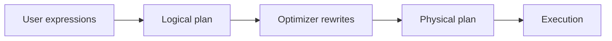

## Module 03: Production Polars — Plans, Performance, UDFs, and Engineering Practice

> **Version & scope contract**
>
> * Target: **Polars 1.x** (Python bindings). Always verify and pin in your environment:
>
>   ```python
>   import polars as pl
>   print(pl.__version__)
>   ```
> * Scope: **single-node** pipelines. Default workflow is **lazy** (`scan_*` → expression pipeline → one `.collect()`).

### Table of contents

1. **Core 01 — Lazy Query Plans:** Read `explain()` or you’re guessing
2. **Core 02 — Performance Rules That Actually Matter**
3. **Core 03 — The UDF Trap:** `map_elements` / `apply` vs controlled `map_batches`
4. **Core 04 — Robust Pipelines:** Contracts, tests, deterministic outputs
5. **Core 05 — Interop and Ecosystem Reality**

**Appendices**
A. Plan failure signatures (5) + exact refactors + what “good” looks like
B. Minimal production harness
C. Benchmark discipline (how to measure without lying to yourself)

---

# Core 01 — Lazy Query Plans: Read `explain()` or you’re guessing

## Learning objectives

You will be able to:

* read plans **bottom-up** and predict cost,
* spot the five production killers: **blocked pushdown**, **early materialization**, **width explosion**, **accidental sort**, **Python boundary**,
* refactor and re-verify by re-reading the optimized plan.

## 1.1 What you’re building



The operational mindset is: **plan → evidence → refactor → evidence**.

## 1.2 The two prints you always do

```python
import polars as pl

print(lf.explain(optimized=False))  # what you wrote
print(lf.explain(optimized=True))   # what will run
```

**How to read** (bottom-up):

1. what’s scanned (files + columns)?
2. do filters/projections happen **before** joins/groupbys/sorts?
3. where is Python invoked?
4. is there an unintended sort?
5. where does the plan materialize?

---

## 1.3 Failure signature #1: blocked pushdown (Python boundary)

### Bad: Python per-element blocks optimization opportunities

```python
import polars as pl

lf_bad = (
    pl.scan_parquet("data/events/*.parquet")
      .with_columns(
          pl.col("event")
            .map_elements(lambda s: s.strip().lower(), return_dtype=pl.String)
            .alias("event_norm")
      )
      .filter(pl.col("event_norm") == "buy")
      .select(["user_id", "event_norm", "value"])
)

print(lf_bad.explain(optimized=True))
```

**Expected plan (representative; structure matters more than exact tokens):**

```text
SELECT [user_id, event_norm, value]
  FILTER [(event_norm == "buy")]
    WITH_COLUMNS [event_norm = python_udf(event)]
      PARQUET SCAN data/events/*.parquet
```

**What to notice**

* The filter depends on a Python UDF output → less pushdown/reordering.
* In practice: more bytes scanned + more allocations.

### Good: native expressions keep the pipeline optimizable

```python
import polars as pl

lf_good = (
    pl.scan_parquet("data/events/*.parquet")
      .with_columns(pl.col("event").str.strip_chars().str.to_lowercase().alias("event_norm"))
      .filter(pl.col("event_norm") == "buy")
      .select(["user_id", "event_norm", "value"])
)

print(lf_good.explain(optimized=True))
```

**Expected plan shape:**

```text
FILTER [(event_norm == "buy")]
  PROJECT [user_id, event_norm, value]
    PARQUET SCAN data/events/*.parquet
```

---

## 1.4 Failure signature #2: early materialization (multiple collects)

### Bad: two execution boundaries

```python
import polars as pl

lf = pl.scan_parquet("data/events/*.parquet")

tmp = lf.filter(pl.col("value") > 0).collect()               # boundary #1
out = tmp.lazy().group_by("user_id").agg(pl.len()).collect() # boundary #2
print(out.head(3))
```

**Expected output format:**

```
shape: (3, 2)
┌─────────┬─────┐
│ user_id │ len │
│ ---     │ --- │
│ ...     │ ... │
└─────────┴─────┘
```

### Good: one lazy pipeline, one collect

```python
import polars as pl

lf = (
    pl.scan_parquet("data/events/*.parquet")
      .filter(pl.col("value") > 0)
      .group_by("user_id")
      .agg(pl.len().alias("n"))
)

print(lf.explain(optimized=True))
out = lf.collect()
print(out.head(3))
```

---

## 1.5 Failure signature #3: width explosion (global ops on fat frames)

### Bad: join before projection (payload bloat)

```python
import polars as pl

events = pl.scan_parquet("data/events/*.parquet")
users  = pl.scan_parquet("data/users.parquet")

lf_bad = (
    events.join(users, on="user_id", how="left")
          .group_by("country")
          .agg(pl.col("value").sum())
)

print(lf_bad.explain(optimized=True))
```

**Plan smell to look for**

* scan nodes show many columns
* join happens before meaningful projections

### Good: project minimal payload on both sides

```python
import polars as pl

events = pl.scan_parquet("data/events/*.parquet").select(["user_id", "value"])
users  = pl.scan_parquet("data/users.parquet").select(["user_id", "country"])

lf_good = (
    events.join(users, on="user_id", how="left")
          .group_by("country")
          .agg(pl.col("value").sum().alias("gross"))
)

print(lf_good.explain(optimized=True))
```

**Expected plan shape:**

```text
AGGREGATE [group_by=country] (gross=sum(value))
  JOIN [on=user_id, how=left]
    PROJECT [user_id, value]
      SCAN events
    PROJECT [user_id, country]
      SCAN users
```

---

## 1.6 Failure signature #4: accidental sort (show it explicitly)

If you see `SORT` in a plan where you did not request ordering semantics, treat it as a likely defect.

### Example: unintended sort introduced by “dedupe keep” without a prior deterministic boundary

```python
import polars as pl

lf = (
    pl.scan_parquet("data/events/*.parquet")
      .unique(subset=["user_id"], keep="last")   # semantics can trigger ordering work
      .select(["user_id"])
)

print(lf.explain(optimized=True))
```

**Expected smell (representative):**

```text
... SORT ...
... UNIQUE ...
```

**Fix**

* Make ordering explicit and narrow first:

  * `select` the minimal columns that define the survivor rule,
  * `sort` with tie-breakers,
  * then `unique`,
  * then join back payload if needed.

---

## 1.7 Failure signature #5: Python boundary (plan evidence)

A Python boundary must show up somewhere in the plan. If you rely on it in a hot path, you are paying for it.

```python
import polars as pl

lf = (
    pl.scan_parquet("data/events/*.parquet")
      .with_columns(pl.col("value").map_elements(lambda v: v, return_dtype=pl.Float64).alias("v2"))
      .select(["v2"])
)

print(lf.explain(optimized=True))
```

**Expected smell:**

```text
... WITH_COLUMNS [v2 = python_udf(value)] ...
```

---

# Core 02 — Performance Rules That Actually Matter

## Learning objectives

You will be able to:

* predict runtime and memory from **width**, **cardinality**, **skew**, and **sorts**,
* design benchmarks that reveal real bottlenecks,
* choose refactors that usually dominate: reduce width, reduce rows early, avoid Python boundaries.

> **Benchmark note**
> Timings are machine-dependent. The goal is magnitude and direction. Compare *relative* changes on your target hardware.

---

## 2.1 Width dominates (with memory estimate)

```python
import polars as pl
import time

n = 250_000
base = pl.DataFrame({"k": pl.int_range(0, n, eager=True), "x": pl.int_range(0, n, eager=True)})

narrow = base.select(["k", "x"])
wide = base.with_columns([pl.col("x").alias(f"x{i}") for i in range(120)])  # scale down if RAM is tight

print("narrow width:", narrow.width, "estimated bytes:", narrow.estimated_size())
print("wide width:  ", wide.width,   "estimated bytes:", wide.estimated_size())

t0 = time.perf_counter()
_ = narrow.group_by("k").agg(pl.col("x").sum())
t1 = time.perf_counter()

t2 = time.perf_counter()
_ = wide.group_by("k").agg(pl.all().exclude("k").sum())
t3 = time.perf_counter()

print("narrow group_by seconds:", round(t1 - t0, 3))
print("wide   group_by seconds:", round(t3 - t2, 3))
```

**Expected output format:**

```
narrow width: 2 estimated bytes: <...>
wide width:   122 estimated bytes: <...>
narrow group_by seconds: <...>
wide   group_by seconds: <...>
```

**What to notice**

* Width multiplies hash work and memory traffic.
* You win by projecting minimal payload before joins/groupbys/sorts.

---

## 2.2 Cardinality dominates group_by/join cost (hash table size)

```python
import polars as pl
import time

n = 1_500_000
low = pl.DataFrame({"k": pl.repeat("A", n, eager=True), "v": pl.int_range(0, n, eager=True)})
high = pl.DataFrame({"k": pl.int_range(0, n, eager=True), "v": pl.int_range(0, n, eager=True)})

t0 = time.perf_counter(); _ = low.group_by("k").agg(pl.col("v").sum());  t1 = time.perf_counter()
t2 = time.perf_counter(); _ = high.group_by("k").agg(pl.col("v").sum()); t3 = time.perf_counter()

print("low-card groups:", low.select(pl.col("k").n_unique()).item(),  "seconds:", round(t1 - t0, 3))
print("high-card groups:", high.select(pl.col("k").n_unique()).item(), "seconds:", round(t3 - t2, 3))
```

Expected: high-cardinality aggregation is materially slower.

---

## 2.3 Skew is a distinct pathology (hot keys dominate)

```python
import polars as pl
import time

n = 2_000_000
skew = pl.DataFrame({
    "k": pl.concat([
        pl.repeat("HOT", int(n * 0.9), eager=True),
        pl.int_range(0, int(n * 0.1), eager=True).cast(pl.String),
    ]),
    "v": pl.int_range(0, n, eager=True),
})

# quantify skew
top = skew.group_by("k").len().sort("len", descending=True).head(1)
print(top)

t0 = time.perf_counter(); _ = skew.group_by("k").agg(pl.col("v").sum()); t1 = time.perf_counter()
print("skew group_by seconds:", round(t1 - t0, 3))
```

**Expected:**

* `HOT` dominates counts.
* performance differs from “uniform” workloads even at similar row counts.

---

## 2.4 Sorts are global coordination (measure the difference)

```python
import polars as pl
import time

n = 1_000_000
df = pl.DataFrame({"x": pl.int_range(0, n, eager=True).shuffle(seed=0)})

t0 = time.perf_counter(); _ = df.select(pl.col("x").sum()); t1 = time.perf_counter()
t2 = time.perf_counter(); _ = df.sort("x");                t3 = time.perf_counter()

print("sum seconds: ", round(t1 - t0, 3))
print("sort seconds:", round(t3 - t2, 3))
```

**Interpretation**

* Streaming reductions are cheap; global sorts are not.
* Sort only when semantics require it.

---

# Core 03 — The UDF Trap: `map_elements` / `apply` vs controlled `map_batches`

## Learning objectives

You will be able to:

* quantify why element-wise Python UDFs are slow,
* detect Python boundaries in plans,
* replace common UDF cases with expressions or joins,
* use batch UDFs only with strict typed contracts.

---

## 3.1 Timed contrast: expression vs `map_elements`

```python
import polars as pl
import time

n = 800_000
df = pl.DataFrame({"x": pl.int_range(0, n, eager=True).cast(pl.Float64)})

t0 = time.perf_counter()
_ = df.with_columns(pl.col("x").sqrt().alias("y"))
t1 = time.perf_counter()

t2 = time.perf_counter()
_ = df.with_columns(pl.col("x").map_elements(lambda v: v ** 0.5, return_dtype=pl.Float64).alias("y"))
t3 = time.perf_counter()

expr_s = t1 - t0
udf_s  = t3 - t2
print("expr seconds:", round(expr_s, 3))
print("udf  seconds:", round(udf_s, 3))
print("udf/expr ratio:", round(udf_s / max(expr_s, 1e-9), 1))
```

**What to notice**

* If the ratio is not large, your data is too small to expose the boundary cost.

---

## 3.2 Plan evidence (full smell)

```python
import polars as pl

lf = (
    pl.scan_parquet("data/events/*.parquet")
      .with_columns(pl.col("value").map_elements(lambda v: v, return_dtype=pl.Float64).alias("v2"))
      .filter(pl.col("v2") > 0)
      .select(["v2"])
)

print(lf.explain(optimized=True))
```

**Expected smell:**

```text
... WITH_COLUMNS [v2 = python_udf(value)] ...
```

---

## 3.3 Dict lookup: UDF vs join-as-map (time both)

```python
import polars as pl
import time

n = 1_000_000
events = pl.DataFrame({"code": pl.Series(["A", "B", "C", "D"]).sample(n, with_replacement=True, seed=0)})
lut = pl.DataFrame({"code": ["A", "B", "C", "D"], "label": ["alpha", "beta", "gamma", "delta"]})

mapping = dict(zip(lut["code"].to_list(), lut["label"].to_list()))

t0 = time.perf_counter()
out_udf = events.with_columns(pl.col("code").map_elements(lambda c: mapping.get(c), return_dtype=pl.String).alias("label"))
t1 = time.perf_counter()

t2 = time.perf_counter()
out_join = events.join(lut, on="code", how="left")
t3 = time.perf_counter()

print("udf seconds: ", round(t1 - t0, 3))
print("join seconds:", round(t3 - t2, 3))
print(out_join.head(3))
```

Expected head format:

```
shape: (3, 2)
┌──────┬───────┐
│ code │ label │
│ ---  │ ---   │
│ str  │ str   │
╞══════╪═══════╡
│ ...  │ ...   │
└──────┴───────┘
```

---

## 3.4 Batch UDFs (`map_batches`): allowed, but still a constraint

### Native expression baseline

```python
import polars as pl

lf_native = (
    pl.scan_parquet("data/events/*.parquet")
      .select(["value"])
      .with_columns((pl.col("value") * 2).alias("v2"))
      .filter(pl.col("v2") > 0)
)

print(lf_native.explain(optimized=True))
```

### Batch UDF version

```python
import polars as pl

lf_batch = (
    pl.scan_parquet("data/events/*.parquet")
      .select(["value"])
      .with_columns(
          pl.map_batches([pl.col("value")], lambda cols: cols[0] * 2, return_dtype=pl.Float64).alias("v2")
      )
      .filter(pl.col("v2") > 0)
)

print(lf_batch.explain(optimized=True))
```

**What to notice**

* The batch version is sometimes necessary, but it can reduce optimizer freedom.
* Use only when you can justify it with measured benefit and strict output contracts.

---

# Core 04 — Robust Pipelines: Contracts, Tests, Deterministic Outputs

## Learning objectives

You will be able to:

* encode invariants as executable checks,
* produce deterministic outputs (explicit ordering + tie-breakers),
* write golden tests that don’t flake under parallel execution,
* handle float equality professionally.

---

## 4.1 Invariants as code

```python
import polars as pl

def quality_report(lf: pl.LazyFrame, key: str) -> pl.LazyFrame:
    return lf.select([
        pl.len().alias("rows"),
        pl.col(key).n_unique().alias("key_cardinality"),
        pl.col(key).is_null().mean().alias("key_null_rate"),
    ])

lf = pl.LazyFrame({"user_id": [1, 2, 2, None], "x": [10, 20, 30, 40]})
print(quality_report(lf, "user_id").collect())
```

Expected:

```
shape: (1, 3)
┌─────┬────────────────┬──────────────┐
│ rows│ key_cardinality│ key_null_rate │
│ --- │ ---            │ ---           │
│ u32 │ u32            │ f64           │
╞═════╪════════════════╪═══════════════╡
│ 4   │ 3              │ 0.25          │
└─────┴────────────────┴──────────────┘
```

---

## 4.2 Determinism demo: ties require tie-breakers

```python
import polars as pl

df = pl.DataFrame({
    "id": [1, 1, 1],
    "ts": [5, 5, 5],
    "ingest_id": [10, 11, 12],
    "value": [100, 101, 102],
})

bad = df.sort(["id", "ts"]).unique(subset=["id"], keep="last")  # tie not broken
good = df.sort(["id", "ts", "ingest_id"]).unique(subset=["id"], keep="last")

print("BAD (tie unspecified):")
print(bad)
print("\nGOOD (tie broken):")
print(good)
```

Expected:

* GOOD always returns ingest_id=12.
* BAD is not a stable contract.

---

## 4.3 Golden-frame test pattern (with explicit determinism boundary)

```python
import polars as pl

def compute(df: pl.DataFrame) -> pl.DataFrame:
    return (
        df.lazy()
          .group_by("k")
          .agg(pl.col("x").sum().alias("sx"))
          .sort("k")
          .collect()
    )

df = pl.DataFrame({"k": ["b", "a", "a"], "x": [10, 1, 2]})
print(compute(df))
```

Expected:

```
shape: (2, 2)
┌─────┬─────┐
│ k   │ sx  │
│ --- │ --- │
│ str │ i64 │
╞═════╪═════╡
│ a   │ 3   │
│ b   │ 10  │
└─────┴─────┘
```

**Float note**

* For floats: compare rounded columns or use epsilon comparisons; never rely on exact equality unless the pipeline guarantees it.

---

# Core 05 — Interop and Ecosystem Reality

## Learning objectives

You will be able to:

* use Arrow as the interchange boundary,
* verify pandas conversion semantics,
* quantify allocations caused by forcing NumPy,
* choose hybrid strategies with concrete criteria.

---

## 5.1 Arrow interop (exact class print)

```python
import polars as pl

df = pl.DataFrame({"a": [1, None, 3], "b": ["x", "y", "z"]})
arrow = df.to_arrow()
print(type(arrow))
```

Expected (common):

```
<class 'pyarrow.lib.Table'>
```

---

## 5.2 Pandas conversion: extension arrays (preferred) vs NumPy materialization

```python
import polars as pl
import numpy as np

n = 1_000_000
df = pl.DataFrame({"a": pl.int_range(0, n, eager=True)})

print("polars estimated bytes:", df.estimated_size())

pdf = df.to_pandas(use_pyarrow_extension_array=True)
print("pandas dtypes:")
print(pdf.dtypes)

arr = np.asarray(pdf["a"])  # forces NumPy materialization in many cases
print("numpy dtype:", arr.dtype, "numpy nbytes:", arr.nbytes)
```

**What to notice**

* The “interop trap” is not pandas itself; it is **forcing NumPy-backed arrays** (allocations, copies, lost null semantics).

---

## 5.3 When another engine is better (criteria, not vibes)

Hand off when:

* the consumer contract is SQL/BI and Parquet is already the storage boundary,
* you need ad hoc SQL over many persisted datasets in a SQL-first workflow,
* you need federation beyond Polars’ intended scope.

Production discipline: avoid ping-pong. Do heavy shaping once (Polars), persist Parquet partitions, query downstream.

---

# Appendix A — Plan failure signatures (5) + exact refactors + what “good” looks like

1. **Blocked pushdown**

* **Smell**: Python UDF appears before filter/projection; filters far above scan.
* **Fix**: rewrite to expressions; move `select/filter` directly after `scan_*`.

2. **Early materialization**

* **Smell**: multiple `.collect()` / eager conversions mid-pipeline.
* **Fix**: one lazy pipeline, one collect.

3. **Width explosion**

* **Smell**: join/group/sort on many columns.
* **Fix**: project minimal payload; compute; join payload back.

4. **Accidental sort**

* **Smell**: `SORT` appears without semantic need.
* **Fix**: remove; or sort late and narrow; add tie-breakers explicitly.

5. **Python boundary**

* **Smell**: `map_elements` / python nodes in plan.
* **Fix**: expression rewrite; join-as-map; batch UDF only with strict contract and measured need.

---

# Appendix B — Minimal production harness

```python
import polars as pl

def run(lf: pl.LazyFrame) -> pl.DataFrame:
    print(lf.explain(optimized=True))  # evidence first
    return lf.collect()                # single boundary
```

---

# Appendix C — Benchmark discipline

Measure:

* width (`.width`) and bytes (`.estimated_size()`),
* cardinality (`n_unique`) and skew (top key fractions),
* row counts after joins/explodes,
* whether plans include Python nodes or unintended sorts,
* wall time across repeated runs.

Do not trust:

* single-run timing,
* comparisons where one pipeline materializes early,
* “syntax benchmarks” that ignore data shape.

---

## Closing recap

Production Polars is a loop: **stay lazy → inspect the plan → shape the data early (reduce width/rows) → keep computation in expressions (avoid Python) → enforce contracts and determinism → test**. If you follow that loop, performance becomes predictable and correctness regressions become rare.
