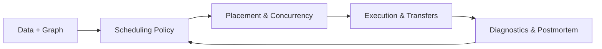
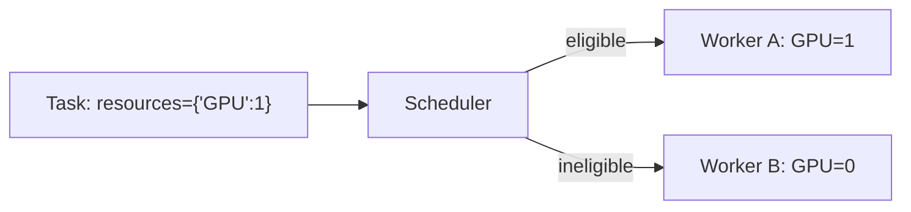
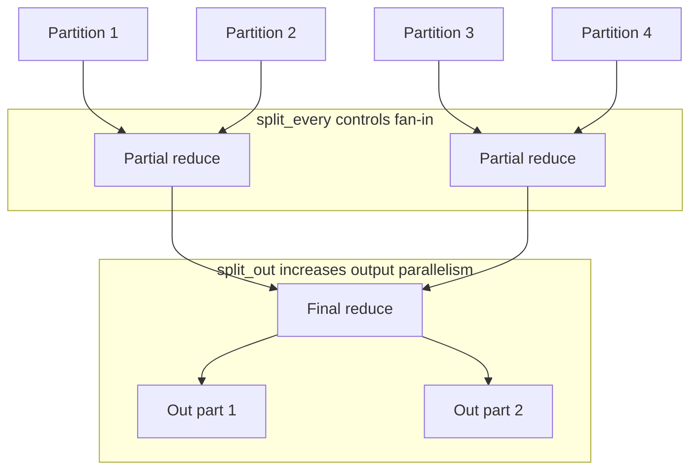
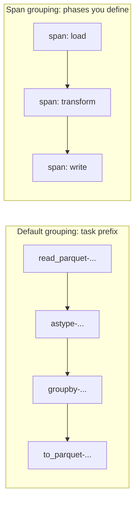

# Module 04: Advanced Topics — Control Plane, Scheduling, and Sharp Edges

> ## Version & scope contract
> Validated against the **stable documentation** for **Dask** and **Dask Distributed** in the **2025.11.0-era** documentation stream (Distributed stable currently identifies as *2025.11.0*). Defaults, available shuffle backends, and optimization behavior **do change** across releases.

Before you hardcode configuration or operational assumptions, verify on the cluster you will actually run:

- `dask.__version__`, `distributed.__version__`
- `dask.config.config` (and any site/cluster overrides)
- worker hardware + storage + network reality (especially for shuffles)

**Prereqs:** Modules 01–03 (graph economics, shuffle discipline, memory/survival, dashboard diagnostics).  
**This module’s job:** the remaining levers that control **placement**, **bounded concurrency**, **reduction/shuffle behavior**, and **shared-cluster safety**.

---

## Table of Contents

- [0. Orientation](#0-orientation)
- [Core 1 — Control Plane Primitives](#core-1--control-plane-primitives-locality-scatter-sync-actors)
- [Core 2 — Scheduling Controls](#core-2--scheduling-controls-resources-priorities-annotations-retries)
- [Core 3 — Advanced DataFrame Scalability Knobs](#core-3--advanced-dataframe-scalability-knobs-shuffle-method-split_out-split_every-categoricals)
- [Core 4 — Advanced Array + Bag Patterns](#core-4--advanced-array--bag-patterns-rechunk-overlap-custom-reductions)
- [Core 5 — Operational Instrumentation and Safety](#core-5--operational-instrumentation-and-safety-spans-tls-shared-clusters)
- [Appendix A — Minimal Advanced Lab Setup](#appendix-a--minimal-advanced-lab-setup)
- [Appendix B — Advanced Knobs Anti-Patterns](#appendix-b--advanced-knobs-anti-patterns)
- [Appendix C — Diagnostics-to-Knobs Map](#appendix-c--diagnostics-to-knobs-map)
- [Appendix D — Exercises (Synthesis)](#appendix-d--exercises-synthesis)
- [Further Reading — Official Docs Map](#further-reading--official-docs-map)

---

## 0. Orientation

### The rule of advanced Dask

Every advanced knob is a trade. Before you touch one, write down:

1. **Failure signature** (dashboard panel + symptom)
2. **Cost term** (shuffle bytes, peak memory, scheduler load, network transfer, tail latency)
3. **Acceptance metric** (what must improve, and what must not regress)

A useful mental model:



### Minimal pre-flight checklist (advanced features)

- **Graph health:** no micro-task explosion; no accidental `compute()` loops; task count not absurd.
- **Shuffle discipline:** projection/filtering early; pre-aggregation where possible; skew assessed.
- **Memory regime:** spilling configured and tested; payload sizes known; serialization costs measured.
- **Deployment reality:** network + storage characteristics understood (FS vs object store; bandwidth/latency).
- **Safety:** TLS and multi-tenant constraints decided *before* production.

---

# Core 1 — Control Plane Primitives: Locality, Scatter, Sync, Actors

## 1.1 Locality: move big data once, ship references forever

**Definition:** the scheduler prefers running tasks near their inputs. When you repeatedly reuse large inputs, you often want to **place them once** and reuse by reference.

Docs: [Data Locality](https://distributed.dask.org/en/stable/locality.html)

**Failure signature**
- Dashboard **Communications** shows elevated transfer time/bytes; tasks spend time “waiting on dependencies”.
- Runtime scales with “how many times I reuse the same constant”.

**Cost term**
- Network transfer bytes + dependency fetch latency.

**Mitigation ladder**
1. Make the pipeline stageful (`persist()` boundaries) so upstream work isn’t repeated.
2. Stop re-sending large read-only inputs: `scatter()` once and pass futures.
3. Use `broadcast=True` only when reuse is high *and* memory headroom exists.

**Minimal example**

```python
import numpy as np
from distributed import Client, LocalCluster

cluster = LocalCluster(n_workers=4, threads_per_worker=1, processes=True, dashboard_address=":8787")
client = Client(cluster)

big = np.random.randn(20_000_000)            # ~160 MiB
big_f = client.scatter(big)                  # place once; locality will pull as needed
big_b = client.scatter(big, broadcast=True)  # replicate to every worker (memory * workers)
```

**Sharp edges**
- Broadcast multiplies memory footprint by worker count. Don’t “default to broadcast”.
- Scatter of huge Python objects can still be slow if serialization is expensive; measure it.

**What to measure**
- Communications bytes/time
- Task Stream: dependency wait time / fetch activity

---

## 1.2 Publish datasets: cluster-scoped names (convenience, not durability)

Docs: [Publish Datasets](https://distributed.dask.org/en/stable/publish.html)

**Definition:** the scheduler stores a named handle to a Dask collection or a set of futures for the scheduler lifetime.

**Runnable minimal example (small handle)**

```python
import dask.bag as db
from distributed import Client

client = Client("tcp://scheduler:8786")

obj = db.from_sequence(range(100), npartitions=4)  # small, safe demo object
obj = client.persist(obj)

client.publish_dataset(constants=obj)
same = client.get_dataset("constants")
same.take(5)  # sanity check
```

**Failure signature**
- You “lose the dataset” after scheduler restart or cluster restart.

**Cost term**
- Avoided recompute (and avoided transfer) when reused correctly.

**Sharp edges**
- Publishing is not storage. For durability, write to Parquet/Zarr/object store.
- **Safety warning:** published datasets are tracked by the scheduler and can increase **scheduler-side memory pressure**.  
  Do **not** publish massive results (GBs). Use publish for small configuration objects, lightweight handles, or references—not bulk data.

**What to measure**
- Task Stream: reuse should *not* rerun upstream stages when you intended reuse
- Scheduler memory (if you publish many handles)

---

## 1.3 Synchronization: coarse coordination, not inner-loop plumbing

Docs: [Distributed API](https://distributed.dask.org/en/stable/api.html) (Lock/Semaphore/Event/Queue/Variable)

**When to use**
- Rate-limited API / DB connection caps
- Single-device contention (one GPU; one license server)
- Coordinating phases between task families

**Failure signature**
- External system throttles/bans; retries explode tail latency.
- Throughput drops when you add more parallelism (device contention).

**Cost term**
- Tail latency + retry amplification (often also scheduler churn).

**Semaphore pattern (global concurrency cap)**

Robust pattern: define the semaphore once (sets max leases), reopen by name inside tasks.

```python
import time
from distributed import Client, Semaphore

client = Client("tcp://scheduler:8786")

Semaphore(name="rate-limit", max_leases=2)  # define cluster-wide cap once

def call_external(i: int) -> int:
    sem = Semaphore(name="rate-limit")
    with sem:
        time.sleep(0.2)
    return i

futs = client.map(call_external, range(30))
client.gather(futs)
```

**Sharp edges**
- Keep critical sections coarse. Fine-grained locking becomes scheduler-mediated overhead.
- Don’t use locks/semaphores to serialize work you could batch or redesign.

**What to measure**
- Task Stream: at most `max_leases` tasks inside the critical section
- Tail latency (p95/p99) improves; retry count decreases

---

## 1.4 Actors: stateful objects pinned to workers (rare, deliberate)

Docs: [Actors](https://distributed.dask.org/en/stable/actors.html)

**Definition:** an actor is a Python object living on a worker; method calls are RPCs to that worker.

**Failure signature**
- One actor becomes a sequential hotspot.
- **Throughput collapses to that of a single Python thread** for the actor instance (many actor interactions serialize through one object).
- State becomes a failure domain (worker restart forces rebuild).
- Memory pinned to one worker becomes a balancing problem.

**Cost term**
- Serialization + RPC overhead; single-worker saturation; availability risk.

**Use cases that justify actors**
- Stateful sessions/connections (DB, external tool wrapper, long-lived model server)
- Worker-local cache that must persist across multiple tasks
- Logic that cannot be expressed as pure tasks + reductions

```python
from distributed import Client

client = Client("tcp://scheduler:8786")

class Counter:
    def __init__(self):
        self.n = 0
    def inc(self, k=1):
        self.n += k
        return self.n

actor = client.submit(Counter, actor=True).result()
vals = client.gather([actor.inc(1) for _ in range(10)])
```

**Mitigation ladder (prefer first)**
1. Pure tasks + reductions
2. Persist immutable intermediate state
3. Actors only with an explicit restart/failure story

**What to measure**
- Worker occupancy on the actor’s worker (hotspot)
- Communication overhead vs useful compute time

---

# Core 2 — Scheduling Controls: Resources, Priorities, Annotations, Retries

## 2.1 Resources: hard placement constraints (GPU, high-mem, licenses)

Docs: [Worker Resources](https://distributed.dask.org/en/stable/resources.html)

**Definition:** workers advertise abstract resource labels; tasks request them. Dask enforces constraints; it does not interpret labels.

```python
from distributed import Client, LocalCluster

cluster = LocalCluster(n_workers=2, threads_per_worker=1, processes=True, resources={"GPU": 1})
client = Client(cluster)

def gpu_task(x): return x * 2

f = client.submit(gpu_task, 10, resources={"GPU": 1})
print(f.result())
```



**Failure signature**
- GPU tasks land on CPU nodes, or multiple GPU tasks contend on one device.

**Cost term**
- Queueing delay + device contention.

**Critical nuance**
- Resources are **logical counters in the scheduler**, not physical isolation.  
  `resources={"GPU": 1}` does not magically enforce exclusive GPU access unless your worker/task code also respects it (e.g., one process per GPU, `CUDA_VISIBLE_DEVICES`, device-level locking, etc.).

**Sharp edge (collections + resources)**
- Annotating collections with resources may require disabling certain fusions/optimizations; follow “Resources with collections” in the docs:  
  [Resources with collections](https://distributed.dask.org/en/stable/resources.html#resources-with-collections)

**What to measure**
- Queueing delay for resource-constrained tasks
- Placement correctness (tasks land only on eligible workers)

---

## 2.2 Priorities: interactive-first, backfill-later

Docs: [Prioritizing Work](https://distributed.dask.org/en/stable/priority.html)

**Definition:** higher priority tasks are scheduled before lower priority tasks when there is contention.

```python
from distributed import Client

client = Client("tcp://scheduler:8786")

def work(i): return i * i

interactive = [client.submit(work, i, priority=100) for i in range(10)]
backfill    = [client.submit(work, i, priority=0)   for i in range(10_000, 10_200)]

client.gather(interactive)
```

**Failure signature**
- Interactive jobs queue behind batch graphs, even though the cluster is healthy.

**Cost term**
- Queueing + tail latency for interactive work.

**Mitigation ladder**
1. Fix graph shape first (priorities won’t shrink a shuffle).
2. Use priorities to encode service intent.
3. In multi-tenant clusters, combine with admission control / per-user quotas (Gateway).

**What to measure**
- Time-to-first-result for interactive jobs under load
- Whether batch work still makes progress (avoid starvation if you care)

---

## 2.3 Annotations: attach policy to regions of a graph

Docs: [Dask API — annotations](https://docs.dask.org/en/stable/api.html)

**Definition:** annotations attach metadata (priority/resources/retries/etc.) to graph regions.

```python
import dask

with dask.annotate(priority=50, retries=2):
    ...
```

**Failure signature**
- Policy sprinkled everywhere becomes un-auditable; scheduling doesn’t match intent.

**Cost term**
- Scheduler complexity + unexpected optimization interactions.

**Mitigation ladder**
1. Annotate coarse regions only.
2. Keep a small set of named policy blocks (“io-stage”, “gpu-stage”, “backfill”).
3. Validate on the dashboard that scheduling matches intent.

**What to measure**
- Placement/priority behavior matches your policy blocks
- Any regression in graph optimization (e.g., increased task count)

---

## 2.4 Retries: bounded resilience, not correctness

**Failure signature**
- Retries hide a bug and amplify load; you get “eventual success” with corrupted/duplicated outputs.

**Cost term**
- Tail latency + duplicated work + external side-effect damage.

**Mitigation ladder**
1. Make side effects idempotent (transaction keys, atomic writes, content-addressed outputs).
2. Retry only idempotent boundaries (pure compute, safe reads).
3. Track retry counts and failures as metrics; fail fast when it’s a logic error.

**What to measure**
- Retry count distribution and tail latency
- Output correctness invariants (checksums, row counts, manifests)

---

# Core 3 — Advanced DataFrame Scalability Knobs: Shuffle Method, split_out, split_every, Categoricals

## 3.1 Shuffle method: choose the failure mode you can tolerate

Docs:
- [Shuffling Performance](https://docs.dask.org/en/stable/dataframe-groupby.html)
- [Configuration](https://docs.dask.org/en/stable/configuration.html) (search `dataframe.shuffle.method`)
- [`DataFrame.set_index`](https://docs.dask.org/en/stable/generated/dask.dataframe.DataFrame.set_index.html)
- [`DataFrame.shuffle`](https://docs.dask.org/en/stable/generated/dask.dataframe.DataFrame.shuffle.html)

**Why this matters**
Shuffles dominate runtime and memory. Different shuffle implementations trade off scheduler load, network behavior, disk spill behavior, and peak memory.

**Defaults note (future-proofing)**
Defaults change. In newer Dask versions, `p2p` (peer-to-peer) may become the default on some installs/clusters. Check before overriding:

```python
import dask
dask.config.get("dataframe.shuffle.method")
```

**Dependency note**
Some shuffle backends (notably `p2p`) may imply extra dependencies (commonly `pyarrow`) or different network/serialization paths. Verify your environment and cluster image before switching.

**Failure signature**
- Shuffle panel shows high bytes; workers hit memory pressure; stragglers dominate tail.
- Task Stream shows shuffle dominating wall-clock.

**Cost term**
- Shuffle bytes + peak memory amplification + tail latency.

**Mitigation ladder**
1. Reduce shuffle input: project columns, filter rows, pre-aggregate.
2. Fix skew (hot keys).
3. Only then evaluate shuffle methods with measurements.

**Configuration (global default)**

```python
import dask

# Choose explicitly only if you can measure the impact on your cluster.
dask.config.set({"dataframe.shuffle.method": "p2p"})
```

**Per-operation override (runnable context)**

```python
import dask.dataframe as dd

ddf = dd.read_parquet("some_dataset/")  # placeholder path
ddf2 = ddf.set_index("key", shuffle_method="p2p")
ddf3 = ddf.shuffle(on="key", shuffle_method="tasks")
```

**What to measure**
- Shuffle bytes + peak worker memory during shuffle
- Tail completion time (slowest partitions) and straggler count

---

## 3.2 `split_out` / `split_every`: reduce stragglers in reductions

Docs:
- [`GroupBy.aggregate`](https://docs.dask.org/en/stable/generated/dask.dataframe.api.GroupBy.aggregate.html)
- Example GroupBy method showing knobs (e.g., [`GroupBy.std`](https://docs.dask.org/en/stable/generated/dask.dataframe.api.GroupBy.std.html))

```python
out = ddf.groupby("k").v.std(split_out=32, split_every=8, shuffle_method="p2p")
```



**Failure signature**
- A few reducers become hotspots; tail latency dominated by a small number of tasks.

**Cost term**
- Tail latency + peak reducer memory.

**Mitigation ladder**
1. Project + filter + pre-aggregate.
2. Fix skew.
3. Tune `split_out` / `split_every` to spread reducers.

**What to measure**
- Tail time (slowest reducer) and worker memory during reduction
- Output partition balance (avoid a few huge partitions)

---

## 3.3 Categoricals: payload reduction only when cardinality is truly low

Docs: [DataFrame best practices](https://docs.dask.org/en/stable/dataframe-best-practices.html)

**Failure signature**
- Join/groupby keys dominate shuffle bytes and worker memory.

**Cost term**
- Shuffle payload + in-memory groupby/join state.

**Mitigation ladder**
1. Measure cardinality stability (distinct counts) and value distribution.
2. Convert to categorical only if low-cardinality is a stable contract.
3. Re-check after pipeline changes (new sources often change cardinality).

**Sharp edge**
- If cardinality silently explodes, categoricals can backfire (larger metadata/state, slower ops).

**What to measure**
- Shuffle bytes before/after (same workload)
- Peak worker memory during shuffle/reduction
- Distinct count drift over time (regression guard)

---

# Core 4 — Advanced Array + Bag Patterns: Rechunk, Overlap, Custom Reductions

## 4.1 Rechunk: global rewrite (treat like a shuffle)

Docs:
- [Array overlap overview](https://docs.dask.org/en/stable/array-overlap.html)
- [`dask.array.map_overlap`](https://docs.dask.org/en/stable/generated/dask.array.map_overlap.html)
- [Configuration](https://docs.dask.org/en/stable/configuration.html) (search `array.rechunk.method`)

```python
import dask.array as da

x = da.random.random((200_000, 1024), chunks=(20_000, 1024))
y = x.rechunk((5_000, 1024))
```

**Failure signature**
- Graph size blows up; scheduler overhead climbs; long tails appear.

**Cost term**
- Task count / scheduler load + potential data movement.

**Mitigation ladder**
1. Choose chunks near the source.
2. Rechunk only as an explicit stage boundary.
3. Avoid “chunk ping-pong” (rechunk back/forth).

**What to measure**
- Task count and scheduler overhead indicators
- Runtime and peak memory during the rechunk stage

---

## 4.2 `map_overlap`: halos for rolling/stencils

Docs: [`dask.array.map_overlap`](https://docs.dask.org/en/stable/generated/dask.array.map_overlap.html)

Key behavior: overlap depth greater than chunk size can trigger rechunking (see `allow_rechunk`).

```python
import numpy as np
import dask.array as da

x = da.from_array(np.random.randn(200_000), chunks=20_000)

def smooth(block):
    return block  # placeholder

y = da.map_overlap(smooth, x, depth=10, boundary="reflect", allow_rechunk=True)
```

**Failure signature**
- Unexpected rechunking and task inflation; memory pressure increases.

**Cost term**
- Task count + peak memory + extra data movement.

**Mitigation ladder**
1. Pick chunk sizes that naturally accommodate your halo.
2. If halo is large, reconsider the algorithm or stage it (coarser blocks).
3. Use `allow_rechunk` consciously; don’t let it surprise you.

**What to measure**
- Graph size before/after; task durations
- Peak worker memory and spill activity

---

## 4.3 Bag reductions: control tree shape with `split_every`

Docs: [`Bag.reduction`](https://docs.dask.org/en/stable/generated/dask.bag.Bag.reduction.html)

```python
import dask.bag as db

b = db.from_sequence(range(10_000), npartitions=100)

def perpart(part):
    return sum(part)

def agg(xs):
    return sum(xs)

total = b.reduction(perpart, agg, split_every=8).compute()
```

**Failure signature**
- Too many tiny Python tasks; scheduler-bound; poor throughput.

**Cost term**
- Task overhead (scheduler + Python) and tail latency.

**Mitigation ladder**
1. Keep per-element Python work inside partitions (not as single-element tasks).
2. Control reduction tree (`split_every`) to balance overhead vs parallelism.
3. Convert to Array/DataFrame once schema is stable and shuffles are justified.

**What to measure**
- Task duration distribution (avoid sub-10ms tasks)
- Scheduler overhead vs useful compute

---

# Core 5 — Operational Instrumentation and Safety: Spans, TLS, Shared Clusters

## 5.1 Spans: phase attribution for real postmortems

Docs:
- [Spans](https://distributed.dask.org/en/stable/spans.html)
- [Fine Performance Metrics](https://distributed.dask.org/en/stable/fine-performance-metrics.html)

**Definition:** spans group tasks into workflow phases (load/transform/write), which is often more meaningful than grouping by task prefix.

```python
from distributed import Client, span

client = Client("tcp://scheduler:8786")

with span("workflow"):
    with span("load"):
        ...
    with span("transform"):
        ...
    with span("write"):
        ...
```

**Where to see spans (the payoff)**
- Dask Dashboard: Graph/Task views can attribute tasks by span metadata (when supported).
- Fine Performance Metrics: breakdowns can be filtered/grouped by spans.
- `distributed.performance_report(...)` HTML artifact (when used) can embed the same attribution.



**Failure signature**
- You can’t answer “which phase caused the slowdown” from task prefixes alone.
- Fine Performance Metrics feels noisy; regressions are hard to localize.

**Cost term**
- MTTR (mean time to root cause) + regression detection latency.

**Sharp edges**
- Spans are experimental; optimization (fusion) may collapse expected granularity.
- Validate spans on your real graphs and ensure the signal survives.

**What to measure**
- Fine Performance Metrics: time and bytes grouped by span tag
- Whether span boundaries match operational phases you actually care about

---

## 5.2 TLS/SSL: mandatory on untrusted networks

Docs: [TLS/SSL](https://distributed.dask.org/en/stable/tls.html)

```python
from distributed import Client
from distributed.security import Security

sec = Security(
    tls_ca_file="cluster_ca.pem",          # NOTE: these paths must exist and be readable by the client process
    tls_client_cert="client_cert.pem",     # NOTE: same
    tls_client_key="client_key.pem",       # NOTE: same
    require_encryption=True,
)

client = Client("tls://scheduler-host:8786", security=sec)
```

**Failure signature**
- Mixed `tcp://` and `tls://` endpoints produce confusing connection failures.
- You cannot justify running plain TCP on a shared/untrusted network.

**Cost term**
- Operational risk (not performance). Security is a correctness requirement.

**Mitigation ladder**
1. Make the decision early: TLS everywhere or nowhere (dev-only).
2. Centralize certificate issuance/rotation.
3. Test client/scheduler/worker connectivity in CI or a staging cluster.

**What to measure**
- Connection success rate and handshake failures
- Certificate rotation drill success (staging)

---

## 5.3 Shared clusters: guardrails before throughput

Docs: [Dask Gateway](https://gateway.dask.org/)

Multi-tenant operation requires policy:

- quotas (workers/cores/memory)
- resource pools (GPU/high-mem)
- fairness (priorities + admission control)
- safe autoscaling bounds (avoid shuffle churn)

**Failure signature**
- One user’s shuffle floods the cluster; everyone’s interactive work stalls.

**Cost term**
- Cluster-wide tail latency + fairness/availability.

**What to measure**
- Per-user resource consumption and queueing
- Policy compliance (quota enforcement events)

---

## Appendix A — Minimal Advanced Lab Setup

```python
from distributed import Client, LocalCluster

cluster = LocalCluster(
    n_workers=4,
    threads_per_worker=1,
    processes=True,
    memory_limit="4GiB",
    dashboard_address=":8787",
)
client = Client(cluster)
client
```

---

## Appendix B — Advanced Knobs Anti-Patterns

| Anti-pattern | Why it fails | Replace with |
|---|---|---|
| Broadcasting large objects by default | Multiplies memory by worker count | Scatter once; rely on locality; broadcast only when reuse is extreme |
| Using priorities to “fix slowness” | Biases ordering; doesn’t shrink shuffle/task cost | Fix graph shape; reduce shuffle bytes; tune partitions |
| Sprinkling annotations everywhere | Un-auditable; interacts with optimization | Coarse named policy regions; validate on dashboard |
| Actors for aggregation/state you could reduce | Hotspots + failure domains | Pure tasks + reductions + persist |
| Switching shuffle methods without measurement | Chooses failure mode blind | Measure shuffle bytes + peak memory + tail latency |
| Rechunking casually | Graph blow-up; hidden movement | Choose chunks at ingestion; rechunk only as explicit stage |
| Locks in tight loops | Scheduler-mediated bottleneck | Batch work; use semaphores for coarse concurrency control |
| Retries around side effects | Duplicates/corrupts outputs | Idempotent writes; retry only safe boundaries |
| Publishing huge datasets | Scheduler instability / memory pressure | Publish small handles only; store bulk data in durable storage |

---

## Appendix C — Diagnostics-to-Knobs Map

| Dashboard/Metric symptom | Likely cause | Knobs to consider (after fundamentals) |
|---|---|---|
| Communications time/bytes high | repeated shipping of big inputs | scatter/locality; broadcast only if justified |
| Tail latency dominated by few tasks | skew/hot reducers; constrained resources | split_out/split_every; resources; pre-aggregate; key redesign |
| Workers hit memory during shuffle | shuffle amplification | reduce shuffle input; evaluate shuffle method; partition tuning; spill/pause |
| Interactive jobs queue behind batch | contention without intent separation | priorities + admission control (Gateway); smaller batch stages |
| One worker always saturated | actor hotspot; resource bottleneck | replace actor; expand resource pool; redesign placement |
| Many tiny tasks; scheduler-bound | micro-task pathology | fuse/pack work; larger partitions/chunks; fewer graph layers |
| Scheduler memory spikes | too many published handles / metadata churn | publish only small refs; avoid scheduler-heavy patterns |

---

## Appendix D — Exercises (Synthesis)

1. **Locality win (scatter):** reuse a large constant across many tasks. Run without scatter and with scatter. Record: Communications bytes/time and runtime.
2. **Bounded concurrency (Semaphore):** simulate a rate-limited external call. Cap concurrency to 2. Validate Task Stream: max two tasks in the critical section.
3. **Placement control (resources):** create GPU-tagged tasks and CPU tasks. Show GPU-tagged tasks queue when GPU leases are exhausted; measure queueing delay.
4. **Interactive vs backfill (priority):** submit a large backfill and a small interactive batch. Verify interactive completes first under contention; confirm fundamentals still matter.
5. **Groupby tail-latency synthesis:** create skewed keys. Apply (a) pre-aggregation, (b) `split_out`/`split_every`, (c) optional shuffle method change. Record which lever moved: shuffle bytes vs tail latency vs peak memory.
6. **Spans postmortem:** wrap a 3-stage pipeline in spans (“load/transform/write”). Use Fine Performance Metrics to attribute time per phase; confirm span signal survives optimization.
7. **Capstone outage-prevention drill:** deliberately create an unsafe pattern (broadcast a large object or publish too many handles) in a LocalCluster and observe the failure signature. Write the mitigation plan and the acceptance metrics that prove the fix.

---

## Further Reading — Official Docs Map

### Distributed (control plane / ops)

- [Data locality and scatter](https://distributed.dask.org/en/stable/locality.html)
- [Publish datasets](https://distributed.dask.org/en/stable/publish.html)
- [Distributed API (Lock/Semaphore/Event/Queue/Variable)](https://distributed.dask.org/en/stable/api.html)
- [Worker resources](https://distributed.dask.org/en/stable/resources.html)
- [Priorities](https://distributed.dask.org/en/stable/priority.html)
- [Actors](https://distributed.dask.org/en/stable/actors.html)
- [Spans (and caveats)](https://distributed.dask.org/en/stable/spans.html)
- [Fine Performance Metrics](https://distributed.dask.org/en/stable/fine-performance-metrics.html)
- [TLS/SSL](https://distributed.dask.org/en/stable/tls.html)
- [Dask Gateway (multi-tenant clusters)](https://gateway.dask.org/)

### Dask (collections / configuration)

- [Configuration reference](https://docs.dask.org/en/stable/configuration.html) (see `dataframe.shuffle.method`, `array.rechunk.method`, and `optimization.*` keys)
- [`DataFrame.set_index(..., shuffle_method=...)`](https://docs.dask.org/en/stable/generated/dask.dataframe.DataFrame.set_index.html)
- [`DataFrame.shuffle(..., shuffle_method=...)`](https://docs.dask.org/en/stable/generated/dask.dataframe.DataFrame.shuffle.html)
- [`GroupBy.aggregate` (split_out)](https://docs.dask.org/en/stable/generated/dask.dataframe.api.GroupBy.aggregate.html)
- Example GroupBy method showing knobs (e.g., [`GroupBy.std`](https://docs.dask.org/en/stable/generated/dask.dataframe.api.GroupBy.std.html))
- [Array overlap overview](https://docs.dask.org/en/stable/array-overlap.html)
- [`map_overlap`](https://docs.dask.org/en/stable/generated/dask.array.map_overlap.html)
- [Bag reduction](https://docs.dask.org/en/stable/generated/dask.bag.Bag.reduction.html)
- [DataFrame best practices](https://docs.dask.org/en/stable/dataframe-best-practices.html)
