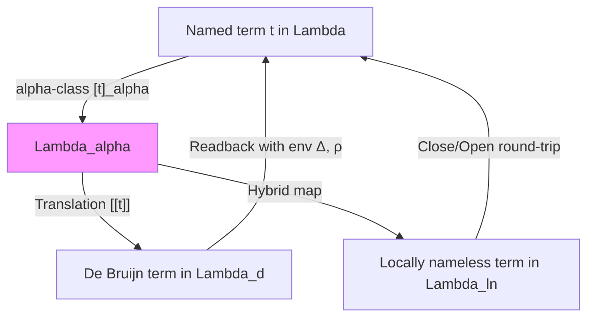

# Module 2 – Binding Representations and Mechanization

Module 1 defined $\lambda$-terms with **named variables**, $\alpha$-equivalence, and capture-avoiding substitution on raw terms. That style is readable but challenging for **mechanized proofs**, as $\alpha$-renaming and freshness conditions require constant attention.

This module introduces **binding representations** that facilitate implementation and proof:

* We treat $\lambda$-terms as **$\alpha$-classes** (quotients by $\alpha$-equivalence from Module 1),
* We introduce **De Bruijn indices** (fully nameless syntax),
* We introduce the **locally nameless** representation (bound indices with free names),
* We state core **substitution and renaming lemmas** in the nameless setting,
* And we provide a **mechanization pattern** in Coq.

These representations ensure that $\alpha$-equivalence coincides with syntactic equality, simplifying metatheory. Throughout, we assume familiarity with Module 1. Definitions and operations are given on raw terms where needed, but all reasoning is well-defined on $\alpha$-classes via the lemmas below.

---

## 2.1 Named vs Nameless Syntax and $\alpha$-Classes

### Mathematical Presentation

We begin by formalizing $\alpha$-classes and explaining the transition to nameless representations.

#### Definition 2.1 (Named terms)

Let $\Lambda$ be the set of $\lambda$-terms as in Module 1 (Def. 1.1):
$$
t ::= x \mid \lambda x.t \mid t\, t.
$$

$\alpha$-equivalence $\equiv_\alpha$ is as in Module 1 (Defs. 1.4–1.5).

#### Definition 2.2 ($\alpha$-classes)

The **$\alpha$-class** of a term $t \in \Lambda$ is
$$
[t]_{\alpha} := \{ u \in \Lambda \mid u \equiv_{\alpha} t \}.
$$

Let
$$
\Lambda_{\alpha} := \Lambda / \equiv_{\alpha}
$$
be the set of $\alpha$-classes; elements are written $[t]$ when unambiguous.

> **Theorem 2.1 (Substitution respects $\alpha$).**
> If $t \equiv_\alpha u$ then for all $s,x$ we have
> $$
> t[s/x] \equiv_\alpha u[s/x].
> $$
>
> *Proof:* This is Lemma 1.2 from Module 1, proved by induction on the derivation of $t \equiv_\alpha u$. It implies that (capture-avoiding) substitution from Module 1 is **well-defined** on $\alpha$-classes: $[t][[s]/x] = [[t[s/x]]]_{\alpha}$.

> **Corollary 2.2 ($\beta$-reduction respects $\alpha$).**
> If $t \to_\beta t'$ (where $\to_\beta$ is the standard single $\beta$-step: $(\lambda x.u)\, v \to_\beta u[v/x]$) and $t \equiv_\alpha u$, then there exists $u'$ with $u \to_\beta u'$ and $t' \equiv_\alpha u'$.
>
> *Proof sketch:* By cases on the $\beta$-step in $t$, using Thm. 2.1 to lift substitution to the representative $u$.

Thus $\beta$-reduction induces a well-defined relation $\to_\beta$ on $\Lambda_\alpha$.

#### Why Nameless Representations?

In **named syntax**, proofs must handle $\alpha$-renaming explicitly (e.g., freshness side conditions). In **nameless syntax**, $\alpha$-equivalence reduces to **syntactic equality** on indices, enabling pure structural inductions.

The two main approaches (detailed in Sections 2.2–2.3) model $\Lambda_\alpha$ via:

1. **De Bruijn indices**: Fully nameless; bound variables are relative depths (indices).
2. **Locally nameless**: Hybrid; bound variables are indices, free variables retain names.

For open terms (with free variables), De Bruijn uses a fixed set $\mathsf{Atom}$ of atoms for free variables, mapped via a **name environment** (global assignment of free names to distinct atoms). The translation $\llbracket - \rrbracket: \Lambda_\alpha \to \Lambda_d$ (Def. 2.3 below) is bijective when $\mathsf{Atom}$ is chosen sufficiently large and distinct from bound positions; free variables become $\mathsf{fvar}(a)$ with $a$ from this environment, preserving distinctness up to $\alpha$.

The following flowchart illustrates the mappings (forward and readback):



This ensures round-trip preservation: readback of $\llbracket t \rrbracket$ yields a representative of $[t]_\alpha$.

#### Python Utilities for Translation

The following Python code provides a minimal named-to-De Bruijn translator (0-based indices) and readback, with a sanity check verifying round-trip preservation of structure and free variables for the example term. For simplicity, we identify variable names with atoms (i.e., free variables map directly to $\mathsf{fvar}(name)$); in general, use a distinct $\mathsf{Atom}$ set and environment mapping.

```python
from dataclasses import dataclass

class NamedTerm:
    pass

@dataclass
class NVar(NamedTerm):
    name: str

@dataclass
class NAbs(NamedTerm):
    var: str
    body: NamedTerm

@dataclass
class NApp(NamedTerm):
    func: NamedTerm
    arg: NamedTerm

class DBTerm:
    pass

@dataclass
class DBFVar(DBTerm):
    atom: str  # Free var atom (here, reused name)

@dataclass
class DBBVar(DBTerm):
    idx: int  # Bound index, 0 = innermost

@dataclass
class DBAbs(DBTerm):
    body: DBTerm

@dataclass
class DBApp(DBTerm):
    func: DBTerm
    arg: DBTerm

def named_to_db(t, gamma_list=None, gamma_dict=None):
    if gamma_list is None:
        gamma_list = []
    if gamma_dict is None:
        gamma_dict = {name: idx for idx, name in enumerate(gamma_list)}  # innermost-first
    if isinstance(t, NVar):
        idx = gamma_dict.get(t.name)
        return DBBVar(idx) if idx is not None else DBFVar(t.name)
    if isinstance(t, NAbs):
        new_list = [t.var] + gamma_list
        new_dict = {name: idx for idx, name in enumerate(new_list)}
        return DBAbs(named_to_db(t.body, new_list, new_dict))
    if isinstance(t, NApp):
        return DBApp(named_to_db(t.func, gamma_list, gamma_dict), named_to_db(t.arg, gamma_list, gamma_dict))
    raise TypeError("Invalid term")

def db_to_named(t, depth=0):
    """Readback with fresh names based on binder depth (0 innermost)."""
    if isinstance(t, DBFVar):
        return NVar(t.atom)
    if isinstance(t, DBBVar):
        binder_depth = depth - 1 - t.idx
        return NVar(f"x{binder_depth}")
    if isinstance(t, DBAbs):
        return NAbs(f"x{depth}", db_to_named(t.body, depth + 1))
    if isinstance(t, DBApp):
        return NApp(db_to_named(t.func, depth), db_to_named(t.arg, depth))
    raise TypeError("Invalid DB term")

def free_vars_named(t):
    if isinstance(t, NVar):
        return {t.name}
    if isinstance(t, NAbs):
        return free_vars_named(t.body) - {t.var}
    if isinstance(t, NApp):
        return free_vars_named(t.func) | free_vars_named(t.arg)
    return set()

def pretty_named(t):
    if isinstance(t, NVar):
        return t.name
    if isinstance(t, NAbs):
        return f"λ{t.var}.{pretty_named(t.body)}"
    if isinstance(t, NApp):
        return f"({pretty_named(t.func)} {pretty_named(t.arg)})"
    return ""

def pretty_db(t):
    if isinstance(t, DBFVar):
        return t.atom
    if isinstance(t, DBBVar):
        return str(t.idx)
    if isinstance(t, DBAbs):
        return f"λ.{pretty_db(t.body)}"
    if isinstance(t, DBApp):
        return f"({pretty_db(t.func)} {pretty_db(t.arg)})"
    return ""

# Sanity check: round-trip preserves structure and FV
def test_roundtrip():
    # Example: λx. (λy. y x)
    inner_app = NApp(NVar("y"), NVar("x"))
    inner_abs = NAbs("y", inner_app)
    t = NAbs("x", inner_abs)
    print(f"Original: {pretty_named(t)}, FV: {free_vars_named(t)}")
    
    db_t = named_to_db(t)
    print(f"De Bruijn: {pretty_db(db_t)}")
    
    # Readback
    readback = db_to_named(db_t)
    print(f"Readback: {pretty_named(readback)}, FV: {free_vars_named(readback)}")
    
    assert free_vars_named(t) == free_vars_named(readback), "FV mismatch!"
    
    # Round-trip via re-translation to DB
    db_readback = named_to_db(readback)
    assert db_readback == db_t, "DB structure mismatch after round-trip!"
    print("Round-trip: PASS (FV and DB structure preserved)")

test_roundtrip()
```

This demonstrates the bijection empirically: free variables are preserved as atoms, and bound indices ensure structural invariance under round-trip.

---

## 2.2 De Bruijn Indices

#### Mathematical Presentation

De Bruijn indices represent bound variables by non-negative integers indicating the number of enclosing $\lambda$s (0 for the innermost binder). We adopt **0-based indexing** throughout this prose (aligning with mechanization); some traditional texts use 1-based, as noted below.

> **Note on Indexing Conventions.**  
> In this text and the Coq encoding (Section 2.5), indices are **0-based**: `bvar(0)` refers to the innermost binder. Theoretical presentations sometimes use **1-based** indices (e.g., `1` for innermost). The translation is: add 1 to 0-based indices for 1-based.  
>   
> **Example:** The term $\lambda x.\lambda y.y$ in 0-based: $\lambda.\lambda.0$; in 1-based: $\lambda.\lambda.1$.

#### Definition 2.3 (De Bruijn syntax)

Let $\mathsf{Atom}$ be a countably infinite set of atoms (for free variables; e.g., strings). Let $\mathbb{N} = \{0,1,2,\dots\}$ for indices.

The set $\Lambda_d$ of **De Bruijn terms** is the smallest set such that:
$$
t ::= \mathsf{fvar}(a) \mid \mathsf{bvar}(k) \mid \lambda.\, t \mid t\, t,
$$
where $a \in \mathsf{Atom}$ and $k \in \mathbb{N}$.

- $\mathsf{fvar}(a)$: A free variable, with $a$ from a fixed name environment (global atoms distinct from bound positions).
- $\mathsf{bvar}(k)$: A bound variable, bound by the $k$-th enclosing $\lambda$ ($k=0$ innermost).

For open terms, free variables map to distinct $\mathsf{fvar}(a)$ via the environment, ensuring injectivity.

#### Local Closure for De Bruijn Terms

#### Definition 2.4 (Local closure for De Bruijn)

$\mathsf{lc}_n^d(t)$ (“locally closed up to $n$ binders”):

- $\mathsf{lc}_n^d(\mathsf{fvar}(a))$ holds,
- $\mathsf{lc}_n^d(\mathsf{bvar}(k))$ iff $k < n$,
- $\mathsf{lc}_n^d(t_1\, t_2)$ iff $\mathsf{lc}_n^d(t_1) \land \mathsf{lc}_n^d(t_2)$,
- $\mathsf{lc}_n^d(\lambda.\, t)$ iff $\mathsf{lc}_{n+1}^d(t)$.

Let $\mathsf{lc}^d(t) := \mathsf{lc}_0^d(t)$ (fully closed, no dangling indices).

#### Translation from Named to De Bruijn

Fix a bound environment $\Delta$ (a finite list of variable names from $\mathcal{V}$, innermost binder first) and a free environment $\rho : \mathcal{V} \to \mathsf{Atom}$ (mapping free variables to distinct atoms). Define the translation $\llbracket t \rrbracket_{\Delta,\rho} \in \Lambda_d$ by recursion on $t \in \Lambda$:

- $\llbracket x \rrbracket_{\Delta,\rho} = \mathsf{bvar}(k)$ if $x = \Delta_k$ (0-based position in $\Delta$), else $\mathsf{fvar}(\rho(x))$.
- $\llbracket \lambda x.t \rrbracket_{\Delta,\rho} = \lambda.\, \llbracket t \rrbracket_{x :: \Delta, \rho}$.
- $\llbracket t_1\, t_2 \rrbracket_{\Delta,\rho} = \llbracket t_1 \rrbracket_{\Delta,\rho}\, \llbracket t_2 \rrbracket_{\Delta,\rho}$.

> **Proposition 2.3.**
> If $t \equiv_\alpha u$, then for any $\Delta,\rho$, we have
> $$
> \llbracket t \rrbracket_{\Delta,\rho} = \llbracket u \rrbracket_{\Delta,\rho}.
> $$
> Thus $\llbracket - \rrbracket$ induces a bijection $\Lambda_\alpha \cong \Lambda_d$ (when $\mathsf{Atom}$ is chosen to match free variables distinctly).
>
> *Proof sketch:* Induction on $t$; $\alpha$-renaming permutes bound names in $\Delta$, but indices depend only on relative positions. For free variables, the environment ensures consistency.

#### Example 2.1

For $t = \lambda x.(\lambda y.y\, x)$ with empty initial $\Delta = []$:

- $\llbracket t \rrbracket_{[],\rho} = \lambda.\, \llbracket \lambda y.y\, x \rrbracket_{[x],\rho}$.
- $\llbracket \lambda y.y\, x \rrbracket_{[x],\rho} = \lambda.\, \llbracket y\, x \rrbracket_{[y,x],\rho}$.
- $\llbracket y \rrbracket_{[y,x],\rho} = \mathsf{bvar}(0)$, $\llbracket x \rrbracket_{[y,x],\rho} = \mathsf{bvar}(1)$.

Result: $\lambda.\, (\lambda.\, (\mathsf{bvar}(0)\, \mathsf{bvar}(1)))$, or $\lambda.\lambda.(0\, 1)$.

If $z$ is free in an outer context, it becomes $\mathsf{fvar}(\rho(z))$.

#### Shifting and Substitution

To support $\beta$-reduction, we define **shifting** (to adjust indices under binders) and **index substitution**.

#### Definition 2.5 (Shifting)

$\uparrow^d_c(t)$ raises indices $\geq c$ by $d$:

- $\uparrow^d_c(\mathsf{fvar}(a)) = \mathsf{fvar}(a)$,
- $\uparrow^d_c(\mathsf{bvar}(k)) = \mathsf{bvar}(k)$ if $k < c$, else $\mathsf{bvar}(k + d)$,
- $\uparrow^d_c(\lambda.\, t) = \lambda.\, \uparrow^d_{c+1}(t)$,
- $\uparrow^d_c(t_1\, t_2) = \uparrow^d_c(t_1)\, \uparrow^d_c(t_2)$.

Here $\uparrow^d_c$ is defined for $d \in \mathbb{Z}$; when $t$ and $s$ are locally closed, $\uparrow^{-1}_0$ does not produce negative indices.

We use standard De Bruijn substitution with shifting. Define:

(1) shift $\uparrow^d_c(t)$ (Def. 2.5): raises every $\mathsf{bvar}(k)$ with $k \geq c$ by $d$.

(2) $\mathsf{subst}_j(s,t)$: substitute $s$ for $\mathsf{bvar}(j)$ in $t$ (and decrement indices above $j$):

- $\mathsf{subst}_j(s, \mathsf{fvar}(a)) = \mathsf{fvar}(a)$
- $\mathsf{subst}_j(s, \mathsf{bvar}(k)) =$
    $s$               if $k = j$
    $\mathsf{bvar}(k-1)$       if $k > j$
    $\mathsf{bvar}(k)$         if $k < j$
- $\mathsf{subst}_j(s, t_1 t_2) = \mathsf{subst}_j(s,t_1) \mathsf{subst}_j(s,t_2)$
- $\mathsf{subst}_j(s, \lambda.\, t)  = \lambda.\, \mathsf{subst}_{j+1}(\uparrow^1_0(s), t)$

Finally, define top-level substitution (standard):
  $\mathsf{substTop}(s, t) := \uparrow^{-1}_0( \mathsf{subst}_0(\uparrow^1_0(s), t) )$.

This is **capture-free**: indices are positional, with no name clashes.

> **Lemma 2.4 (De Bruijn substitution lemmas).**
> 1. If $\mathsf{lc}_n^d(t)$, then $\mathsf{lc}_n^d(\uparrow^d_c(t))$ for appropriate $c,n$.
> 2. If $\mathsf{lc}^d(t)$ and $\mathsf{lc}^d(s)$, then $\mathsf{lc}^d(\mathsf{substTop}(s, t))$.
>
> *Proof sketch:* Mutual induction on $t$; shifting preserves index bounds relative to $n$, and substitution via $\mathsf{lc}^d(s)$ and recursive adjustment ensures no dangling indices under binders.

$\beta$-reduction on $\Lambda_d$: $(\lambda.\, t)\, s \to_\beta \mathsf{substTop}(s, t)$.

---

## 2.3 Locally Nameless Representation

#### Mathematical Presentation

Locally nameless combines De Bruijn indices for binders with named free variables, improving readability while retaining proof automation.

#### Definition 2.7 (Locally nameless syntax)

Terms in $\Lambda_{ln}$:
$$
t ::= \mathsf{bvar}(k) \mid \mathsf{fvar}(a) \mid \lambda.\, t \mid t\, t,
$$
$k \in \mathbb{N}$, $a \in \mathsf{Atom}$. Free variables are named; bound are indexed (0 innermost).

#### Definition 2.8 (Local closure)

$\mathsf{lc}_n(t)$ (“locally closed under $n$ binders”):

- $\mathsf{lc}_n(\mathsf{fvar}(a))$ always,
- $\mathsf{lc}_n(\mathsf{bvar}(k))$ iff $k < n$,
- $\mathsf{lc}_n(t_1\, t_2)$ iff $\mathsf{lc}_n(t_1) \land \mathsf{lc}_n(t_2)$,
- $\mathsf{lc}_n(\lambda.\, t)$ iff $\mathsf{lc}_{n+1}(t)$.

Let $\mathsf{lc}(t) := \mathsf{lc}_0(t)$ (fully closed, no dangling indices).

The mapping from $\Lambda_\alpha$ to $\Lambda_{ln}$ is similar to De Bruijn but preserves free names directly as $\mathsf{fvar}(a)$.

#### Opening and Closing

#### Definition 2.9 (Opening with name)

$\mathsf{open}_k(t, x)$ replaces $\mathsf{bvar}(k)$ with $\mathsf{fvar}(x)$:

- $\mathsf{open}_k(\mathsf{fvar}(a), x) = \mathsf{fvar}(a)$,
- $\mathsf{open}_k(\mathsf{bvar}(n), x) = \mathsf{fvar}(x)$ if $n=k$, else $\mathsf{bvar}(n)$,
- $\mathsf{open}_k(t_1\, t_2, x) = \mathsf{open}_k(t_1, x)\, \mathsf{open}_k(t_2, x)$,
- $\mathsf{open}_k(\lambda.\, t, x) = \lambda.\, \mathsf{open}_{k+1}(t, x)$.

Let $\mathsf{open}(t, x) := \mathsf{open}_0(t, x)$.

#### Definition 2.10 (Closing)

$\mathsf{close}_k(t, x)$ replaces $\mathsf{fvar}(x)$ with $\mathsf{bvar}(k)$:

- $\mathsf{close}_k(\mathsf{fvar}(a), x) = \mathsf{bvar}(k)$ if $a=x$, else $\mathsf{fvar}(a)$,
- $\mathsf{close}_k(\mathsf{bvar}(n), x) = \mathsf{bvar}(n)$,
- $\mathsf{close}_k(t_1\, t_2, x) = \mathsf{close}_k(t_1, x)\, \mathsf{close}_k(t_2, x)$,
- $\mathsf{close}_k(\lambda.\, t, x) = \lambda.\, \mathsf{close}_{k+1}(t, x)$.

Let $\mathsf{close}(t, x) := \mathsf{close}_0(t, x)$.

#### Example 2.2

For De Bruijn $\lambda.\lambda.(0\, 1)$ (as in Ex. 2.1), first close the readback $\lambda x.(\lambda y.(y\, x))$ to get the locally nameless representative $\lambda.\lambda.(0\, 1)$:

Directly: in the inner body $(y\, x)$, closing for $y$ under the inner binder gives $\mathsf{bvar}(0)$, and $x$ refers to the next binder out, giving $\mathsf{bvar}(1)$; thus the result is $\lambda.\lambda.(0\, 1)$.

- $\mathsf{open}_1((\mathsf{bvar}(0) \mathsf{bvar}(1)), y) = \mathsf{bvar}(0) \mathsf{fvar}(y)$.

Note: opening “an abstraction” is applied to its *body*. For instance, if the body of an abstraction is $\mathsf{bvar}(0)$, then $\mathsf{open}(\mathsf{bvar}(0), x) = \mathsf{fvar}(x)$.

#### Lemma 2.5 (Close/Open round-trip)

For fresh $x \notin \mathsf{fv}(t)$ and $\mathsf{lc}(t)$,
$$
\mathsf{open}(\mathsf{close}(t, x), x) = t.
$$

*Proof:* Structural induction on $t$; $\mathsf{lc}(t)$ ensures indices are bound, and freshness prevents spurious closes.

This enables binder-specific reasoning without global $\alpha$.

#### Opening with Terms (for $\beta$-Reduction)

To define $\beta$-reduction, we generalize opening to terms: $\mathsf{openTerm}_k(t, u)$ replaces $\mathsf{bvar}(k)$ with $u$ (assuming $\mathsf{lc}(u)$).

#### Definition 2.11 (openTerm)

$\mathsf{openTerm}_k(t, u)$ (assuming $\mathsf{lc}(u)$):

- $\mathsf{openTerm}_k(\mathsf{fvar}(a), u) = \mathsf{fvar}(a)$,
- $\mathsf{openTerm}_k(\mathsf{bvar}(n), u) = u$ if $n=k$, else $\mathsf{bvar}(n)$,
- $\mathsf{openTerm}_k(t_1\, t_2, u) = \mathsf{openTerm}_k(t_1, u)\, \mathsf{openTerm}_k(t_2, u)$,
- $\mathsf{openTerm}_k(\lambda.\, t, u) = \lambda.\, \mathsf{openTerm}_{k+1}(t, u)$.

Let $\mathsf{openTerm}(t, u) := \mathsf{openTerm}_0(t, u)$. Then $\beta$: $(\lambda.\, t)\, u \to_\beta \mathsf{openTerm}(t, u)$.

> **Key Lemmas for openTerm.**
> 1. **Local closure preservation:** If $\mathsf{lc}(t)$ and $\mathsf{lc}(u)$, then $\mathsf{lc}(\mathsf{openTerm}(t, u))$.
> 2. **Capture-freedom (soundness direction):** $\mathsf{fv}(\mathsf{openTerm}(t,u)) \subseteq \mathsf{fv}(t) \cup \mathsf{fv}(u)$.
>    Moreover, $\mathsf{fv}(\mathsf{openTerm}(t,u)) = \mathsf{fv}(t)$ if $t$ contains no occurrence of the opened index.
> 3. **Round-trip with close:** For fresh $x \notin \mathsf{fv}(t)$ and $\mathsf{lc}(t)$, $\mathsf{openTerm}(\mathsf{close}(t, x), \mathsf{fvar}(x)) = t$.
>
> *Proof sketches:* Induction on $t$; $\mathsf{lc}(t)$ ensures that insertion of $\mathsf{lc}(u)$ (with no dangling indices) at binder depth $k$ maintains bounds in subterms. Capture-freedom follows from replacing a bound variable (empty $\mathsf{fv}$) with $u$, without rebinding $\mathsf{fv}(u)$. The round-trip uses mutual inverse behavior under freshness.

These make $\beta$-reduction well-defined on $\Lambda_{ln}$ without explicit renaming.

---

## 2.4 Substitution and Renaming Lemmas

#### Mathematical Presentation

We now state lemmas for **free-variable substitution** (meta-level) and index substitution (operational) in locally nameless syntax.

#### Definition 2.12 (Free-variable substitution)

For $x \in \mathsf{Atom}$, $\mathsf{lc}(u)$, define $[x := u]t$:

- $[x := u]\mathsf{fvar}(a) = u$ if $a=x$, else $\mathsf{fvar}(a)$,
- $[x := u]\mathsf{bvar}(k) = \mathsf{bvar}(k)$,
- $[x := u](t_1\, t_2) = [x := u]t_1\, [x := u]t_2$,
- $[x := u](\lambda.\, t) = \lambda.\, [x := u]t$.

This affects only free $x$; bound indices are unchanged (capture-free).

Define $\mathsf{fv}(t) \subseteq \mathsf{Atom}$ inductively:

- $\mathsf{fv}(\mathsf{fvar}(a)) = \{a\}$,
- $\mathsf{fv}(\mathsf{bvar}(k)) = \emptyset$,
- $\mathsf{fv}(t_1\, t_2) = \mathsf{fv}(t_1) \cup \mathsf{fv}(t_2)$,
- $\mathsf{fv}(\lambda.\, t) = \mathsf{fv}(t)$.

> **Lemma 2.6 (Free variables under substitution).**
> $$
> \mathsf{fv}([x := u]t) = (\mathsf{fv}(t) \setminus \{x\}) \cup \mathsf{fv}(u) \quad \text{if } x \in \mathsf{fv}(t), \quad \text{else } \mathsf{fv}(t).
> $$
>
> *Proof:* Induction on $t$; only $\mathsf{fvar}(x)$ replaces with $\mathsf{fv}(u)$.

> **Lemma 2.7 (Preserves local closure).**
> If $\mathsf{lc}(t)$ and $\mathsf{lc}(u)$, then $\mathsf{lc}([x := u]t)$.
>
> *Proof:* Induction on $\mathsf{lc}(t)$; substitution introduces no unbound indices.

Index substitution uses $\mathsf{openTerm}$ (Def. 2.11); see Lemmas thereunder for renaming properties.

> **Theorem 2.8 ($\beta$-reduction capture-free).**
> Using $\mathsf{openTerm}$, $(\lambda.\, t)\, u \to_\beta \mathsf{openTerm}(t, u)$ binds no free variables of $u$.
>
> *Proof:* Direct from openTerm lemmas; free vars of $u$ are inserted without rebinding.

---

## 2.5 Coq Encoding

#### Coq Mechanization

The following provides a self-contained Coq encoding of locally nameless $\lambda$-terms, matching the mathematical definitions (0-based indices). It includes syntax, $\mathsf{lc}$, open/close, free-var substitution, and key lemmas. For $\mathsf{openTerm}$, we implement the corrected generalization (no shifting of $u$).

```coq
From Coq Require Import List String Arith.
Import ListNotations.

Module LN.

(* Atoms: strings for free vars *)
Definition atom := string.

(* Syntax: locally nameless *)
Inductive term : Type :=
| t_bvar : nat -> term          (* bound: index 0=innermost *)
| t_fvar : atom -> term         (* free *)
| t_abs  : term -> term         (* λ. t *)
| t_app  : term -> term -> term.

(* Free vars *)
Fixpoint fv (t : term) : list atom :=
  match t with
  | t_bvar _     => []
  | t_fvar x     => [x]
  | t_abs t1     => fv t1
  | t_app t1 t2  => fv t1 ++ fv t2
  end.

(* Local closure: lc_at k t *)
Inductive lc_at : nat -> term -> Prop :=
| lc_fvar : forall k a, lc_at k (t_fvar a)
| lc_bvar : forall k n, n < k -> lc_at k (t_bvar n)
| lc_app  : forall k t1 t2, lc_at k t1 -> lc_at k t2 -> lc_at k (t_app t1 t2)
| lc_abs  : forall k t1, lc_at (S k) t1 -> lc_at k (t_abs t1).

Definition lc (t : term) : Prop := lc_at 0 t.

(* Open with name: open_rec k x t *)
Fixpoint open_rec (k : nat) (x : atom) (t : term) : term :=
  match t with
  | t_bvar n     => if Nat.eqb n k then t_fvar x else t_bvar n
  | t_fvar y     => t_fvar y
  | t_abs t1     => t_abs (open_rec (S k) x t1)
  | t_app t1 t2  => t_app (open_rec k x t1) (open_rec k x t2)
  end.

Definition open (t : term) (x : atom) : term := open_rec 0 x t.

(* Close: close_rec k x t *)
Fixpoint close_rec (k : nat) (x : atom) (t : term) : term :=
  match t with
  | t_bvar n     => t_bvar n
  | t_fvar y     => if String.eqb y x then t_bvar k else t_fvar y
  | t_abs t1     => t_abs (close_rec (S k) x t1)
  | t_app t1 t2  => t_app (close_rec k x t1) (close_rec k x t2)
  end.

Definition close (t : term) (x : atom) : term := close_rec 0 x t.

(* Free-var subst: [x := u] t *)
Fixpoint subst (x : atom) (u t : term) : term :=
  match t with
  | t_bvar n     => t_bvar n
  | t_fvar y     => if String.eqb y x then u else t_fvar y
  | t_abs t1     => t_abs (subst x u t1)
  | t_app t1 t2  => t_app (subst x u t1) (subst x u t2)
  end.

(* openTerm: replace bvar k with u (lc u assumed), no shift on u *)
Fixpoint openTerm_rec (k : nat) (u t : term) : term :=
  match t with
  | t_bvar n     => if Nat.eqb n k then u else t_bvar n
  | t_fvar y     => t_fvar y
  | t_abs t1     => t_abs (openTerm_rec (S k) u t1)
  | t_app t1 t2  => t_app (openTerm_rec k u t1) (openTerm_rec k u t2)
  end.

Definition openTerm (t u : term) : term := openTerm_rec 0 u t.

End LN.
```

#### Key Lemmas (Mechanized)

These match the mathematical lemmas; proofs are standard structural inductions.

```coq
(* In Module LN *)

(* Close-open round-trip *)
Lemma close_open_id : forall x t, lc t -> open (close t x) x = t.
(* Proof: standard, by induction on the structure of t (or on lc_at). *)

(* Subst preserves lc *)
Lemma subst_lc : forall t u x, lc t -> lc u -> lc (subst x u t).
(* Proof: by induction on lc_at derivation of t. *)

(* FV under subst *)
Lemma fv_subst_incl : forall t u x a,
  lc t -> lc u ->
  In a (fv (subst x u t)) -> In a (fv t) \/ In a (fv u).
(* Proof: by induction on t; use In properties for lists. *)

(* openTerm preserves lc *)
Lemma openTerm_lc : forall t u, lc t -> lc u -> lc (openTerm t u).
(* Proof: by induction on lc_at derivation of t. *)

(* Capture-free for openTerm: FV inclusion *)
Lemma fv_openTerm_incl : forall t u a,
  lc t -> lc u ->
  In a (fv (openTerm t u)) -> In a (fv t) \/ In a (fv u).
(* Proof: by induction on lc_at derivation of t. *)

(* openTerm round-trip with close *)
Lemma openTerm_close_id : forall x t, lc t -> openTerm (close t x) (t_fvar x) = t.
(* Proof: by induction on lc_at derivation of t. *)

End LN.
```

This encoding supports full mechanization: extend with $\beta$-reduction using `openTerm`, then prove confluence, etc., via structural induction on `lc` derivations.

---

## Summary

This module established:

* **$\alpha$-classes** and well-definedness of substitution/$\beta$ thereon (Defs. 2.1–2.2, Thm. 2.1).
* **De Bruijn indices** (0-based), with translation, shift, and substitution (Defs. 2.3–2.5, Prop. 2.3, Lem. 2.4).
* **Locally nameless** syntax, local closure, open/close, and openTerm (Defs. 2.7–2.11, Lem. 2.5, openTerm lemmas).
* **Substitution lemmas** (Defs. 2.12, Lemmas 2.6–2.7, Thm. 2.8).
* A **Coq encoding** with core lemmas, separated for clarity.

Nameless representations simplify later proofs (e.g., Modules 3–4). From Module 3, we reason primarily on $\Lambda_\alpha$ via these encodings.
