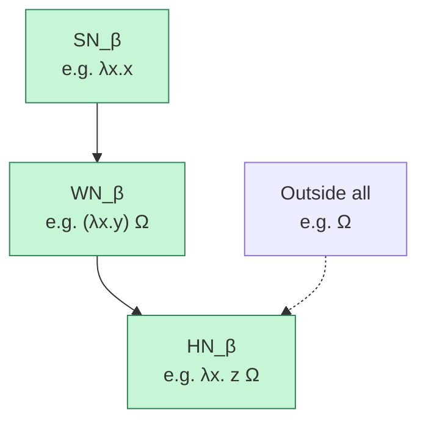
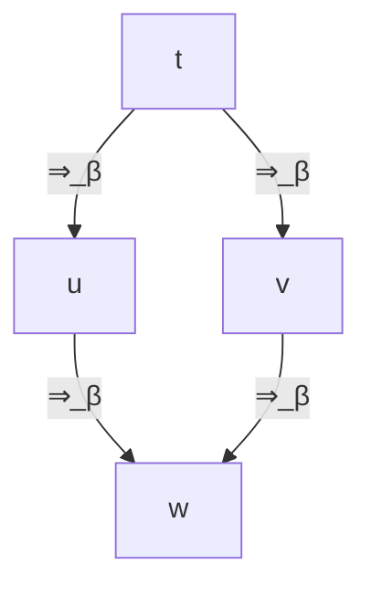

# Module 3 – Reduction, Equivalence, Normal Forms

This module develops the **operational core** of the untyped $\lambda$-calculus. We will:

1. Define **$\beta$-reduction** (computation) and its **equational closure**.
2. Introduce **$\eta$-conversion** (extensionality).
3. Define **normal forms** and **normalization** notions (weak, strong, head).
4. Prove (or at least carefully state) **confluence** (Church–Rosser).
5. State and explain the **standardization theorem** and its consequences for evaluation strategies.

We assume the **raw syntax** of $\lambda$-terms from Module 1:

* Variables: $x,y,z,\dots$
* Terms: $t,u,v ::= x \mid \lambda x.t \mid t\, u$

with:

* **Free variables** $\mathrm{FV}(t)$ as in Module 1,
* **Capture-avoiding substitution** $t[s/x]$ as in Module 1,
* **$\alpha$-equivalence** $t \equiv_\alpha u$ (terms that differ only by renaming bound variables).

---

## 3.1 Raw terms vs $\alpha$-classes

Formally, we distinguish:

* $\Lambda$: the set of **raw $\lambda$-terms** built from variables, application, abstraction.
* $\equiv_\alpha$: the $\alpha$-equivalence relation on $\Lambda$.
* $\Lambda_\alpha = \Lambda / \equiv_\alpha$: the set of **$\alpha$-equivalence classes**.

In practice, we want to **ignore bound variable names**: we care about terms “up to $\alpha$”. However, it is technically convenient to **define** $\beta$-reduction and substitution on **raw terms**, and only then show they are well-defined on $\alpha$-classes.

We adopt the following convention:

> **Convention.**  
> All inductive definitions (substitution, $\beta$-reduction, etc.) are given on raw terms $t \in \Lambda$.  
> In statements and proofs, we usually reason “modulo $\alpha$”: the word *term* may mean either a raw term or its $\alpha$-class, when no confusion can arise.

The key lemma that justifies this is:

> **Lemma 3.1 ($\beta$ respects $\alpha$ on raw terms).**  
> If $t \equiv_\alpha t'$ and $t \to_\beta u$, then there exists $u'$ such that  
> $$  
> t' \to_\beta u' \quad\text{and}\quad u \equiv_\alpha u'.  
> $$  

*Proof idea.*  
Induction on the derivation of $t \to_\beta u$, using the fact that capture-avoiding substitution respects $\alpha$-equivalence (Module 2). Whenever we rename bound variables to avoid capture, we can choose fresh names uniformly in both $t$ and $t'$ so that $\beta$-steps correspond.

From this we obtain:

> **Corollary 3.2 ($\beta$-reduction well-defined on $\alpha$-classes).**  
> The raw relation $\to_\beta \subseteq \Lambda \times \Lambda$ induces a well-defined relation (still written $\to_\beta$) on $\Lambda_\alpha$:  
> $[t] \to_\beta [u]$ iff there exist representatives $t' \in [t]$, $u' \in [u]$ with $t' \to_\beta u'$.  
> This is independent of the choice of representatives.  

So we are safe to talk about $\beta$-reduction **on $\alpha$-classes**, but we will usually write concrete examples using raw syntax for readability.

---

## 3.2 $\beta$-Reduction and Multi-Step Reduction

### Definition 3.3 ($\beta$-redex and one-step $\beta$-reduction)

A **$\beta$-redex** is a term of the form  
$$  
(\lambda x.t)\, s  
$$  
where $\lambda x.t$ is an abstraction and $s$ an arbitrary term.

The **one-step $\beta$-reduction** relation $\to_\beta$ on raw terms is the smallest relation closed under:

* **($\beta$)** *(basic contraction)*  
  $$  
  (\lambda x.t)\, s \to_\beta t[s/x],  
  $$  
  where $t[s/x]$ is **capture-avoiding substitution**.

* **(AppL)** *(congruence for application, left)*  
  If $t \to_\beta t'$, then $t\, u \to_\beta t'\, u$.

* **(AppR)** *(congruence for application, right)*  
  If $u \to_\beta u'$, then $t\, u \to_\beta t\, u'$.

* **(Abs)** *(congruence under $\lambda$)*  
  If $t \to_\beta t'$, then $\lambda x.t \to_\beta \lambda x.t'$.

We allow $\beta$-reduction **inside** abstractions (via Abs); this is sometimes called **strong** $\beta$-reduction.

A term with **no** $\beta$-redex is called **$\beta$-normal** (or simply in **normal form**, NF).

---

### Definition 3.4 (Multi-step $\beta$-reduction)

The **multi-step** (or **reflexive-transitive closure**) of $\to_\beta$ is written $\to_\beta^*$:

* For every term $t$, $t \to_\beta^* t$ (reflexivity).
* If $t \to_\beta u$ and $u \to_\beta^* v$, then $t \to_\beta^* v$ (transitivity).
* No other pairs are in $\to_\beta^*$.

A **reduction sequence** is a finite chain  
$$  
t_0 \to_\beta t_1 \to_\beta \dots \to_\beta t_n.  
$$  
We sometimes write $t \to_\beta^n u$ to indicate a sequence of **exactly** $n$ $\beta$-steps from $t$ to $u$.

---

### Definition 3.5 ($\beta$-equivalence / $\beta$-convertibility)

The **$\beta$-equivalence** relation $\equiv_\beta$ (also called **$\beta$-convertibility**) is the smallest **congruence** on terms containing $\to_\beta$. That is, it is the smallest relation such that:

* It contains $\to_\beta$ (if $t \to_\beta u$ then $t \equiv_\beta u$),
* It is an equivalence relation (reflexive, symmetric, transitive),
* It is closed under all term constructors:  
  * If $t \equiv_\beta u$, then $t\, s \equiv_\beta u\, s$ and $s\, t \equiv_\beta s\, u$,  
  * If $t \equiv_\beta u$, then $\lambda x.t \equiv_\beta \lambda x.u$.

Equivalently, $\equiv_\beta$ is the **equivalence closure** of the symmetric relation  
$$  
t \leftrightarrow_\beta u \quad\text{iff}\quad t \to_\beta u\ \text{or}\ u \to_\beta t.  
$$  
Because $\to_\beta$ itself is closed under contexts (Def. 3.3), this equivalence closure is automatically a **congruence**.

Intuitively, $t \equiv_\beta u$ means “you can get from $t$ to $u$ by a finite zig-zag of forward and backward $\beta$-steps, possibly inside larger contexts.”

---

### Example 3.1 (Basic $\beta$-reductions and non-determinism)

We illustrate $\beta$-reduction and the role of **different reduction paths**.

1. **Identity.**  
   $$  
   (\lambda x.x)\, y \to_\beta y.  
   $$

2. **Constant function.**  
   $$  
   (\lambda x.z)\, y \to_\beta z.  
   $$

3. **Nested redex and non-determinism in the choice of redex.**  

   Let  
   $$  
   t \equiv (\lambda x.(\lambda y.x)\, z)\, w.  
   $$  

   There are **two obvious redexes**: the **outer** one at the root and the **inner** one $(\lambda y.x)\, z$ in the body.

   * **Outer-first reduction.**  
     $$  
     \begin{aligned}  
     (\lambda x.(\lambda y.x)\, z)\, w  
     &\to_\beta (\lambda y.w)\, z \\  
     &\to_\beta w.  
     \end{aligned}  
     $$  

   * **Inner-first reduction** (reduce inside the body first):  

     First reduce $(\lambda y.x)\, z$ inside the abstraction:  
     $$  
     (\lambda y.x)\, z \to_\beta x.  
     $$  
     So  
     $$  
     \begin{aligned}  
     (\lambda x.(\lambda y.x)\, z)\, w  
     &\to_\beta (\lambda x.x)\, w \\  
     &\to_\beta w.  
     \end{aligned}  
     $$  

   Two different choices of redex give **different intermediate terms**, but both paths end at the **same** normal form $w$. This is a first glimpse of **confluence**.

4. **Non-termination (self-application).**  

   Let  
   $$  
   \Omega \equiv (\lambda x.x\, x)\, (\lambda x.x\, x).  
   $$  
   Then  
   $$  
   \Omega \to_\beta \Omega \to_\beta \Omega \to_\beta \cdots  
   $$  
   yields an **infinite** $\beta$-reduction sequence, and $\Omega$ has **no normal form**.

This example shows:

* $\beta$-reduction is **non-deterministic** (many choices of redex),
* Different choices can lead to:  
  * The same normal form,  
  * Or infinite loops,  
  * Or, in general, different intermediate behavior.  

The next sections make this precise.

---

### Lemma 3.3 ($\beta$-reduction preserves free variables)

If $t \to_\beta u$, then $\mathrm{FV}(t) = \mathrm{FV}(u)$.

*Proof.*  
By induction on the last rule used in the derivation of $t \to_\beta u$.

* **Case ($\beta$)**: $t = (\lambda x.r)\, s$, $u = r[s/x]$.  
  From the substitution lemma (Module 1),  
  $$  
  \mathrm{FV}(r[s/x])  
  = (\mathrm{FV}(r) \setminus \{x\}) \cup \mathrm{FV}(s).  
  $$  
  On the other hand  
  $$  
  \mathrm{FV}((\lambda x.r)\, s)  
  = \mathrm{FV}(r) \setminus \{x\} \cup \mathrm{FV}(s).  
  $$  
  So $\mathrm{FV}(t) = \mathrm{FV}(u)$.

* **Cases (AppL/AppR/Abs)**: follow directly from the inductive hypothesis and the definitions of $\mathrm{FV}$ for application and abstraction.

Since $\mathrm{FV}$ is invariant under $\alpha$-equivalence (Module 1), the lemma also holds when we view terms as $\alpha$-classes.

---

## 3.3 $\eta$-Conversion and $\beta\eta$-Equivalence

While $\beta$-reduction captures the **mechanics** of computation, $\eta$-conversion captures a simple form of **extensional equality** for functions: a function is determined by what it does on its argument.

### Definition 3.6 ($\eta$-reduction and $\eta$-expansion)

An **$\eta$-redex** is a term of the form  
$$  
\lambda x.(t\, x)  
$$  
where $x \notin \mathrm{FV}(t)$.

We define:

* **$\eta$-reduction**:  
  $$  
  \lambda x.(t\, x) \to_\eta t,  
  $$  
  provided $x \notin \mathrm{FV}(t)$.

* **$\eta$-expansion** (formal inverse step):  
  $$  
  t \to_{\eta^{-1}} \lambda x.(t\, x),  
  $$  
  where $x$ is fresh (not free in $t$).

We extend $\to_\eta$ to arbitrary terms by the same **congruence rules** as for $\beta$: if $t \to_\eta t'$, then $t\, u \to_\eta t'\, u$, etc.

Intuition: if applying a function $t$ to a fresh variable and immediately abstracting over that variable gives you back $t$, then $\lambda x.(t\, x)$ and $t$ are **operationally indistinguishable** as functions, hence we consider them equivalent.

---

### Definition 3.7 ($\beta\eta$-equivalence)

We combine $\beta$ and $\eta$:

* $\to_{\beta\eta} := \to_\beta \cup \to_\eta$,
* $\to_{\beta\eta}^*$ is the reflexive-transitive closure of $\to_{\beta\eta}$,
* $\equiv_{\beta\eta}$ is the equivalence closure of  
  $$  
  \leftrightarrow_{\beta\eta} := \to_{\beta\eta} \cup \to_{\beta\eta}^{-1}.  
  $$

So $t \equiv_{\beta\eta} u$ iff we can transform $t$ into $u$ using a finite zig-zag of $\beta$- and $\eta$-steps (forwards or backwards), possibly under contexts.

> **Remark (Confluence of $\beta\eta$).**  
> The combined reduction $\to_{\beta\eta}$ is also **confluent** (Church–Rosser for $\beta\eta$). This can be shown by extending the parallel-reduction argument used for $\beta$ alone, or by treating $\beta$ and $\eta$ as commuting confluent systems. We do not prove this here in detail but rely on standard results (see Appendix 3.B for references).

### Example 3.2 ($\eta$-conversion in action)

1. For a function symbol $f$ with no free occurrence of $x$:  
   $$  
   \lambda x.(f\, x) \to_\eta f.  
   $$

2. Composition with $\beta$:  
   $$  
   \lambda z.\big((\lambda x.(f\, x))\, z\big)  
   \to_\beta \lambda z.(f\, z)  
   \to_\eta f.  
   $$

3. “$\eta$-long” vs “short” form:  

   Every function $f$ is $\beta\eta$-equivalent to its $\eta$-expansion:  
   $$  
   f \equiv_{\beta\eta} \lambda x.(f\, x),  
   $$  
   but these are generally **not** $\beta$-equivalent unless we allow $\eta$.

---

## 3.4 Normal Forms and Normalization Notions

We now formalize **termination properties**.

### Definition 3.8 (Normal forms)

* A term $t$ is in **$\beta$-normal form** (NF) if it contains **no** $\beta$-redex.
* A term is in **$\beta\eta$-normal form** if it contains no $\beta$- or $\eta$-redex.

Because our $\beta$-reduction is **strong** (we reduce under $\lambda$), a $\beta$-normal form has **no redex anywhere** in the syntax tree.

---

### Definition 3.9 (Head normal form)

A term is in **head normal form (HNF)** if it has the shape  
$$  
\lambda x_1.\dots\lambda x_n.\, y\, t_1 \dots t_k  
$$  
for some $n,k \ge 0$, where:

* $y$ is a **variable** (the “head”), and
* there is **no** redex at the head position (i.e. the head is not an abstraction).

The arguments $t_i$ may contain redexes. So head normal form means: “if we keep reducing only at the outermost, leftmost position, we eventually expose a variable at the head.”

---

### Definition 3.10 (WN, SN, HN)

Let $\to$ be $\beta$-reduction.

* $t$ is **weakly normalizing** (WN) if there exists a normal form $u$ such that  
  $$  
  t \to_\beta^* u.  
  $$  
  We write $t \in \mathsf{WN}_\beta$.

* $t$ is **strongly normalizing** (SN) if there is **no infinite $\beta$-reduction sequence** starting from $t$; equivalently, **every** reduction sequence  
  $$  
  t = t_0 \to_\beta t_1 \to_\beta t_2 \to_\beta \dots  
  $$  
  is finite. We write $t \in \mathsf{SN}_\beta$.

* $t$ is **head normalizing** (HN) if there exists a head normal form $u$ such that  
  $$  
  t \to_\beta^* u.  
  $$  
  We write $t \in \mathsf{HN}_\beta$.

Intuition:

* WN: “there exists **some** terminating path to a normal form.”
* SN: “**all** paths terminate” (no infinite reduction).
* HN: “if we reduce the head as far as possible, we eventually expose a variable.”

---

### Example 3.3 (Classification of terms)

Let  
$$  
\Omega := (\lambda x.x\, x)\, (\lambda x.x\, x).  
$$

1. $t_1 := \lambda x.x$.  

   * No $\beta$-redex: **normal form**, hence $t_1 \in \mathsf{WN}_\beta$.  
   * No reductions at all: trivially $t_1 \in \mathsf{SN}_\beta$.  
   * It is also in HNF: $\lambda x.x$ matches the HNF pattern with $n=1$, $y=x$, $k=0$. So $t_1 \in \mathsf{HN}_\beta$.

2. $t_2 := \Omega$.  

   * We have $\Omega \to_\beta \Omega \to_\beta \dots$. All reduction sequences loop forever.  
   * Hence $t_2 \notin \mathsf{SN}_\beta$, $t_2 \notin \mathsf{WN}_\beta$, $t_2 \notin \mathsf{HN}_\beta$.

3. $t_3 := \lambda x.\, z\, \Omega$ (with $z$ free).  

   * The body $z\, \Omega$ has head variable $z$, so $t_3$ is already in HNF ($\lambda x.\, z\, \Omega$). Hence $t_3 \in \mathsf{HN}_\beta$.  
   * But the argument $\Omega$ never normalizes, so there is no $\beta$-normal form for the whole term.  
   * Thus $t_3 \notin \mathsf{WN}_\beta$ and $t_3 \notin \mathsf{SN}_\beta$.

4. $t_4 := (\lambda x.y)\, \Omega$.  

   * One possible reduction path:  
     $$  
     (\lambda x.y)\, \Omega \to_\beta y,  
     $$  
     and $y$ is in NF. So $t_4 \in \mathsf{WN}_\beta$.  
   * However, we could choose to reduce inside $\Omega$ indefinitely:  
     $$  
     (\lambda x.y)\, \Omega \to_\beta (\lambda x.y)\, \Omega \to_\beta \dots  
     $$  
     (i.e. keep reducing the argument and never contract the outer redex). There exists an **infinite** reduction sequence, so $t_4 \notin \mathsf{SN}_\beta$.  
   * Because normal forms are in particular head normal forms, and we have $t_4 \to_\beta^* y$ with $y$ in HNF, we also have $t_4 \in \mathsf{HN}_\beta$.

From these examples we see:

* $\mathsf{SN}_\beta \subsetneq \mathsf{WN}_\beta$:  
  $t_1 \in \mathsf{SN}_\beta$, $t_4 \in \mathsf{WN}_\beta \setminus \mathsf{SN}_\beta$.
* $\mathsf{WN}_\beta \subsetneq \mathsf{HN}_\beta$:  
  $t_4 \in \mathsf{WN}_\beta$, $t_3 \in \mathsf{HN}_\beta \setminus \mathsf{WN}_\beta$.

So we have a strict chain:  
$$  
\mathsf{SN}_\beta \subsetneq \mathsf{WN}_\beta \subsetneq \mathsf{HN}_\beta.  
$$

A schematic picture:

---

## 3.5 Confluence and the Church–Rosser Theorem

Confluence formalizes:

> “Reduction choices may differ locally, but they **can be joined** again globally.”

### Definition 3.11 (Confluence)

A relation $\to$ on terms is **confluent** if for all $t,u,v$:  
$$  
t \to^* u \land t \to^* v \quad\Longrightarrow\quad \exists w.\ u \to^* w \land v \to^* w.  
$$

We say $\beta$-reduction is confluent if this holds for $\to_\beta$.

---

### Theorem 3.4 (Church–Rosser for $\beta$-reduction)

$\beta$-reduction is **confluent**.

Equivalently, for all terms $t,u$:  
$$  
t \equiv_\beta u \quad\Longleftrightarrow\quad \exists v.\ t \to_\beta^* v \land u \to_\beta^* v.  
$$

So $\beta$-equivalence means “having a **common reduct**”.

The standard proof uses **parallel $\beta$-reduction**, which contracts many redexes at once.

---

### Parallel $\beta$-reduction

We define a relation $\Rightarrow_\beta$ (“parallel $\beta$-reduction”) on terms so that **all redexes can contract simultaneously**.

#### Definition 3.12 (Parallel $\beta$-reduction)

Define $\Rightarrow_\beta$ by structural recursion:

* **Variables**: $x \Rightarrow_\beta x$.
* **Non-redex application**:  
  If $t \Rightarrow_\beta t'$ and $u \Rightarrow_\beta u'$, and the original term is **not** of the form $(\lambda x.t)\, u$, then  
  $$  
  t\, u \Rightarrow_\beta t'\, u'.  
  $$
* **Abstraction**:  
  If $t \Rightarrow_\beta t'$, then  
  $$  
  \lambda x.t \Rightarrow_\beta \lambda x.t'.  
  $$
* **Redex at the root**:  
  If $t \Rightarrow_\beta t'$ and $u \Rightarrow_\beta u'$, then  
  $$  
  (\lambda x.t)\, u \Rightarrow_\beta t'[u'/x].  
  $$

Thus, in a parallel step, each **occurrence** of a $\beta$-redex decides independently whether to be contracted.

We write $\Rightarrow_\beta^*$ for its reflexive-transitive closure.

---

### Key properties

1. **Parallel extends ordinary $\beta$.**  

   > **Lemma 3.5.** If $t \to_\beta u$, then $t \Rightarrow_\beta u$.  

   *Idea:* A one-step $\beta$-reduction contracts exactly **one** redex; define a parallel step that contracts that redex and leaves all other subterms unchanged (using the “non-redex application” and “abstraction” clauses).

2. **Parallel steps can be simulated by ordinary $\beta$.**  

   > **Lemma 3.6.** If $t \Rightarrow_\beta u$, then $t \to_\beta^* u$.  

   *Idea:* Induction on the derivation $t \Rightarrow_\beta u$. Each parallel contraction of a redex can be simulated by a **finite sequence** of individual $\beta$-steps, and the structural cases are compatible with the congruence rules.

3. **Diamond property for parallel $\beta$.**  

   > **Lemma 3.7 (Diamond).**  
   > If $t \Rightarrow_\beta u$ and $t \Rightarrow_\beta v$, then there exists $w$ such that  
   > $$  
   > u \Rightarrow_\beta w \quad\text{and}\quad v \Rightarrow_\beta w.  
   > $$  

   *Idea:* Structural induction on $t$. The interesting case is when the root of $t$ is a redex: then both $u$ and $v$ come from contracting it, possibly reducing the body and argument differently in parallel. The induction hypothesis gives a common parallel reduct for body and argument, and substitution respects these reductions, yielding $w$.

The diamond property gives the picture:

Parallel $\beta$ is **locally confluent** in the strongest possible sense.

---

### Proof sketch of Church–Rosser

Given $t \to_\beta^* u$ and $t \to_\beta^* v$:

1. By Lemma 3.5, each $\beta$-step is a parallel step. By induction on the length of these chains, we get:  
   $$  
   t \Rightarrow_\beta^* u \quad\text{and}\quad t \Rightarrow_\beta^* v.  
   $$
2. Using Lemma 3.7 (diamond) repeatedly, we join these two parallel chains to a common term $w$:  
   $$  
   u \Rightarrow_\beta^* w \quad\text{and}\quad v \Rightarrow_\beta^* w.  
   $$
3. By Lemma 3.6, each parallel chain can be simulated by ordinary $\beta$-reduction:  
   $$  
   u \to_\beta^* w \quad\text{and}\quad v \to_\beta^* w.  
   $$

Thus $\beta$-reduction is confluent.

**Consequence.** If a term has a $\beta$-normal form $n$, then that normal form is **unique** (up to $\alpha$-equivalence): any reduction sequence that terminates must end at $n$.

---

## 3.6 Standardization and the Role of Strategies

Confluence tells us that **if** a normal form exists, it is unique. It does **not** tell us:

* how to **find** it,
* which **strategy** (which redex to reduce next) is guaranteed to succeed.

The **standardization theorem** fills this gap: it says that there is a notion of **“standard”** reduction sequence (roughly: leftmost-outermost first) which is complete for finding normal forms.

### Positions and order

We represent positions in a term as words over the alphabet $\{L,R,B\}$:

* $\epsilon$: the root,
* $L$: go to the left child of an application,
* $R$: go to the right child,
* $B$: go to the body of a $\lambda$-abstraction.

We order positions **lexicographically** with  
$$  
L \prec R \prec B  
$$  
and with the usual convention that **shorter** words come before longer ones. This induces a **total** order $\prec$ on positions that respects “outer-before-inner” and “left-before-right”.

### Definition 3.13 (Standard reduction sequence)

A finite $\beta$-reduction sequence  
$$  
t_0 \to_\beta t_1 \to_\beta \dots \to_\beta t_n  
$$  
is **standard** if the positions $p_1,\dots,p_n$ of the contracted redexes satisfy:  
$$  
p_1 \preceq p_2 \preceq \dots \preceq p_n  
$$  
with respect to the above order $\prec$. Intuitively:

* you never go back to contract a redex **to the left** of one you already contracted,
* you never go back to a **higher** (more outer) position once you have gone deeper.

Classical **leftmost-outermost** (also called **normal-order**) reduction corresponds to a particular **deterministic** way of generating such standard sequences.

---

### Theorem 3.8 (Standardization)

If  
$$  
t \to_\beta^* u  
$$  
and $u$ is in $\beta$-normal form, then there exists a **standard** reduction sequence  
$$  
t \to_\beta^* u.  
$$

In words:

> Whenever a term reduces to a normal form, there is **some** reduction sequence to that normal form that always reduces **leftmost-outermost-ish** redexes first.

*Proof idea (very high-level).*  
Given an arbitrary reduction sequence, identify a **leftmost earliest** redex that was “skipped over” in favor of a later one. Using confluence and a careful permutation argument, one shows that the order of those two steps can be swapped without changing the final normal form. Repeating this process, one can re-order any sequence to match the standard position order. Technically, this uses the Church–Rosser property plus an analysis of redex positions (see Barendregt for full proof).

---

### Corollary 3.9 (Normal-order is normalizing on WN terms)

Fix a deterministic leftmost-outermost (normal-order) evaluation strategy (formalized in Module 6 via evaluation contexts). Then:

> If $t$ is **weakly normalizing**, i.e. there exists some normal form $u$ with $t \to_\beta^* u$, then **normal-order evaluation on $t$** is guaranteed to **terminate** and yield a normal form (necessarily that same $u$, by confluence).

This justifies the classical slogan:

> *If a $\lambda$-term has a normal form, normal-order (leftmost-outermost) reduction will find it.*

This is a **deep** and extremely important result: confluence gives us **uniqueness** of normal forms; standardization plus an explicit strategy gives us a **computable way** to search for them.

---

## 3.7 Summary of the Module

In this module we:

1. Defined **$\beta$-reduction** on raw $\lambda$-terms, extended it to $\alpha$-classes, and introduced **multi-step** and **$\beta$-equivalence**.
2. Introduced **$\eta$-reduction** and **$\beta\eta$-equivalence**, separating computation ($\beta$) from extensionality ($\eta$).
3. Defined:  
   * **normal forms** and **head normal forms**,  
   * the classes $\mathsf{SN}_\beta$, $\mathsf{WN}_\beta$, $\mathsf{HN}_\beta$,  
   * and exhibited the strict chain $\mathsf{SN}_\beta \subsetneq \mathsf{WN}_\beta \subsetneq \mathsf{HN}_\beta$.
4. Proved (via **parallel $\beta$-reduction**) that $\beta$-reduction is **confluent** (Church–Rosser), giving **uniqueness of normal forms**.
5. Stated the **standardization theorem**, explaining why **leftmost-outermost** strategies are **complete** for finding normal forms.

This is the backbone for:

* **Module 4**: infinitary semantics (Böhm trees, solvability, separation).
* **Module 5**: $\lambda$-calculus as a programming language (Church encodings, fixed points).
* **Module 6**: concrete evaluation strategies and abstract machines (Krivine, CEK).

---

## 3.8 Suggested Exercises

1. **Basic $\beta$-chains and confluence.**  
   Compute **all** distinct $\beta$-reduction sequences (up to commutation of independent steps) from  
   $$  
   (\lambda x.x)\, ((\lambda y.y)\, z)  
   $$  
   and show that every terminating sequence ends at the same normal form.

2. **Classification.**  
   For each of the following terms, determine which of $\mathsf{SN}_\beta$, $\mathsf{WN}_\beta$, $\mathsf{HN}_\beta$ it belongs to, and justify:  

   * $((\lambda x.y)\, \Omega)$,  
   * $\lambda x.\Omega$,  
   * $((\lambda f.\lambda x.f(f\, x))\, (\lambda x.x))$.

3. **$\eta$-reduction and free variables.**  
   Find all $\eta$-redexes in:  
   $$  
   \lambda x.\big((\lambda y.f\, y)\, x\big)  
   \quad\text{and}\quad  
   \lambda z.(g\, z\, w),  
   $$  
   reduce them, and compute the sets of free variables before and after.

4. **Parallel $\beta$ step.**  
   Describe a single parallel $\beta$ step  
   $$  
   (\lambda x.(x\, x))\, ((\lambda y.y)\, z) \Rightarrow_\beta t  
   $$  
   that contracts **both** the outer redex and the inner $(\lambda y.y)\, z$ redex at once. What is $t$? Verify that $t$ is reachable by ordinary $\beta$-reduction.

5. **Standardization intuition.**  
   For  
   $$  
   t := (\lambda x.y)\, ((\lambda z.z)\, \Omega),  
   $$  
   show explicitly:  

   * a **non-terminating** reduction sequence (keep reducing inside $\Omega$),  
   * the **terminating** leftmost-outermost sequence to the normal form $y$.  
     Explain how the standardization theorem guarantees that the “good” sequence exists whenever a normal form exists.
