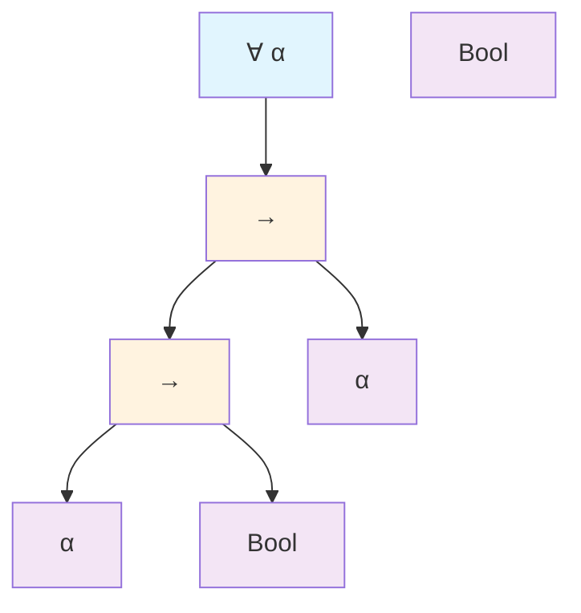

# Module 12: System F and Parametric Polymorphism

This module extends the Simply Typed λ-Calculus (STLC) of Modules 8 and 9 with parametric polymorphism, yielding System F—a foundational system for generic programming that allows terms to abstract over types themselves, much as λ-abstractions abstract over values. In STLC, functions are monomorphic, bound to specific types (e.g., an identity function typed as Int → Int cannot reuse for Bool → Bool without redefinition), constraining modularity and reusability. System F resolves this via universal quantification (∀), enabling a single term to operate uniformly across types, as in a polymorphic identity ∀ α. α → α that instantiates to any A → A. This parametricity not only enhances expressiveness—permitting typed encodings of data structures like lists without type-specific variants (extending Module 5's untyped encodings)—but also yields "free theorems": properties derivable solely from types, such as the fusion law for maps, ensuring abstraction without ad hoc proofs. However, polymorphism introduces undecidable inference (though checking remains decidable), bridging to practical systems like Hindley-Milner (HM) in Module 13. System F's impredicativity (quantifying over all types, including polymorphic ones) confers power but complexity, with strong normalization inherited from STLC (Core 9.4) via extended logical relations.

The module traverses five cores, each amplifying polymorphism: Core 12.1 details syntax for types and terms; Core 12.2 presents typing rules with derivations; Core 12.3 retypes Church encodings generically; Core 12.4 analyzes expressiveness and inference undecidability; and Core 12.5 expounds parametricity with relational interpretations and a full free theorem proof, plus an HM subsection. Explanations derive each feature from monomorphism's limitations, with formal statements unpacked via inductive proofs on terms/types. Clarity stems from step-by-step derivations for polymorphic terms, comparative tables of monomorphic vs. polymorphic, and Mermaid diagrams for type scopes and instantiations. Python prototypes simulate polymorphic evaluation using generics, integrating typed reduction (Module 8) and substitution (Module 7). These illuminate System F's duality—universal yet constrained—preparing for higher-kinded types in Module 14. Prerequisites include mastery of Modules 1–11, notably STLC metatheory (Module 9), recursive safety (Module 11), and explicit substitution (Module 7); all polymorphic constructs are self-contained with recaps.

## Core 12.1: Syntax of System F: Type Variables, Type Abstraction Λα.t, Type Application t [A]

System F's syntax elevates types to first-class entities, introducing type variables as placeholders and term constructs to bind and instantiate them. This duality—terms abstract over values, now also over types—fosters generics, with syntax ensuring scoped binding akin to term variables (Module 1.3).

### Syntax of Types

Types $\mathcal{T}_F$ extend STLC types (Core 8.1) with polymorphism:

\[
A ::= B \mid \alpha \mid A \to A \mid \forall \alpha. A
\]

- $B \in \mathcal{B}$: Base types (e.g., Nat, Bool from Module 10.1).
- $\alpha \in \mathcal{TV}$: Type variables $\{\alpha, \beta, \dots \}$, an infinite enumerable set, serving as parameters for quantification (analogous to term variables x, y).
- $A \to B$: Function types, as in STLC.
- $\forall \alpha. A$: Universal type, binding $\alpha$ in A, denoting "for all substitutions of $\alpha$ with a type."

Binding: ∀ scopes A, excluding $\alpha$ from FTV(∀ α. A) = FTV(A) \ {$\alpha$}. Arrow unbound. α-equivalence: ∀ α. A ≡α ∀ β. A[β/α] (fresh β, Core 1.3). Well-formedness: Δ ⊢ A wf if FTV(A) ⊆ Δ (type context, list of α's).

Example: ∀ α. α → α (polymorphic identity); instantiate to Nat → Nat by [Nat].

Type tree for ∀ α. (α → Bool) → α → Bool:


This illustrates nested binding, with ∀ scoping the entire arrow.

### Syntax of Terms

Terms $\Lambda_F$ extend STLC (Core 8.3) with type-level operations:

\[
t ::= x \mid \lambda x : A. t \mid t\, t \mid \Lambda \alpha. t \mid t [A]
\]

- Term variables, λ-abstractions, and applications as in STLC (explicit types in λ for clarity).
- $\Lambda \alpha. t$: Type abstraction (capital Λ distinguishes from λ), binding type variable $\alpha$ in t.
- $t [A]$: Type application, substituting type A for bound $\alpha$ in t.

Free term variables FV(t) as Module 1.2; free type variables FTV(t) recursively: FTV(x) = ∅, FTV(λx:A. t) = FTV(A) ∪ FTV(t), FTV(Λ α. t) = FTV(t) \ {$\alpha$}, FTV(t [A]) = FTV(t) ∪ FTV(A) \ FTV-bound in t.

α-equivalence extends: Λ α. t ≡α Λ β. t[β/α] (fresh β).

Reduction preview (Core 12.2): $(\Lambda \alpha. t) [A] \to_\beta t[A/\alpha]$ (type β), with substitution as Module 7.3 for hygiene.

Examples:
- Polymorphic identity: $\Lambda \alpha. \lambda x : \alpha. x$.
- Instantiation: $(\Lambda \alpha. \lambda x : \alpha. x) [\mathsf{Nat}]$ reduces to $\lambda x : \mathsf{Nat}. x$.

| Construct | Role | Example | FTV/FV Impact |
|-----------|------|---------|---------------|
| $\Lambda \alpha. t$ | Bind type var | $\Lambda \alpha. \lambda x : \alpha. x$ | Binds α in FTV(t) |
| $t [A]$ | Instantiate | id$[\mathsf{Bool}]$ | Adds FTV(A), removes bound α |
| $\lambda x : A. t$ | Value bind | $\lambda x : \alpha. x$ (α free) | FTV(A) ∪ FTV(t), FV(x) bound |

These enable generic terms, typed under type contexts Δ; Γ ⊢ t : A (Δ for FTV).

### Representation in Programming

Python generics simulate (dynamic but annotated):

```python
from typing import TypeVar, Generic

T = TypeVar('T')

class PolyId(Generic[T]):
    def __init__(self):
        pass

    def apply(self, x: T) -> T:
        return x

id_int = PolyId[int]()
print(id_int.apply(5))  # 5

id_bool = PolyId[bool]()
print(id_bool.apply(True))  # True
```

Mimics instantiation.

### Exercises

1. Compute FTV(∀ α. α → ∀ β. β → α).
2. α-equivalence: Show ∀ α. α → α ≡ ∀ γ. γ → γ.
3. Syntax tree for Λ α. (λ x:α. x) [Bool].

## Core 12.2: Typing Rules for ∀-Types and Polymorphic Terms

System F's typing rules stratify term and type binders, employing separate contexts for each to ensure well-formedness and scope. These extend STLC (Core 8.3), introducing introduction/elimination for ∀ analogous to λ/app but over types.

### Judgements and Contexts

Judgements: Δ; Γ ⊢ t : A, where:
- Δ: Type context, finite list of distinct type variables (α : * implicit, un-kinded here).
- Γ: Term context, x : A (A wf under Δ).
- A wf under Δ if FTV(A) ⊆ dom(Δ).

Separate: Type vars in Δ global, term vars local; prevents dependent mixing (Module 14.4).

Well-formed A: Δ ⊢ A wf (ind):
- Δ ⊢ α wf if α ∈ Δ.
- Δ ⊢ A → B wf if Δ ⊢ A,B wf.
- Δ ⊢ ∀ α. A wf if Δ,α ⊢ A wf.

### Typing Rules

Extend STLC:
- **T-Var**: x : A ∈ Γ (Δ ⊢ A wf) ⇒ Δ; Γ ⊢ x : A.
- **T-Abs**: Δ; Γ, x : A ⊢ t : B (Δ ⊢ A wf) ⇒ Δ; Γ ⊢ λ x : A. t : A → B.
- **T-App**: Δ; Γ ⊢ t : A → B, Δ; Γ ⊢ u : A (Δ ⊢ A,B wf) ⇒ Δ; Γ ⊢ t u : B.
- **T-∀-Intro**: Δ, α; Γ ⊢ t : A (α ∉ FTV(Γ)) ⇒ Δ; Γ ⊢ Λ α. t : ∀ α. A (Δ,α ⊢ A wf).
- **T-∀-Elim**: Δ; Γ ⊢ t : ∀ α. A, Δ ⊢ B wf ⇒ Δ; Γ ⊢ t [B] : A[B/α].

Freshness in T-∀-Intro: α not free in Γ types (no dep).

Preservation (extend Module 9.3): Δ; Γ ⊢ t : A, t → u ⇒ Δ; Γ ⊢ u : A (type β: (Λ α. t) [B] → t[B/α], sub preserves).

Examples:
- Poly id: Δ=∅, Γ=∅ ⊢ Λ α. λ x : α. x : ∀ α. α → α.
  - Inner: α; x : α ⊢ x : α (T-Var).
  - T-Abs: α; ∅ ⊢ λ x : α. x : α → α.
  - T-∀-Intro: ∅; ∅ ⊢ Λ α. ... : ∀ α. α → α.

- Inst: id [Bool] : Bool → Bool (T-∀-Elim, Bool wf).

| Rule | Premise | Conclusion | Freshness Condition |
|------|---------|------------|---------------------|
| T-∀-Intro | Δ, α; Γ ⊢ t : A | Δ; Γ ⊢ Λ α. t : ∀ α. A | α ∉ FTV(Γ types) |
| T-∀-Elim | Δ; Γ ⊢ t : ∀ α. A, Δ ⊢ B wf | Δ; Γ ⊢ t [B] : A[B/α] | B wf under Δ |
| T-Abs (recap) | Δ; Γ, x : A ⊢ t : B | Δ; Γ ⊢ λ x : A. t : A → B | A wf under Δ |

Derivation tree for poly id [Nat]:
- Root T-∀-Elim: id : ∀ α. α → α, Nat wf → λ x : Nat. x : Nat → Nat.
- id from T-∀-Intro (as above).

### Programming Representation

Python type vars:

```python
from typing import TypeVar

T = TypeVar('T')

def poly_id(x: T) -> T:
    return x

# Instantiate
def id_int(x: int) -> int:
    return poly_id(x)  # Type checker infers

print(id_int(42))  # 42
```

### Exercises

1. Derive Λ α. λ f : α → α. λ x : α. f x : ∀ α. (α → α) → α → α.
2. T-∀-Elim for poly const [Bool] [Nat] : Bool → Nat.
3. Why freshness in T-∀-Intro (avoid dep Γ types).

## Core 12.3: Church Encodings in System F (Lists, Trees, etc. with Better Types)

System F's polymorphism enables typed Church encodings from Module 5, transforming untyped data into generic structures with precise types, ensuring operations like mapping preserve types automatically.

### Generic Lists in System F

Un-typed list (Module 5.4) as fold: List = ∀ β. β → (A → List → β) → β.

- nil = Λ β. λ n : β. λ c : A → List → β. n.
- cons a l = Λ β. λ n : β. λ c : A → List → β. c a l.

Type: ∀ A β. A → List A → List A for cons (poly A).

Map: ∀ A B. (A → B) → List A → List β (inst β = List B).

Unfold: map f nil = nil [List B]; map f (cons a l) = cons (f a) (map f l).

**Lemma 12.1**: map id ≡ id : ∀ A. List A → List A.

*Proof*: By β-reduction on fold; id as Λ α. λ x:α. x inst List A.

Trees similar: Tree A = ∀ β. β → (A → Tree A → Tree A → β) → β (binary).

Encodings parametric: No type-specific code.

| Encoding | System F Type | STLC Counterpart | Polymorphic Benefit |
|----------|---------------|------------------|---------------------|
| List A | ∀ β. β → (A → List A → β) → β | Fixed A (no ∀) | Generic map over any A |
| Map f | ∀ A B. (A → B) → List A → List B | Mono f : A → B | f any, A/B arbitrary |
| Tree A | ∀ β. β → (A → Tree A → Tree A → β) → β | Fixed arity | Rec children any depth |

Example derivation for cons a nil : List A.
- a : A (assume).
- nil : ∀ β. ... (Λ β. λ n c. n).
- cons = Λ β. λ n c. c a nil [β].
- Inst β = List A: c a (nil [List A]) : List A (c : A → List A → List A).

### Representation in Programming

Python generics for lists:

```python
from typing import TypeVar, List, Callable

T = TypeVar('T')
U = TypeVar('U')

def fold_map(f: Callable[[T], U], lst: List[T]) -> List[U]:
    return [f(x) for x in lst]  # Poly

print(fold_map(lambda x: x+1, [1,2]))  # [2,3]
```

### Exercises

1. Derive type cons : ∀ A. A → List A → List A.
2. Show map (λx.x) nil = nil [reduction].
3. Type tree node a left right : ∀ A. Tree A.

## Core 12.4: Expressiveness vs Undecidable Type Inference in System F

System F's polymorphism confers immense expressiveness—generic data, modules, existentials—but renders full type inference undecidable, necessitating annotations for practicality.

### Expressiveness Highlights

- **Generics**: Single map for all A (Core 12.3).
- **Abstract Data Types**: ∀ α. (List α → α) → (α → List α → List α) → ... for opaque lists (hides rep).
- **Existentials**: Pack ∃ α. A × α as ∀ β. (∀ α. A → α → β) → β → β (pack/unpack).
- **Rank-2**: ∀ α. (∀ β. β → α) → α (higher-rank, beyond HM).

Impredicative: ∀ α over polymorphic (e.g., ∀ α. List α), powerful for proofs (Module 9 CH).

Limits: No rec types (Module 11); no dep (Module 14.4).

### Undecidability of Type Inference

**Theorem 12.2**: Inferring principal type for term (find most general A s.t. ⊢ t : A) undecidable in System F.

*Proof Sketch*: Reduction from semi-unification or halting: Polymorphic terms encode computations (e.g., via fix from Module 10.1, but typed); inference solves whether t instantiates to specific type, equiv undecidable problem (Mitchell 1991).

Checking decidable: Given A, verify ⊢ t : A via recursion on t/A (unify vars).

Practical: Annotations for ∀-Intro/Elim; ML/HM (Module 13) rank-1 decidable subset.

| Aspect | STLC | System F | HM (M13) | Note |
|--------|------|----------|----------|------|
| Inference | Decidable | Undecidable | Decidable principal | Rank-1 limit |
| Express | Monomorphic | Full param | Ad-hoc poly | Let-bound ∀ |
| Annotations | None | ∀ positions | Let | Balance |

F full power, HM practical.

### Exercises

1. Existential pack: Type Λ γ. λ p : (∀ α. A → α → γ). λ u : γ. p [∃ α. A × α] ⟨inj a, witness⟩ u.
2. Why impred ∀ α. ∀ β. α → β → α powerful (const poly).

## Core 12.5: Parametricity and “Free Theorems”

Parametricity posits that polymorphic functions behave uniformly across types, yielding theorems "free" from code inspection—solely from signatures. We define relational parametricity via logical relations, proving the fundamental theorem, and derive a nontrivial free theorem for composition.

### Relational Interpretation of Types

Parametricity via relations R_A ⊆ [[A]] × [[A]] (denot from Module 15, but abstract):

- Base B: R_B = Id (identity, a R_B b iff a=b).
- Arrow A → B: R_{A→B}(f,g) iff ∀ a b, a R_A b ⇒ f a R_B g b.
- ∀ α. A: R_∀α.A (t,u) iff ∀ types S,T, ∀ rel Q : S ~ T, R_A[S/α](t [S], u [T]) where ~ relates types, R_A[S] lifted via Q.

Fundamental **Theorem 12.3**: If ⊢ t : A, then t R_A t (self-relates).

*Full Proof by Induction on Typing Derivation*:
- T-Var: x R_A x (Id).
- T-Abs: t = λ x:A. s, A = B → C, premise x:B ⊢ s : C. IH s R_C s. For λs R_{B→C} λs: ∀ a b, a R_B b ⇒ (λs) a R_C (λs) b i.e. s[a/x] R_C s[b/x]. By sub lemma (Core 8.4 typed), x:B ⊢ s[a/x] : C, but a R_B b ⇒ lift rel to s[a/x] R s[b/x] by IH on extended (rel lift: vars map to related).
- T-App: t = s1 s2, premises s1 : B→A, s2 : B. IH s1 R_{B→A} s1, s2 R_B s2. Then s1 s2 R_A s1 s2 by s1 def (applies related to related).
- T-∀-Intro: t = Λ α. s, A = ∀ α. C, premise α; ⊢ s : C. IH s R_C s. For Λs R_∀α.C Λs: ∀ S T Q, R_C[S/α]( (Λs)[S], (Λs)[T] ) i.e. s[S/α] R_C[T/α] s[T/α]. By IH on premise (extended rel Q for α), yes.
- T-∀-Elim: t = s [B], A = C[B/α], premise s : ∀ α. C. IH s R_∀ s. Then s [B] R_C[B/α] s [B] by s def (Q=Id for B~B).

Self-rel: Polymorphic uniform (cannot branch on α).

### A Nontrivial Free Theorem: Map Fusion

**Free Theorem for map**: If ⊢ map : ∀ α β. (α → β) → List α → List β, then ∀ f : A → B, g : B → C, map g ∘ map f = map (g ∘ f) : List A → List C.

*Proof Using Parametricity*:
- map R (all inst). For rel Id on List A, map g ∘ map f Id map (g∘f): ∀ l1 l2 Id(l1,l2) ⇒ (map g (map f l1)) Id (map (g∘f) l2).
- But Id on List from fold rel: List rel if nil-nil or cons-related (h1 R_A h2, t1 R_List t2).
- By map def (fold), unfolds to structural preservation: map g maps related lists to related (by rel def arrow), compose.

Full: Parametricity forces map structural, no type-peek, hence fusion.

Other: length (List α → Nat) ∘ map f = length (preserves size).

| Signature | Free Theorem | Parametric Reason |
|-----------|--------------|-------------------|
| ∀ α. α → α | t [B] ∘ f = f ∘ t [A] | Uniform map |
| ∀ α β. (α→β) → List α → List β | map g ∘ map f = map (g∘f) | Rel preserves compose |
| ∀ α. List α → Nat | length ∘ map f = length | Size invariant |

### Subsection: Hindley-Milner (HM) and Relation to Rank-1 System F

HM, or ML polymorphism, approximates System F with rank-1: ∀ leftmost in types (let-bound schemes ∀ α. A, no nested ∀ in args).

Type schemes: Let x = t in s, x : ∀ α. A (principal A from infer).

Generalization: Monotype A, gen to ∀ α in A (free in A not Γ).

Instantiation: Scheme ∀ α. A inst to A[B/α].

**Algorithm W**: Infer monotypes, gen schemes at let, inst use.

Sketch soundness: Infer preserves typing (ind t); gen/inst mono.

HM rank-1 F: Let-poly simulates prenex F (pull ∀ left), decidable infer.

ML/Haskell cores HM (inferred generics).

| System | Polymorphism | Inference | Rank | Relation |
|--------|--------------|-----------|------|----------|
| STLC | None | Decidable | 0 | Mono base |
| HM | Let-bound | Decidable principal | 1 | F subset (prenex) |
| F | Universal | Undecidable | Arbitrary | Full param |

### Representation in Programming

Python HM sim (simple infer):

```python
from typing import Dict, Any

def infer_hm(gamma: Dict[str, str], t: Any) -> str:
    if isinstance(t, str):  # Var
        return gamma.get(t, None)
    if t[0] == 'lambda':  # (lambda x body)
        x = t[1]
        body_type = infer_hm({**gamma, x: 'alpha'}, t[2])  # Fresh alpha
        return f'alpha -> {body_type}'
    if t[0] == 'app':
        func_type = infer_hm(gamma, t[1])
        arg_type = infer_hm(gamma, t[2])
        # Unify func domain = arg
        return func_type.split(' -> ')[1]  # Codomain
    return None

# Example lambda x. x : alpha -> alpha
print(infer_hm({}, ('lambda', 'x', 'x')))  # alpha -> alpha
```

### Exercises

1. Derive rel for arrow: ∀ a b R_A a b ⇒ f a R_B g b.
2. Free theorem length map: Prove using rel Id_List.
3. HM gen: Let id = λx.x in id 5; scheme ∀α. α→α.
4. W sketch: Infer app (infer lambda).

## Summary and Suggested Exercises

System F poly: Syntax ∀ Λ [ ], typing intro/elim, typed encodings generic, express undecid infer, parametric rel free theorems, HM rank-1 bridge.

**Exercises**:
1. Syntax tree ∀α. α→α.
2. Derive poly map type.
3. Inst map [Int] [String] : (Int→String) → List Int → List String.
4. Free comp theorem: map g ∘ map f = map g f.
5. HM infer let poly_id = Λα λx:α x in poly_id [Bool] true.

F poly power, Module 13 HM practical.
