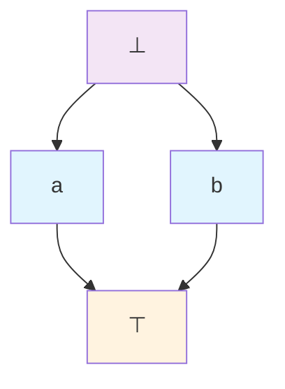

# Module 15: Denotational and Categorical Semantics

This module introduces denotational semantics as a mathematical lens for interpreting λ-terms, assigning to each term an abstract "denotation" in a structured space that captures its computational essence—beyond the step-by-step mechanics of operational semantics (Module 6). While operational views detail *how* terms reduce via βη-steps (Module 3), denotational semantics elucidates *what* terms mean as fixed objects, facilitating proofs of equivalence (terms denoting identically), correctness (denotation matching specification), and termination (non-diverging terms denoting defined values). For the untyped λ-calculus (Modules 1–5), domain theory models self-reference and divergence using ordered limits; for typed variants like STLC (Modules 8–9) and System F (Module 12), cartesian closed categories (CCCs) abstract types as objects and terms as arrows, aligning with Curry-Howard logic (Core 9.5). To ground these abstractions, we incorporate a mini-module on PCF (extending Module 10), modeling its observational equivalence (Core 10.3) in domains and discussing full abstraction—a property where denotations precisely capture behaviors, often requiring games (Module 18). Motivations include equating implementations (same denotation implies correctness) and bridging syntax to logic. Analogously, denotations resemble a program's Platonic form, independent of execution path. We advance through five cores, each erecting semantic edifice: posets/CPOs for orders, continuous functions/lfps for recursion, untyped domains solving D ≅ [D→D], CCCs for typed, and soundness/adequacy/obs eq with PCF example. Formalisms motivate challenges (e.g., self-app in untyped), with unpacked proofs via induction (Module 1.5). Examples compute explicit denotations (e.g., identity in Set CCC); tables contrast models; Mermaid visualizes orders/morphisms. A worked CCC denotation for λx.λy.x exemplifies. Prerequisites: Modules 1–14, especially reduction (Module 3), STLC metatheory (Module 9), PCF (Module 10), and F parametricity (Core 12.5); self-contained with recaps.

## Core 15.1: Domain Theory Basics: Posets, CPOs, Directed Suprema

Domain theory, pioneered by Dana Scott, equips λ-semantics with ordered structures to model approximation and limits, resolving untyped self-reference (Module 4.5) where set theory falters. Posets order "information," CPOs ensure completeness for chains/directed sets, suprema converge infinite processes.

### Posets: Partially Ordered Sets

A poset $(D, \sqsubseteq)$ pairs set D with reflexive ($x \sqsubseteq x$), antisymmetric ($x \sqsubseteq y \land y \sqsubseteq x \implies x=y$), transitive ($x \sqsubseteq y \land y \sqsubseteq z \implies x \sqsubseteq z$) relation $\sqsubseteq$ ("approximates"). $\sqsubseteq$ quantifies definedness: $x \sqsubseteq y$ means y refines x's partial info. Incomparability permits orthogonal computations.

Examples:
- Flat $\mathbb{N}_\bot = \mathbb{N} \cup \{\bot\}$: $\bot \sqsubseteq n$ ∀n, n \sqsubseteq m iff n=m (maximal flats).
- Powerset $(\mathcal{P}(S), \subseteq)$: Inclusion grows sets (knowledge).

Chains: Totally ordered subsets, e.g., $\bot \sqsubseteq 0 \sqsubseteq 1$ (iteration sequence).

Hasse diagram for $\{\bot, a, b, \top\}$ ($\bot \sqsubseteq a,b \sqsubseteq \top$, a||b):


**Lemma 15.1**: Finite totally ordered subsets are chains.

*Proof*: Direct from totality; finite ensures no infinite descent.

Posets foundation: Approximation orders, but incompleteness (no lubs) hinders limits.

### CPOs: Complete Partial Orders

CPO augments poset with $\bot$ ($\bot \sqsubseteq x$ ∀x, undefined start) and lubs for chains: Every chain C has $\bigsqcup C$, least upper bound.

DCPOs extend to directed sets (finite F ⊆ S has z ∈ S upper-bounding F), branching approximations.

Examples:
- $\mathbb{N}_\bot$: $\bot$ least; chain lub max or $\bot$ (flats finite).
- Function DCPO $[D \to E]$: Pointwise $(f \sqsubseteq g \iff \forall x, f(x) \sqsubseteq g(x))$; lub $(\bigsqcup F)(x) = \bigsqcup \{f(x) | f \in F\}$ (pointwise).

**Lemma 15.2**: Finite directed sets have lubs in CPOs.

*Proof Ind Size*: Size 1: lub = element. Ind n+1: Finite directed, upper z ∈ S; subset n lub w; chain w \sqsubseteq z lub by CPO, upper-bounds S by transitivity, least by minimality.

CPOs model iteration: Chains successive refinements, lub convergence.

Pitfall: Rationals $\leq$ not CPO ($\sqrt{2}$ lub irrational).

### Directed Suprema Role

Directed sets S: ∀ finite F ⊆ S, ∃ z ∈ S ∀ f ∈ F, f \sqsubseteq z (merging branches).

Supremum $\bigsqcup S$: Least w upper-bounding S.

Role: Converge non-linear approx (parallel threads merge). In domains, solve equations via suprema chains.

| Concept | Properties | Example $\mathbb{N}_\bot$ | Semantic Role |
|---------|------------|---------------------------|---------------|
| Poset | Reflex/anti/trans | $\bot \sqsubseteq 0 \nsubseteq 1$ | Orders approx/info |
| Chain | Total sub | $\bot \sqsubseteq 0 \sqsubseteq 1$ | Linear iteration |
| Directed Set | Finite upper in S | {0,1} upper 1 | Branching convergence |
| CPO | $\bot$ + chain lubs | lub {0,1} =1 (if comparable) | Finite/infinite limits |
| DCPO | + directed lubs | lub directed {bot,0,1} =1 | General partial comp |

### Programming Representation

Python poset/CPO approx:

```python
class ApproxPoset:
    def __init__(self, value, approx_level=0):
        self.value = value
        self.approx_level = approx_level  # For chains

    def __le__(self, other):
        if self.value is None:
            return True
        if other.value is None:
            return False
        return self.approx_level <= other.approx_level and self.value <= other.value

def lub_chain(chain):
    if not chain:
        return None
    max_level = max(c.approx_level for c in chain)
    max_val = max(c.value for c in chain if c.value is not None)
    return ApproxPoset(max_val, max_level)

# Example chain bot <= approx 0 <= 1
bot = ApproxPoset(None)
zero = ApproxPoset(0, 1)
one = ApproxPoset(1, 2)
print(lub_chain([bot, zero, one]).value)  # 1
```

### Exercises

1. Hasse for divisors 6: Chains? CPO?
2. Product CPOs lub: (lub F1 × lub F2).
3. Directed non-chain: {bot, 0, 1} directed?

## Core 15.2: Scott-Continuous Functions and Least Fixpoints (Knaster–Tarski, etc.)

Continuous functions preserve orders/suprema, enabling fixed points for recursion (Module 11.4). Knaster-Tarski constructs lfps in lattices, iterative in DCPOs.

### Monotonic and Continuous Functions

f : D → E monotonic: x \sqsubseteq y ⇒ f(x) \sqsubseteq f(y) (refinement preserves).

Continuous (Scott): Monotonic + f(\bigsqcup S) = \bigsqcup f(S) for directed S (limits commute).

[D → E] DCPO pointwise: f \sqsubseteq g iff ∀x f(x) \sqsubseteq g(x); lub pointwise.

**Lemma 15.3**: Continuous compose continuous.

*Proof*: Monotonic compose monotonic. Continuous: f(\bigsqcup S) = \bigsqcup f(S), g(\bigsqcup f(S)) = \bigsqcup g(f(S)) = \bigsqcup (g ∘ f)(S).

### Least Fixed Points

Fixed point x = f(x); lfp least \sqsubseteq.

Knaster-Tarski: Monotonic f on complete lattice, lfp = \bigsqcap {x | f(x) \sqsubseteq x} (pre-fps glb).

DCPO continuous f: lfp = \bigsqcup f^n(\bot), chain from \bot.

**Theorem 15.4 (Fixed-Point)**: Continuous f on pointed DCPO, μf = \bigsqcup f^n(\bot) fixed, least.

*Proof*: Chain directed (monotonic). y = \bigsqcup f^n(\bot). f(y) = f(\bigsqcup f^n) = \bigsqcup f(f^n) = \bigsqcup f^{n+1} = y (continuous). Least: z fixed, \bot \sqsubseteq z, ind f^n(\bot) \sqsubseteq z, lub y \sqsubseteq z.

Iterative lfp computes rec, \bot div.

| Property | Role | Example Succ on \mathbb{N}_\bot | Semantic Use |
|----------|------|---------------------------------|--------------|
| Monotonic | Preserves order | \bot → \bot, 0 → 1 | Refinement consistent |
| Continuous | Preserves lubs | lub { \bot,0 } =0 →1 = lub { \bot,1 } | Approx limits commute |
| lfp | Rec solution | μ succ = \bigsqcup { \bot,1,2,... } = \infty if extended | Y g denot μ [[g]] |

### Programming

Continuous succ approx:

```python
def continuous_succ(chain):
    # Lub chain, then succ
    if all(x is None for x in chain):
        return None
    max_v = max(x for x in chain if x is not None)
    return max_v + 1 if max_v is not None else None

# Chain bot,0,1 lub 1, succ 2
print(continuous_succ([None, 0, 1]))  # 2
```

### Exercises

1. Compose monotonic not continuous? Example.
2. Knaster-Tarski glb pre-fps = iterative lfp.
3. lfp f(x) = if x=0 1 else x-1 (loops, \bot).

## Core 15.3: Domain Models for (Untyped) λ-Calculus: Solving D ≅ [D → D]

Untyped λ self-applies (λx.xx), requiring D = [D→D]; domains solve via limits, den [[t]]_ρ recursive.

### Reflexive Domain Construction

Equation no set solution (cardinality); iterative chain:
- D0 = { \bot } (trivial).
- Dn+1 = [Dn → Dn] (continuous funcs pointwise).
- Embed φn : Dn → Dn+1 strict continuous injective; proj ψn : Dn+1 → Dn continuous surj, ψn φn = id, φn ψn \sqsubseteq id.
- D∞ = lim Dn = coherent sequences (dn) φn(dn) = dn+1, order componentwise.

D∞ ≅ [D∞ → D∞], reflexive.

Scott D∞ basis enumerable, ideals for continuity.

### Denotational Semantics [[t]]_ρ

ρ : Var → D∞.

[[x]]_ρ = ρ(x).
[[λx.t]]_ρ = λ d ∈ D∞. [[t]]_ρ[x ↦ d] (continuous by recursion theorem).
[[t u]]_ρ = [[t]]_ρ ([[u]]_ρ).

Sound: t → u ⇒ [[t]] = [[u]] (ind, β by def, cong continuous compose).

Sub lemma: [[t[s/x]]]_ρ = [[t]]_ρ[x ↦ [[s]]_ρ] (ind t, abs update, app compose).

| Approximation | D0 | D1 | D2 | ... D∞ |
|---------------|----|----|----|---------|
| Elements | { \bot } | Constant \bot | Funcs on constants | Self-apply safe |
| [[λx.x]] | — | Constant func | Identity on D1 | Identity D∞ |
| [[Y]] | — | \bot | Partial Y | Full rec |

### Programming

Finite D2 approx:

```python
# D0 = {bot}
BOT = 0  # Rep

# D1 = funcs D0 → D0 = {const bot =0}
def const_bot(d):
    return 0

# D2 = [D1 → D1], e.g. id-like on funcs
def id_on_funcs(f):
    return f

# [[λx.x x]] approx self-app
self_app = lambda f: f(f)
print(self_app(id_on_funcs)(const_bot))  # 0
```

### Exercises

1. Why |D| < |[D→D]| Cantor's.
2. Sub lemma app case.
3. Sound β: [[(λx.t) u]] = [[t[u/x]]] detail.

## Core 15.4: Cartesian Closed Categories (CCC) as Models of STLC

CCCs abstract STLC: Objects types, morphisms terms; products contexts, exponentials arrows, terminal unit (Core 9.5).

### Categories

Category C: Objects (types), hom(A,B) morphisms (terms A→B), id_A : A→A, compose g∘f if cod f = dom g.

Assoc, id neutral.

Set: Objects sets, hom functions.

### Cartesian CCCs

Cartesian: Terminal 1 (! : A→1), products A×B (π1,π2, ⟨f,g⟩).

Closed: Exponential B^A, eval : B^A × A → B, curry Λh : C → B^A for h : C×A → B.

CCC = cartesian + closed.

Set CCC: 1 = {*}, A×B product, B^A funcs, eval(f,a)=f(a), Λh(c)(a)=h(c,a).

Curry-Howard: B^A = A ⊃ B, × = ∧, 1 = ⊤; intuitionistic logic model.

### STLC Model

[[A → B]] = [[B]]^[[A]].
[[A × B]] = [[A]] × [[B]].
[[1]] = 1.

[[Γ ⊢ x_i : σ_i]] = π_i : [[Γ]] → [[σ_i]].
[[Γ ⊢ λx:σ. t : τ]] = Λ [[t]] : [[Γ]] → [[τ]]^[[σ]].
[[Γ ⊢ t u : τ]] = eval ∘ ⟨ [[t]], [[u]] ⟩ : [[Γ]] → [[τ]].

Contexts [[Γ]] = product σ's.

**Theorem 15.5 (Soundness for CCC)**: Γ ⊢ t ≡_βη u : τ ⇒ [[t]] = [[u]].

*Proof Ind Equiv*:
- β: [[(λx.t) u]] = eval ∘ ⟨Λ[[t]], [[u]]⟩ = [[t]][[[u]]/x] by CCC (uncurry curry = id).
- η: [[λx. t x]] = Λ (eval ∘ ([[t]] × id)) = [[t]] by axiom.
- Congruence: Functorial comp/pairing preserve =.

Worked Example: λx.λy.x in Set.
- Types: Assume A,B bases; [[A]] = set A, [[B]] = B.
- [[λy.x]] : A → B → A = λ a ∈ A. (λ b ∈ B. a) = func a |→ const_a : B → A.
- [[λx. λy.x]] : A → (B → A) = λ a ∈ A. const_a.
- Morphism: From [[A]] to [[B → A]] = funcs B→A, mapping a to the constant function returning a.

Verifies η: λy. x y = λy. x (η for inner).

| STLC Construct | CCC Interpretation | Denotation in Set | Reduction Soundness |
|----------------|--------------------|-------------------|---------------------|
| A → B | B^A | Funcs A→B | β eval curry = id |
| A × B | A × B | Products | Pair proj |
| 1 | 1 | Singleton | Discard |

### Programming

CCC sim Python:

```python
# Toy Set-like
class Singleton:
    def __init__(self):
        pass

def curry(h):
    return lambda c: lambda a: h((c, a))

def eval_exp(p):
    func = p[1]
    a = p[0][1]
    return func(a)

# λx.λy.x
inner = lambda a: lambda b: a
outer = lambda a: inner
print(outer('x')('y'))  # 'x'
```

### Exercises

1. CCC β for λx.t u.
2. Set [[λx.λy.y]] morphism.
3. Why CCC intuitionistic (no ¬).

## Core 15.5: Soundness, Adequacy, and Observational Equivalence (Semantic vs Operational)

Sound/adequate models reflect ops; obs eq behaviors; full abst exact match.

### Soundness

**Theorem 15.6**: t ≡_βη u ⇒ [[t]] = [[u]].

*Proof Ind Rules*: β/η by CCC axioms (Core 15.4); cong functorial.

### Adequacy

For ground G (Bool observables true/false), t ↓ v iff [[t]] = [[v]] ≠ ⊥ (extend CCC ⊥).

**Theorem 15.7**: Sound/adequate models reflect termination.

*Proof Logical Rel*: R_G(v,d) iff v value [[v]]=d ≠ ⊥.
R_{A→B}(t,e) iff ∀ (s,d') R_A ⇒ (t s, e d') R_B.
Fund: Typed (t,[[t]]) R (ind typing).
Closed ground: [[t]] ≠ ⊥ ⇒ R ⇒ ↓ v with [[v]] = [[t]].

### Observational Equivalence

t ≈ u : A iff ∀ closing C[-] : Bool, C[t] ↓ true iff C[u] ↓ true (behaviors match).

**Theorem 15.8**: Sound adequate ⇒ [[t]] = [[u]] ⇒ t ≈ u.

*Proof*: C[t] ↓ v iff [[C[t]]] = [[v]] ≠ ⊥ iff [[C[u]]] = [[v]] ≠ ⊥ iff C[u] ↓ v (comp, adequacy).

Full abst converse; domains not (equate div); CCC Set total, adequate for SN STLC but not full (higher-order).

PCF Mini-Module: PCF (Module 10) denot in CPOs Nat_⊥, Bool_⊥.

[[fix t]] = lfp [[t]] (Core 15.2).

Obs eq (Core 10.3): ~ in applicative H.

Domain model adequate: ↓ v ⇒ [[ ]] = [[v]] ≠ ⊥.

Not full: Two div terms [[ ]] = ⊥, but ~ differ if one ↓ in context other not (e.g., call/cc vs Ω).

Full abst story: Plotkin 1977 domains inadequate; games (Module 18) strategies match ~ exactly.

| Property | Statement | Technique | PCF Example |
|----------|-----------|-----------|-------------|
| Soundness | ≡_βη ⇒ = den | Ind rules | β fix unfold = |
| Adequacy | ↓ v iff = [[v]] ≠ ⊥ | Rel | fix fact 3 ↓ 6 ⇒ fact den |
| Obs Eq | Indistinguishable H | Den + adequate | fix id ≈ id (same ↓) |
| Full Abst | = den iff ≈ | Games | Strategies full for PCF |

Worked CCC Denotation: λx.λy.x : A → B → A in Set.

[[A]] = set A, [[B]] = B.
[[λy.x]] : A → (B → A) = λ a ∈ A. (λ b ∈ B. a) = func a ↦ const_a : B → A.
[[λx. λy.x]] : A → (B → A) = λ a ∈ A. const_a.

Morphism: From A to B^A (funcs B→A), mapping a to constant a.

Verifies η: λy. x y ≡ λy. x, but in CCC, curry eval ([x] × id) = [x].

### Programming

Obs eq sim:

```python
def obs_eq(t, u, contexts):
    for c in contexts:
        ct = c(t)
        cu = c(u)
        if terminates(ct) != terminates(cu):
            return False
    return True

def terminates(term):
    # Sim reduce
    return term != 'div'  # Placeholder

print(obs_eq('id', 'fix id', [lambda x: x('true')]))  # True if both ↓
```

### Exercises

1. Sound η CCC: Λ(eval ∘ ([t] × id)) = [t].
2. Rel for arrow; fund typed.
3. Adequacy PCF fix: ↓ n ⇒ [[fix]] n ≠ ⊥.
4. Full abst fail domain: Div terms = ⊥ but ≈ diff.

## Summary and Suggested Exercises

Denot models: Domains untyped reflexive, CCCs typed structure. Sound/adequate reflect ops; obs eq behavioral, full abst games/PCF.

**Exercises**:
1. Poset powerset lub { {1}, {1,2} } = {1,2}.
2. Continuous compose detail sup.
3. [[λx.xx]]_ρ self-app = ρ(x)(ρ(x)).
4. CCC β λx.t u.
5. PCF [[if true 1 2]] =1.

Semantics complete, Module 16 effects.

**Resources**: Scott (1972) domains; Lambek-Scott (1986) CCCs; Streicher (2003) full abst.
