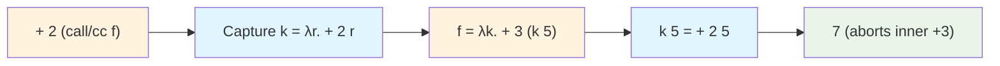

# Module 10: Control, Effects, and Real Languages

This module delves into advanced extensions of the λ-calculus that introduce mechanisms for non-local control flow, handling side effects (such as mutable state or input/output operations), and their practical incorporation into real-world programming languages and tools. To ensure this is self-contained, let's recap the basics: The core λ-calculus from Modules 1–4 is a pure functional system where terms are built from variables (x), abstractions (λx.t, which create functions), and applications (t u, which apply functions to arguments), with computation defined by β-reduction ((λx.t) u → t[u/x], substituting u for x in t) and optional η-reduction (λx.t x → t if x not free in t). This purity means no built-in way to jump out of computations, modify global state, or interact with the external world—limitations that control operators, continuations, and effects address. These features extend the typed systems from Modules 5–8 (e.g., STLC for basic safety, System F for polymorphism) while preserving denotational semantics (Module 9) for mathematical reasoning. We cover control operators like call-with-current-continuation (call/cc) to capture and manipulate the "rest of the computation," continuation-passing style (CPS) transformations to make control flow explicit and optimize programs, the λμ-calculus to connect λ with classical logic (allowing non-constructive proofs like excluded middle, unlike the intuitionistic logic of standard λ), monads and algebraic effects to model side effects in a pure, composable way, and overviews of λ as the semantic foundation for languages (e.g., Haskell's Core language) and tools (e.g., Coq's proof kernel). Motivations include supporting exception handling (to abort and recover from errors), compiler optimizations (e.g., eliminating recursion via tail calls), and safe impurity in functional programming (e.g., sequencing I/O without mutable globals). For grade-level understanding, analogies include: call/cc as a "save point" in a video game where you can jump back with new values; monads as "assembly lines" that package effects with values. We progress through five core sections, each motivated by a computational challenge (e.g., non-locality or impurity), with formal definitions of syntax and semantics, step-by-step examples including reductions, detailed proof sketches using induction or semantic equivalence, discussions of tradeoffs (e.g., power vs. complexity), common pitfalls, visualizations, tables, Python representations, and exercises. By deriving these extensions and verifying their properties, you'll appreciate how λ-calculus evolves into a versatile tool for practical computing. Mastery of Modules 1–9 is assumed, but each core includes recaps (e.g., β-reduction basics).

## Core 10.1: Control Operators

The pure λ-calculus evaluates expressions in a strictly local manner: When you apply a function (t u), it substitutes u into t's body and continues sequentially. There's no built-in way to "escape" early from a deep nested call or save the state to resume later—features common in imperative languages via goto, break, or exceptions. Control operators fill this gap by making **continuations**—the sequence of pending operations after evaluating an expression—first-class values that can be captured, stored, and invoked. This enables sophisticated patterns like exception handling (jump to a catcher), coroutines (yield control and resume), or backtracking in search algorithms. The quintessential operator is **call-with-current-continuation** (call/cc), which grabs the current continuation and passes it to a user function, allowing arbitrary jumps.

### Continuations and the call/cc Operator

A **continuation** k is a function representing "what happens next": Given the result r of the current subcomputation, k(r) computes the overall result. Formally, in big-step semantics (Module 4 recap: t ⇓ v means t evaluates to value v), k is λr. (rest of program with r plugged in). In small-step, using evaluation contexts E[·] (holes in terms like [] u or v []), k = λr. E[r].

The **call/cc** operator syntax is call/cc f, where f is a function expecting a continuation. Its type in an STLC extension (Module 5) is ((A → B) → A) → A, where A is the expected result type, and B is arbitrary (often a "throwaway" type like unit for aborts). Semantics: When reducing call/cc f, capture the current continuation k (of type A → final result type), then evaluate f k. If f invokes k on v, it "jumps" by replacing the entire call/cc expression with v and applying the captured context.

Reduction rule (extending β from Module 2): If the current context is E[·], then E[call/cc f] → f (λx. E[x]), where x is fresh.

Detailed example: Consider the term (+ 2 (call/cc (λ k. (+ 3 (k 5))))).
- The overall context when reaching call/cc is (+ 2 []).
- So k = λ r. (+ 2 r).
- Then f = λ k. (+ 3 (k 5)), applied to k → (+ 3 (k 5)).
- Now evaluate (k 5) = (+ 2 5) = 7.
- The +3 is aborted because invoking k jumps back to the call/cc site, plugging 5 into the outer context.

Step-by-step reduction trace:
1. Start: + 2 (call/cc λk. + 3 (k 5))
2. Capture k = λr. + 2 r
3. Apply λk. + 3 (k 5) to k → + 3 (k 5)
4. Evaluate k 5: Substitute 5 into λr. + 2 r → + 2 5 = 7
5. The entire expression reduces to 7, discarding the inner +3.

This shows call/cc can abort parts of the computation.

**Lemma**: call/cc satisfies the identity law: call/cc (λk. k v) ≡ v.

*Proof Sketch by Direct Reduction*: call/cc (λk. k v) captures k_outer, applies λk. k v to k_outer → k_outer v, which plugs v back into the original context, equivalent to directly evaluating to v (no change).

**Lemma**: call/cc can simulate an abort operator: Define abort x = call/cc (λk. x).

*Proof Sketch*: abort e captures k but discards it (λk. x returns x without using k), so the call/cc site is replaced with e, aborting the surrounding context.

Tradeoffs: call/cc is extremely powerful (can simulate any control structure) but can make code hard to reason about (non-local jumps break modularity) and challenging to type (requires continuation types or effects). In practice, it's undelimited (captures the whole program), which can lead to unexpected behavior; delimited variants like shift/reset (capture only up to a reset boundary) are safer for modular code.

Common Pitfall: Invoking a continuation multiple times (e.g., store k and call k v1 then k v2) can "rewind" and re-execute code, potentially duplicating side effects if not pure.

Diagram for call/cc flow in the example:


| Operator | Type in Typed Extension | Operational Behavior | Practical Application Example |
|----------|-------------------------|----------------------|-------------------------------|
| call/cc | ((A → B) → A) → A | Captures full current continuation k and applies f k | Implementing exceptions: call/cc (λk. if error then k default else compute) to jump out on error |
| shift/reset | Delimited forms, e.g., shift: ((A → B) → C) → A | Captures partial continuation up to reset delimiter | Generators/coroutines: reset { yield = shift (λk. ...) } to suspend and resume computation |

### λ Encodings and Extensions for Control

In pure λ-calculus, call/cc cannot be encoded without extensions because it requires accessing the global evaluation state (the implicit stack). However, CPS transformations (Core 10.2) simulate it by making all continuations explicit. Full native support requires calculi like λμ (Core 10.3) or language builtins.

### Representation in Programming

In Python, continuations are not native, but generators provide delimited continuations (similar to shift/reset):

```python
def generator_example():
    print("Start")
    x = yield 1  # Yield like shift, send back to caller
    print(f"Resumed with {x}")
    yield 2

gen = generator_example()
print(next(gen))  # Start, yields 1
print(gen.send("hello"))  # Resumed with hello, yields 2
```

This code demonstrates suspending (yield) and resuming (send), approximating delimited control.

For full call/cc simulation, advanced libraries like PyContinuation can be used, but they're non-standard.

### Exercises
1. Use call/cc to simulate a simple try-catch: Write a term where "throw" jumps to a "catch" handler with a default value.
2. Prove that call/cc (λk. k (k v)) applies the continuation twice; explain the resulting computation in the example from above.

## Core 10.2: CPS Translations

Continuation-passing style (CPS) is a program transformation technique that converts direct-style code (where functions return values normally) into a form where every function takes an extra continuation argument k and "passes" its result to k instead of returning it. This makes the control flow explicit as data, eliminating the need for an implicit call stack and enabling optimizations like tail-call elimination (recursive calls become simple jumps). CPS is particularly useful for compilers, as it simplifies analysis of control and effects, and it can simulate advanced features like call/cc. This core defines CPS translations for call-by-value (CBV) and call-by-name (CBN) strategies (recap Module 4: CBV evaluates arguments to values before substitution, CBN substitutes unevaluated), provides detailed examples with reduction traces, and proves correctness via simulation and equivalence theorems.

### Defining CPS Translation

The CPS translation [[t]] recursively rewrites term t into CPS form, targeting an extended λ-calculus with let-bindings or pairs for administrative steps (to avoid excessive λ-nesting).

For **CBV** (arguments evaluated to values before application):
- [[x]] = λk. k x  (pass variable to k)
- [[λx.t]] = λk. k (λx c. [[t]] c)  (abstractions become closures that take their own continuation c)
- [[t u]] = [[t]] (λf. [[u]] (λv. f v k))  (first get function f, then evaluate arg v, then apply f to v and pass to k)

For **CBN** (arguments substituted as thunks, evaluated on demand):
- [[x]] = λk. k x
- [[λx.t]] = λk. k (λx. [[t]])  (no inner cont, args unevaluated)
- [[t u]] = [[t]] (λf. f [[u]] k)  (pass unevaluated [[u]] directly)

The target language often includes administrative λs or lets to flatten (e.g., let x = e in body). The translation preserves types if source typed (e.g., in STLC, CPS types involve cont types like (A → R) → R, where R answer type).

Detailed example for CBV: Consider t = (λx.x) y.
- [[y]] = λk. k y
- [[λx.x]] = λk. k (λx c. c x)
- [[t]] = [[λx.x]] (λf. [[y]] (λv. f v k)) = λk. [λk'. k' (λx c. c x)] (λf. λk''. k'' y (λv. f v k))

Reduction: This unfolds to k y, simulating the β-step (λx.x) y → y.

Trace for simplification (admin reds):
1. Apply outer λk. ...
2. Inner applications reduce to passing y to k.

For CBN: Similar but [[y]] passed uneval.

### Correctness of CPS

Correctness ensures CPS preserves original behavior: Reductions simulate, evaluations equivalent.

**Theorem (Simulation)**: If t → u in direct style, then [[t]] →* [[u]] in CPS (possibly with administrative β/η reductions).

*Proof Sketch by Structural Induction on t → u*:
- Base (β-rule): t = (λx.body) v → body[v/x]. CPS [[t]] = [[λx.body]] (λf. [[v]] (λw. f w k)) → (λx c. [[body]] c) v k (unfold closure) → [[body]][v/x] k by substitution lemma (Module 5).
- Congruence cases (steps in subterms): IH on subreduction, CPS contexts (λs) preserve steps.

**Theorem (Equivalence)**: t evaluates to v (t ⇓ v) iff [[t]] id ⇓ [[v]] (with initial continuation id = λx.x).

*Proof Sketch by Induction on Evaluation Derivation*: For abstractions, CPS wraps in closure; applications unfold to match; overall, CPS simulates the call stack via explicit λ-arguments, with each direct step corresponding to β in CPS.

Tradeoffs: CPS exposes all control (good for analysis), but increases code size (η-expansions) and can obscure original structure; useful in compilers for eliminating recursion.

Common Pitfall: Administrative reductions (extra β/η from lets/λs) are needed for exact equivalence; without, terms may differ up to η.

| Strategy | Key Difference in Translation | Correctness Property | Practical Application |
|----------|-------------------------------|----------------------|-----------------------|
| CBV | Evaluate arguments to values before passing | Simulates strict evaluation order | Precise effect sequencing (e.g., print before next) |
| CBN | Pass arguments as unevaluated thunks | Simulates lazy evaluation | Optimizes by avoiding unused computations |

### Representation in Programming

In Python, manual CPS transformation for a simple function:

```python
# Direct style
def direct_add(x, y):
    return x + y

# CPS version
def cps_add(x, y, k):
    return k(x + y)  # Pass to cont k

# Example usage
def example(k):
    return cps_add(1, 2, lambda r: k(r * 3))  # Chain

example(print)  # 9
```

This shows sequencing via k; for full programs, transform recursively.

### Exercises
1. Write CPS for an if-then-else construct: cps_if cond then_branch else_branch k, handling branches.
2. Prove simulation for a CBV application step: Detail the CPS reductions for (λx.t) u → t[u/x] assuming u value.

## Core 10.3: λμ-Calculus and the Link to Classical versus Intuitionistic Logic

The λμ-calculus (introduced by Parigot in 1992) extends the λ-calculus with named continuations via μ-bindings, enabling the encoding of classical logic principles like the law of excluded middle (A ∨ ¬A), which are not provable in the standard λ-calculus corresponding to intuitionistic (constructive) logic. This core details λμ's syntax, reductions, and its logical connections.

### Syntax and Reduction in λμ

λμ distinguishes **terms** (computations producing values) from **commands** (interactions with continuations).

Syntax:
- Terms t ::= x | λx.t | t t | μ α.c  (μ binds α in c, capturing continuation)
- Commands c ::= [α] t  (send t to named continuation α)

Typing: Extend STLC with co-types for continuations (duals, e.g., ¬A for cont expecting A). μ α : ¬A . c types if c : ⊥ (false, absurd), but focus on untyped for control.

Reduction rules (extend β):
- β: (λx.t) u → t[u/x] (standard)
- μ-capture: (μ α.c) u → μ α. c[u / [α] · ] (pass arg to command; · hole)
- rename: [β] (μ α.c) → μ γ. [β] (c[γ/α]) (fresh γ, rename bound)
- [α] t → t if α not used (simplification)

Operational intuition: μ α.c "let α be the current continuation in c"; [β] t "throw t to β".

Example: call/cc sim μ α.[α] (λ k. t), where k = λ x. μ _. [α] x (abort and send x to α).

### Link to Logic

Under Curry-Howard (Module 6 recap: types as propositions, terms as proofs), standard λ corresponds to intuitionistic logic, where implications (→) are constructive (to prove A → B, assume A and construct B; no law of excluded middle A ∨ ¬A without constructing which).

Classical logic allows non-constructive proofs (e.g., proof by contradiction using ¬¬A → A).

λμ adds classical power via μ, which realizes control operators like call/cc, enabling encodings of classical axioms.

**Theorem**: λμ embeds classical propositional logic.

*Proof Sketch by Induction on Formulas*: Translate classical sequents (A1, ..., An ⊢ B) to λμ terms/commands. Implications to λ, disjunctions/negations to μ/[·]. Specifically, Peirce's law (((A → B) → A) → A) encodes via μ capturing the "assume falsity" in proof by contradiction. Double negation elimination ¬¬A → A translates to a μ-term that aborts the negation context.

Tradeoffs: λμ more expressive for logic (full classical theorems) and control (delimited continuations), but reductions more complex (naming/renaming), typing requires duals/co-types.

Pitfall: In dependent types (Module 8), classical axioms can lead to inconsistencies (non-terminating proofs), so assistants like Coq stay intuitionistic.

| Calculus | Corresponding Logic | Key Feature | Example Formula/Theorem |
|----------|---------------------|-------------|------------------------|
| λ | Intuitionistic (Constructive) | Proofs must build evidence | A → B → A (always true, constructive) |
| λμ | Classical | Allows proof by contradiction | ((A → B) → A) → A (Peirce's law, non-constructive) |

### Exercises
1. Write a λμ term encoding the double negation elimination ¬¬A → A.
2. Reduce a simple λμ example simulating call/cc: μ α.[α] (λ k. k 5 + 3).

## Core 10.4: Monads and Algebraic Effects in λ-Calculus

Side effects like mutable state or I/O violate λ-calculus purity (same input always same output, no external change), but are essential for practical programs. Monads (Moggi 1989) encapsulate effects in typed pure way, allowing sequenced "impure" computations without global mutation. Algebraic effects (Plotkin-Power 2002) generalize with explicit operations and handlers for modular, composable effects. This core details both, with examples and properties.

### Monads in Typed λ

A **monad** is type constructor M : * → * (Module 8 higher kinds) with:
- return : A → M A (inject pure value into monad)
- bind (>>=) : M A → (A → M B) → M B (sequence, extract from first, apply func produce second)

Laws (ensuring category-like):
1. return a >>= f = f a (left unit)
2. m >>= return = m (right unit)
3. (m >>= f) >>= g = m >>= (λx. f x >>= g) (associativity)

In do-notation (sugar): do {x <- m; e} = m >>= λx. [[e]]

Example **State monad** for mutable state S:
- M A = S → A × S (function take state, return value/new state)
- return a = λs. (a, s)
- m >>= f = λs. let (a, s') = m s in f a s'

This "threads" state through computations purely.

Example comp: do {x <- get; put (x+1); return x} = get >>= λx. put (x+1) >>= λ_. return x

Run: Apply initial state, get final value/state.

**Lemma**: State monad satisfies laws.

*Proof Sketch for Associativity*: Left: ((λs. (a,s')) >>= f) >>= g = λs. let (b,s'') = f a s' in g b s''  
Right: λs. let (a,s') = m s in (f a >>= g) s' = same.

### Algebraic Effects

Algebraic effects define effects via operations signatures (e.g., State: get:Unit→S, put:S→Unit).

Syntax extend λ: t ::= ... | op t (cont) (apply op, cont resume)

Handlers: handle {op p k → t; return x → u} in e (intercept op with p params, k resume, or transform returns).

Semantics: Eval e until op, match handler, execute t resume k or propagate outer.

In λ: Encode free monad as trees ops/returns, handlers fold trees.

**Lemma**: Algebraic effects sim monads.

*Proof Sketch*: Monad from effect sig free monad (ops generate, bind compose trees).

Tradeoffs: Monads simple sequence, but compose poorly (stack monad transf); effects modular (handlers compose, multiple effects one term).

Pitfall: Effects require careful handling avoid leaks; monads enforce via types.

| Effect | Monad Definition | Algebraic Ops | Use Case |
|--------|------------------|---------------|----------|
| State | S → A × S | get Unit→S, put S→Unit | Simulate var |
| Except | A + E | raise E→⊥ | Error prop |
| IO | Abstract | print A→Unit, read Unit→String | External interact |

### Representation in Programming

In Python, state monad:

```python
from typing import Callable, Tuple, TypeVar

S = TypeVar('S')
A = TypeVar('A')
B = TypeVar('B')

State = Callable[[S], Tuple[A, S]]

def return_state(a: A) -> State[A, S]:
    return lambda s: (a, s)

def bind_state(m: State[A, S], f: Callable[[A], State[B, S]]) -> State[B, S]:
    def bound(s: S) -> Tuple[B, S]:
        a, s_prime = m(s)
        return f(a)(s_prime)
    return bound

# Get
def get() -> State[S, S]:
    return lambda s: (s, s)

# Put
def put(new_s: S) -> State[None, S]:
    return lambda _: (None, new_s)

# Example: Inc get
def increment() -> State[int, int]:
    return bind_state(get(), lambda x: bind_state(put(x + 1), lambda _: return_state(x)))

# Run
print(increment()(0))  # (0, 1)
```

This threads state purely.

### Exercises
1. Impl maybe monad Python: A | None; bind propagate None.
2. Prove assoc law state monad detail λ expand.

## Core 10.5: λ-Calculus as the Core of Real Languages and Tools

λ-calculus provides mathematical/logical foundation many langs/tools, offering simple yet powerful model computation. Langs often compile λ-like cores reason/opt; proof assistants use typed/dep λ minimal trusted kernels. This core surveys examples, explain benefits.

### Cores in Languages

Many langs semantic core λ-variant:
- **ML (SML/OCaml)**: Core HM poly (Module 7), extend STLC let/rec/patterns/modules/refs (effects). Compile core opt type check.
- **Haskell**: Core System FC (F + gadts/coherence, Module 8), handle lazy eval/monads (this module). GHC use Core intermediate trans backend.
- **Scheme/Racket**: Core untyped λ + macros, cont (call/cc this module), dynamic types. Impl often CPS (this module) efficient tail/cont.

Compilers: Use λ IR (e.g., CPS/ANF Module 4) static analysis, opt (defunc, inline), before low-level (LLVM/machine).

Example Haskell Core (sim): data List a = Nil | Cons a (List a); map = \f l -> case l of Nil -> Nil | Cons x xs -> Cons (f x) (map f xs)

### Proof Assistant Kernels

Assistants minimize trust kernel—small code verify proofs:
- Coq: Kernel CIC (λΠ dep + ind + universes + Prop impred proofs, Module 8); essentially pure dep λ, external tactics generate terms check kernel.
- Agda: Kernel MLTT (dep + patterns + intensional eq); λ core dep typing.
- Lean: Kernel dep λ + quot (eq classes) + choice axiom classical; small, verifiable.

**Lemma**: λ kernels ensure consistency.

*Proof Sketch Ind Properties*: SN (Module 6) all proofs terminate, no loops prove false; dep + universes (Module 8) stratify avoid self-ref paradox; classical axioms controlled Prop/choice not lead incon (careful design).

Tradeoffs: Small kernel high trust (bugs kernel catastrophic), but slow (external elaborate); λ simplicity aids verification.

| Lang/Tool | λ Core | Key Ext | App |
|-----------|--------|---------|-----|
| ML | Poly typed λ | Modules/refs | General FP |
| Haskell | Fω-like | Lazy/monads | Pure declarative |
| Scheme | Untyped λ | Cont/macros | Teach/script |
| Coq | Dep λ | Ind/tactics | Formal proofs |
| Compiler IR | Typed/untyped λ | Opt passes | Trans codegen |

λ core enables analyzable, extensible systems.

### Exercises
1. Describe diff Haskell Core STLC: Poly, let, gadts.
2. Explain how Coq λ kernel prevents paradoxes dep types.

## Summary and Suggested Exercises

Module covered control (cont/call/cc), CPS (trans/correct), λμ (classical logic), monads/effects (pure impure), λ langs/tools (cores/trust). Extensions make λ versatile practical comp, from exceptions opt proofs.

For grade learning, ref: "Structure Interpretation Programming Langs" Strachey (control/cont); "Compiling Continuations" Appel (CPS); "λμ-Calculus" Parigot; "Notions Computation Monads" Moggi; "Algebraic Effects Handlers" Plotkin/Power; "Types Programming Langs" Pierce (monads).

**Exercises** (Encode; prove; impl):
1. Simulate simple except call/cc term.
2. CPS trans if cond then else k; prove correct sim.
3. Write λμ term encode excluded middle.
4. Impl Python reader monad: Env → A; bind sequence.
5. Compare Scheme untyped core Haskell typed: Adv/disadv.

λ enhanced, ready real-world app.
