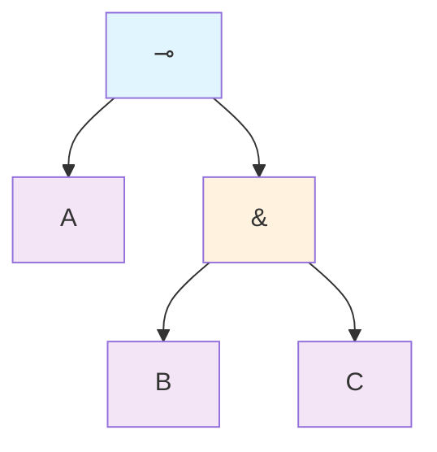

# Module 11: Linear Types and Resource-Aware Extensions

This module introduces linear types, a sophisticated extension to the typed λ-calculi covered in Modules 5–8, designed to enforce precise control over resource usage by requiring that certain variables be used exactly once. Unlike standard types, which allow unrestricted duplication or discarding of values (e.g., using a variable multiple times in a function body), linear types model non-duplicable or non-discardable resources, such as file handles (which must be closed exactly once to avoid leaks), unique pointers in systems programming, or qubits in quantum computing (where cloning is physically impossible due to the no-cloning theorem). Building on the polymorphism of System F (Module 7) and effect handling (Module 10), linear types connect to substructural logics (logics without weakening or contraction rules) and enable safe extensions for concurrency, such as session types that guarantee deadlock-free communication protocols. Motivations stem from real-world needs for efficiency in resource-constrained environments (e.g., embedded systems or garbage collection avoidance) and error prevention (e.g., eliminating double-free or use-after-free bugs at compile time). For grade-level understanding, analogies include Rust's ownership and borrowing system, where linear-like rules track resource lifetimes to prevent invalid accesses, or managing limited tickets where each must be used exactly once. We proceed through five core sections, each layering linear features from basic syntax to advanced applications and metatheory. Definitions are motivated by resource safety requirements; concrete examples demonstrate typing linear functions with step-by-step derivations; proofs use structural induction on terms or derivations, often with context splitting. Visualizations via Mermaid depict type flows and context management; tables summarize comparisons like linear vs. affine. By verifying lemmas, deriving encodings, and exploring pitfalls, you will grasp how linearity transforms computation into a resource-aware paradigm. Mastery of Modules 1–10 is assumed, including syntax (Module 1), reduction (Module 2), encodings (Module 3), operational semantics (Module 4), typing (Modules 5–8), and effects (Module 10); each core is self-contained with recaps (e.g., typing judgements from Module 5).

## Core 11.1: Syntax of Linear λ-Calculus

Linear λ-calculus modifies the standard typed λ to track resource usage through type annotations, distinguishing linear types (used exactly once) from unrestricted ones. This prevents operations that duplicate or discard linear resources, ensuring safety for scenarios like memory management or quantum bits. The syntax extends STLC (Module 5) with linear arrows and exponentials.

### Extended Syntax

Types in linear λ include base types, linear arrows, and exponentials:
$$
A ::= B \mid A \multimap A \mid !A
$$
- $B \in \mathcal{B}$: Base types (e.g., Int, Bool), as in STLC.
- $A \multimap B$: Linear implication (arrow), for functions that consume the input exactly once (no duplication or discard).
- $!A$: Exponential (bang), marking types that can be duplicated or discarded freely (unrestricted).

The ! modality allows recovering classical (unrestricted) behavior for non-linear resources. Free and bound variables follow STLC, but linearity is enforced in typing (Core 11.2).

Terms remain similar to STLC: t ::= x | λx.t | t t, but with let !x = t in u for destructing !A (to use unrestricted). This let binds x : A from !t, allowing multiple uses of x.

Reduction extends β: (λx.t) u → t[u/x], but only if u linear or ! (typing ensures). For !: let !x = !v in t → t[v/x].

α-equivalence as before.

Example: Linear function close : Handle ⊸ Unit (consumes handle once); cannot duplicate.

To visualize a linear type structure like A ⊸ (B & C) (where & is linear product, Core 11.3):


This diagram shows a linear function producing a linear pair, where the output components must each be used once.

Pitfall: Without !, pure linear λ cannot express duplication (e.g., no term of type A ⊸ A ⊗ A, where ⊗ is linear product, as it would duplicate A).

### Terms and Binders

In full linear λ, include linear products ⊗ and additives & for pairs, but core focuses on arrows. Binders like λx.t require x linear unless !A. Syntax ensures no implicit copy/discard—enforced by typing.

### Representation in Programming

In Python, simulate linear types via classes that enforce single use (runtime check, not static):

```python
class LinearResource:
    def __init__(self, value):
        self.value = value
        self.used = False

    def use(self):
        if self.used:
            raise ValueError("Linear resource already used")
        self.used = True
        return self.value

# Linear function
def linear_func(res: LinearResource) -> int:
    return res.use() * 2  # Consume once

res = LinearResource(5)
print(linear_func(res))  # 10
# linear_func(res)  # Error: already used
```

This runtime approximates linear enforcement.

### Exercises
1. Define a linear type for a function that takes two linear resources and returns their "sum" without duplicating.
2. Show why a term like λx. <x, x> cannot have a linear type A ⊸ A ⊗ A.

## Core 11.2: Typing Rules for Linearity

Linear typing uses split contexts to track linear/unrestricted resources separately, forbidding weakening (discard) and contraction (duplicate) on linear parts. This ensures exact-once use.

### Contexts and Judgements

Contexts split: Γ = Δ ; Λ (unrestricted Δ, linear Λ).

Judgement: Δ ; Λ ⊢ t : A.

Unrestricted Δ allows weaken/contract; linear Λ not.

### Typing Rules

Rules with context splitting (for app, e.g., split Λ = Λ1 + Λ2 disjoint union).

- **Var-Unrestricted**: Δ, x:A ; Λ ⊢ x : A (unlimited copy).
- **Var-Linear**: Δ ; x:A ⊢ x : A (consume once).
- **Abs-Linear**: Δ ; Λ, x:A ⊢ t : B ⇒ Δ ; Λ ⊢ λx.t : A ⊸ B (linear input).
- **Abs-Unrestricted**: Δ, x:A ; Λ ⊢ t : B ⇒ Δ ; Λ ⊢ λx.t : A → B (classical arrow, if added; often !A → B).
- **App**: Δ1 ; Λ1 ⊢ t : A ⊸ B, Δ2 ; Λ2 ⊢ u : A ⇒ Δ1 ∪ Δ2 ; Λ1 + Λ2 ⊢ t u : B (split contexts).
- **!-Intro**: Δ ; ∅ ⊢ t : A ⇒ Δ ; Λ ⊢ !t : !A (promote empty linear to unrestricted).
- **Let-!**: Δ ; Λ1 ⊢ t : !A, Δ, x:A ; Λ2 ⊢ u : B ⇒ Δ ; Λ1 + Λ2 ⊢ let !x = t in u : B (destruct !, x unrestricted).

No linear weaken: Cannot add unused linear var.

No linear contract: Cannot use linear var twice.

**Lemma**: Linear typing prevents duplication: No term ⊢ t : A ⊸ A ⊗ A.

*Proof Sketch*: Suppose derivation. By inversion T-Abs, body uses x once, but ⊗ requires two copies—context split cannot duplicate linear x.

Affine variant: Allow weaken linear (discard ok), but no contract—used at most once.

### Examples

Example: Linear close file: open : Unit ⊸ Handle ⊗ Cont, close : Handle ⊸ Unit.

Use: let <h, c> = open () in let _ = use h in close h (linear h used once).

Derivation sketch: open types Unit ⊸ Handle ⊗ Cont; let split linear context.

| Rule | Feature | Example | Notes |
|------|---------|---------|-------|
| Abs ⊸ | Consume input once | λx. close x : Handle ⊸ Unit | No reuse x |
| !-Intro | Promote to duplicable | ! (const 5) : !Int | Copy !t |
| App | Split linear context | f g where f linear func | Contexts disjoint |

Rules ensure resource linearity.

Pitfall: Forgetting split—app requires partitioning linear resources between func/arg.

### Representation in Programming

In Python, runtime linear simulation classes:

```python
class Linear:
    def __init__(self, value):
        self.value = value
        self.used = False

    def consume(self):
        if self.used:
            raise ValueError("Linear used")
        self.used = True
        return self.value

def linear_abs(x: Linear) -> int:
    return x.consume() + 1  # Consume once

lin = Linear(10)
print(linear_abs(lin))  # 11
# linear_abs(lin)  # Error
```

Approximates.

### Exercises
1. Derive typing linear pair destruct: let <x,y> = p in x + y : (Int ⊗ Int) ⊸ Int.
2. Show contract fails: No type A ⊸ A ⊗ A.

## Core 11.3: Semantics and Properties

Linear λ semantics similar STLC, but linearity affects red (no copy). Affine allows discard (weaken), strict no.

### Affine vs Strict

**Affine linear**: Weaken linear (discard unused), contract no (no duplicate). Used at most once.

**Strict linear**: No weaken/contract, exactly once.

Affine common prog (Rust allow drop unused), strict quantum (measure/consume qubit exactly).

Semantics: In * categories (star-autonomous, model linear logic), ! exponential affine discard/dupe.

**Lemma**: Affine typing allows optional use: If ⊢ t : A ⊸ B, can embed weaken A unused.

*Proof*: Weaken rule adds unused linear var.

### Connections to Quantum

Linear types model quantum computing: Qubits linear (no-clone theorem—no copy quantum state). Type Qubit ⊸ Qubit for gates, prevent clone.

Example: Bell state entangle two qubits linear ⊗.

**Lemma**: Linear prevents cloning: No term ⊢ Qubit ⊸ Qubit ⊗ Qubit.

*Proof*: Similar duplication lemma—split cannot copy linear.

Properties: Linear STLC SN (like STLC Module 6), since no recursion pure linear (linear logic consistent).

### Representation in Programming

In Python, affine simulation (allow discard):

```python
class Affine:
    def __init__(self, value):
        self.value = value
        self.used = False

    def __del__(self):
        if not self.used:
            print("Affine discarded")  # Allow discard

    def consume(self):
        if self.used:
            raise ValueError("Used")
        self.used = True
        return self.value

aff = Affine(10)
del aff  # Discarded
```

### Exercises
1. Compare affine/strict: Example term types affine not strict.
2. Encode quantum not gate: Qubit ⊸ Qubit.

## Core 11.4: Encodings and Applications

Linear types enable safe encodings resources, like linear lists (no share elements), sessions protocols.

### Session Types

Session types linear types channels: Describe protocols seq send/recv/close.

Syntax: !A.S (send A, continue S), ?A.S (recv A, continue), end (close).

Linear ensure dual (send match recv), no deadlock (use once).

Example: Echo server ?String. !String. end (recv, send back, close).

Client dual !String. ?String. end.

**Lemma**: Session-typed processes deadlock-free.

*Proof Sketch*: Linear use ensure progress (no stuck channel), duality match send/recv.

Applications: Safe distrib sys (e.g., Go channels types, Rust sessions).

### Exercises
1. Encode linear cons: A ⊸ List A ⊸ List A.
2. Define session calc server: ?Op. ?Int. ?Int. !Int. end.

## Core 11.5: Metatheory

Linear STLC metatheory similar STLC: Progress, preservation, SN.

### Normalization

**Theorem**: Linear typed terms SN.

*Proof Sketch Reducibility Candidates*: Extend Module 6 RED sets linear—RED_{A⊸B} t use input linearly. Ind show typed RED, hence SN.

Equiv linear logic CH: ⊸ linear impl, ! exponential dupe/discard.

Affine weaker (discard allow cycles? No, still SN).

Tradeoffs: Linear restrict express (no reuse), but safe resources.

| Property | Linear | Affine | Classical | Notes |
|----------|--------|--------|-----------|-------|
| Weaken | No | Yes | Yes | Discard |
| Contract | No | No | Yes | Duplicate |
| CH Logic | Linear | Affine | Intuitionistic | Substructural |

Metatheory guarantees resource-safe computation.

### Exercises
1. Prove progress linear CBV: No stuck well-typed.
2. Explain linear logic ! role recover classical.

## Summary and Suggested Exercises

Module introduced linear types: Syntax enforce once, typing split contexts, semantics properties, apps sessions/quantum, metatheory safe. Linearity resource-aware comp.

**Exercises** (Type; prove; encode):
1. Type linear swap λp. let <x,y>=p in <y,x> : (A⊗B)⊸(B⊗A).
2. Show no duplicator: Cannot type A⊸A⊗A.
3. Encode linear stack push/pop types.
4. Define session echo server/client dual.
5. Prove progress linear term example.

Linearity mastered, ready advanced apps.
