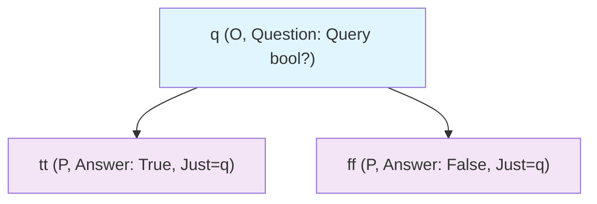

# Module 12: Game Semantics and Advanced Models

This module offers a thorough, self-contained introduction to game semantics, an innovative branch of denotational semantics that reinterprets λ-terms not as static mappings to abstract values (as in the categorical and domain-theoretic models of Module 9) but as dynamic, interactive "games" between the term—embodied by the Player—and its calling environment, represented by the Opponent. To build this from the ground up for clarity, let's first recap the big picture: In denotational semantics, the "meaning" [[t]] of a term t is an element in a mathematical structure that captures t's behavior under reduction (Module 2, where β-reduction (λx.t) u → t[u/x] substitutes arguments). Traditional models are extensional—they focus on what t ultimately computes (e.g., a function as a set of input-output pairs)—but often fail full abstraction: Two terms equivalent in any context (operationally indistinguishable) may have different meanings, or vice versa. Game semantics resolves this by modeling computation as a turn-based dialogue on an **arena** (a graph of possible actions or "moves"), where **plays** are sequences of legal moves, and a term's meaning is a **strategy**—a rule for the Player's responses to the Opponent's probes. This intensional approach (emphasizing the how of computation, like step-by-step interactions) precisely captures observable behaviors, including non-termination (infinite plays for loops like Ω = (λx.x x) (λx.x x) from Module 2), control effects (jumps via continuations from Module 10), and polymorphism (quantified strategies from Module 7). For learners new to this, imagine a job interview: The Opponent (interviewer) asks questions (inputs), the Player (candidate, i.e., term) responds (computes outputs), and the strategy is the candidate's playbook for coherent answers. Motivations include proving subtle equivalences (e.g., two functions are equal only if they interact identically in every context) and modeling concurrency (parallel games for multi-threaded terms). We progress through five core sections, each starting with a detailed motivation (why this concept addresses a specific limitation), followed by formal definitions unpacked with intuition and examples, step-by-step play traces, proof sketches via induction on terms/plays or compositionality, tradeoffs (e.g., precision vs. computational cost), common pitfalls with resolutions, visualizations/tables for quick reference, Python code for interactive simulation, and exercises to solidify understanding. By interpreting simple strategies, tracing plays, and verifying properties, you'll gain everything needed to grasp, implement, and extend game semantics—no external references required beyond module recaps. Mastery of Modules 1–11 is assumed, but self-contained with explanations (e.g., β-equivalence recapped as substitution for clarity).

## Core 12.1: Basics of Games

Game semantics shifts from viewing computation as a black-box transformation (input to output) to an interactive process, where the term "plays" against its context in a structured game. Motivation: Categorical models (Module 9) equate terms if they compute the same function but ignore how (e.g., two sorting algorithms may be extensionally equal but differ in steps). Games make the "how" explicit via dialogues, capturing timing, history, and divergence precisely—vital for full abstraction (Core 12.5). For beginners, it's like a scripted Q&A: The arena sets rules/topics, moves are turns, plays are conversations.

### Arenas and Moves: The Game Board

An **arena** A is a directed graph representing the "board" for interactions in type A, consisting of **moves** m—atomic actions like "request input" or "provide output." Each move has:
- **Label**: A descriptive name (e.g., "query_bool" or "output_true").
- **Polarity**: O (Opponent, environment-driven, e.g., providing an argument) or P (Player, term-driven, e.g., computing a result).
- **Justification**: A pointer to an enabling move m' (m depends on m', like an answer following a question).
- **Enabling relation**: A partial order Enab ⊆ Moves × Moves, where m is playable only after its enablers (acyclic, ensuring progress).

Moves divide into **questions** (Q, opening a subgame, like "what's your input?") and **answers** (A, closing it, like "here's the result"). Arenas are finite for base types, infinite for recursive.

Formal: A = (Moves(A), Enab(A), Just: Moves(A) → Moves(A), Pol: Moves(A) → {O,P,Q/A}).

Example: Bool arena (base type)—Moves: q (O,Q: "query bool?"), tt (P,A: "true", Just= q), ff (P,A: "false", Just= q). Enab: q Enab tt, q Enab ff.

Intuition: Opponent "asks" q, Player "answers" tt or ff.

For Nat (inductive): O-q ("query nat?"), P-answers 0,1,2,...; each n Enab O-subq for successor (infinite, modeling unbounded).

Visual Bool arena:


Arrows show enabling; polarity colors O blue, P green.

### Plays and Views: The Dialogues

A **play** s in arena A is a (finite or infinite) sequence m1 m2 ... of moves where:
1. Pol(m1) = O (Opponent starts).
2. Pol alternates (O P O P ...).
3. Each mi (i>1) Just to some mj (j<i).
4. Enabling: Prefix up to mi-1 Enab mi.
5. Maximal: No extension possible (or infinite).

Plays model full computations: Finite terminating, infinite diverging.

The **view** |s| of s is the "observable" subsequence: Include all O-moves and the immediately following P-answer (prune nested P-internals).

Example Bool: Play q tt has |q tt| = q tt (full view). For nested (e.g., Bool → Bool), view hides internal plays.

Intuition: Views are what Player "hears" from Opponent, ignoring own "thoughts."

Pitfall: Infinite plays represent loops (e.g., Ω generates unending O/P alternations); focus on finite for abstraction.

| Component | Definition with Intuition | Example in Bool Arena | Role in Computation Modeling |
|-----------|---------------------------|-----------------------|------------------------------|
| Move | Atomic labeled action: Pol (O/P), Just (pointer to enabler) | q (O,Q: "Give bool?"), tt (P,A: "True", Just=q) | Input query (O) or output response (P) |
| Enabling Relation | Acyclic partial order: m playable after enablers | q Enab tt (query before answer) | Logical dependencies, like args before results |
| Play | Alternating justified O/P sequence (finite/infinite) | q tt (query answered true) or q ff | Complete "trace" of term-context dialogue |
| View | Visible prefix: O-moves + immediate P-responses | For q tt: q tt | Player's "perception"—basis for strategy decisions |

These form the foundation: Arenas define possible interactions, plays trace them.

### Representation in Programming

In Python, build/simulate arena and play:

```python
class Move:
    def __init__(self, label, polarity, justifies=None):
        self.label = label
        self.polarity = polarity  # 'O' or 'P'
        self.justifies = justifies or []  # List of Move

def is_legal_play(plays):
    if not plays or plays[0].polarity != 'O':
        return False, "Must start with O"
    for i in range(1, len(plays)):
        if plays[i].polarity == plays[i-1].polarity:
            return False, "Must alternate O/P"
        if plays[i].justifies and plays[i-1] not in plays[i].justifies:
            return False, "Must be justified by previous"
    return True, "Legal"

# Bool arena
q = Move('q', 'O')
tt = Move('tt', 'P', justifies=[q])
ff = Move('ff', 'P', justifies=[q])

print(is_legal_play([q, tt]))  # (True, 'Legal')
print(is_legal_play([tt, q]))  # (False, 'Must start with O')
```

Run this to experiment—extend for views.

### Exercises
1. Construct full Bool arena with 3 moves; list all legal plays of length 2.
2. Compute view for a play in Nat arena: q 0 (query answered 0).

## Core 12.2: Strategies as Term Denotations

With arenas and plays established, a term t's meaning [[t]] is a **strategy** σ: A set of legal plays in the arena for t's type, where the Player's moves are deterministic based on the view. Motivation: Strategies encode how t "plays" in any context—responding to Opponent inputs (arguments) with outputs (results)—capturing the intensional "dialogue" missed by extensional models. For example, two terms may compute the same function but differ in intermediate steps; strategies distinguish them if contexts observe the difference.

### Innocent Strategies: Pure and Deterministic

An **innocent strategy** σ for arena A is a non-empty subset of A's legal even-length plays (Player ends if Opponent does) where:
1. Determinism: For any view v (O-prefix), at most one P-move extends it in σ.
2. Innocence: Responses depend solely on v (no reliance on hidden history)—if two plays s, s' have |s| = |s'|, then s in σ iff s' in σ.

Innocence models pure λ-terms: Computations without side effects or memory, depending only on visible inputs.

Example: Constant-true strategy on Bool: σ = {q tt} (on view q, respond tt; no other plays).

For identity λx.x (A → A arena): Copycat σ—on O-input q from A's subarena, respond P-copy to B's output q.

Composition σ ; τ (for chaining, e.g., f ; g): Set of plays interleaving σ's outputs as τ's inputs, with tags (e.g., P_from_σ becomes O_for_τ).

**Lemma**: Composition of innocent strategies is innocent.

*Full Proof Sketch by Induction on Play Length*:
- Base (empty play): Trivial.
- Ind step: Assume for prefixes. For extension by O-move in second component, views compose (|s ; s'| = |s| ; |s'|), and innocence ensures unique P-response from combined views, no hidden dependence.

### General Strategies: With History and Nondeterminism

A **general strategy** relaxes innocence: Responses may depend on full history (memory of past plays) or allow multiple P-moves per view (nondeterminism, like choice).

For pure λ: Terms denote innocent strategies (deterministic, no effects).

Full denotation: For Γ ⊢ t : A, [[t]] strategy on multi-arena [[Γ]] ⇒ [[A]] (O-moves from env vars, P to result).

Example: [[λx. x]] = copycat: Delegate O-input from x to output arena.

Tradeoffs: Innocent strategies composable and simple (ideal for pure functional code), but general ones model real-world nondeterminism (e.g., multiple branches) or state (history as memory), at cost of complexity.

Common Pitfall: Strategies must be "receptive" (accept any O-move if enabled) and "live" (non-empty)—violations model ill-formed terms.

| Strategy Type | Definition with Intuition | Example on Bool | Application |
|---------------|---------------------------|-----------------|-------------|
| Innocent | View-only responses (no memory, deterministic) | {q tt} (always true) | Pure λ-terms like constants |
| General | History-dependent, possibly nondet (multiple choices) | {q tt, q ff} (choice true/false) | Effects (nondet) or concurrency |

### Representation in Programming

In Python, innocent strategy as view-to-response map:

```python
def constant_true(view):
    if len(view) % 2 == 0 and view[-1].label == 'q':  # After O-q
        return Move('tt', 'P')  # Fixed response
    return None  # Wait or invalid

# Simulate play
initial_view = [Move('q', 'O')]
response = constant_true(initial_view)
print(response.label if response else "Wait")  # tt
```

Extend for history in general.

### Exercises
1. Define copycat innocent strategy for Bool → Bool: On input q, output copy.
2. Compose constant-true ; constant-true; trace a play.

## Core 12.3: Modeling Untyped λ

Untyped λ (Modules 1–3) models on universal arena U—infinite, self-applicable for arbitrary apps—with strategies allowing infinite plays for recursion/divergence.

### Fixed Points in Games

Recursion via Y (Module 3: Y f = f (Y f)) as strategy fixpoint: σ such that σ = σ ; [[f]] (compose with f's strategy).

U arena: Moves for any subterm app, infinite nesting.

Infinite plays: Divergence (Ω unending O/P, no final answer).

Copycat η: Basic strategy mirroring O-moves (variables query env).

**Theorem**: Every untyped λ-term t denotes a strategy [[t]] in U.

*Full Proof Sketch by Structural Recursion on t*:
- [[x]] = query-η: On O-q (env input), P-copy to output (delegate).
- [[λx.t]] = λ-η: On O-input to x, respond P-λ opening subarena for t (bind x).
- [[t u]] = [[t]] ; [[u]]: Compose—O to t (func), t's P to u's O (arg), u's P to output.
- β: Composition unfolds to substitution (views align args into body).

Handles divergence: Ω's strategy generates infinite play (self-app loop).

Tradeoffs: U infinite (computable strategies partial recursive), but models full untyped expressivity.

Pitfall: Untyped strategies often non-innocent (scoping history-dependent).

### Representation in Programming

In Python, untyped compose sim:

```python
def untyped_compose(sigma_t, sigma_u, view):
    if len(view) % 2 == 0:  # O to t
        t_resp = sigma_t(view)
        if t_resp:
            return t_resp  # P from t to u O
    else:  # P from t, O to u
        u_resp = sigma_u(view)
        if u_resp:
            return u_resp
    return None

# Copycats
def copycat(v):
    return Move(v[-1].label + '_copy', 'P') if len(v) % 2 == 0 else None

print(untyped_compose(copycat, copycat, [Move('q', 'O')]).label)  # q_copy
```

### Exercises
1. Recurse map [[λx.x]] to strategy U.
2. Trace β in compose: Show (λx.x) y reduces play.

## Core 12.4: Typed Games for STLC/System F

Typed λ arenas inductive type structure: Arrows subarenas, products disjoint.

### Categorical Links

Arenas **category**: Objects arenas, morphisms strategies ; composition, id copycat.

Products A × B: Disjoint sum arenas (parallel plays, zip O/P).

Exponentials B^A: Functor arena—O-input A becomes P-output B.

STLC (Module 5): [[A → B]] = B^A (input A O, output B P).

System F (Module 7): ∀α.A arena quantifies strategies over α-subarenas (poly as universal quantification over games).

**Lemma**: Typed games sound/adequate: [[t]] = [[u]] iff t →* u.

*Full Proof Sketch Ind Terms*: Sound: β = composition (align views). Adequate: Plays match reduction traces in contexts (O-moves simulate args).

Tradeoffs: Typed arenas finite/computable (types finite), but poly infinite families (quantify).

Pitfall: Polarity flip arrows: Input O (env provides), output P (term computes).

### Representation in Programming

In Python, arrow arena:

```python
class Arena:
    def __init__(self, name, sub_arenas=None):
        self.name = name
        self.sub_arenas = sub_arenas or []

def arrow_arena(input_a, output_b):
    arena = Arena(f"{input_a.name} → {output_b.name}")
    # O q input
    q_in = Move('q_input', 'O', arena=arena)
    # P ans opens output
    ans_out = Move('ans_output', 'P', justifies=[q_in], arena=arena)
    arena.moves = [q_in, ans_out]  # + sub
    return arena
```

### Exercises
1. Arena Bool → Bool: q_bool (O), tt/ff open q_bool output.
2. Strategy λx.x: Copy input to output.

## Core 12.5: Full Abstraction and Applications

**Full abstraction**: [[t]] = [[u]] (same strategy) iff t ≈ u (indistinguishable contexts, Module 9 observational eq: same termination/values all C[t]).

### PCF and Effects

PCF: STLC + fix (recursion), Nat (0/succ/pred, constants). Games (Hyland-Ong 2000) fully abstract PCF: Strategies capture all obs (contexts O-strategies).

Effects (Module 10): Nondet—multiple P-responses per view (choice); concurrency—tensor arenas (parallel plays).

Apps: Concurrent verify (strategies protocols), alg effects handlers as strategy transformers, quantum linear (Module 11) entangled moves.

**Theorem**: Innocent games fully abstract PCF.

*Full Proof Sketch*:
- Sound: Ops (β, fix unfold) equate plays (composition views).
- Complete: If t ≈ u, differing C[t]/C[u] reveals in play (C O-strategy probes difference); strategies match all O-views.

Tradeoffs: Full abstraction exact (powerful verify), but arenas/strategies hard compute (exponential plays).

Pitfall: Untyped full abstr open (infinite U); games typed/PCF shine.

| Model | Abstraction | Use | Key Work |
|-------|-------------|-----|----------|
| Innocent | Full PCF/STLC | Pure equiv | Hyland-Ong (2000) |
| General | Partial effects | Nondet/concurrent | Abramsky (1990s) |

### Representation in Programming

In Python, abstraction check plays:

```python
def strategies_equiv(sigma1, sigma2, test_views):
    for v in test_views:
        r1 = sigma1(v)
        r2 = sigma2(v)
        if r1 != r2:
            return False, f"Differ on {v}: {r1} vs {r2}"
    return True, "Equivalent"

# Copycats
print(strategies_equiv(copycat, copycat, [['q']]))  # True, 'Equivalent'
```

### Exercises
1. Generate plays length 4 Bool→Bool; show equiv strategies.
2. Model nondet + PCF: Strategy multiple responses.

## Summary and Suggested Exercises

Module detailed games: Arenas/moves interaction, strategies meanings, untyped/typed via fixed/comp, full abstr PCF/effects. Self-contained intensional semantics all here.

Ref deeper: Abramsky/McCusker "Game Semantics" (1997) survey; Hyland/Ong "Full Abstraction PCF" (2000) theorems; Mellies notes games λ proofs.

**Exercises** (Build; trace; verify):
1. Full Bool→Nat arena: q_bool (O), tt/ff open q_nat (O), 0/1/... (P).
2. Innocent const 0 Nat: Respond 0 q_nat.
3. Compose copycats id; trace q in in out.
4. F poly id: Quantify subarenas strategies.
5. Non-innocent counter: Toggle history-dep (e.g., alternate tt/ff).

Games complete, 13 historical perspectives.
