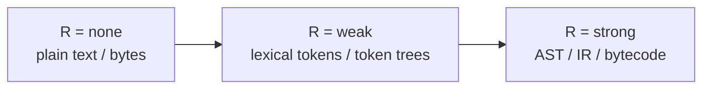
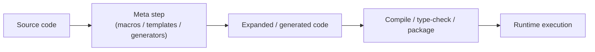
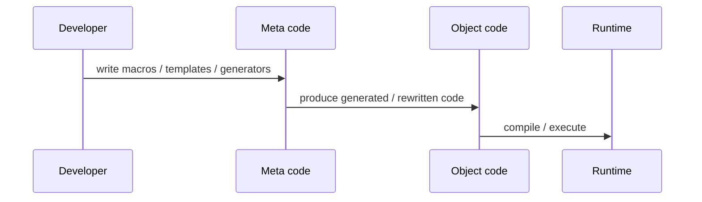
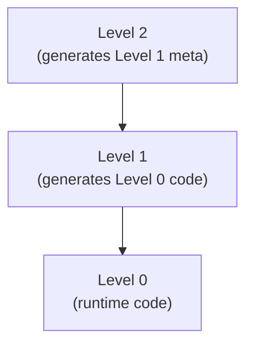
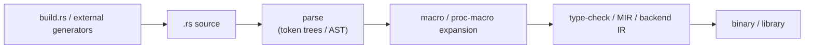
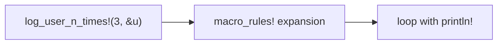
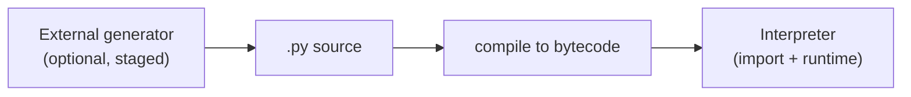
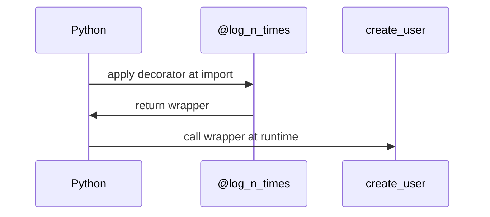
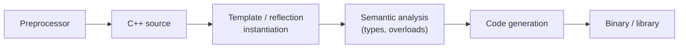
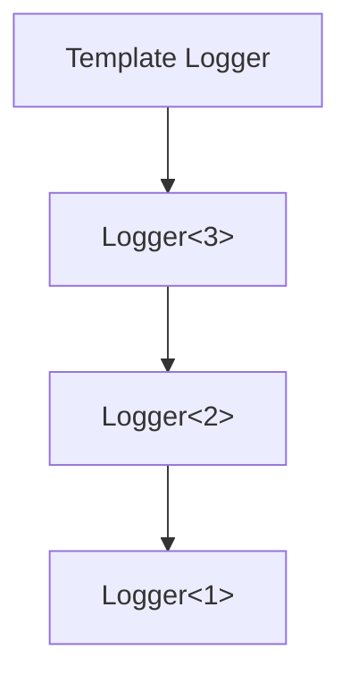

# M01C01 – What Is Metaprogramming? Object vs Meta Language, Meta-Levels

---

## 0. Learning Objectives

After M01C01, you should be able to:

1. Give a **precise, operational definition** of **static metaprogramming** using the **R–T–S triad**:

   * **R – Reification**: treating code as data with a specific degree of structure;
   * **T – Transformation**: generating or rewriting code that ends up in the final program;
   * **S – Staging**: running such transformations in a **pre-runtime phase** enforced by the language or the build pipeline.

2. Distinguish **object language** from **meta language** in **Rust**, **Python**, and **C++**.

3. Explain **meta-levels** (0, 1, 2+) and why deeper stacks of “code that writes code” increase complexity and debugging cost.

4. Apply the **R–T–S diagnostic protocol** to classify mechanisms as:

   * **static metaprogramming** (structured, staged),
   * **textual static metaprogramming** (text/tokens, staged),
   * **dynamic metaprogramming** (runtime/import-time),
   * or **not metaprogramming** (analysis only).

5. Follow any **one language track** (Rust / Python / C++) and still get a coherent, self-contained view of the core ideas.

**Structure**

* §§1–7 – **Language-neutral core**
* §§8–10 – **Language tracks** (Rust, Python, C++)
* §11 – Checkpoint answers
* §12 – Glossary
* §13 – ADR (design choice: 3 languages now, extensible later)

Running scenario:

> A `User` abstraction and different ways to **“log a `User` N times”**.

**Cross-module note**

* This module defines the **R–T–S triad** and the high-level taxonomy.
* **Concrete representations** of code (tokens, CST, AST, IR, bytecode) and how they map to **R = none / weak / strong** are detailed in **M01C02 – Code as Data: Syntax, ASTs, IRs, Semantics**.

---

## 1. Why We Need a Crisp Definition

“Metaprogramming is code that writes code” is:

* **too vague** – it does not distinguish static vs dynamic mechanisms;
* **too coarse** – it treats string-based `eval` and type-safe AST macros as the same;
* **not predictive** – it does not predict when you will get:

  * useless error messages,
  * massive compile-time blow-ups,
  * fragile generated code.

We want a definition that:

* is **language-neutral** (applies to Rust / Python / C++),
* separates **textual** from **structured** metaprogramming,
* integrates with later topics:

  * concrete code representations (M01C02),
  * taxonomy (M01C03),
  * risk tiers (M01C04–M01C05).

We achieve this via the **R–T–S triad**.

---

## 2. The R–T–S Triad

We classify mechanisms along three axes:

* **R – Reification**: how code is represented as data;
* **T – Transformation**: whether code is generated/rewritten;
* **S – Staging**: when the transformation runs.

The **R-scale** is shared with M01C02: `R ∈ {none, weak, strong}`.

### 2.1 R – Reification (Code as Data)

We use a strict three-point scale:

* **R = none**
  Code is treated as opaque bytes or strings. No structural information is exposed.

  * Example: `eval(user_string)` in Python where the string is never parsed or inspected beforehand.
  * Example: a `sed` search/replace on a `.cpp` file.

* **R = weak (lexical / token-level)**
  You see **lexical structure** (tokens, simple placeholders), but not full syntax trees or binding.

  * Example: C/C++ preprocessor macros (token substitution).
  * Example: Rust `macro_rules!` token trees (patternable token sequences, but no explicit names/types or binding).

* **R = strong (syntactic / semantic)**
  You manipulate **syntax trees** or **IR** with clear structure and usually some semantics (binding, types, control flow, bytecode).

  * Example: Rust procedural macros operating on an AST.
  * Example: Python’s `ast` module plus `compile` on `ast.AST` nodes.
  * Example: compiler passes over SSA IR.



This **R scale** is **purely representational**; by itself it says nothing about whether a mechanism is “good” or “safe”. It only describes what structure the meta mechanism can see.
M01C02 explains how tokens, CST, AST, IR, and bytecode correspond to `R = none / weak / strong` in concrete toolchains.

---

### 2.2 T – Transformation (Generating / Rewriting Code)

**T = true** if the mechanism:

* **produces new code** (source, AST/IR, bytecode) that is then compiled or executed; or
* **rewrites existing code** before it becomes part of the final program.

**T = false** if it only:

* **analyses** code (linting, metrics, diagnostics), or
* **executes** existing code without changing the program text/AST.

---

### 2.3 S – Staging (When It Runs)

We say **S = true** if:

1. There is a **distinguished pre-runtime phase** (compile step, macro expansion, code generation step); and
2. The language/toolchain **enforces** that the mechanism runs in that phase (or the build fails).

Examples with **S = true**:

* Rust macro expansion (declarative and procedural macros).
* C++ template instantiation and compile-time reflection.
* External code generators invoked by build tools (e.g. Cargo build scripts, CMake custom commands) where a failure stops the build.

Examples with **S = false**:

* Python decorators and metaclasses that run as ordinary code during import/runtime.
* Python `eval` / `exec` inside request handlers.
* A plugin that modifies ASTs **at runtime** using `ast` + `compile`.



Metaprograms live in the **meta step**. Staging describes whether that step is **enforced before runtime**.

---

### 2.4 Classes of Mechanisms

We combine **R**, **T**, and **S**. The classification is based on both R–T–S values and the *style* of manipulation (text vs structured). We standardise the terminology here; the same wording is used in the glossary and in M01C02.

1. **Static metaprogramming**

   * `T = true` – it generates or rewrites code for the final program;
   * `S = true` – it runs in an enforced pre-runtime phase (compile/macro/build step);
   * `R ≥ weak` – it treats code as structured data (tokens, CST, AST, IR, bytecode);
   * and it uses that structure, not arbitrary text splicing, as its main interface.

   Typical examples:

   * Rust `macro_rules!` macros (token-tree based, but syntax-aware).
   * Rust procedural macros.
   * C++ templates and compile-time reflection that generate code.
   * Build-step AST→source generators integrated into the build.

2. **Textual static metaprogramming**

   * `T = true` – generates or rewrites code;
   * `S = true` – runs in an enforced pre-runtime phase;
   * but operates essentially as **text or simple token splicing**, without a full notion of syntax and binding (effectively `R = none` or barely `R = weak` and not exploiting structure).

   Typical examples:

   * C preprocessor macros used as text/token substitution.
   * `sed`/regex-based code generators wired into the build.

3. **Dynamic metaprogramming**

   * `T = true` – generates or rewrites code;
   * `S = false` – runs at runtime or import-time, with no compiler- or build-enforced staging;
   * `R` can be `none`, `weak`, or `strong`.

   Typical examples:

   * Python decorators and metaclasses (value- and class-level).
   * Python `ast` + `compile` + `exec` at runtime (AST-level).
   * Reflection-based runtime code generation and dynamic loading.

4. **Not metaprogramming** (in this module’s sense)

   * `T = false` – no code generation/rewriting for the final program, regardless of R and S.

   Typical examples:

   * Linters and static analyzers (AST/IR inspection only).
   * Formatting tools that reflow code but are not part of the enforced build pipeline.
   * Ordinary library calls that do not generate new code.

```mermaid
flowchart TD
    start[Mechanism]
    t{Generates or\nrewrites code? (T?)}
    s{Runs in an\nenforced pre-runtime phase? (S?)}
    r{Uses code as\nstructured data? (R ≥ weak?)}
    static["Static meta\n(T, S, R ≥ weak)"]
    text["Textual static meta\n(T, S, text/tokens)"]
    dyn["Dynamic meta\n(T, ¬S)"]
    none["Not meta\n(¬T)"]

    start --> t
    t -- "No" --> none
    t -- "Yes" --> s
    s -- "No" --> dyn
    s -- "Yes" --> r
    r -- "No" --> text
    r -- "Yes" --> static
```

Remarks:

* Whether **R is weak or strong** tells you how much structure your static metaprograms can exploit; both still count as **static metaprogramming** when `T = true` and `S = true`.
* **Textual static metaprogramming** is technically staged, but fragile because it lacks a robust structural view.

---

### 2.5 Quick Classification Table

Using the unified terminology:

| Mechanism                              | R      | T   | S   | Class                                   |
| -------------------------------------- | ------ | --- | --- | --------------------------------------- |
| Rust `macro_rules!`                    | weak   | yes | yes | static metaprogramming                  |
| Rust procedural macro                  | strong | yes | yes | static metaprogramming                  |
| C++ templates                          | strong | yes | yes | static metaprogramming                  |
| C/C++ preprocessor macro               | weak   | yes | yes | textual static metaprogramming          |
| Python decorator                       | none   | yes | no  | dynamic metaprogramming (value-level)   |
| Python `ast` + `compile` + `exec`      | strong | yes | no  | dynamic metaprogramming (AST-level)     |
| External AST→source generator in build | strong | yes | yes | static metaprogramming (pipeline-level) |
| Linter / static analysis               | strong | no  | any | not metaprogramming                     |

---

### Checkpoint 1 – R Only

Assign **R = none / weak / strong**:

1. A tool that parses source into an AST and checks for forbidden APIs.
2. A `sed` script that replaces `FOO` with `BAR` in `.cpp` files.
3. A compiler pass that rewrites a **SSA IR**.
4. A Python decorator that receives a function object and returns a wrapper.

(Answers in §11.)

---

## 3. Object Language vs Meta Language

We always have two roles:

* **Object language**
  The language of the **final program** (after all macros/templates/generators). This is what actually runs.

* **Meta language**
  The language (or sublanguage) used to **define the transformations** that generate or rewrite object-language code.

These can look syntactically identical (Rust macros written in Rust syntax, C++ templates written in C++ syntax), but they occupy **different phases** and have different responsibilities.



Design principles:

1. **One-way direction in production systems**

   * meta code generates object code;
   * object code should rarely (if ever) modify meta code dynamically.

2. **Error locality matters**

   * a bug can be in the generator (meta layer) or in the generated code (object layer);
   * good systems make it clear where failures originate: in the meta language or in the expanded object language.

We will reuse these principles when analysing language-specific mechanisms.

---

## 4. Meta-Levels: How Many Layers?

Meta-levels answer:

> “How many layers of code-that-writes-code are stacked?”

This is **orthogonal** to whether the mechanism is static/dynamic or what its R–T–S values are.

* **Level 0**
  Code that does **not** generate other code; it just runs.

* **Level 1**
  Code that generates **Level-0** code.

  * macros that expand to ordinary functions/loops;
  * templates that instantiate concrete classes/functions;
  * build tools that emit `.rs` / `.py` / `.cpp` files consumed directly by the compiler/interpreter.

* **Level 2**
  Code that generates **Level-1** metaprograms.

  * IDL-to-macro-library generators;
  * tools that write template libraries from schema specifications.

* **Level n**
  Code that generates **Level (n−1)**.



Practical observations:

* Ordinary application logic is **Level 0**.
* Most pragmatic metaprogramming in applications is **Level 1**.
* **Level 2+** is mainly justified in compilers, large frameworks, and code-generation-heavy infrastructure:

  * debugging crosses multiple meta layers;
  * build complexity and error surfaces grow quickly.

---

### Checkpoint 2 – Meta-Level

For each, assign the **meta-level**:

1. A tool that reads an IDL and emits plain `.rs` files (no macros).
2. A macro that expands into regular functions.
3. A tool that reads an IDL and emits a macro library; those macros generate bindings.
4. A Python metaclass that constructs classes at import-time.

(Answers in §11.)

---

## 5. R–T–S Diagnostic Protocol

We can now define a **diagnostic protocol** to classify any mechanism: macros, templates, decorators, build generators, reflection-based codegen, etc.

```mermaid
flowchart TD
    M[Mechanism]
    TQ{T?\nGenerates/rewrites code\nfor final program?}
    SQ{S?\nEnforced pre-runtime phase?}
    RQ{R?\nStructured\nview of code? (R ≥ weak?)}
    NM["Not meta"]
    TXT["Textual static meta"]
    SM["Static meta"]
    DM["Dynamic meta"]

    M --> TQ
    TQ -- "No" --> NM
    TQ -- "Yes" --> SQ
    SQ -- "No" --> DM
    SQ -- "Yes" --> RQ
    RQ -- "No" --> TXT
    RQ -- "Yes" --> SM
```

**Step 1 – T (Transformation)**

> Does it generate or rewrite code that becomes part of the compiled / executed program?

* **No →** not metaprogramming (for this module).
* **Yes →** proceed.

**Step 2 – S (Staging)**

> Does it run in a pre-runtime phase that is enforced by the language or build pipeline?

* **No →** dynamic metaprogramming.
* **Yes →** proceed.

**Step 3 – R (Reification)**

> Does it have a structured view of code (tokens/CST/AST/IR/bytecode), i.e. `R ≥ weak`, or is it essentially textual?

* **No →** textual static metaprogramming.
* **Yes →** static metaprogramming.

We will apply this protocol uniformly across Rust, Python, and C++ mechanisms.

---

### Checkpoint 3 – Full Classification

For each construct, classify **R**, **T**, **S**, and the resulting **class**:

1. A linter that parses ASTs and reports style errors, but never rewrites code.
2. A runtime plugin loader that reads configuration and uses `dlopen` / `dlsym` to load functions from shared libraries.
3. A CMake-invoked generator that reads an IDL and emits C++ headers; the build fails if the generator fails.
4. A Python call `eval(user_supplied_string)` inside a web request handler.

(Answers in §11.)

---

## 6. Neutral Running Scenario: “Log `User` N Times”

We use a minimal pseudo-language:

```text
type User = { name: String, age: Int }

function make_user(name: String, age: Int) -> User:
    return { name = name, age = age }
```

Goal: print a message **N times** when a `User` appears.

### 6.1 Level 0 – No Metaprogramming

```text
function log_user_three_times(u: User):
    print("User created:", u)
    print("User created:", u)
    print("User created:", u)
```

* **R = none**, **T = false**.
* Pure boilerplate; deliberately uninteresting.

### 6.2 Level 1 – Abstract Static Meta Rule

Introduce a conceptual meta rule:

```text
meta log_n_times(N, expr):
    expand to:
        let tmp = expr
        for i in 0..N-1:
            print("User created:", tmp)
```

Usage:

```text
log_n_times(3, make_user("Alice", 30))
```

expands (at meta time) to:

```text
let tmp = make_user("Alice", 30)
for i in 0..3-1:
    print("User created:", tmp)
```

If this expansion happens **before runtime** and is **enforced**:

* **R ≥ weak** – the meta system sees `log_n_times(3, make_user(...))` as structured code;
* **T = true** – it generates concrete Level-0 code;
* **S = true** – expansion is part of the build/compile step.

→ **Level-1 static metaprogramming**.

```mermaid
flowchart LR
    call["log_n_times(3, make_user(...))"]
    meta["Meta expansion"]
    code["Expanded loop code"]

    call --> meta
    meta --> code
```

The Rust, Python, and C++ tracks will instantiate this abstract rule in real syntax.

---

## 7. Bridge to M01C02

In this core, **R** is defined abstractly (`none / weak / strong`).

In **M01C02 – Code as Data: Syntax, ASTs, IRs, Semantics**, we:

* distinguish **CST vs AST**,
* describe compiler **IRs** (SSA, control-flow graphs, bytecode),
* spell out **what representation** each meta feature sees in Rust, Python, and C++,
* outline core invariants for meta code:

  * scope and binding,
  * basic hygiene concerns,
  * semantic preservation.

M01C03 then builds a richer taxonomy using **R–T–S + meta-levels**.

---

## 8. Rust Track – Static Metaprogramming in a Staged World

We assume a **modern stable Rust** compiler (1.9x series).

### 8.1 Where Meta Lives in Rust

* **Object language**

  * Rust after:

    * `macro_rules!` expansion,
    * attribute/procedural macro expansion (e.g. `#[derive]`),
    * any `build.rs`-driven code generation that emits `.rs` files.

* **Meta language**

  * `macro_rules!` declarative macros (token-tree based).
  * Procedural macros (compiler plugins as crates).
  * `build.rs` and external generators invoked by Cargo.



* Token trees and ASTs form the **reified code** (`R ≥ weak`).
* Macro/proc-macro expansion is the **meta step** (`S = true`).

### 8.2 R–T–S for Rust Mechanisms

| Mechanism             | R       | T   | S   | Class                                   |
| --------------------- | ------- | --- | --- | --------------------------------------- |
| `macro_rules!`        | weak    | yes | yes | static metaprogramming                  |
| Procedural macros     | strong  | yes | yes | static metaprogramming                  |
| `build.rs` codegen    | strong* | yes | yes | static metaprogramming (pipeline-level) |
| Traits/generics alone | none    | no  | n/a | not metaprogramming (under R–T–S)       |

* `build.rs` can be textual or AST-based; when it uses structured models of code, we treat that as **R = strong**.

> **Note on generics and Tiers (for later cores)**  
> Under the strict R–T–S definition used in this module, plain traits and generics in Rust do **not** count as metaprogramming: there is no explicit user-visible transformation step over code (`T = false`), and no reified representation of code is manipulated (`R = none`).  
>  
> In **M01C03–M01C05**, however, we deliberately treat **parametric abstraction (traits/generics/templates/type classes)** as **Tier 1** in the *mechanism ladder* so that we can compare “ordinary generic code” directly with macros, staging, and external code generators when applying the Weakest Sufficient Mechanism (WSM) principle.  
>  
> So:
> * **Here (M01C01)**: generics/traits are “not metaprogramming” in the narrow R–T–S sense.  
> * **Later (M01C03–M01C05)**: the *same* constructs are still syntactically “ordinary code” but are classified as **Tier 1 parametric abstraction** in the *design* space, i.e. as the first step up the ladder you consider before macros, type-level encodings, or codegen.

### 8.3 Rust Scenario: Logging `User` N Times

#### 8.3.1 Level 0 – No Meta

```rust
#[derive(Debug)]
struct User {
    name: String,
    age: u32,
}

fn log_user_three_times(user: &User) {
    println!("User created: {:?}", user);
    println!("User created: {:?}", user);
    println!("User created: {:?}", user);
}

fn main() {
    let u = User {
        name: "Alice".to_string(),
        age: 30,
    };
    log_user_three_times(&u);
}
```

#### 8.3.2 Level 1 – Declarative Macro (`macro_rules!`)

```rust
#[derive(Debug)]
struct User {
    name: String,
    age: u32,
}

macro_rules! log_user_n_times {
    ($n:expr, $user:expr) => {{
        let user_ref = $user;
        for _ in 0..$n {
            println!("User created: {:?}", user_ref);
        }
    }};
}

fn main() {
    let u = User {
        name: "Alice".to_string(),
        age: 30,
    };
    log_user_n_times!(3, &u);
}
```

**R–T–S**

* **R = weak** – the compiler matches token patterns (`$n:expr`, `$user:expr`) without full semantic information.
* **T = true** – the macro expands into a loop and `println!` calls.
* **S = true** – expansion is part of compilation before type-checking.

→ **Static metaprogramming, Level 1**.



#### 8.3.3 Level 1 – Procedural Macro (Conceptual)

```rust
use my_logging::Loggable;

#[derive(Loggable)]
struct User {
    name: String,
    age: u32,
}
```

The `#[derive(Loggable)]` procedural macro:

* receives an **AST** of `struct User { ... }`,
* generates an `impl Loggable for User { fn log_n(&self, n: usize) { ... } }`,
* runs inside the compiler’s expansion phase.

So:

* **R = strong**, **T = true**, **S = true**
  → **static metaprogramming** (structured, staged).

### 8.4 Rust: Risk Surface (Preview)

* **Error mapping**
  Mapping compiler errors back to macro use sites is non-trivial; poor macro design can destroy error locality.

* **Compile-time cost**
  Heavy procedural macros and build scripts can dominate build time.

* **Meta-levels**
  Generators that emit macro crates that emit code are **Level 2**. This pattern is often justified in infrastructure (frameworks, protocol stacks), but should be used sparingly in application code.

---

## 9. Python Track – Dynamic Meta + Static Meta in the Pipeline

We assume a **modern Python 3** (e.g. Python 3.14 or later).

### 9.1 Where Meta Lives in Python

* **Object language**

  * Python source, compiled to bytecode and executed by the interpreter (CPython or another runtime).

* **Language-level meta (dynamic)**

  * Decorators.
  * Metaclasses.
  * `eval` / `exec`.
  * AST transforms via `ast` + `compile`, possibly combined with JIT/subinterpreter features.

* **External static meta (pipeline-level)**

  * Generators that emit `.py` files, invoked by build tools (packaging hooks, shell scripts, CI jobs).

Python does not expose a user-level compile-time macro system. In R–T–S terms, **language-level metaprogramming is dynamic**: `S = false`.



* Decorators and metaclasses execute in `interp` at import/runtime (**S = false**).
* Pipeline-level generators can be staged (**S = true** at the build level).

### 9.2 R–T–S for Python Mechanisms

| Mechanism                                     | R            | T   | S   | Class                                   |
| --------------------------------------------- | ------------ | --- | --- | --------------------------------------- |
| Decorators                                    | none         | yes | no  | dynamic metaprogramming (value-level)   |
| Metaclasses                                   | none         | yes | no  | dynamic metaprogramming (class-level)   |
| `eval` / `exec` on opaque strings             | none         | yes | no  | dynamic metaprogramming (string-level)  |
| `ast` + `compile` + `exec` at runtime         | strong       | yes | no  | dynamic metaprogramming (AST-level)     |
| Template/format-based code generation         | weak/strong* | yes | no  | dynamic metaprogramming (templated)     |
| Generator emitting `.py` wired into the build | strong       | yes | yes | static metaprogramming (pipeline-level) |

* If you treat templates as structured objects and post-process them via ASTs, you effectively move towards **R = strong**.

### 9.3 Python Scenario: Logging `User` N Times

#### 9.3.1 Level 0 – No Meta

```python
class User:
    def __init__(self, name: str, age: int) -> None:
        self.name = name
        self.age = age

def log_user_three_times(user: "User") -> None:
    print("User created:", user.__dict__)
    print("User created:", user.__dict__)
    print("User created:", user.__dict__)

u = User("Alice", 30)
log_user_three_times(u)
```

#### 9.3.2 Level 1 – Decorator (Dynamic Meta)

```python
from functools import wraps
from typing import Callable, TypeVar

U = TypeVar("U")

def log_n_times(n: int) -> Callable[[Callable[..., U]], Callable[..., U]]:
    def decorator(func: Callable[..., U]) -> Callable[..., U]:
        @wraps(func)
        def wrapper(*args, **kwargs) -> U:
            user = func(*args, **kwargs)
            for _ in range(n):
                print("User created:", getattr(user, "__dict__", user))
            return user
        return wrapper
    return decorator

class User:
    def __init__(self, name: str, age: int) -> None:
        self.name = name
        self.age = age

@log_n_times(3)
def create_user(name: str, age: int) -> User:
    return User(name, age)

create_user("Alice", 30)
```

**R–T–S**

* **R = none** – the decorator sees a function object, not its AST.
* **T = true** – it produces a new function (`wrapper`) used by the program.
* **S = false** – the decoration happens at import/runtime, under normal interpreter rules.

→ **Dynamic metaprogramming, Level 1**.



#### 9.3.3 Python with Static Meta in the Pipeline (Conceptual)

A typical realistic setup:

* An IDL → `.py` generator produces data model classes using templates and possibly AST templates in a build step:

  * the generator is **Level 1**, static metaprogramming at the pipeline level (`T = true`, `S = true`, `R ≥ weak/strong`);
  * decorated classes then use **dynamic metaprogramming** inside Python (`T = true`, `S = false`).

The result is a hybrid: **static meta in the build**, **dynamic meta in the language runtime**.

---

## 10. C++ Track – Templates, Preprocessor, Reflection

We assume a **C++26 working draft** with extended compile-time features and reflection.

### 10.1 Where Meta Lives in C++

* **Object language**

  * C++ after:

    * preprocessor expansion,
    * template instantiation,
    * `constexpr` evaluation,
    * reflection-based compile-time codegen (where available).

* **Meta mechanisms**

  * Templates and template specialisation (classic TMP).
  * C preprocessor macros.
  * `constexpr` computations and constant evaluation.
  * Compile-time reflection APIs and token injection (C++26 draft).



### 10.2 R–T–S for C++ Mechanisms

| Mechanism                      | R      | T   | S   | Class                             |
| ------------------------------ | ------ | --- | --- | --------------------------------- |
| Templates (classic TMP)        | strong | yes | yes | static metaprogramming            |
| C preprocessor macros          | weak   | yes | yes | textual static metaprogramming    |
| `constexpr` value computation  | none   | no  | n/a | not metaprogramming (pure values) |
| C++26 reflection-based codegen | strong | yes | yes | static metaprogramming            |

* `constexpr` is meta in the broad sense of “compile-time evaluation of values”, but without code generation/rewriting it does **not** count as metaprogramming in this module’s `T`-centric definition.

### 10.3 C++ Scenario: Logging `User` N Times

#### 10.3.1 Level 0 – No Meta

```cpp
#include <iostream>
#include <string>

struct User {
    std::string name;
    int age;
};

void log_user_three_times(const User& u) {
    std::cout << "User created: " << u.name << ", " << u.age << "\n";
    std::cout << "User created: " << u.name << ", " << u.age << "\n";
    std::cout << "User created: " << u.name << ", " << u.age << "\n";
}

int main() {
    User u{"Alice", 30};
    log_user_three_times(u);
}
```

#### 10.3.2 Level 1 – Template-Based Static Meta

```cpp
#include <iostream>
#include <string>

struct User {
    std::string name;
    int age;
};

template<int N>
struct Logger {
    static void log(const User& u) {
        std::cout << "User created: " << u.name << ", " << u.age << "\n";
        if constexpr (N > 1) {
            Logger<N - 1>::log(u);
        }
    }
};

int main() {
    User u{"Alice", 30};
    Logger<3>::log(u);
}
```

**R–T–S**

* **R = strong** – the compiler works with full AST/IR for templates and instantiations.
* **T = true** – it generates concrete instantiations `Logger<3>`, `Logger<2>`, `Logger<1>`.
* **S = true** – template instantiation is part of compilation.

→ **Static metaprogramming, Level 1**.



### 10.4 C++26 Reflection (Conceptual)

C++26 reflection adds **compile-time access to program structure** (types, members, etc.) accessible from template and `constexpr` contexts. This enables:

* inspection of types and their members at compile time,
* generation of additional code (e.g. serialisation, logging, bindings) **during compilation**.

From an R–T–S standpoint:

* **R = strong** – reflection APIs expose structured representations of program entities;
* **T = true** – reflection-based metaprograms can generate or modify code;
* **S = true** – all of this happens during compilation.

So reflection-based codegen is **static metaprogramming**. Ergonomically, it moves C++ closer to Rust-style procedural macro capabilities.

---

## 11. Checkpoint Answers (Compact)

### Checkpoint 1 – R Only

1. Tool parsing source into an AST to check APIs
   → **R = strong** (AST-level).

2. `sed` replacement on `.cpp`
   → **R = none** (plain text).

3. Compiler pass rewriting SSA IR
   → **R = strong** (IR-level).

4. Python decorator operating on a function object
   → **R = none**; it never sees code as structured data.

---

### Checkpoint 2 – Meta-Level

1. Script: IDL → `.rs` files (no macros)
   → **Level 1** (generator emits Level-0 code).

2. Macro expanding to functions
   → **Level 1** (macro is Level 1, expanded functions are Level 0).

3. Tool: IDL → macro library → macros → bindings
   → The tool is **Level 2**, the macros it emits are **Level 1**, the bindings they generate are **Level 0**.

4. Python metaclass constructing classes at import-time
   → **Level 1** (dynamic metaprogramming generating Level-0 classes).

---

### Checkpoint 3 – Full Classification

1. AST-based linter:

   * **R = strong**, **T = false**, **S = (irrelevant)**
     → **Not metaprogramming** (analysis only).

2. Runtime plugin loader (`dlopen` / `dlsym`):

   * **R = none**, **T = false** (no new code, just loading existing libraries), **S = false**
     → **Not metaprogramming** under this definition.

3. CMake-invoked IDL → C++ header generator:

   * **R = strong** (IDL parser), **T = true**, **S = true** (failures stop the build)
     → **Static metaprogramming (pipeline-level)**.

4. Python `eval(user_supplied_string)` in a handler:

   * **R = none** (opaque string), **T = true**, **S = false** (runtime)
     → **Dynamic metaprogramming (string-level)**.

---

## 12. M01C01 Glossary

This glossary is aligned with M01C02 and uses the same R–T–S terminology.

| Term                                    | Definition                                                                                                                                                                                                                     |
| --------------------------------------- | ------------------------------------------------------------------------------------------------------------------------------------------------------------------------------------------------------------------------------ |
| **Abstract Syntax Tree (AST)**          | Tree representation of code that captures its semantic structure (expressions, statements, declarations) while omitting most surface syntax and punctuation.                                                                   |
| **Analysis (here)**                     | Inspecting or reasoning about code (tokens, AST, IR, bytecode) **without** generating or rewriting code that ends up in the final program (i.e. `T = false`).                                                                  |
| **Concrete Syntax Tree (CST)**          | Parse tree that mirrors the grammar and closely tracks the source text, including punctuation and syntactic scaffolding.                                                                                                       |
| **Dynamic metaprogramming**             | Metaprogramming where `T = true` (code is generated/rewritten) and `S = false` (no enforced pre-runtime phase). Runs at import-time or runtime; `R` may be `none`, `weak`, or `strong`.                                        |
| **Intermediate Representation (IR)**    | Internal compiler or VM representation (e.g. SSA, MIR, bytecode control-flow graphs) used between AST and machine code for analysis and optimisation.                                                                          |
| **Interface Definition Language (IDL)** | Language for describing APIs or schemas from which code (bindings, stubs, data types) is generated by tools.                                                                                                                   |
| **Meta language**                       | Language or sublanguage in which metaprograms are written; it produces or rewrites code in the **object language**.                                                                                                            |
| **Meta-level**                          | Level of “code that writes code”: Level-0 code does not generate other code; Level-1 generates Level-0; Level-2 generates Level-1; in general, Level-n generates Level-(n−1).                                                  |
| **Object language**                     | The language of the final expanded program after all macros/templates/generators; this is the code that actually executes at runtime.                                                                                          |
| **Reification (R)**                     | Treating code as data at a given structural level. We use a single R-scale shared with M01C02: **R = none** (plain text/bytes), **R = weak** (tokens / token trees / shallow templates), **R = strong** (AST/IR/bytecode).     |
| **R–T–S triad**                         | The triple **(R, T, S)** – **Reification**, **Transformation**, **Staging** – used to classify metaprogramming mechanisms.                                                                                                     |
| **R–T–S diagnostic protocol**           | The three-step test: (1) **T?** – does it generate/rewrites code for the final program? (2) **S?** – does it run in an enforced pre-runtime phase? (3) **R?** – does it see code as structured data (`R ≥ weak`) or just text? |
| **Static metaprogramming**              | Metaprogramming where `T = true`, `S = true`, and code is handled as structured data (`R ≥ weak`, i.e. tokens/CST/AST/IR/bytecode). Includes macros, templates, and staged reflection-based code generation.                   |
| **Textual static metaprogramming**      | Static metaprogramming where `T = true`, `S = true`, but operations are essentially textual or simple token substitutions without a robust structural model of code (e.g. C preprocessor, regex-based generators in a build).  |
| **Transformation (T)**                  | The act of generating new code or rewriting existing code that becomes part of the final compiled or executed program.                                                                                                         |
| **Staging (S)**                         | The presence of an **enforced pre-runtime phase** (build, macro expansion, compilation, linking) during which metaprogramming mechanisms run.                                                                                  |
| **Parametric abstraction / generics**   | Ordinary polymorphic code (e.g. Rust traits/generics, C++ templates used as simple generics, type classes) that is instantiated by the compiler. Under the narrow R–T–S definition in this module, such constructs are **not** metaprogramming (`T = false`, `R = none`); in later cores (M01C03–M01C05) they are nonetheless treated as **Tier 1** in the *mechanism ladder* so they can be compared directly against macros, staging, and code generators when applying WSM. |

For concrete examples of tokens, CST, AST, IR, and bytecode in Rust, Python, and C++, see **M01C02**.

---

## 13. ADR – Module-Level Design Choices

**Context**

M01C01 sets the foundation for the whole programme:

* defines **R–T–S** (Reification, Transformation, Staging),
* introduces a shared **R-scale** (`none / weak / strong`),
* defines **meta-levels**,
* and establishes the **R–T–S diagnostic protocol**.

It also introduces the three running language tracks: **Rust**, **Python**, and **C++**.

**Decision**

1. Use **R–T–S + meta-levels** as the **canonical definition** of metaprogramming for all subsequent modules.
2. Treat **R = none / weak / strong** as a **shared scale** across M01C01–M01C05 and pin all later representations (tokens, CST, AST, IR, bytecode) to this scale.
3. Structure each core as:

   * a **language-neutral spine** (concepts, definitions, protocols),
   * followed by **three language tracks** (Rust, Python, C++) that instantiate the neutral story.

4. Treat **plain generics / parametric abstraction** as:

   * **not metaprogramming under the strict R–T–S definition in this module** (`T = false`, `R = none`),  
   * but still part of the **Tier-1 “parametric abstraction” bucket** in M01C03–M01C05, so they can be compared directly against macros, staging, and codegen when applying WSM.

**Rationale**

* Later cores must not silently redefine “metaprogramming”. Fixing R–T–S and the R-scale here gives a stable contract.
* The **three-language design** gives concrete anchors without locking the theory to any single ecosystem.
* Making the generics nuance explicit avoids apparent contradictions between:

  * “generics are not metaprogramming” (strict R–T–S sense), and
  * “generics are Tier 1 mechanisms” (WSM / Tier ladder sense).

**Extensibility**

To add another language track (e.g. Haskell, Scala, Zig, a Lisp):

1. Identify its **object vs meta** boundary in the compilation / execution pipeline.
2. Classify its mechanisms via **R–T–S** and **meta-levels**, reusing the same R-scale.
3. Instantiate the **running scenario** (log `User` N times) in that language.
4. Add a track section mirroring §§8–10.

The **neutral core** (R–T–S + meta-levels + diagnostic protocol) is intended to remain stable even if language tracks change.

**Consequences**

* All later modules must **conform to M01C01’s R–T–S definitions**; they are not allowed to introduce incompatible notions of “meta”.
* Updates to language tracks do **not** require changes to the core theory, as long as they continue to map through R–T–S and meta-levels.
