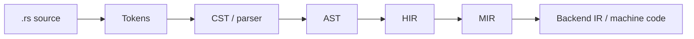
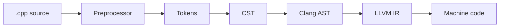

# M01C02 – Code as Data: Syntax, ASTs, IRs, Semantics

---

## 0. Learning Objectives

After M01C02, you should be able to:

1. Explain how source code passes through **tokens → CST → AST → IR → bytecode/machine code** in **Rust**, **Python**, and **C++**.
2. Distinguish **CST, AST, IR** by what each representation **keeps** and **throws away**.
3. Identify which **reified representations (R)** are available for metaprogramming under the **R–T–S triad** from **M01C01**.
4. Argue concretely why **structured R** (tokens/trees/IR) is safer and more robust than ad-hoc string manipulation.

Relationship to other cores:

* **From M01C01** – provides the **R–T–S triad** and meta-levels.
* **This module** – makes **R** concrete: tokens, CST, AST, IR, bytecode, and where meta hooks attach.
* **To M01C03–M01C05** – supplies the representation axis used in the taxonomy and in choosing a **Weakest Sufficient Mechanism (WSM)**.

We work with minimal examples (e.g. `x = 1 + 2 * 3`) and then show how each representation looks in abstract, followed by language-specific instantiations.

> Cross-link: for the definitions of **R = none / weak / strong**, **T**, **S**, and the metaprogramming taxonomy, see **M01C01 – What Is Metaprogramming?**

---

## 1. “Code as Data” in the R–T–S Sense

From **M01C01**:

* **R – Reification**: treating code as data with some structure.

  * **R = none** – raw strings/bytes.
  * **R = weak** – lexical structure (tokens, token trees, simple templates).
  * **R = strong** – syntax/semantics (AST, IR, bytecode).
* **T – Transformation**: generating or rewriting code that ends up in the final program.
* **S – Staging**: transformation happens in an **enforced pre-runtime phase** (build/compile/macro expansion).

**Static metaprogramming** in this course means:

> `T = true`, `S = true`, and code handled as structured data (`R ≥ weak`).

**Dynamic metaprogramming**:

> `T = true`, `S = false`, any `R`.

**Textual static metaprogramming**:

> `T = true`, `S = true`, but operations are essentially text/token splicing without robust structure.

This core answers:

> “What exactly counts as *code as data* in real toolchains, and at which `R` do different mechanisms operate?”

---

## 2. Neutral Front-End Pipeline

Most compilers/interpreters follow a shape like:

```mermaid
flowchart LR
    src[Source code]
    lex[Lexing\nchars -> tokens]
    cst[CST\n(concrete syntax tree)]
    ast[AST\n(abstract syntax tree)]
    ir[IR\n(compiler/VM IR)]
    out[Bytecode / machine code]

    src --> lex --> cst --> ast --> ir --> out
```

High-level situation as of late 2025:

* **Rust (1.9x / 1.92)**
  Tokens, CST/AST, and conceptual HIR/MIR stages; procedural macros and tools often work on AST-like structures.

* **Python (3.14)**
  Public `tokenize` and `ast` modules; bytecode and control-flow structures internally; experimental JIT on top of bytecode/IR; deferred annotations change *when* some expressions are evaluated, not AST shape.

* **C++ (C++26 draft, Clang/LLVM)**
  Preprocessor, tokens, CST/AST in Clang, then LLVM IR.

For metaprogramming, the practical Rs are:

* **Token streams** (R = weak),
* **ASTs** (R = strong),
* **IR / bytecode / CFG** (R = strong, but lower-level).

---

## 3. Tokens – Smallest Structured R

Neutral example:

```text
x = 1 + 2 * 3;
```

Token stream (schematic):

```text
IDENT("x")
EQ("=")
INT("1")
PLUS("+")
INT("2")
STAR("*")
INT("3")
SEMI(";")
```

Properties:

* Whitespace and comments removed.
* Each token has a **kind** and usually a **span** (source position).
* Lexical rules respected (identifier names, numeric literal forms, etc.).

In R–T–S terms:

* tokens ⇒ **R = weak**.

In practice:

* Rust `macro_rules!` operates on token trees;
* Python has `tokenize`, but most meta work uses AST;
* Clang can expose tokens, but tools typically climb directly onto the AST.

Token-level R is often sufficient for:

* local syntactic sugar,
* small code patterns that can be safely matched lexically.

It is fragile once you care about binding, types, or deeper semantics.

---

### Checkpoint 1 – Token-Level or Not?

For each mechanism, is the *primary* representation **token-level** (R = weak)?

1. A Rust `macro_rules!` macro.
2. A Python decorator that only sees function objects.
3. A Clang-based refactoring tool that traverses `clang::ASTContext`.

(Answers in §11.)

---

## 4. Concrete Syntax Trees (CST)

A **Concrete Syntax Tree (CST)** is the parse tree induced by the grammar.

CST for the expression statement (schematic):

```text
Stmt
├── Ident("x")
├── Eq("=")
└── Expr
    ├── Expr
    │   └── Term
    │       └── Factor
    │           └── Lit(1)
    ├── Plus("+")
    └── Term
        ├── Term
        │   └── Factor
        │       └── Lit(2)
        ├── Star("*")
        └── Factor
            └── Lit(3)
```

Characteristics:

* Every token appears, often as a node.
* Tree shape mirrors grammar (`Expr`, `Term`, `Factor`).
* Operator precedence encoded via extra nonterminals and depth.

Usage:

* parsing and error recovery,
* formatting and pretty-printing with layout preservation,
* syntax-aware editors.

For metaprogramming, CST is usually **too noisy**: many nodes, not focused on semantics.

---

### Checkpoint 2 – CST or AST?

You see a tree where `if`, `(`, `)`, `{`, `}`, and `;` are all distinct node types.

* Is this more likely a **CST** or an **AST**?
* Why?

(Answer in §11.)

---

## 5. Abstract Syntax Trees (AST)

### 5.1 AST as Strong R

AST for the same example:

```text
Assign(
  target = Ident("x"),
  value  = Add(
    left  = Lit(1),
    right = Mul(
      left  = Lit(2),
      right = Lit(3)
    )
  )
)
```

Differences vs CST:

* Grammar scaffolding (`Expr`, `Term`, `Factor`) removed.
* Punctuation (`;`, `+`, `*`) turned into structure and node kinds.
* Tree reflects **semantic structure** (assignment, addition, multiplication).

In R–T–S terms:

* AST ⇒ **R = strong**.

In practice:

* Rust proc macros and tools (e.g. `syn`, `rust-analyzer`) use AST-like Rs.
* Python’s `ast` module exposes a public AST.
* Clang exposes an AST API for C++.

AST is the **default representation** for robust metaprogramming and refactoring.

---

### 5.2 CST vs AST – Summary

| Aspect               | CST                                        | AST                                       |
| -------------------- | ------------------------------------------ | ----------------------------------------- |
| Shape                | mirrors grammar                            | mirrors semantic constructs               |
| Tokens               | all preserved (incl. punctuation)          | mostly discarded                          |
| Node labels          | grammar nonterminals                       | language constructs (Assign, Call, If, …) |
| Good for             | parsing, recovery, exact layout formatting | analysis, refactoring, metaprogramming    |
| Transform complexity | higher (more nodes, boilerplate)           | lower (leaner, more meaningful nodes)     |

---

### Checkpoint 3 – Pretty-Printing vs Transform

You need a tool that:

* pretty-prints code **without changing layout of comments**, and

* applies only minimal structural edits.

* Which R is more appropriate as *primary*: **CST** or **AST**?

* Why?

(Answer in §11.)

---

## 6. IR and Lowering: HIR, MIR, VM IR, Bytecode

Beyond AST, compilers lower to **Intermediate Representations (IR)**:

* more normalised, less syntactic sugar,
* explicit control flow and data flow,
* often close to SSA.

Typical situation (conceptual):

* **HIR (High-Level IR)** – desugared, typed, close to AST.
* **MIR/Mid-level IR / VM IR** – control-flow oriented, suited for data-flow and optimisation.
* **Bytecode** – VM instructions (Python, JVM-style VMs, etc.).

Usage:

* compiler analyses (borrow checking, inlining decisions),
* optimisation,
* low-level instrumentation.

For typical library-level metaprogramming:

* IR is **too far** from source code,
* mapping back to user code is non-trivial.

It is the right R when you:

* write compiler passes,
* do serious whole-program analysis,
* instrument binaries/bytecode.

---

### Checkpoint 4 – AST or IR for Derive-Style Codegen?

You want a mechanism that, given a user-defined record/struct, generates a logging or serialisation implementation.

* Which R is more appropriate: surface **AST** or mid-level **IR**?
* Why?

(Answer in §11.)

---

## 7. Invariants: What T Must Preserve on a Given R

When you apply **T (Transformation)** on some **R**, several invariants must hold.

### 7.1 Structural Invariants

The representation must remain structurally valid:

* Tokens must still parse into well-formed CST/AST.
* AST nodes must respect the AST schema (e.g. `Assign` must have target and value).
* IR blocks must have valid terminators, CFGs must be closed.

Violations produce early failures: parse errors, internal compiler errors, or crashes.

### 7.2 Binding and Hygiene

**Binding structure** must be preserved:

* new bindings must not accidentally capture or shadow,
* renaming must preserve which definition each use refers to.

Macro hygiene in Rust and other macro systems is exactly about enforcing binding invariants at R-level.

### 7.3 Type and Kind Consistency

In typed languages:

* transforms must not produce type-inconsistent programs;
* if you change a type, you must update dependent sites.

At IR level, type information is often explicit; at AST level it may be separate (symbol tables) but still needs to line up.

### 7.4 Control-Flow and Resource Safety

Even structurally and type-correct code can violate intended **control-flow invariants**:

* inserted `return` / `break` can skip clean-up,
* re-ordered statements may break invariants.

IR/CFG-level R makes these problems visible: you see paths that bypass specific blocks.

### 7.5 Error Locality and Tool Cooperation

Structured R supports:

* good error mapping from transformed code back to original locations,
* integration with IDEs, LSPs, and static analysis.

Textual code generation often destroys locality:

* diagnostics refer to generated files,
* debugging jumps between “schema”, “generator”, and “product” without clear mapping.

---

### Checkpoint 5 – Which Invariants?

A macro wraps a block in a loop and introduces a `return` that unintentionally skips clean-up code.

* Which invariants are primarily violated: structural, binding/hygiene, type, or control-flow?
* Which **R-level** information would help a tool detect this systematically?

(Answer in §11.)

---

## 8. Rust Track – R in Rust 1.9x / 1.92

We consider a contemporary **Rust 1.9x / 1.92** compiler.

### 8.1 Rust Front-End Pipeline

Conceptual pipeline:



Developer-relevant Rs:

* **Tokens** (`TokenStream` inside macros) – **R = weak**.
* **AST** (via crates like `syn`, via `rust-analyzer`) – **R = strong**.
* **HIR/MIR** – internal but conceptually documented; used for analysis, borrow checking, and optimisation – **R = strong**.

### 8.2 Declarative Macros: Token Trees (R = weak)

```rust
macro_rules! repeat_expr {
    ($n:expr, $body:expr) => {{
        let mut i = 0;
        while i < $n {
            $body;
            i += 1;
        }
    }};
}

fn main() {
    repeat_expr!(3, println!("hi"));
}
```

R–T–S classification:

* **R = weak** – pattern matching over token trees.
* **T = true** – expansion generates a `while` loop.
* **S = true** – macro expansion runs before type checking.

So this is **static metaprogramming over R = weak**.

### 8.3 Procedural Macros: AST-Level (R = strong)

```rust
use proc_macro::TokenStream;
use quote::quote;
use syn::{parse_macro_input, DeriveInput};

#[proc_macro_derive(LogFields)]
pub fn derive_log_fields(input: TokenStream) -> TokenStream {
    let ast: DeriveInput = parse_macro_input!(input);
    let name = &ast.ident;

    let fields = match &ast.data {
        syn::Data::Struct(data) => &data.fields,
        _ => panic!("#[derive(LogFields)] only supports structs"),
    };

    let field_idents = fields.iter().map(|f| f.ident.as_ref().unwrap());

    let body = quote! {
        #(
            println!(
                concat!(stringify!(#field_idents), " = {:?}"),
                self.#field_idents
            );
        )*
    };

    let expanded = quote! {
        impl LogFields for #name {
            fn log_fields(&self) {
                #body
            }
        }
    };

    expanded.into()
}
```

R–T–S:

* **R = strong** – `DeriveInput` is an AST node with structured type information.
* **T = true** – generates an `impl` block.
* **S = true** – runs during compilation, as part of macro expansion.

→ **Static metaprogramming over R = strong**.

### 8.4 HIR/MIR and Invariants

Rustc lowers AST → HIR → MIR:

* **HIR** – desugared, typed representation used for name resolution and early analyses.
* **MIR** – mid-level IR used for borrow checking and optimisation.

In Rust 1.90–1.92, ongoing work refines MIR and diagnostics. For user-level metaprogramming:

* you rarely touch HIR/MIR directly;
* you rely on them indirectly via guarantees (borrow checker, error messages, performance).

IR-level R is primarily for:

* compiler contributors,
* advanced static analysis tools,
* formal verification.

---

## 9. Python Track – R in Python 3.14

We consider **Python 3.14**:

* public `tokenize` and `ast` modules,
* bytecode and CFGs under `code` objects and `dis`,
* **deferred annotations** and an **experimental JIT** that operate on the bytecode/IR side.

### 9.1 CPython 3.14 Pipeline

Conceptual pipeline:

```mermaid
flowchart LR
    src[.py source]
    lex[Tokens]
    parse[CST]
    ast[AST]
    bc[Bytecode\n(code objects)]
    vm[Interpreter / JIT]

    src --> lex --> parse --> ast --> bc --> vm
```

Developer-facing Rs:

* **Tokens** – `tokenize` → **R = weak**.
* **AST** – `ast` module → **R = strong**.
* **Bytecode / CFG** – via `code` objects and `dis` → **R = strong**, but VM-centric.

Deferred annotations and JIT:

* change *evaluation time* and *execution strategy* of some code,
* do not change AST-level structural R.

### 9.2 AST Transform Example – Dynamic Meta over R = strong

```python
import ast

class RepeatTransformer(ast.NodeTransformer):
    def visit_Call(self, node: ast.Call) -> ast.AST:
        if (isinstance(node.func, ast.Name)
                and node.func.id == "repeat"
                and len(node.args) == 2):
            n_node, expr = node.args
            if not (isinstance(n_node, ast.Constant)
                    and isinstance(n_node.value, int)):
                raise ValueError("repeat expects an integer literal as first argument")

            n = n_node.value
            loop = ast.For(
                target=ast.Name(id="_i", ctx=ast.Store()),
                iter=ast.Call(
                    func=ast.Name(id="range", ctx=ast.Load()),
                    args=[ast.Constant(value=n)],
                    keywords=[],
                ),
                body=[ast.Expr(value=expr)],
                orelse=[],
            )
            return loop

        return self.generic_visit(node)

source = "repeat(3, print('hi'))"
tree = ast.parse(source, mode="exec")
new_tree = RepeatTransformer().visit(tree)
ast.fix_missing_locations(new_tree)

code = compile(new_tree, "<ast>", "exec")
exec(code)
```

R–T–S:

* **R = strong** – Python AST.
* **T = true** – call `repeat(3, ...)` rewritten into an explicit loop.
* **S = false** – unless integrated into a build step, this runs at import/runtime.

→ **Dynamic metaprogramming over R = strong**.

### 9.3 Bytecode / IR

Python 3.14:

* compiles AST to bytecode in `code` objects,
* can produce CFGs and IR-like structures internally,
* has an **experimental JIT** driven by bytecode/IR.

Bytecode-level R is useful for:

* profiling and optimisation tooling,
* low-level instrumentation,
* research prototypes on JIT strategies.

For mainstream metaprogramming:

* **AST** remains the right level,
* bytecode-level T is brittle and implementation-dependent.

---

## 10. C++ Track – R in C++26 / Clang–LLVM

We consider **C++26** with **compile-time reflection** and a Clang/LLVM-style toolchain.

### 10.1 C++ / Clang Pipeline



Developer-facing Rs:

* **Preprocessor-level tokens/text** – **R = none / weak**, textual static metaprogramming.
* **Clang AST** – **R = strong**, widely used in tools.
* **LLVM IR** – **R = strong**, used for optimisation and instrumentation.

### 10.2 Clang AST Example

For:

```cpp
int add(int x, int y) { return x + y; }
```

Clang’s AST dump (schematic):

```text
FunctionDecl 'add' 'int (int, int)'
  ParmVarDecl 'x' 'int'
  ParmVarDecl 'y' 'int'
  CompoundStmt
    ReturnStmt
      BinaryOperator '+' 'int'
        DeclRefExpr 'x'
        DeclRefExpr 'y'
```

This mirrors the AST pattern from the language-neutral sections.

### 10.3 C++26 Reflection – Static Meta over R = strong

C++26 compile-time reflection exposes program structure (types, members, etc.) into templates and `constexpr` contexts.

R–T–S:

* **R = strong** – reflective entities mirror AST/semantic information.
* **T = true** – templates can generate different code based on reflection.
* **S = true** – template instantiation and reflection run at compile time.

So reflection-based codegen is **static metaprogramming over R = strong**.

### 10.4 Clang Tools as Pipeline-Level Static Meta

Clang-based tools integrated in the build (e.g. refactorers) can:

* parse to AST (**R = strong**),
* rewrite source files (**T = true**),
* be wired into CI/build (**S = true** when build is configured to fail on tool errors).

That is **static metaprogramming at tool level**, parallel to Rust’s `build.rs` or external Python code generators.

---

## 11. Checkpoint Answers

### Checkpoint 1 – Token-Level?

1. **Rust `macro_rules!` macro**
   Primary R is token trees → **token-level, R = weak**.

2. **Python decorator on function objects**
   No; primary R is function values, not tokens → **R = none** in the R–as-code sense.

3. **Clang-based refactoring tool**
   Uses Clang AST → **R = strong**, not token-level.

---

### Checkpoint 2 – CST or AST?

A tree that explicitly represents `if`, `(`, `)`, `{`, `}`, `;` as nodes:

* much more likely a **CST**:

  * CST mirrors grammar and preserves punctuation,
  * AST typically abstracts these into higher-level constructs (`IfStmt`, `Block`, etc.) and drops punctuation nodes.

---

### Checkpoint 3 – Pretty-Printing vs Transform

To preserve comments and layout:

* primary R should be **CST** (or CST plus comment trivia tables):

  * CST retains all tokens and structural positions;
  * AST discards too much surface structure for faithful layout preservation.

Transformations can still be guided by AST, but the layout result is driven by CST.

---

### Checkpoint 4 – Derive-Style Codegen

For derive-style codegen (logging, serialisation):

* **AST** is the right R:

  * you need direct access to field names, types, attributes, generics;
  * IR has lost that surface structure and been desugared;
  * mapping IR back to source declarations is difficult and brittle.

→ Use **R = strong (AST)** rather than IR.

---

### Checkpoint 5 – Invariants

Macro that introduces a `return` inside a loop and unintentionally skips clean-up:

* Primary violation: **control-flow invariants** (some paths bypass required clean-up).
* Structural and type invariants may still hold.

Helpful R-level information:

* **Control-Flow Graph (CFG)** over AST/IR:

  * to see paths that skip particular blocks or calls;
* optionally, **effect/lifetime metadata**:

  * to know which blocks perform required clean-up (dropping resources, releasing locks).

Static analysis over CFG + effects can then flag paths that violate clean-up obligations.

---

## 12. M01C02 Glossary

This glossary is aligned with **M01C01** and uses the same R–T–S terminology.

| Term                                 | Definition                                                                                                                                                                                                                                                 |
| ------------------------------------ | ---------------------------------------------------------------------------------------------------------------------------------------------------------------------------------------------------------------------------------------------------------- |
| **Reification (R)**                  | Treating code as data at a given structural level. We use a single scale (from M01C01): **R = none** (plain text/bytes), **R = weak** (tokens / token trees / shallow templates), **R = strong** (CST/AST/IR/bytecode with structure and often semantics). |
| **Reified representation (R)**       | Any concrete structured view of code (tokens, CST, AST, IR, bytecode) that a program/metaprogram can inspect or transform (**R = none / weak / strong** as defined in M01C01).                                                                             |
| **Token**                            | Lexical unit produced by lexing (identifier, literal, keyword, operator, punctuation) with a kind and usually a source span.                                                                                                                               |
| **CST (Concrete Syntax Tree)**       | Parse tree mirroring the language grammar and preserving all tokens, often including punctuation and intermediate nonterminals.                                                                                                                            |
| **AST (Abstract Syntax Tree)**       | Tree representing semantic structure; grammar scaffolding and punctuation are removed; nodes correspond to constructs like assignment, call, if, loop, etc.                                                                                                |
| **Desugaring**                       | Transforming high-level syntactic sugar into simpler core constructs with equivalent behaviour, typically when lowering AST to HIR/IR.                                                                                                                     |
| **IR (Intermediate Representation)** | Compiler or VM representation between AST and machine code (e.g. Rust HIR/MIR, LLVM IR, Python bytecode/CFG).                                                                                                                                              |
| **HIR (High-Level IR)**              | Normalised, desugared, typed representation close to AST (e.g. Rust HIR).                                                                                                                                                                                  |
| **MIR (Mid-Level IR)**               | Control-flow-oriented IR suited for data-flow, borrow checking, and optimisation (e.g. Rust MIR).                                                                                                                                                          |
| **Lowering**                         | Transformation from higher-level representation (AST/HIR) to lower-level IR (MIR/LLVM IR/bytecode).                                                                                                                                                        |
| **Hygiene**                          | Property of a macro or transformation system that preserves binding structure and avoids unintended variable capture/shadowing.                                                                                                                            |
| **Bytecode**                         | VM instruction sequence (e.g. CPython `code` objects) executed by an interpreter or JIT.                                                                                                                                                                   |
| **Control-Flow Graph (CFG)**         | Graph whose nodes are basic blocks and whose edges represent possible execution paths within a function/method.                                                                                                                                            |
| **Static metaprogramming**           | Metaprogramming where **T = true**, **S = true**, and code is handled as structured data (**R ≥ weak**); includes macros, templates, and staged reflection-based code generation.                                                                          |
| **Dynamic metaprogramming**          | Metaprogramming where **T = true** (code is generated/rewritten) and **S = false** (no enforced pre-runtime phase); runs at runtime or import-time; **R** may be none, weak, or strong.                                                                    |
| **Textual static metaprogramming**   | Static metaprogramming where **T = true**, **S = true**, but operations are essentially textual/token-level without a robust structural model of code (e.g. preprocessor macros, regex-based generators in a build).                                       |

---

## 13. ADR – Module-Level Design Choices

**Context**

M01C02 takes the abstract R–T–S framework from M01C01 and:

* grounds it in **concrete representations** (tokens, CST, AST, HIR/MIR/IR, bytecode),
* explains where **meta hooks** attach in real toolchains (parsers, compilers, interpreters),
* and defines key invariants (binding, control-flow, hygiene).

It uses the same **Rust / Python / C++** tracks as M01C01.

**Decision**

1. Make **representations** (tokens, CST, AST, IR, bytecode) the **primary vehicle** for instantiating `R = none / weak / strong`:

   * tokens / flat strings → `R = none / weak`,
   * CST/AST → `R = strong (syntactic)`,
   * IR/bytecode → `R = strong (semantic/control-flow)`.

2. Reuse the **three-language structure**:

   * §§1–7: language-neutral description of representations and invariants,
   * §§8–10: Rust, Python, C++ pipelines, each mapped to the R-scale.

3. Treat **static vs dynamic vs textual meta** purely as **R–T–S classifications** in this module; policy decisions about *when* to use them are deferred to M01C04–M01C05.

**Rationale**

* M01C01 defines R abstractly; M01C02 makes R **tangible** via real compiler/interpreter layers.
* The same three languages give wide coverage:

   * Rust: explicit HIR/MIR,
   * Python: AST + bytecode,
   * C++: templates, preprocessor, and IR in mainstream toolchains.

* Keeping policy out of this core keeps M01C02 focused: it is about **what** exists and **where** meta hooks can attach, not **whether** they should be used.

**Extensibility**

To add another language:

1. Describe its pipeline: **source → tokens → CST → AST → IR/bytecode → machine code/runtime**.
2. Map each representation onto `R = none / weak / strong` using M01C01’s definitions.
3. Mark where metaprogramming mechanisms attach (macros, plugins, reflection, external generators).
4. Classify those mechanisms with **R–T–S** and meta-levels, referencing M01C01.

The **representation taxonomy** in this core is meant to remain stable; new languages extend the tables, not the underlying theory.

**Consequences**

* All later discussions of “R-level” must refer back to **these concrete structures**.
* Changes to a language’s pipeline (e.g. new IR layer) can be incorporated by updating the corresponding track without touching the language-neutral core.
