# M01C03 – Taxonomy of Metaprogramming Techniques

---

## 0. Learning Objectives

After M01C03, you should be able to:

1. Place concrete metaprogramming techniques into a **structured taxonomy** using **R–T–S** from M01C01–M01C02.
2. For each major category (textual macros, syntactic/procedural macros, generics, type-level programming, staging/const eval, DSL/codegen, reflection, dynamic JIT/runtime codegen):

   * state its **representation R**,
   * identify **when** it runs (phase, S),
   * classify it precisely via **R–T–S**.
3. Distinguish **core static metaprogramming** (R ∧ T ∧ S) from **adjacent techniques** (reflection-only, non-generative DSLs).
4. For Rust, Python, and C++ **individually**, understand how *all eight taxa* manifest, with concrete code and clear mapping.

**Structure**

* §§1–7 – language-neutral taxonomy
* §§8–10 – language tracks (Rust, Python, C++) with deep examples per taxon
* §11 – checkpoint answers
* §12 – glossary
* §13 – ADR (design choices, extensibility)

---

## 1. The Role of a Taxonomy

Metaprogramming spans:

* textual macros,
* AST/procedural macros,
* generics and type-level hacks,
* const-eval and staging,
* build-time DSL/codegen,
* reflection-only tricks,
* dynamic codegen and JITs.

Without a disciplined taxonomy, teams:

* overuse high-powered mechanisms for minor problems,
* hide logic in opaque generated layers,
* argue about *labels* instead of *trade-offs*.

We will classify techniques along:

* **R – Reification**: how code is represented (none / weak / strong),
* **T – Transformation**: whether new code is generated/rewritten,
* **S – Staging**: whether there is an **enforced pre-runtime phase**.

Then we define **eight taxa** and show how each appears in Rust, Python, and C++.

---

## 2. The 2×2 Foundation: Static/Dynamic × Textual/Structured

Start with a coarse grid:

* **Static (S = true)**: enforced pre-runtime (build, macro expansion, compilation).
* **Dynamic (S = false)**: runtime/import-time.
* **Textual R**: strings, flat tokens (R = none/weak).
* **Structured R**: AST, types, IR, bytecode (R ≥ weak, often strong).

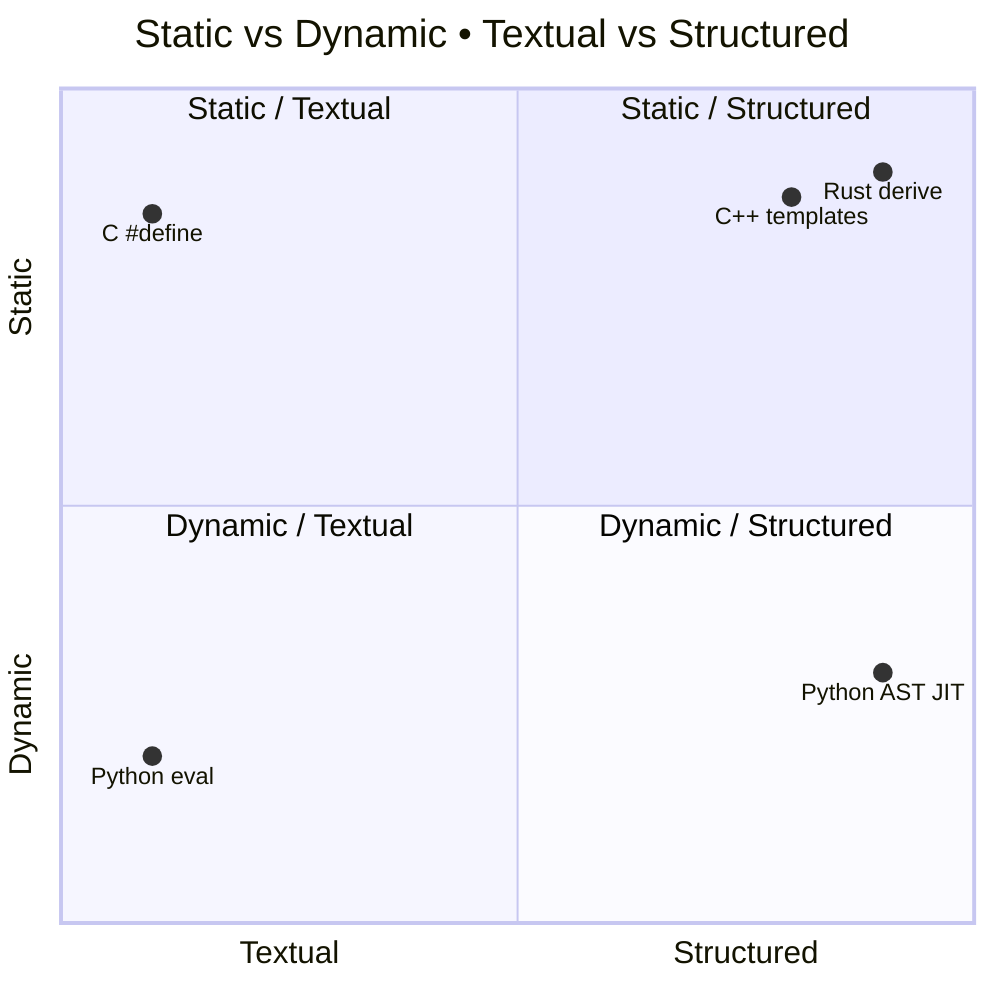

We refine this into **eight taxa**, each with specific R–T–S properties.

---

## 3. The Eight Taxa (Neutral Overview)

We use the following “anchor” categories:

1. **Textual static metaprogramming** – textual macros, token-paste.
2. **Syntactic / procedural macros** – AST-level compile-time transforms.
3. **Generics** – parametric code over types, instantiated statically.
4. **Type-level programming** – using the type system as a logic engine.
5. **Staging / const evaluation** – compile-time evaluation of expressions.
6. **DSLs and build-time code generation** – schema → code, build-integrated.
7. **Reflection & non-generative DSLs** – meta-adjacent, often non-generative.
8. **Dynamic metaprogramming & JITs** – runtime/import-time codegen, IR/bytecode JIT.

High-level classification:

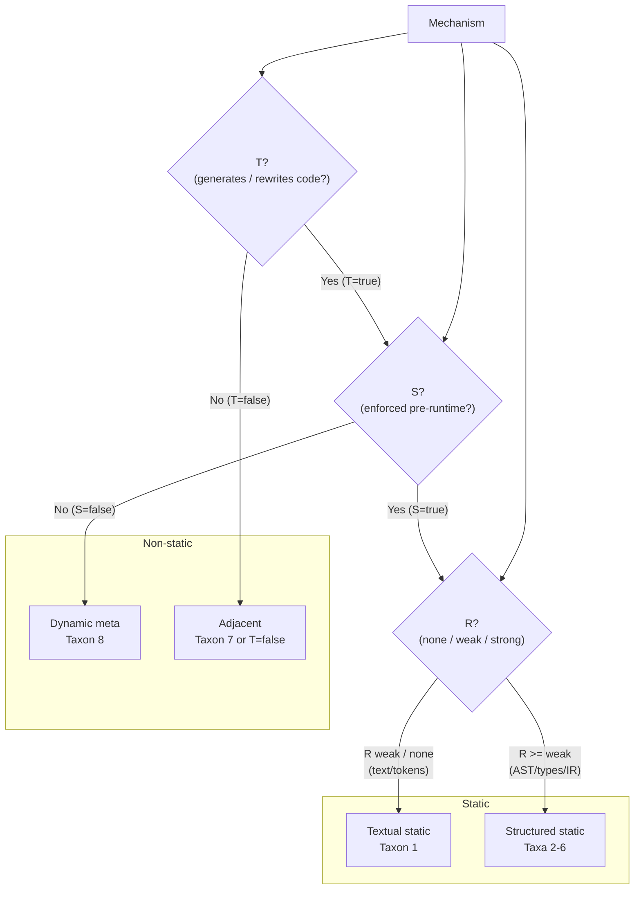

*Taxa 2–6 are **core static structured**; taxon 1 is **core static textual**;
taxon 7 is **adjacent**; taxon 8 is **dynamic**.*

### Checkpoint 1
Classify the following technique into one of the eight taxa: A compile-time macro that operates on abstract syntax trees to generate new code structures.

---

## 4. Taxon 1 – Textual Static Metaprogramming

**R = none/weak (strings / flat tokens)**
**T = true** (substitution/concatenation)
**S = true** (pre-parse or early expand)
**Class:** *textual static metaprogramming.*

### 4.1 Concept

Mechanisms that:

* see only text or minimally structured tokens,
* substitute or paste them,
* run in a pre-runtime, enforced phase.

They satisfy R–T–S but operate at the weakest possible R: semantics are entirely implicit.

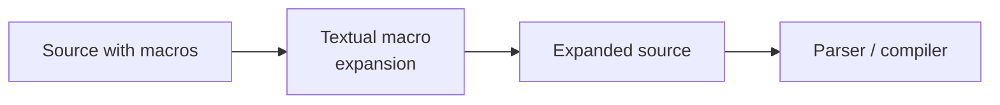

Typical issues:

* precedence surprises,
* double-evaluation,
* poor error messages (pointing into expanded text).

---

## 5. Taxa 2–5 – Core Static Structured Mechanisms

These are all **R ≥ weak**, **T = true**, **S = true**.

* **Taxon 2:** syntactic / procedural macros – **syntax-level R**
* **Taxon 3:** generics – **type-level R**
* **Taxon 4:** type-level programming – **type-level R as logic**
* **Taxon 5:** staging / const-eval – **expression-level R**, compiled early

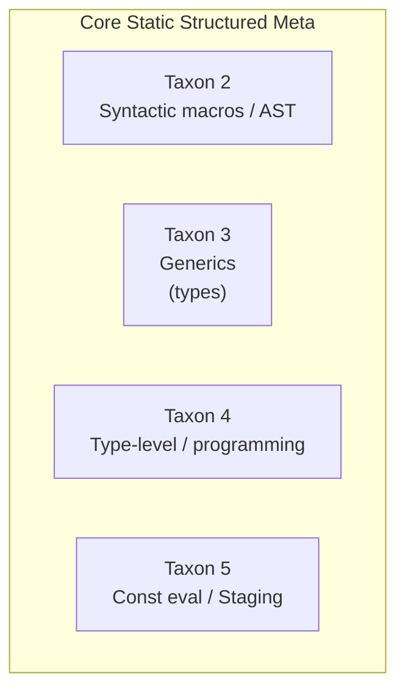

They differ in **what** they see as code:

* syntax trees (Taxon 2),
* type environments (Taxa 3–4),
* const-evaluable expressions (Taxon 5).

---

## 6. Taxon 6 – DSLs and Build-Time Code Generation

**R = schemas / DSL AST / configs**
**T = true** (source/config generation)
**S = true** (generator wired into build)
**Class:** *core static meta, pipeline-level.*

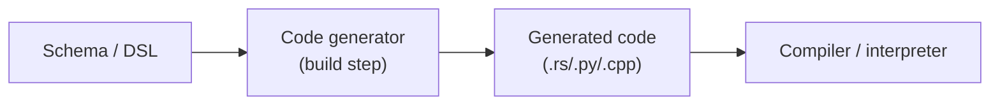

Build fails if the generator fails ⇒ S is enforced.

---

## 7. Taxa 7–8 – Reflection, Non-Generative DSLs, Dynamic Meta

**Taxon 7 – Reflection / non-generative DSLs (adjacent)**

* R: metadata / objects / ordinary terms,
* T: often false (no codegen),
* S: irrelevant or runtime.
  They provide meta *information* but do not necessarily generate code.

**Taxon 8 – Dynamic metaprogramming / JITs**

* R: text / AST / IR / bytecode,
* T: true (runtime codegen / specialisation),
* S: false (runtime/import-time).
  They are full metaprogramming systems, but dynamic rather than static.

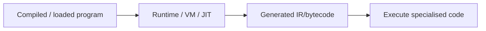

### Checkpoint 2
Explain why reflection is classified as an adjacent technique (Taxon 7) rather than core static metaprogramming.

---

## 8. Rust Track – Each Taxon in Rust

We now walk all eight taxa **in Rust**.
For each:

* show a concrete example,
* classify R–T–S,
* relate to the neutral taxonomy.

### 8.1 Rust – Taxon 1: Textual Static Metaprogramming

Classic `macro_rules!` used in a *token-paste* / textual way, demonstrating potential pitfalls.

```rust
macro_rules! bad_add {
    ($x:expr, $y:expr) => {
        $x + $y * 2
    };
}

fn main() {
    println!("{}", bad_add!(1 + 2, 3));
    // expands to: 1 + 2 + 3 * 2 == 9 (NOT (1+2) + (3*2) == 9, wait, actually in this case same, but precedence issue if different)
    // Better example for pitfall: bad_add!(1 + 2, 3 + 4) expands to 1 + 2 + 3 + 4 * 2 == 1+2+3+8==14, not (3)+(7*2)=17
}
```

**Classification**

* **R**: token trees (R = weak). No AST structure or types.
* **T**: yes – generates expression tokens.
* **S**: yes – expansion runs before parsing/type-check of the expanded result.

→ **Taxon 1: textual static meta**.

**Diagram**

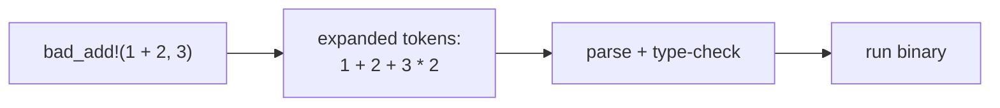

**Pitfall**: Token-level expansion; precedence is entirely the caller’s problem.

---

### 8.2 Rust – Taxon 2: Syntactic / Procedural Macros

Proc macros over AST (`syn`, `quote`) are the archetypal **Taxon 2**.

Example: `#[derive(Loggable)]` that prints all fields.

```rust
// crate: loggable_derive
use proc_macro::TokenStream;
use quote::quote;
use syn::{parse_macro_input, DeriveInput};

#[proc_macro_derive(Loggable)]
pub fn derive_loggable(input: TokenStream) -> TokenStream {
    let ast: DeriveInput = parse_macro_input!(input);
    let name = &ast.ident;

    let fields = match &ast.data {
        syn::Data::Struct(data) => &data.fields,
        _ => panic!("#[derive(Loggable)] only supports structs"),
    };

    let idents = fields.iter().map(|f| f.ident.as_ref().unwrap());

    let body = quote! {
        #(
            println!(
                concat!(stringify!(#idents), " = {:?}"),
                self.#idents
            );
        )*
    };

    let gen = quote! {
        impl Loggable for #name {
            fn log(&self) { #body }
        }
    };

    gen.into()
}
```

Use:

```rust
use loggable_derive::Loggable;

#[derive(Loggable)]
struct User {
    id: u32,
    name: String,
}

fn main() {
    let u = User { id: 1, name: "Alice".into() };
    u.log();
}
```

**Classification**

* **R**: AST (via `syn::DeriveInput`) ⇒ R = strong.
* **T**: yes – generates an `impl Loggable` block.
* **S**: yes – expansion runs in the compiler before type-checking the generated `impl`.

→ **Taxon 2: core static structured meta**.

---

### 8.3 Rust – Taxon 3: Generics

Example: generic function and struct.

```rust
use std::cmp::Ord;

fn max<T: Ord>(a: T, b: T) -> T {
    if a > b { a } else { b }
}

struct Wrapper<T> {
    value: T,
}
```

**Classification**

* **R**: type environment – type parameters `T`, constraints `T: Ord`.
* **T**: yes – monomorphisation produces `max<i32>`, `max<f64>`, `Wrapper<u32>`, etc.
* **S**: yes – instantiation at compile-time during codegen.

→ **Taxon 3: generics as static meta over types.**

Diagram:

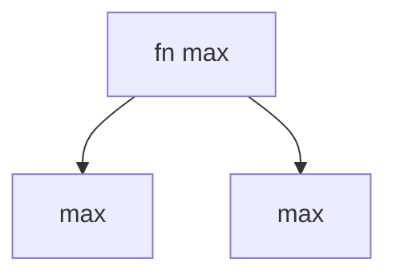

Generics are **often the WSM** for reusable code.

---

### 8.4 Rust – Taxon 4: Type-Level Programming

Use types and phantom data to encode invariants, such as a state machine for a door.

```rust
use std::marker::PhantomData;

struct Open;
struct Closed;

struct Door<S> {
    _phantom: PhantomData<S>,
}

impl Door<Closed> {
    fn open(self) -> Door<Open> {
        Door { _phantom: PhantomData }
    }
}

impl Door<Open> {
    fn close(self) -> Door<Closed> {
        Door { _phantom: PhantomData }
    }
}

// Usage
fn main() {
    let closed_door = Door::<Closed> { _phantom: PhantomData };
    let open_door = closed_door.open();
    let closed_again = open_door.close();
    // closed_again.open(); // ok
    // open_door.open(); // type error: no method `open` on Door<Open>
}
```

**Classification**

* **R**: types (`Open`, `Closed`) and phantom markers ⇒ strong type-level R.
* **T**: yes – type checking drives method resolution and rejects invalid states.
* **S**: yes – at compile-time only.

→ **Taxon 4: type-level programming.**

Cost: complexity and noisy errors. Use when invariants *must* be static.

---

### 8.5 Rust – Taxon 5: Staging / Const Evaluation

Simple const-eval:

```rust
const fn doubled(x: usize) -> usize { x * 2 }

const N: usize = doubled(4);

struct Buffer<const N: usize> {
    data: [u8; N],
}

fn main() {
    let buf = Buffer::<{ N }>{ data: [0; N] };
    println!("{}", N); // 8
}
```

**Classification**

* **R**: expression AST allowed in const contexts ⇒ strong R (over a restricted language).
* **T**: yes – evaluation of `doubled(4)` at compile time.
* **S**: yes – const-eval stage.

→ **Taxon 5: staging / const eval.**

---

### 8.6 Rust – Taxon 6: DSLs and Build-Time Codegen

Example: `build.rs` generating Rust source from a schema.

`build.rs`:

```rust
use std::{env, fs, path::Path};

fn main() {
    let out_dir = env::var("OUT_DIR").unwrap();
    let dest = Path::new(&out_dir).join("schema_types.rs");

    let schema = r#"
    type User {
        id: u32,
        name: String,
    }
    "#;

    // In reality: parse schema AST. Here: toy generator.
    let generated = r#"
        #[derive(Debug)]
        pub struct User {
            pub id: u32,
            pub name: String,
        }
    "#;

    fs::write(dest, generated).unwrap();
}
```

Library code:

```rust
include!(concat!(env!("OUT_DIR"), "/schema_types.rs"));

fn main() {
    let u = User { id: 1, name: "Alice".into() };
    println!("{:?}", u);
}
```

**Classification**

* **R**: schema or DSL (could be strong if parsed; here conceptually weak/strong).
* **T**: yes – generator emits `User` struct definition.
* **S**: yes – build fails if `build.rs` fails.

→ **Taxon 6: DSLs & build-time codegen.**

---

### 8.7 Rust – Taxon 7: Reflection / Non-Generative DSLs

Rust has no general runtime reflection, but derive-based patterns simulate reflection *for specific traits*. Pure non-generative DSL is just libraries.

Example: query DSL, no codegen:

```rust
struct Query<'a> {
    table: &'a str,
    filter: Option<&'a str>,
}

impl<'a> Query<'a> {
    fn new(table: &'a str) -> Self {
        Self { table, filter: None }
    }

    fn filter(mut self, cond: &'a str) -> Self {
        self.filter = Some(cond);
        self
    }

    fn to_sql(&self) -> String {
        match self.filter {
            Some(cond) => format!("SELECT * FROM {} WHERE {}", self.table, cond),
            None => format!("SELECT * FROM {}", self.table),
        }
    }
}

fn main() {
    let q = Query::new("users").filter("age > 18");
    println!("{}", q.to_sql());
}
```

**Classification**

* **R**: plain types and values; no code is generated.
* **T**: false – `to_sql` is regular code.
* **S**: irrelevant.

→ **Taxon 7: non-generative DSL (adjacent).**

---

### 8.8 Rust – Taxon 8: Dynamic Metaprogramming / JITs

Rust itself does not embed a VM with JIT, but you can:

* load dynamic libraries at runtime (`libloading`),
* feed code to an embedded interpreter/JIT (e.g. Lua, Wasmtime) from Rust.

Conceptual Rust-side pattern (pseudo-code):

```rust
fn run_user_script(script: &str) {
    // imagine binding to an embedded scripting engine
    scripting_engine::eval(script).unwrap();
}
```

**Classification**

* **R**: text in `script`.
* **T**: yes – engine compiles/interprets at runtime.
* **S**: false – all at runtime.

→ **Taxon 8: dynamic textual metaprogramming (delegated).**

Rust remains the host; the meta is in the embedded engine.

### Checkpoint 3
In Rust, why is `macro_rules!` classified under Taxon 1 despite using token trees?

---

## 9. Python Track – Each Taxon in Python

Python has **no language-level compile-time**; S is mostly false *inside* Python. Static meta appears via tools/pipeline (Taxon 6). We still walk all taxa.

### 9.1 Python – Taxon 1: Textual Static Meta (Pipeline)

Inside Python proper, there is no preprocessor, but you can have build-time codegen that uses **string substitution**.

Example: a shell or build step that does crude templating on `.py.in` to produce `.py` before packaging. Conceptual:

```text
# config.py.in
VERSION = "@VERSION@"
```

Build script replaces `@VERSION@` with a concrete version string.

**Classification**

* **R**: text.
* **T**: yes – substitution produces final `.py`.
* **S**: yes – build fails if script fails.

→ **Taxon 1: textual static meta at pipeline level.**

Inside Python-the-language, there is no direct Taxon 1 analogue.

---

### 9.2 Python – Taxon 2: Syntactic / Procedural Macros (Tooling)

Python does **not** have built-in syntactic macros, but you can build AST-based generators in a *pre-import* tool.

Example: AST transform that rewrites `log_times(n, expr)` into a loop, run as a codegen step.

```python
# generate_code.py
import ast
from pathlib import Path

class LogTimesTransformer(ast.NodeTransformer):
    def visit_Expr(self, node: ast.Expr) -> ast.AST:
        # match: log_times(N, expr)
        if isinstance(node.value, ast.Call):
            call = node.value
            if (isinstance(call.func, ast.Name)
                    and call.func.id == "log_times"
                    and len(call.args) == 2):
                n_node, inner = call.args
                if not (isinstance(n_node, ast.Constant)
                        and isinstance(n_node.value, int)):
                    raise ValueError("log_times expects an integer literal")

                n = n_node.value
                loop = ast.For(
                    target=ast.Name(id="_i", ctx=ast.Store()),
                    iter=ast.Call(
                        func=ast.Name(id="range", ctx=ast.Load()),
                        args=[ast.Constant(value=n)],
                        keywords=[]
                    ),
                    body=[ast.Expr(value=inner)],
                    orelse=[]
                )
                return loop
        return self.generic_visit(node)

src = Path("app_template.py").read_text()
tree = ast.parse(src)
tree = LogTimesTransformer().visit(tree)
ast.fix_missing_locations(tree)
code = ast.unparse(tree)

Path("app.py").write_text(code)
```

`app_template.py`:

```python
def main():
    log_times(3, print("hi"))

if __name__ == "__main__":
    main()
```

Generated `app.py` will contain the explicit loop.

**Classification**

* **R**: AST (R = strong).
* **T**: yes – transforms calls into loops.
* **S**: yes – if this codegen is integrated into build/packaging and required for deployment.

→ **Taxon 2: syntactic/procedural macros (tooling).**

Note: in vanilla execution, running the AST transform at import-time would be **Taxon 8** (dynamic).

---

### 9.3 Python – Taxon 3: Generics (Typing)

Python generics are **type-checker constructs** rather than runtime codegen, but they still fit the taxonomy as static meta **for the type-checker**.

```python
from typing import TypeVar, Generic, List

T = TypeVar("T")

class Box(Generic[T]):
    def __init__(self, value: T) -> None:
        self.value = value

    def get(self) -> T:
        return self.value

def max_two(a: T, b: T) -> T:
    return a if a > b else b

xs: List[int] = [1, 2, 3]
b: Box[int] = Box(5)
```

**Classification (type-checker perspective)**

* **R**: type environment, generic parameters.
* **T**: yes – type-checker instantiates type schemes for concrete uses.
* **S**: yes – static analysis phase (before running, at least conceptually).

→ **Taxon 3: generics as static meta (within typing subsystem).**

At runtime, Python does **not** monomorphise; generics are erased. But static analyzers (mypy, Pyright) fully operate in Taxon 3.

---

### 9.4 Python – Taxon 4: Type-Level Programming (Limited)

Python’s type system is far weaker than Rust/C++, but you can encode **state in types** at the typing layer.

Example: phantom types via Protocols and Literal types to model a simple state machine in static typing:

```python
from typing import Protocol, TypeVar, Generic, Literal

State = Literal["open", "closed"]

T = TypeVar("T", bound="Door")

class Door(Protocol[State]):
    state: State

class OpenDoor:
    state: Literal["open"] = "open"

class ClosedDoor:
    state: Literal["closed"] = "closed"

D_open = TypeVar("D_open", bound=OpenDoor)
D_closed = TypeVar("D_closed", bound=ClosedDoor)

def close_door(d: OpenDoor) -> ClosedDoor:
    return ClosedDoor()

def open_door(d: ClosedDoor) -> OpenDoor:
    return OpenDoor()
```

**Classification (type-checker)**

* **R**: type-level states via `Literal` and Protocols.
* **T**: yes – type-checker reasons about transitions, rejecting impossible calls.
* **S**: yes – analysis phase.

→ **Taxon 4: type-level programming, albeit limited and purely static-analysis-based.**

---

### 9.5 Python – Taxon 5: Staging / Const Evaluation

Python has no user-facing const-eval, but:

* some code is resolved at **import-time** (module body),
* caches/lookup tables can be precomputed before main logic.

This is **not** enforced like const-eval in Rust/C++; there is no S = true at language level. So strictly speaking, Python has no Taxon 5 in-core. Const-like behaviour is just runtime at import.

So for Python:

* **Taxon 5 is essentially “n/a” at language level**,
* you may emulate it with build-time code generation (Taxon 6).

---

### 9.6 Python – Taxon 6: DSLs & Build-Time Codegen

Canonical example: **Protobuf / gRPC** generating Python stubs from `.proto`.

Workflow (conceptual):

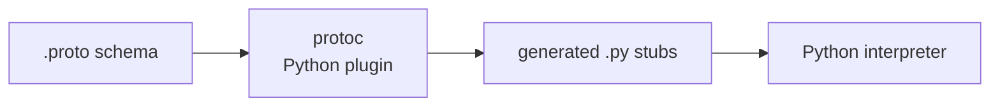

**Classification**

* **R**: schema AST (R = strong).
* **T**: yes – generates Python modules with service and message classes.
* **S**: yes – build fails if `protoc` fails; generated files are required.

→ **Taxon 6: DSLs & build-time codegen.**

Same pattern applies to any “schemas → `.py`” generator integrated into build.

---

### 9.7 Python – Taxon 7: Reflection / Non-Generative DSLs

Reflection example:

```python
import inspect

class User:
    def __init__(self, name: str, age: int) -> None:
        self.name = name
        self.age = age

def dump_signature(obj) -> None:
    sig = inspect.signature(obj)
    print(obj.__name__, sig)

dump_signature(User.__init__)
```

**Classification**

* **R**: metadata about functions and parameters, via `inspect`.
* **T**: false – only introspection; no new code.
* **S**: runtime.

→ **Taxon 7: reflection (adjacent).**

Non-generative DSL example: ORM query building.

```python
query = User.objects.filter(age__gt=18).order_by("name")
```

If the ORM simply builds a SQL string internally, with no code generation, it is a **non-generative DSL** (still Taxon 7).

---

### 9.8 Python – Taxon 8: Dynamic Meta / JIT

Decorators:

```python
from functools import wraps
from typing import Callable, TypeVar

F = TypeVar("F", bound=Callable[..., object])

def log_calls(func: F) -> F:
    @wraps(func)
    def wrapper(*args, **kwargs):
        print("Calling", func.__name__)
        return func(*args, **kwargs)
    return wrapper  # type: ignore[return-value]

@log_calls
def add(x: int, y: int) -> int:
    return x + y
```

**Classification**

* **R**: function objects (no structural code representation) ⇒ R = none.
* **T**: yes – returns a new function (`wrapper`) used in place of `add`.
* **S**: false – runs on import or runtime.

→ **Taxon 8: dynamic metaprogramming (value-level).**

AST-based dynamic transform:

```python
import ast

source = "x = 1 + 2 * 3"
tree = ast.parse(source, mode="exec")

# modify AST at runtime
new_tree = ast.fix_missing_locations(tree)
code = compile(new_tree, "<ast>", "exec")
exec(code)
```

* **R**: AST (R = strong).
* **T**: yes – `tree` is transformed and compiled.
* **S**: false – all at runtime.

→ **Taxon 8: dynamic structured metaprogramming.**

JIT tools (Numba / similar) operate on IR/bytecode at runtime → also Taxon 8.

### Checkpoint 4
Why does Python lack a direct analogue for Taxon 5 (staging / const evaluation) at the language level?

---

## 10. C++ Track – Each Taxon in C++

C++ spans entire history: from preprocessor macros to C++26 reflection.

### 10.1 C++ – Taxon 1: Textual Static Meta

Preprocessor macros:

```cpp
#define SQUARE(x) (x) * (x)

int main() {
    int a = SQUARE(1 + 2);  // expands to: (1 + 2) * (1 + 2)
}
```

**Classification**

* **R**: text / token paste (R = weak).
* **T**: yes – produces expanded C++ source.
* **S**: yes – preprocessing is enforced before compilation.

→ **Taxon 1: textual static meta.**

Pitfall: precedence, double evaluation, etc.

---

### 10.2 C++ – Taxon 2: Syntactic / Procedural Macros (Tooling + Reflection)

C++26 reflection + templates effectively give AST-like information at compile-time.

Conceptual example (schematic, not tied to a specific vendor syntax):

```cpp
// Pseudocode-ish reflection, shape only:
struct User {
    int id;
    std::string name;
};

template <typename T>
void log_fields(const T& obj) {
    // Imagine: meta::for_each_member<T>(...) introspects fields
    meta::for_each_member<T>([&](auto member) {
        std::cout << member.name() << " = " << obj.*member.ptr() << "\n";
    });
}

int main() {
    User u{1, "Alice"};
    log_fields(u);
}
```

**Classification**

* **R**: reflected structure of `T` at compile-time ⇒ strong R (syntax/semantic-level).
* **T**: yes – templates + reflection can generate code paths per field.
* **S**: yes – all compile-time.

→ **Taxon 2: syntactic/procedural macros in C++ flavour.**

Clang tools (refactorers) are also Taxon 2 (pipeline-level).

---

### 10.3 C++ – Taxon 3: Generics (Templates as Generics)

Simple template:

```cpp
template<typename T>
T max(T a, T b) {
    return a > b ? a : b;
}

int main() {
    auto x = max(3, 5);       // instantiation for int
    auto y = max(2.5, 1.5);   // instantiation for double
}
```

**Classification**

* **R**: type parameters and env.
* **T**: yes – template instantiation (monomorphisation).
* **S**: yes – instantiation during compilation.

→ **Taxon 3: generics.**

---

### 10.4 C++ – Taxon 4: Type-Level Programming (TMP)

Classic factorial at compile-time:

```cpp
template<int N>
struct Factorial {
    static const int value = N * Factorial<N - 1>::value;
};

template<>
struct Factorial<0> {
    static const int value = 1;
};

int main() {
    constexpr int x = Factorial<5>::value; // 120
}
```

**Classification**

* **R**: types and integral template parameters.
* **T**: yes – template recursion yields instantiation tree.
* **S**: yes – compile-time only.

→ **Taxon 4: type-level programming (TMP).**

Diagram:

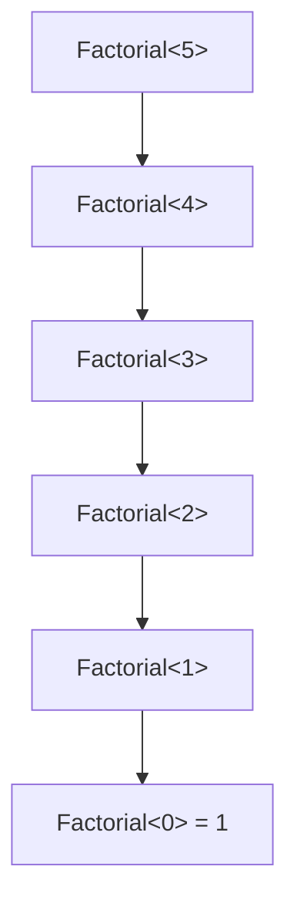

Compile-time recursion, often tricky to debug.

---

### 10.5 C++ – Taxon 5: Staging / Const Evaluation

`constexpr` functions:

```cpp
constexpr int doubled(int x) {
    return x * 2;
}

constexpr int N = doubled(4);

int main() {
    int arr[N]; // N is known at compile-time: 8
}
```

**Classification**

* **R**: expression AST allowed in `constexpr` context.
* **T**: yes – evaluation at compile-time.
* **S**: yes – const-eval stage.

→ **Taxon 5: staging / const eval.**

---

### 10.6 C++ – Taxon 6: DSLs & Build-Time Codegen

Again, Protobuf is canonical:

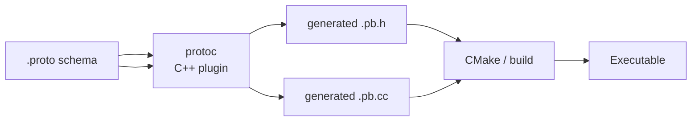

**Classification**

* **R**: schema AST for `.proto`.
* **T**: yes – generator emits C++ classes and RPC stubs.
* **S**: yes – integrated build; errors block build.

→ **Taxon 6: DSLs & build-time codegen.**

Any IDL → C++ workflow fits here.

---

### 10.7 C++ – Taxon 7: Reflection / Non-Generative DSLs

Runtime reflection is limited, but libraries simulate reflection via macros/templates. Non-generative DSLs are abundant.

Example: non-generative DSL with fluent API:

```cpp
auto query = db.table("users")
    .where("age > 18")
    .order_by("name")
    .limit(10);
```

If all of this is:

* implemented as normal functions/templates,
* results in a prepared SQL statement or similar,
* no code generation,

then:

* **R**: values and types, no code-level representation,
* **T**: false – only runtime behaviour, no generated C++ code,
* **S**: N/A.

→ **Taxon 7: non-generative DSL (adjacent).**

---

### 10.8 C++ – Taxon 8: Dynamic Meta / JIT (via LLVM)

Using LLVM to JIT-generate code at runtime:

```cpp
// Conceptual shape only
llvm::LLVMContext ctx;
llvm::Module module("jit", ctx);
// build IR for a function: int add(int,int)
llvm::Function* add_fn = build_add_function(module);

auto jit = llvm::orc::LLJITBuilder().create();
jit->addIRModule(llvm::orc::ThreadSafeModule(
    std::move(module), std::make_unique<llvm::LLVMContext>(ctx)));

auto sym = jit->lookup("add");
int (*add)(int, int) = (int (*)(int, int)) sym.getAddress();
int result = add(2, 3);
```

**Classification**

* **R**: LLVM IR (R = strong).
* **T**: yes – generates machine code at runtime.
* **S**: false – runtime JIT.

→ **Taxon 8: dynamic structured metaprogramming.**

### Checkpoint 5
In C++, how does template metaprogramming (TMP) exemplify Taxon 4?

---

## 11. Checkpoint Answers

**Checkpoint 1**: The technique is Taxon 2: Syntactic / procedural macros, as it involves AST-level transformations at compile time (R = strong, T = true, S = true).

**Checkpoint 2**: Reflection is classified as Taxon 7 because it typically provides metadata inspection without generating new code (T = false), and it often occurs at runtime without an enforced pre-runtime phase.

**Checkpoint 3**: `macro_rules!` is classified under Taxon 1 in Rust because it operates on token trees with weak reification (R = weak), performs substitutions (T = true), and expands before parsing/type-checking (S = true), aligning with textual static metaprogramming despite some structure.

**Checkpoint 4**: Python lacks Taxon 5 because it has no enforced compile-time evaluation phase for expressions; any constant-like behavior occurs at import-time or runtime, without a true staging mechanism (S = false for such evaluations).

**Checkpoint 5**: TMP exemplifies Taxon 4 in C++ by using the type system and template parameters as a compile-time logic engine (R = strong at type level, T = true via instantiation, S = true), enabling computations like factorial through recursive template specialization.

---

## 12. M01C03 Glossary

Aligned with M01C01–M01C02.

| Term                               | Definition                                                                                                                                                                                                         |
| ---------------------------------- | ------------------------------------------------------------------------------------------------------------------------------------------------------------------------------------------------------------------ |
| **Reification (R)**                | Treating code as data at some structural level. Same scale as M01C01: **R = none** (plain text/bytes), **R = weak** (tokens/token trees), **R = strong** (CST/AST/IR/bytecode with structure and often semantics). |
| **Transformation (T)**             | Generating new code or rewriting existing code that becomes part of the final compiled or executed program.                                                                                                        |
| **Staging (S)**                    | Presence of an **enforced pre-runtime phase** (build, macro expansion, compilation, linking) in which metaprogramming mechanisms must run; failure of this phase blocks producing a runnable program.              |
| **Static metaprogramming**         | Metaprogramming where **T = true**, **S = true**, and code is handled as structured data (**R ≥ weak**); includes syntactic macros, templates/generics, const eval, and structured build-time codegen.             |
| **Dynamic metaprogramming**        | Metaprogramming where **T = true**, **S = false**; code is generated/transformed at runtime or import-time, with any R (none/weak/strong).                                                                         |
| **Textual static metaprogramming** | Static metaprogramming where **T = true**, **S = true**, but operations are essentially textual/token-level without robust syntax or binding (e.g. preprocessor macros, string substitution codegen).              |
| **Syntactic / procedural macro**   | Compile-time function or mechanism that transforms parsed syntax (AST) into new syntax, participating in compilation (e.g. Rust proc macros, C++26 reflection-based codegen, AST tools wired into the build).      |
| **Generics**                       | Parametric code over type parameters and constraints, instantiated at compile time (e.g. Rust generics, C++ templates, Python `typing.Generic` at type-check time).                                                |
| **Monomorphisation**               | Compile-time generation of concrete instances from generic definitions by substituting type parameters with concrete types.                                                                                        |
| **Type-level programming**         | Encoding computations and invariants in the type system using types, bounds, const generics, and resolution mechanisms (e.g. C++ TMP, Rust phantom types and const generic logic).                                 |
| **Staging / const evaluation**     | Technique where some expressions are evaluated at compile time (e.g. Rust `const fn`, C++ `constexpr`); their results feed into types, values, or layout.                                                          |
| **DSL (Domain-Specific Language)** | Language or notation tailored to a specific domain, implemented via libraries or with build-time code generation; may or may not involve code generation.                                                          |
| **Reflection**                     | Ability to inspect program structure or metadata (types, fields, methods, annotations) at compile-time or runtime, without necessarily generating new code.                                                        |
| **Core static mechanism**          | Technique that satisfies R–T–S and runs before runtime (Taxa 1–6); e.g. generics, syntactic macros, const eval, structured DSL codegen.                                                                            |
| **Adjacent mechanism**             | Technique that is meta-like but does not satisfy full R–T–S (typically **T = false** or **S** not enforced), e.g. reflection-only APIs, non-generative DSLs.                                                       |
| **Dynamic JIT**                    | Runtime system that compiles IR/bytecode to machine code and optimises based on runtime behaviour; an instance of dynamic metaprogramming (Taxon 8).                                                               |

---

## 13. ADR – Module-Level Design Choices

**Context**

M01C03 builds on:

* **R–T–S + meta-levels** (M01C01),
* **representations and invariants** (M01C02),

to define a concrete **taxonomy of metaprogramming techniques** across languages.

**Decision**

1. Use **R–T–S** as the **canonical lens**:

   * static vs dynamic via **S**,
   * textual vs structured via **R**,
   * generative vs non-generative via **T**.

2. Fix **eight taxa** that cover the majority of real-world mechanisms:

   * **Taxa 1–6**: core static techniques (textual static, syntactic static, generics, type-level, staging/const, DSL/codegen),
   * **Taxon 7**: adjacent (reflection / non-generative DSLs),
   * **Taxon 8**: dynamic meta / JIT.

3. Treat **generics and type-level programming** as **core static mechanisms over types** for the purposes of this taxonomy:

   * they may be “non-meta” under strict R–T–S in M01C01,
   * but they belong to **Taxon 3 / 4** so they can be directly compared to macros, staging, and codegen in M01C04–M01C05.

4. Maintain the **language-neutral core (§§1–7)** and **per-language tracks (§§8–10)** for Rust, Python, C++ with one mapping table per taxon.

**Rationale**

* Teams need a **finite, explicit list** of buckets to place mechanisms into; eight taxa are a pragmatic compromise between precision and usability.
* Pulling generics and type-level tricks into the taxonomy as **first-class taxa** avoids “back-door” metaprogramming:

  * parametric abstraction and type-level encoding are clearly accounted for,
  * you can compare them quantitatively to macros and codegen later.

* The taxonomy is the bridge from **theory (M01C01–M01C02)** to **trade-offs and policy (M01C04–M01C05)**.

**Extensibility**

To add a new language or mechanism:

1. Enumerate its techniques (macros, templates, staging, reflection-only APIs, DSLs, JITs).
2. For each technique:

   * determine **R** (text/tokens/AST/types/IR),
   * check **T** (does it generate/transform code?),
   * check **S** (is staging enforced pre-runtime?),
   * assign a **taxon (1–8)**.

3. Extend the language track with concrete examples per taxon.

The **eight-taxonomy layout** is intended to remain fixed; new mechanisms fill it, they do not reshape it.

**Consequences**

* All later scoring (M01C04) and WSM decisions (M01C05) **must refer to these taxa**; ad-hoc labels are discouraged.
* When a new mechanism is introduced in any language, it should come with an explicit taxon assignment.
