# M01C04 – Expressiveness, Safety, and Complexity

---

## 0. Learning Objectives

After M01C04 you should be able to:

1. Evaluate the metaprogramming **taxa from M01C03** (baseline, generics, syntactic macros, textual codegen, type-level programming, staging/const, reflection, dynamic/JIT) along three axes:

   * **Expressiveness**
   * **Safety**
   * **Complexity** (compile-time, runtime, cognitive)
2. Use a **1–10 scoring rubric** (heuristic, not “scientific”) to compare modalities.
3. Recognise **typical failure modes** for each taxon.
4. See how these trade-offs play out concretely in:

   * **Rust** (core static-meta ecosystem),
   * **Python** (dynamic, reflection-heavy),
   * **C++** (templates, TMP, constexpr, reflection).
5. Apply pragmatic heuristics that already bias you toward the **Weakest Sufficient Mechanism (WSM)**, which M01C05 will formalise.

**Structure**

* §§1–7 – language-neutral core (no code, only concepts)
* §§8–10 – language tracks (Rust, Python, C++) with deep examples per taxon
* §11 – checkpoint answers
* §12 – glossary
* §13 – ADR (design choices, extensibility)

---

## 1. Why Trade-Offs Matter

From M01C01–M01C03 you now have:

* the **R–T–S triad** (Reification, Transformation, Staging),
* concrete representations (tokens, CST, AST, IR, bytecode),
* an eight-way **taxonomy** of techniques:

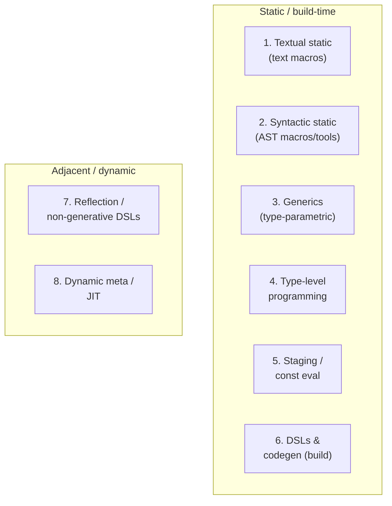

What is still missing is **how to choose**.

Every modality buys **something** and costs **something**:

* less boilerplate vs. noisier errors,
* stronger invariants vs. heavier compile times,
* “nicer” syntax vs. harder debuggability.

M01C04 introduces a **three-axis lens** to quantify these trade-offs qualitatively and prepare for the **WSM + Tier** machinery in M01C05.

---

## 2. The Three Axes and the Scoring Rubric

We always score **relative to a baseline**:

> Baseline = idiomatic code in the object language **with no explicit meta**
> (plain functions, types, modules)

Baseline is “Tier 0”.

### 2.1 Expressiveness

**Expressiveness** = how much additional structure, abstraction, or automation you can express beyond baseline.

Indicators:

* ability to eliminate **repeated patterns** via reusable constructs;
* ability to **introspect** and act on structure (fields, variants, types);
* ability to define **DSLs** or staged programs.

**Heuristic scale (1–10)**

| Score | Meaning                                                                                   |
| ----- | ----------------------------------------------------------------------------------------- |
| 1     | Almost no additional expressive power vs copy–paste.                                      |
| 5     | Baseline – ordinary functions, classes/types, modules.                                    |
| 7     | Can capture reusable patterns across many types/modules (e.g. generics).                  |
| 9–10  | Can encode DSLs, staged programs, and complex invariants (macros, TMP, powerful codegen). |

### 2.2 Safety

**Safety** = how effectively the modality:

* prevents incorrect programs, and
* localises errors when they occur.

Signals:

* strong static checks,
* tight error spans,
* macro hygiene / predictable binding,
* absence of silent miscompilation.

**Heuristic scale (1–10)**

| Score | Meaning                                                                                 |
| ----- | --------------------------------------------------------------------------------------- |
| 10    | Violations are compile-time errors with accurate, local diagnostics.                    |
| 7     | Most problems caught statically; some confusing edges, but behaviour is still explicit. |
| 5     | Mix of static and runtime errors; failures can be non-local but still diagnosable.      |
| 1     | Wrong behaviour / UB is easy; diagnostics often misleading or far from the root cause.  |

Baseline in a strongly checked language is **≈10**.

### 2.3 Complexity

**Complexity** is explicitly **3-dimensional**:

1. **Compile-time complexity**
   *Additional build time, memory, and passes.*

2. **Runtime complexity**
   *Binary size, startup overhead, performance variance.*

3. **Cognitive complexity**
   *How hard it is for a competent engineer to understand / modify / debug.*

**Heuristic scale (1–10)**

| Score | Meaning                                                                        |
| ----- | ------------------------------------------------------------------------------ |
| 1     | Negligible overhead; straightforward for mid-level engineers.                  |
| 5     | Noticeable overhead; needs some specialised knowledge or tuning.               |
| 10    | Very high overhead; fragile builds, or only specialists can safely work on it. |

**Baseline** (no meta) is **(E, S, Cc, Cr, Cg) ≈ (5, 10, 1, 1, 1)**
(Expressiveness 5, Safety 10, Complexity compile/runtime/cognitive = 1/1/1).

---

## 3. Mapping the Axes to M01C03 Taxa

We now sketch **canonical profiles** for each taxon, without language specifics.
Detailed examples per language come later.

### 3.1 Canonical Scores per Taxon (Neutral View)

| Taxon / Modality                | Expressiveness | Safety | Complexity (compile / runtime / cognitive) |
| ------------------------------- | -------------- | ------ | ------------------------------------------ |
| **Baseline (no meta)**          | 5              | 10     | 1 / 1 / 1                                  |
| **T3 – Generics**               | 7              | 9      | 3 / 2 / 3                                  |
| **T2 – Syntactic macros**       | 9              | 7      | 6 / 2 / 7                                  |
| **T1 – Textual static**         | 8              | 4      | 4 / 1 / 7                                  |
| **T4 – Type-level programming** | 8              | 8      | 6 / 1 / 7                                  |
| **T5 – Const eval / staging**   | 6              | 9      | 2 / 1 / 2                                  |
| **T7/8 – Reflection / dynamic** | 6              | 5      | 3 / 4 / 5                                  |

These are **anchors**, not measurements.
They encode “direction and order of magnitude”, not pseudo-scientific precision.

### 3.2 Visualising Trade-offs

Think of each modality as a point in a 3D space:

* **E**: Expressiveness
* **S**: Safety
* **C**: Complexity (compile / runtime / cognitive)

We cannot plot 3D easily in text, so we compress to **qualitative bands**:

| Modality                     | Expressiveness (E) | Safety (S)  | Complexity (C, overall) |
| ---------------------------- | ------------------ | ----------- | ----------------------- |
| Baseline                     | Medium             | Very high   | Very low                |
| Generics (Taxon 3)           | High               | High        | Low–medium              |
| Const eval / staging (T5)    | Medium–high        | Very high   | Very low                |
| Type-level programming (T4)  | High               | High        | High                    |
| Syntactic / proc macros (T2) | Very high          | Medium–high | High                    |
| Textual codegen (T6)         | High               | Low–medium  | High                    |
| Reflection / dynamic (T7/8)  | Medium–high        | Low–medium  | Medium–high             |

A rough **“map”** of where these sit (E on x-axis, S on y-axis) can be approximated by a simple graph:

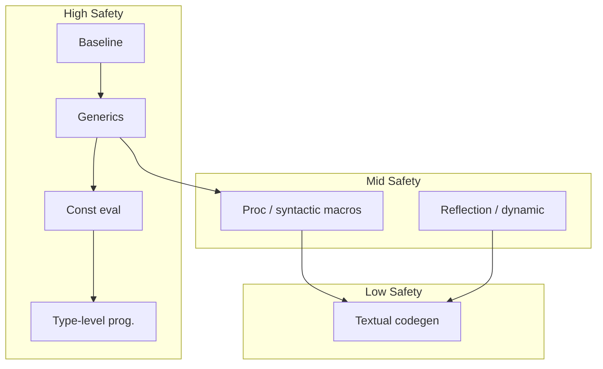

Interpretation (qualitative):

* **Baseline, generics, const eval** live in “high S, low C” space → usually *good defaults*.
* **Proc macros and type-level programming** push toward **very high E** but also **high C**.
* **Textual codegen** sits in **high E / low S / high C** → powerful, but fragile.
* **Reflection/dynamic** tends to **drop S** and **increase runtime & cognitive complexity**, even when E is attractive.

---

**Checkpoint 1 – Generics vs Macros**

You have a small repeated pattern over several types: a pair of “get + set + log” operations that differ only in the inner type.

1. In which order should you consider the following modalities: **baseline, generics (Taxon 3), syntactic macros (Taxon 2)?**
2. Give one concrete reason you might still justify a macro after trying generics.


---

## 4. Neutral Profiles per Taxon (No Code, Just Behaviour)

Here we describe each taxon in neutral terms. Concrete Rust/Python/C++ instantiations come in §§8–10.

### 4.1 Taxon 1 – Textual Static Metaprogramming

**R**: none/weak (strings or flat tokens)
**T**: true (substitution/concatenation)
**S**: true (pre-runtime, enforced)

**Usage**

* Preprocessors and string-based generators that run before the compiler.
* Typical operations: macro substitution, token pasting, regex/templating on source.

**Pros**

* High **expressiveness** once you’re comfortable emitting arbitrary source.
* Simple toolchains: “just text in, text out”.

**Cons / Failure Modes**

* **Safety**:

  * errors surface only after expansion; spans often point to generated code, not the origin;
  * operator precedence, scoping, and binding are “hand-managed”.
* **Cognitive complexity**:

  * results can be opaque; understanding requires mentally inlining expansions;
  * IDEs and refactors often cannot track generated structure.

Used sparingly, acceptable for trivial helpers; as a foundation, risky.

---

### 4.2 Taxon 2 – Syntactic / Procedural Macros

**R**: strong (AST / structured syntax)
**T**: true (AST→AST transforms)
**S**: true (compile-time, enforced)

**Usage**

* AST-level macros (derive-like functionality, attribute macros, AST tools integrated into build).

**Pros**

* High **expressiveness** with **structured** view:

  * can inspect fields, variants, attributes, control flow;
  * can generate complex boilerplate consistently.
* Better safety than textual macros:

  * syntactically valid trees by construction;
  * hygiene mechanisms are possible.

**Cons / Failure Modes**

* **Compile-time** complexity: heavy macros increase build times.
* **Cognitive** complexity:

  * developers must understand both the macro API and its expansion behaviour;
  * debugging can require inspecting expanded code.
* Error locality depends on macro author discipline.

Correctly used, this is the “serious static meta” workhorse.

---

### 4.3 Taxon 3 – Generics

**R**: types and type environments
**T**: true (instantiation/monomorphisation)
**S**: true (compile-time)

**Usage**

* Parametric functions, classes/types with bounded type parameters.

**Pros**

* Strong **safety**: type errors are local and early.
* Expressiveness sufficient for many abstractions:

  * generic containers, algorithms, protocols.
* Often zero-cost at runtime.

**Cons / Failure Modes**

* **Error verbosity** in complex constraint setups.
* **Cognitive** complexity when type hierarchies grow deep or recursive.

As a rule: **try generics first** before any more powerful static meta.

---

### 4.4 Taxon 4 – Type-Level Programming

**R**: types, const generics, type-level values
**T**: true (type resolution / instantiation computes)
**S**: true (type-checking phase)

**Usage**

* Encoding invariants or computations *in the type system*:

  * dimensions, protocol states, capability sets.

**Pros**

* Very strong **safety** for encoded invariants.
* High **expressiveness**: the type system becomes a logic engine.

**Cons / Failure Modes**

* **Cognitive** and **compile-time** complexity spike:

  * error messages can be almost unreadable;
  * tiny changes in logic can cause deep instantiation chains.
* Potential for “type puzzles” that only experts can maintain.

You use this when you genuinely need **type-level guarantees**, not for elegance points.

---

### 4.5 Taxon 5 – Staging / Const Evaluation

**R**: restricted expression AST
**T**: true (compile-time evaluation)
**S**: true (const eval phase)

**Usage**

* Evaluating expressions at compile time:

  * array sizes, layout parameters, precomputed tables, small lookup maps.

**Pros**

* Good **safety** (const-eval rules are precise).
* Lower **complexity** than full type-level programming or macros:

  * mostly mostly local; easy to reason about.
* Useful for performance / footprint optimisations.

**Cons / Failure Modes**

* Diagnostics can be opaque when you hit the limits of what is const-allowed.
* Overuse for trivial computations can unclear the code.

Typically a **low-risk static mechanism**; often preferable to more heavyweight meta when applicable.

---

### 4.6 Taxon 6 – DSLs & Build-Time Code Generation

**R**: schemas, DSL ASTs, data models
**T**: true (source/config generation)
**S**: true (build step required)

**Usage**

* IDL / schema → code (e.g. protocol buffers, RPC stubs).
* Build scripts that emit source files consumed in compilation.

**Pros**

* High **expressiveness**: can generate multi-language code from a single specification.
* Keeps schemas as single source of truth.

**Cons / Failure Modes**

* **Safety** and debugging depend heavily on generator quality:

  * error spans often point into generated code, not schemas;
  * if generator drifts or is under-tested, entire pipelines suffer.
* **Cognitive**:

  * understanding behaviour requires following the schema → generator → code chain.

This is justified when you *already* have a schema and multi-language targets. For purely intra-language abstraction, it is usually overkill.

---

### 4.7 Taxon 7 – Reflection & Non-Generative DSLs

**R**: objects, metadata, types, but
**T**: often false (no new code), or purely local behaviour changes
**S**: static or runtime (varies)

**Usage**

* Reflection APIs exposing structure (fields, methods, annotations).
* Fluent APIs and DSLs that produce **values** (queries, pipelines) but not new code.

**Pros**

* Adds *introspective* power without necessarily generating code.
* In dynamic settings, can simplify some tasks (serialisation, logging, UI binding).

**Cons / Failure Modes**

* Not strictly “metaprogramming” under R–T–S when T = false.
* Overuse can hide behaviour in runtime meta-layers (e.g. reflection-driven frameworks).
* Errors discovered at runtime, often non-local.

These are **adjacent** to meta: you still need to reason about them carefully, but they don’t fit core static R–T–S.

---

### 4.8 Taxon 8 – Dynamic Metaprogramming / JIT

**R**: text / AST / IR / bytecode
**T**: true (runtime codegen / specialisation)
**S**: false (runtime / import-time)

**Usage**

* Runtime code generation and evaluation:

  * eval/exec,
  * AST→code at runtime,
  * JIT compilers that specialise hot paths.

**Pros**

* Very high **expressiveness**; can adapt to runtime conditions.
* Good fit for environments where static compilation is impractical or too rigid.

**Cons / Failure Modes**

* **Safety**:

  * failures appear in production, not at build;
  * reliance on runtime invariants and environment.
* **Runtime complexity**:

  * performance may vary unpredictably;
  * memory and startup overhead.
* **Cognitive**: call stacks and behaviour can differ dramatically from the static picture.

Excellent in certain domains (JIT’d numerics, dynamic languages) but a poor default for infrastructure where static guarantees are valuable.

### Checkpoint 2 – Const Eval vs Type-Level

You need a buffer whose size is `N * 2` for some compile-time constant `N`.

1. Which taxon is the natural first choice: const eval (T5) or type-level programming (T4)?
2. What extra benefit would T4 give that T5 does not, and when would that matter?

---

## 5. Neutral Design Heuristics (Pre-WSM)

These rules are language-agnostic and explicitly conservative.

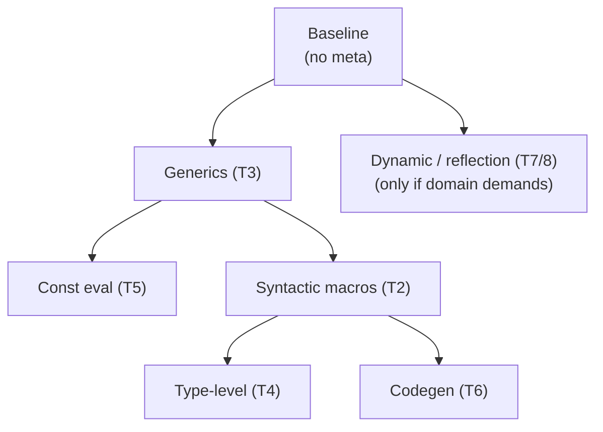

1. **Start at baseline**
   If plain code with functions/types solves the problem adequately, **stop**.

2. **Escalate to generics first (T3)**
   When copying patterns across types, introduce parametric abstraction and traits/type classes rather than immediate meta-machinery.

3. **Use const eval before exotic type-level encodings (T5 > T4)**
   For compile-time values, staging is simpler and safer than encoding everything into types.

4. **Add syntactic macros only when you need structure-aware generation (T2)**
   Typical justifications:

   * field/variant introspection,
   * repetitive boilerplate across many definitions,
   * domain-specific annotations tied to syntax.

5. **Reserve textual codegen (T6) for schema-driven or boundary problems**
   Use it when:

   * there is a **clear external schema**, or
   * multiple target languages must be fed from one description.

6. **Treat heavy type-level programming as a specialist tool (T4)**
   Use it when incorrect states are **catastrophic** and must be excluded by construction.

7. **Be sceptical of dynamic meta (T7/8) in long-lived systems**
   If static alternatives exist at acceptable cost, they often win in safety and maintainability.

M01C05 will encode these into explicit **Tiers** and a **toll ledger**.

### Checkpoint 3 – Textual Codegen

An organisation already maintains a language-agnostic schema for services (RPC endpoints, messages) and targets three languages.

1. Which taxon does “schema → code in three languages” belong to?
2. What is the main safety risk in this setup?

---

## 6. Checkpoints (Neutral Questions)

You can answer now or after reading language tracks; official answers in §11.

**Checkpoint 4 – Dynamic vs Static Meta**

A system uses runtime reflection to automatically wire dependencies and map HTTP routes.

1. Which taxon does this belong to?
2. Name one advantage and one downside compared to a statically generated routing table.

---

## 8. Rust Track – Expressiveness / Safety / Complexity in Practice

We walk the main taxa from M01C03 in Rust, with concrete code and “how this feels in a real codebase” commentary.

---

### 8.1 Rust – Baseline (No Explicit Meta)

Baseline Rust: `struct`, `enum`, `impl`, `fn`, traits, modules. No macros beyond `derive` on std traits, no `build.rs`, no const trickery.

#### Example – HTTP Request Model and Handler

```rust
#[derive(Debug)]
struct UserId(u64);

#[derive(Debug)]
struct User {
    id: UserId,
    name: String,
    email: String,
}

fn handle_create_user(name: String, email: String) -> User {
    // in real code: validate input, write to DB, etc.
    User {
        id: UserId(1),
        name,
        email,
    }
}

fn main() {
    let u = handle_create_user("Alice".into(), "alice@example.com".into());
    println!("{u:?}");
}
```

Everything is explicit:

* Data model: `User`, `UserId`.
* Behaviour: plain functions.

**Scores**

* E = 5 – you have basic abstraction (types, functions, traits).
* S = 10 – all constraints are enforced by the compiler or explicit runtime checks.
* C = 1 / 1 / 1 – negligible overhead.

**Takeaway**

This is your **reference point**. Any meta-layer must justify itself against this mental baseline.

---

### 8.2 Rust – Generics (T3) – Reusing Behaviour Across Types

Generics are the first serious escalation: we start abstracting over *families* of types.

#### Example – Generic Repository Interface

```rust
use std::fmt::Debug;

pub trait Entity {
    type Id: Copy + Debug;
    fn id(&self) -> Self::Id;
}

#[derive(Debug)]
struct UserId(u64);

#[derive(Debug)]
struct User {
    id: UserId,
    name: String,
}

impl Entity for User {
    type Id = UserId;
    fn id(&self) -> Self::Id {
        self.id
    }
}

pub trait Repository<E: Entity> {
    fn get(&self, id: E::Id) -> Option<E>;
    fn save(&self, entity: &E);
}

struct InMemoryRepo<E: Entity> {
    items: Vec<E>,
}

impl<E: Entity> Repository<E> for InMemoryRepo<E> {
    fn get(&self, id: E::Id) -> Option<E> {
        self.items.iter().find(|e| e.id() == id).cloned()
    }

    fn save(&self, entity: &E) {
        // naive: no dedup for brevity
        self.items.push(entity.clone());
    }
}
```

We now have:

* one generic `Repository<E>` trait,
* one generic `InMemoryRepo<E>` struct,
* concrete `User` plugging into that via `impl Entity`.

**Scores (Rust-specific)**

* Expressiveness ≈ 7
  – one generic repo instead of N almost-identical repos.
* Safety ≈ 9
  – misuse surfaces as type errors at call sites.
* Complexity ≈ compile 3 / runtime 2 / cognitive 3
  – you need to understand associated types and trait bounds, but it’s still “normal Rust”.

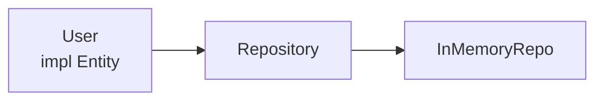

**Failure modes**

* Over-generalised traits (“god traits”) with many associated types and bounds.
* Error messages that explode once you add nested generics and higher-order traits.

**Rule**

If you can express a pattern with **traits + generics** without grotesque bounds, do that first. You’re still in relatively low-complexity territory.

---

### 8.3 Rust – Const Eval / Staging (T5)

Const evaluation is valuable for *configuration baked into types* and small precomputation.

#### Example – Compile-Time Lookup Table

```rust
const fn sbox_entry(i: u8) -> u8 {
    // toy example: some reversible permutation
    i.rotate_left(3) ^ 0b1010_1010
}

const fn build_sbox() -> [u8; 256] {
    let mut table = [0u8; 256];
    let mut i = 0;
    while i < 256 {
        table[i] = sbox_entry(i as u8);
        i += 1;
    }
    table
}

const SBOX: [u8; 256] = build_sbox();

fn substitute_block(block: &mut [u8; 16]) {
    for b in block.iter_mut() {
        *b = SBOX[*b as usize];
    }
}
```

**Scores**

* E ≈ 6
  – can precompute tables, constants, and layout-related values.
* S ≈ 9
  – misuse (non-const operations) is a compile-time error.
* C ≈ compile 2 / runtime 1 / cognitive 2.

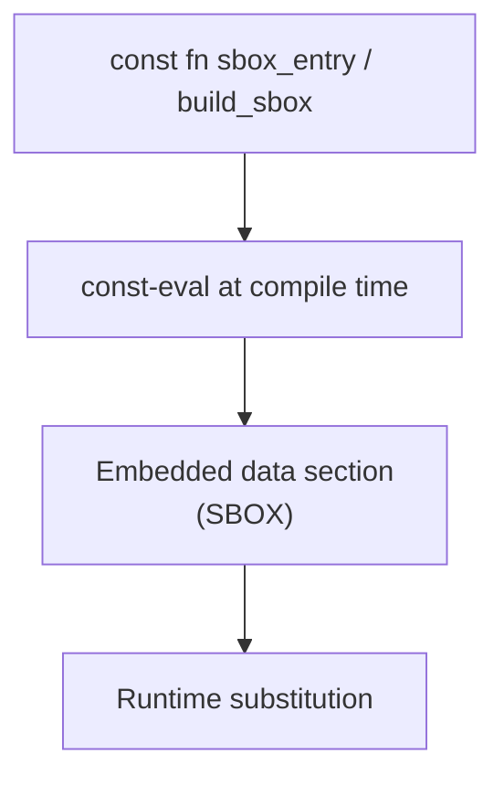

**Overuse**

* Trying to cram an entire pipeline (I/O, parsing, heavy numeric algorithms) into `const fn`.
  You quickly hit const restrictions and end with contorted code.

**Guideline**

Use const eval for:

* small, deterministic, **pure** computations;
* configuration baked into types or static data.

If the logic is non-trivial to explain verbally, consider leaving it at runtime.

---

### 8.4 Rust – Syntactic / Procedural Macros (T2)

Procedural macros are where Rust’s **core static meta** lives.

#### Example – Derive for Audit Logging

```rust
// in a proc-macro crate

use proc_macro::TokenStream;
use quote::quote;
use syn::{parse_macro_input, DeriveInput};

#[proc_macro_derive(Audit)]
pub fn derive_audit(input: TokenStream) -> TokenStream {
    let ast = parse_macro_input!(input as DeriveInput);
    let name = &ast.ident;

    // only support structs
    let data = match ast.data {
        syn::Data::Struct(ref s) => &s.fields,
        _ => panic!("#[derive(Audit)] only supports structs"),
    };

    let field_idents = data.iter().map(|f| f.ident.as_ref().unwrap());

    let expanded = quote! {
        impl #name {
            pub fn log_audit(&self) {
                println!("AUDIT: {} {{", stringify!(#name));
                #(
                    println!(
                        "  {} = {:?}",
                        stringify!(#field_idents),
                        &self.#field_idents
                    );
                )*
                println!("}}");
            }
        }
    };

    expanded.into()
}
```

Usage:

```rust
#[derive(Audit)]
struct Payment {
    id: u64,
    amount_cents: u64,
    approved: bool,
}

fn main() {
    let p = Payment { id: 1, amount_cents: 10_00, approved: true };
    p.log_audit();
}
```

**Scores**

* E ≈ 9 – you can derive a whole “mini-framework” API from plain struct declarations.
* S ≈ 7 – still strongly typed; but misdesigned macros can mislead error diagnostics.
* C ≈ compile 6 / runtime 2 / cognitive 7 – macro code, macro API, and expansions must all be understood.

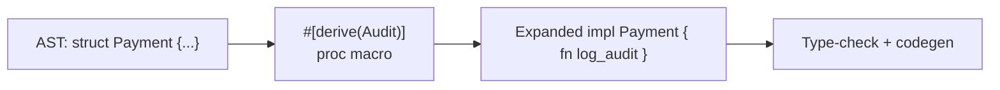

**Rust-specific failure modes**

* Macro produces code that depends on hidden invariants (e.g. `pub`/`private` fields, naming conventions).
* span handling is sloppy → user sees errors pointing deep into generated code.
* macros add hidden control-flow / allocations that confuse performance reasoning.

**Use when**

* you need **field-level introspection**,
* the pattern is repeated across many types,
* and you can commit to maintaining the macro code as a first-class component.

---

### 8.5 Rust – Textual Codegen (T6) via `build.rs`

Build scripts can be structured (AST-based) or purely textual. Here we focus on **pure textual** to show the risk.

```rust
// build.rs
use std::{env, fs::File, io::Write, path::Path};

fn main() {
    let out_dir = env::var("OUT_DIR").unwrap();
    let dest = Path::new(&out_dir).join("version.rs");
    let mut f = File::create(dest).unwrap();

    let git_hash = env::var("GIT_COMMIT_HASH").unwrap_or_else(|_| "unknown".into());
    writeln!(
        f,
        "pub const GIT_COMMIT_HASH: &str = \"{}\";",
        git_hash
    ).unwrap();

    println!("cargo:rerun-if-env-changed=GIT_COMMIT_HASH");
}

// src/main.rs
include!(concat!(env!("OUT_DIR"), "/version.rs"));

fn main() {
    println!("commit: {GIT_COMMIT_HASH}");
}
```

This is harmless and common. But note:

* The generator writes a **string of Rust source**.
* The compiler only sees the result; static tools don’t know where it came from.

**Scores (pure textual)**

* E ≈ 8 – you can generate arbitrary Rust code.
* S ≈ 4 – syntax/type errors only found post-generation; no hygiene.
* C ≈ compile 4 / runtime 1 / cognitive 7.

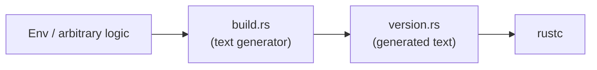

**Danger zone**

Once people start generating **logic** (trait impls, APIs) as text:

* IDE tooling, LSP, and refactors fail to see real dependencies.
* breaking changes in Rust syntax or semantics can silently invalidate the generator.

**Guideline**

* Use textual generation only when the generator is trivial (like version info), or when there is an external schema and you accept the cost.
* For anything substantial, prefer **proc macros** or structured generators working over AST.

---

### 8.6 Rust – Type-Level Programming (T4)

Rust’s trait system and const generics let you encode behavioural states in the type system.

#### Example – Simple State Machine for a Connection

```rust
struct Closed;
struct Open;

struct Connection<State> {
    id: u64,
    state: std::marker::PhantomData<State>,
}

impl Connection<Closed> {
    fn open(self) -> Connection<Open> {
        // do actual open
        Connection { id: self.id, state: std::marker::PhantomData }
    }
}

impl Connection<Open> {
    fn send(&self, data: &[u8]) {
        // can only send when Open
        println!("send {} bytes on {}", data.len(), self.id);
    }

    fn close(self) -> Connection<Closed> {
        // do actual close
        Connection { id: self.id, state: std::marker::PhantomData }
    }
}
```

**Scores**

* E ≈ 8 – the type system now encodes state transitions.
* S ≈ 8 – misuse is a compile-time error (you cannot call `send` on `Connection<Closed>`).
* C ≈ compile 6 / runtime 1 / cognitive 7 – type signatures become more involved; newcomers must understand the phantom state pattern.

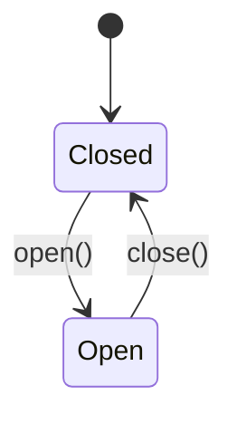

**Failure modes**

* Once you embed more dimensions (permissions, protocol versions, capabilities), types become unreadable.
* Trait bounds combining multiple phantom states become cryptic.

**Guideline**

Use this pattern when:

* mis-ordering operations is **truly** costly (e.g. cryptographic handshakes, DB transactions),
* and you’re willing to pay the mental overhead.

---

### 8.7 Rust – Reflection & Dynamic Meta (T7/8)

Rust has no built-in runtime reflection, but you can simulate meta or go dynamic through FFI and loaders.

#### Example – Plugin Loader with `libloading`

```rust
use libloading::{Library, Symbol};

type Handler = unsafe extern "C" fn(input: &str) -> String;

fn main() {
    let lib = Library::new("libplugin.so").unwrap();
    unsafe {
        let f: Symbol<Handler> = lib.get(b"handle_request").unwrap();
        let out = f("ping");
        println!("{out}");
    }
}
```

This is **Taxon 8**: you are loading code at runtime and calling into it.

* E ≈ 8 – you can add behaviour without recompiling.
* S ≈ 4 – unresolved symbols, ABI mismatches, and runtime-only failures.
* C ≈ compile 3 / runtime 6 / cognitive 7 – operational and debugging complexity are high.

Rust encourages static meta precisely to **avoid** this class of issues, but the pattern is available when you need dynamic plugins.

---

### 8.8 Rust Example – Builder Pattern Across Taxa (Recap Diagram)

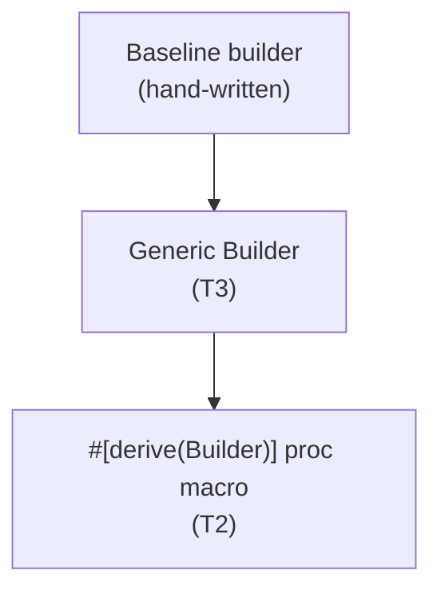

* **Baseline** – simplest to read; manual per type.
* **Generics** – introduces a reusable `Builder<T>` concept without heavy meta.
* **Proc macro** – removes per-type boilerplate at the cost of macro complexity.

The right choice depends on **how many types** and **how complex the builder rules** are. For 1–3 types, baseline wins. For 50+ types with shared behaviour, the macro might be justified.

### Checkpoint 4 – Dynamic vs Static Meta

A system uses runtime reflection to automatically wire dependencies and map HTTP routes.

1. Which taxon does this belong to?
2. Name one advantage and one downside compared to a statically generated routing table.

---

## 9. Python Track – Dynamic First, Static as an Overlay

Python’s default position is **Taxon 7/8**: dynamic meta and reflection are cheap and ubiquitous. Static mechanisms are opt-in layers.

---

### 9.1 Python – Baseline vs Decorators (T8)

#### Baseline – Direct Function

```python
def create_user(name: str, age: int) -> dict:
    # naive; real code would have validation, DB writes, etc.
    return {"name": name, "age": age}

u = create_user("Alice", 30)
print(u)
```

#### Decorator – Cross-Cutting Logging

```python
from functools import wraps
from typing import Callable, Any

def logged(fn: Callable[..., Any]) -> Callable[..., Any]:
    @wraps(fn)
    def wrapper(*args, **kwargs):
        print(f"[LOG] calling {fn.__name__} with args={args}, kwargs={kwargs}")
        result = fn(*args, **kwargs)
        print(f"[LOG] {fn.__name__} -> {result!r}")
        return result
    return wrapper

@logged
def create_user(name: str, age: int) -> dict:
    return {"name": name, "age": age}

create_user("Alice", 30)
```

**Scores (decorator-heavy style)**

* E ≈ 7 – easy cross-cutting behaviour: logging, caching, auth, tracing.
* S ≈ 5 – type/shape mistakes and decorator misuses appear only at runtime.
* C ≈ compile 1 / runtime 3 / cognitive 4 – the call stack now includes wrappers, behaviour can be non-local.

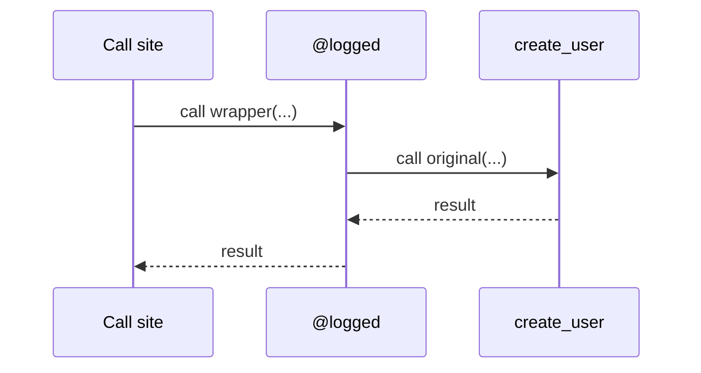

**Risk**

* If decorators depend on global configuration / environment, you now have **runtime configuration meta** layered on top of function logic.
* Error surfaces move from “import-time syntax/type issues” to “runtime path issues”.

---

### 9.2 Python – Static Generics (T3) vs Runtime Behaviour

Type checkers (mypy, Pyright) interpret type hints; the runtime mostly ignores them.

#### Example – Generic Repository Interface

```python
from typing import TypeVar, Generic, Protocol, Optional

T = TypeVar("T")
Id = TypeVar("Id")

class Entity(Protocol[Id]):
    id: Id

class Repository(Generic[T, Id]):
    def get(self, id: Id) -> Optional[T]: ...
    def save(self, entity: T) -> None: ...
```

Concrete implementation:

```python
from dataclasses import dataclass

@dataclass
class User:
    id: int
    name: str

class InMemoryUserRepo(Repository[User, int]):
    def __init__(self) -> None:
        self._items: dict[int, User] = {}

    def get(self, id: int) -> Optional[User]:
        return self._items.get(id)

    def save(self, entity: User) -> None:
        self._items[entity.id] = entity
```

**Static view (type checker)**

* E ≈ 7 – same as Rust generics conceptually.
* S ≈ 8 – many shape/type mismatches caught by myp.
* C ≈ compile 3 / runtime 1 / cognitive 4 – annotation burden and static/dynamic mismatch.

**Runtime view**

At runtime, `Repository[User, int]` is largely erased:

* misuse will not be prevented by the interpreter,
* dynamic code (reflection, `__getattr__`, `**kwargs`) can circumvent types.

This split is important: you must treat static generics as **tooling**, not as language semantics.

---

### 9.3 Python – AST-Based Tools (T2/T6) vs `eval` (T8)

#### Example – Pre-Commit AST Rewriter (Static, T2/T6)

Suppose you want to ban `print` in library code and rewrite it to `logger.info`.

* A pre-commit hook or CI script can:

  * parse each `.py` into an AST,
  * transform `ast.Call(func=Name("print"), ...)` into a `logger.info(...)` call,
  * write back the modified file.

This is:

* R = strong (AST),
* T = true (code rewriting),
* S = “static pipeline” (runs as part of tooling).

It sits in **Taxon 2/6**:

* E high – you can do systematic refactorings,
* S moderate-high – you can validate and test the tool,
* C compile 3 / runtime 1 / cognitive 4–5 (for tool authors).

#### Example – `eval` (Dynamic, T8)

```python
expr = input("Enter expression: ")   # e.g. "1 + 2 * 3"
print(eval(expr))  # DO NOT DO THIS IN REAL CODE
```

* R = none (string),
* T = true (dynamic compilation + execution),
* S = false (runtime).

**Scores**

* E ≈ 8 – can execute arbitrary programs typed by the user.
* S ≈ 3 – security issues, runtime-only failures.
* C ≈ compile 1 / runtime 5 / cognitive 6 – reasoning about behaviour requires thinking like a dynamic language implementer.

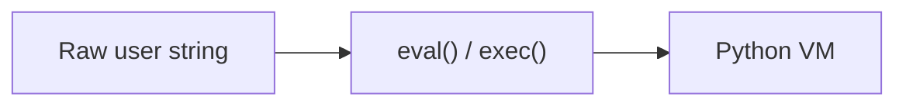

**Takeaway**

* AST-based, staged tools sit in the **static quadrant**.
* `eval` is squarely **dynamic meta** with all the usual risks.

---

### 9.4 Python – Reflection (T7) as Default Mechanism

Python’s reflection surface is huge and cheap:

* `dir(obj)`, `getattr`, `setattr`, `__dict__`,
* `inspect.signature`, `inspect.getsource`,
* metaclasses modifying class creation.

#### Example – Simple ORM-Like Mapping

```python
class ModelMeta(type):
    def __new__(mcls, name, bases, ns):
        fields = {
            key: value
            for key, value in ns.items()
            if not key.startswith("_") and isinstance(value, Field)
        }
        ns["_fields"] = fields
        return super().__new__(mcls, name, bases, ns)

class Field:
    def __init__(self, column: str):
        self.column = column

class Model(metaclass=ModelMeta):
    pass

class User(Model):
    id = Field("id")
    name = Field("name")

# somewhere else
for fname, field in User._fields.items():
    print(fname, "->", field.column)
```

* R = structured metadata on classes and attributes,
* T = limited (we’re not generating new code, only behaviour),
* S = runtime.

**Scores**

* E ≈ 6 – easy to build ORMs, serializers, admin UIs.
* S ≈ 5 – misconfigurations only show at runtime.
* C ≈ compile 1 / runtime 4 / cognitive 5 – behaviour is convention- and reflection-driven.

This is the Python analogue of “macro-heavy” code in static languages: powerful, but you must be honest about the safety and complexity cost.

---

## 10. C++ Track – Static Power, Static Cost

C++ lives almost entirely in the **static quadrant**, with a long history of templates and preprocessor macros, and newer constexpr and reflection.

---

### 10.1 C++ – Templates as Generics (T3) vs TMP (T4)

#### Templates as Generics (T3)

Classic generic container:

```cpp
#include <vector>
#include <algorithm>
#include <iostream>

template<typename T>
void log_vector(const std::vector<T>& v) {
    for (const auto& x : v) std::cout << x << " ";
    std::cout << "\n";
}

int main() {
    std::vector<int> vi{1, 2, 3};
    std::vector<double> vd{1.5, 2.5};
    log_vector(vi);
    log_vector(vd);
}
```

* E ≈ 7 – one generic algorithm works for many types.
* S ≈ 8–9 – misuse becomes a compile-time error.
* C ≈ compile 3 / runtime 1 / cognitive 4.

#### Templates as TMP (T4)

Now use templates **to compute**:

```cpp
template<int N>
struct Fib {
    static const int value = Fib<N - 1>::value + Fib<N - 2>::value;
};

template<>
struct Fib<0> { static const int value = 0; };

template<>
struct Fib<1> { static const int value = 1; };

constexpr int F = Fib<40>::value;
```

* E ≈ 9 – templates as a Turing-complete logic engine.
* S ≈ 7 – still mostly safe, but easy to hit recursion limits and weird errors.
* C ≈ compile 8 / runtime 1 / cognitive 8.

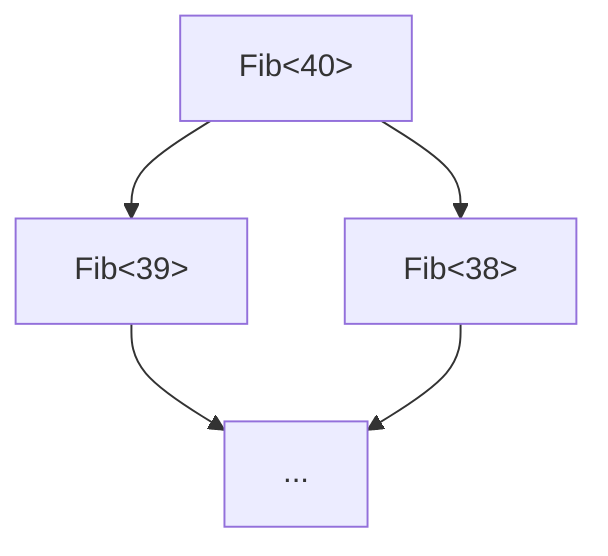

**Takeaway**

The language gives you both; the rubric forces you to acknowledge the **huge complexity jump** when you start encoding logic in template instantiations.

---

### 10.2 C++ – `constexpr` (T5) vs TMP (T4)

Most compile-time numeric logic is better expressed as `constexpr` functions.

```cpp
constexpr int fib(int n) {
    return (n <= 1) ? n : fib(n - 1) + fib(n - 2);
}

constexpr int F = fib(40);
```

* E ≈ 7 – enough for most numeric/structural compile-time needs.
* S ≈ 8 – errors are local; code looks like normal C++.
* C ≈ compile 3 / runtime 1 / cognitive 3.

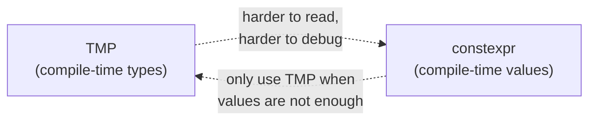

**Guideline**

* Use `constexpr` for compile-time value computations.
* Only move to TMP if you **genuinely** need type-level reasoning.

---

### 10.3 C++ – Preprocessor (T1) vs Reflection/Macros (T2)

#### Preprocessor Logging Macro (T1)

```cpp
#include <iostream>

#define LOG_VAR(x) \
    std::cout << #x << " = " << (x) << " (" << __FILE__ << ":" << __LINE__ << ")\n"

int main() {
    int a = 5;
    LOG_VAR(a);
}
```

* R = weak (tokens/text),

* T = substitution,

* S = static (preprocessing).

* E ≈ 7, S ≈ 3–4, C ≈ compile 3 / runtime 1 / cognitive 6.

Failure modes: precedence problems, double evaluation, weird error locations, no scoping awareness.

#### Reflection + Templates (T2) – C++26-Style

With C++26 reflection (conceptually):

```cpp
// Pseudocode-ish, final syntax may differ
constexpr auto info = reflexpr(MyStruct);

template<typename T>
void log_fields(const T& obj) {
    constexpr auto members = get_data_members(reflexpr(T));
    // iterate members and log names/values
}
```

* R = strong (AST/semantic reflection),

* T = true (templates generate code from reflection data),

* S = static.

* E ≈ 9, S ≈ 7–8, C ≈ compile 6 / runtime 1 / cognitive 7.

Reflection-based static meta is **structurally aligned** with Rust proc macros: more to learn, but far safer and more predictable than preprocessor hacks.

---

### 10.4 C++ – LLVM JIT and Runtime Meta (T8)

#### Sketch – Expression JIT

You can JIT-compile runtime expressions using LLVM ORC:

```cpp
// Pseudocode for clarity; real code is verbose
// 1. Parse user expression into AST
// 2. Lower AST to LLVM IR function
// 3. Use ORC JIT to compile and obtain function pointer
// 4. Call compiled function at runtime
```

* R = strong (IR),
* T = true (IR → machine code),
* S = runtime.

**Scores**

* E ≈ 8 – arbitrary runtime-compiled DSLs, query engines, etc.
* S ≈ 4 – bugs and safety issues appear during execution.
* C ≈ compile 6 / runtime 6 / cognitive 7 – implementing and operating a JIT layer is non-trivial.

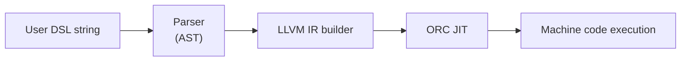

**Use only when**

* you need true runtime specialisation and can afford the complexity,
* you understand that you have stepped into **Taxon 8**, with all the associated operational risk.

### Checkpoint 5 – Templates as Generics vs TMP

In C++, how do templates as generics (T3) differ from template metaprogramming (T4) in terms of complexity and when should each be used?

---

## 11. Checkpoint Answers

**Checkpoint 1**

1. Order:
   *Baseline → Generics (T3) → Syntactic macros (T2)*.
2. You might justify a macro when:
   *you need to inspect or generate code based on structure (fields/variants), not just types;* for example, automatically generating a logging or serialisation implementation per field.

**Checkpoint 2**

1. Natural first choice: **const eval (T5)** – simple numeric expression at compile time.
2. Type-level encoding (T4) could **carry the size as part of the type** and enforce invariants across APIs (e.g. only functions accepting buffers of size `N*2`). This matters when you need those invariants globally and statically, not just locally in one allocation.

**Checkpoint 3**

1. “Schema → code in three languages” = **Taxon 6 – DSLs & build-time codegen**.
2. Main safety risk: **generator correctness and drift** – if the generator is under-tested or falls out of sync with schema semantics, it can silently produce wrong code for all targets.

**Checkpoint 4**

1. Runtime reflection-driven wiring = **Taxon 8 – Dynamic meta (with reflection)**.
2. Advantage: high flexibility and minimal boilerplate – new routes/components can be discovered automatically.
   Downside: failures show up at runtime (e.g. missing annotations, naming mismatches); behaviour and performance are harder to predict and reason about statically.

**Checkpoint 5**

Templates as generics (T3) provide reusable code over types with lower complexity (compile 3 / cognitive 4), suitable for abstractions like containers or algorithms. Template metaprogramming (T4) encodes computations in types for stronger invariants but with higher complexity (compile 8 / cognitive 8), used when type-level guarantees are essential, like in compile-time computations beyond simple values.

---

## 12. M01C04 Glossary

| Term                             | Definition                                                                                                                                                                                                                   |
| -------------------------------- | ---------------------------------------------------------------------------------------------------------------------------------------------------------------------------------------------------------------------------- |
| **Expressiveness**               | Degree to which a modality allows you to express abstractions, automation, or code transformations beyond baseline code (plain functions/types).                                                                             |
| **Safety**                       | How effectively a modality prevents incorrect programs or localises errors, via static checks, hygiene, and clear diagnostics.                                                                                               |
| **Compile-time complexity**      | Additional compilation time, memory, passes, and tooling load introduced by a modality.                                                                                                                                      |
| **Runtime complexity**           | Additional binary size, startup overhead, runtime performance variability, and operational risk introduced by a modality.                                                                                                    |
| **Cognitive complexity**         | Human effort required to understand, modify, and debug code that uses a modality, including generated layers and meta-logic.                                                                                                 |
| **Baseline**                     | Idiomatic object-language code using standard abstraction features and no explicit metaprogramming (no R–T–S beyond what the language/compiler already provides behind the scenes).                                          |
| **Taxon 1 – Textual static**     | Static metaprogramming operating on text or flat tokens (weak R), typically via preprocessors or string-based code generators.                                                                                               |
| **Taxon 2 – Syntactic static**   | Static metaprogramming over structured syntax (CST/AST); includes procedural/derive macros and AST-based build tools.                                                                                                        |
| **Taxon 3 – Generics**           | Parametric definitions over type parameters and constraints, instantiated at compile-time; treated here as static meta over types.                                                                                           |
| **Taxon 4 – Type-level**         | Encoding of logic and invariants in the type system using types, traits, const generics, and resolution; type system as a logic engine.                                                                                      |
| **Taxon 5 – Staging / const**    | Compile-time evaluation of expressions (`const`/`constexpr`), feeding results into values, types, array sizes, layouts.                                                                                                      |
| **Taxon 6 – DSL/codegen**        | Domain-specific languages or schemas feeding build-time generators that emit source or configuration consumed by compilation or runtime.                                                                                     |
| **Taxon 7 – Reflection / DSL**   | Reflection and non-generative DSLs that inspect structure or provide fluent APIs without generating new code; meta-adjacent but not core static meta under R–T–S.                                                            |
| **Taxon 8 – Dynamic meta / JIT** | Runtime or import-time code generation and optimisation using text, AST, IR, or bytecode; includes eval/exec, AST transforms at runtime, and JIT compilers.                                                                  |
| **Weakest Sufficient Mechanism** | The least expressive modality (in terms of the taxonomy) that still satisfies correctness and maintainability requirements for a given problem; formalised in M01C05 as a decision principle with Tiers and a “toll ledger”. |

---

## 13. ADR – Module-Level Design Choices

**Context**

M01C04 takes the taxonomy from M01C03 and asks:

> “Given all these mechanisms, **which should we use, and at what cost**?”

It introduces:

* the **Expressiveness / Safety / Complexity** axes,
* a **1–10 scoring rubric**,
* and language-specific profiles for Rust, Python, and C++.

**Decision**

1. Use three axes for all metaprogramming discussions going forward:

   * **Expressiveness (E)** – additional abstraction/automation power vs baseline,
   * **Safety (S)** – ability to prevent and localise errors,
   * **Complexity (C)** – decomposed as `C_compile`, `C_runtime`, `C_cognitive`.

2. Assign **canonical heuristic scores** (on 1–10) to each taxon from M01C03, with:

   * a shared baseline (idiomatic non-meta code),
   * explicit assumptions and caveats.

3. Keep the **core scoring framework language-neutral**, and push all language-specific anecdotes and examples into Rust/Python/C++ tracks.

4. Treat these scores as **design anchors**, not gospel:

   * they should be stable enough to support WSM/Tier decisions in M01C05,
   * but can be revised with explicit versioning if real-world evidence demands it.

**Rationale**

* M01C01–M01C03 tell you **what exists**; M01C04 must tell you **how expensive each thing tends to be**.
* A shared scoring rubric:

   * prevents unstructured debates (“macros are scary”, “codegen is free”),
   * enables cross-language comparisons (e.g. Rust proc-macros vs C++ TMP),
   * feeds directly into the **WSM + Tier ladder** in M01C05.

* Splitting Complexity into compile/runtime/cognitive maps directly to:

   * CI/build impact,
   * operational/runtime impact,
   * team comprehension/debugging impact.

**Extensibility**

When adding a new taxon instance (new language or mechanism):

1. Map it to one of the eight taxa from M01C03.
2. Assign **E/S/C scores** relative to the existing table, with short justifications.
3. If a mechanism really does not fit the existing profiles, consider:

   * documenting it as a variant of an existing taxon, or
   * revising the table in a future version with a clear change log.

**Consequences**

* M01C05’s **Tier and WSM decisions** are expected to rely on these scores; changing them is a non-trivial semantic change and should be coordinated across modules.
* Design discussions in later modules should phrase trade-offs explicitly in terms of **E/S/C** rather than vague “complex/clever” language.
