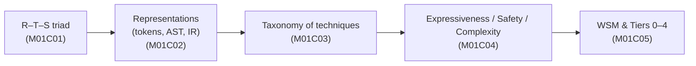
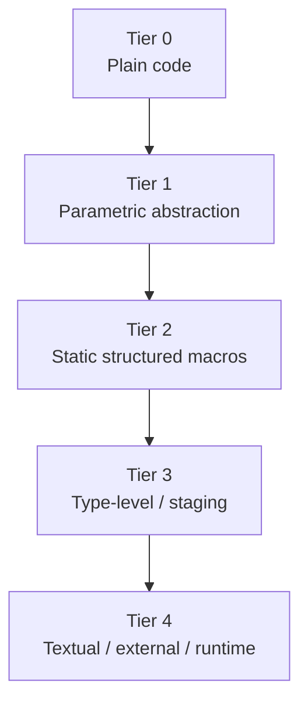
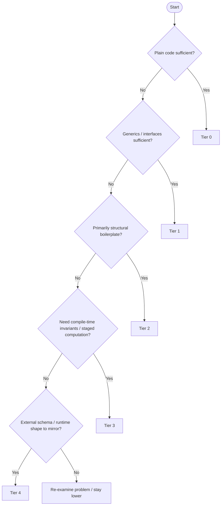
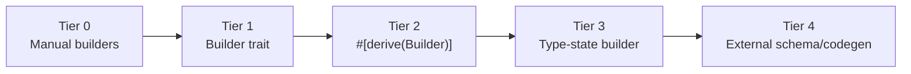
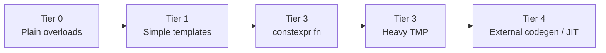

# M01C05 – When Metaprogramming Is Justified

---

## 0. Learning Objectives

After M01C05, you should be able to:

1. Start from the stance that **most metaprogramming is unjustified** until it passes a structured test.

2. Use the **Tier 0–4 ladder** to select the **Weakest Sufficient Mechanism (WSM)** for a problem, and explain why each lower Tier is inadequate.

3. Estimate the **toll** of a metaprogramming feature along key dimensions:

   * anomaly locality,
   * stewardship burden,
   * compile-time cost,
   * runtime cost,
   * tooling impact,
   * team resilience.

4. Assemble a concise **justification dossier** for a metaprogramming proposal, linking:

   * problem statement,
   * rejected lower Tiers,
   * trade-off scores from M01C04,
   * toll ledger,
   * final decision and mitigations.

5. Enter later modules (language-specific) with a clear policy for when macros, AST transforms, code generators, or type-level encodings are acceptable.

---

## 1. Default Stance: Most Metaprogramming Is Unjustified

In production codebases, metaprogramming often appears because:

* it looks clever or elegant,
* a library author wanted to experiment,
* someone imported idioms from another language without re-evaluating costs.

Symptoms you see over time:

* error messages become longer and less local,
* build or startup times creep upward,
* one person “owns” the meta layer,
* nobody can clearly articulate what the feature bought.

**Default stance for this course:**

> A metaprogramming feature is **unjustified by default**
> until it passes a structured WSM/Tier test and survives a toll assessment.

We are not “anti-meta”. We are **hostile to unjustified meta**:

* we treat expressiveness as a **cost**, not a bonus,
* we assume baseline mechanisms are good enough unless proven otherwise.

This module puts a **gate** in front of Tiers 2–4.

---

## 2. Principle: Weakest Sufficient Mechanism (WSM)

Core rule:

> **Weakest Sufficient Mechanism**
> For a given problem, choose the **lowest Tier** that fully satisfies the requirements.
> Higher Tiers are allowed **only after** you can concretely explain why each lower Tier fails.

Formally, if you choose Tier *k*:

1. Tier *k* **solves the problem adequately**, and
2. for every *j < k*, Tier *j* fails in a **specific, written-down way** (not hand-wavy).

### 2.1 Tiers vs Meta-Levels

We use two orthogonal notions:

* **Tier** – which *kind* of mechanism you use (plain code, generics, macros, etc.).
* **Meta-level** – how many *layers* of code-generation or staging you stack.

Examples:

* A simple derive-like macro that expands to plain code:

  * **Tier 2**, meta-level 1.
* A tool that generates code which itself runs macros:

  * still **Tier 2** (mechanism), but meta-level 2.
* An external generator that emits sources containing macros and build scripts:

  * **Tier 4**, meta-level ≥ 2.

Rule of thumb:

> Keep both **Tier** and **meta-level** as low as you reasonably can.

### 2.2 WSM in the Module-1 Pipeline

Conceptually, WSM is the last link in the chain:



WSM uses everything before it as **input**.

---

## 3. Tiers 0–4: The Ladder

Tiers are **conceptual buckets**, not language keywords.

### 3.1 Tier Definitions (Language-Neutral)

| Tier | Name                                      | Typical mechanisms (conceptual)                                           |
| ---- | ----------------------------------------- | ------------------------------------------------------------------------- |
| 0    | **Plain code**                            | Functions, classes/structs, modules, interfaces, manual boilerplate       |
| 1    | **Parametric abstraction**                | Generics/templates, interfaces/traits, type classes, simple polymorphism  |
| 2    | **Static macros / structured generation** | Hygienic macros, AST-to-AST transforms, schema-to-code using structured R |
| 3    | **Type-level / advanced staging**         | Type-level computation, const evaluation used for invariants, staged DSLs |
| 4    | **Textual / external / runtime codegen**  | Preprocessors, textual generators, external codegen, runtime `eval`/JIT   |

These are **fixed labels** for the course.

### 3.2 Ladder Diagram



You move to the right only when you can **write down** why staying left fails.

### 3.3 Why Tier 4 Is “Highest”

Tier 4 is not “smartest”. It is “most expensive to integrate”:

* build system coupling,
* tooling (IDEs, linters, coverage) lag behind,
* multiple languages or representations must stay in sync,
* runtime codegen introduces deployment and operational complexity.

Tier 4 can be intellectually simple but still **operationally expensive**.

---

## 4. First-Pass Decision Procedure (Strict Yes/No → Tier)

Before designing any metaprogramming solution, perform this **first-pass filter**.

You go through **steps 1–5 in order**.
The **first “Yes”** gives you a **candidate Tier**.
You may still reject it later, but you never skip ahead.

### 4.1 Decision Table

| Step | Question                                                                                  | If **Yes** → candidate Tier | If **No** → continue |
| ---- | ----------------------------------------------------------------------------------------- | --------------------------- | -------------------- |
| 1    | Can straightforward plain code avoid serious duplication and confusion?                   | Tier 0                      | Step 2               |
| 2    | Can parametric abstraction (generics, interfaces) express the pattern clearly?            | Tier 1                      | Step 3               |
| 3    | Is the problem **primarily structural boilerplate** over fields/variants/syntax/metadata? | Tier 2                      | Step 4               |
| 4    | Do you need compile-time invariants or computation beyond what Tier 1+2 can express?      | Tier 3                      | Step 5               |
| 5    | Must you mirror an **external schema** or runtime-evolving structure as code or IR?       | Tier 4                      | Re-examine problem   |

If you reach Step 5 and still cannot justify Tier 4, the WSM outcome is:

> “We do not implement a metaprogramming mechanism for this.
> Stay at Tier 0 or 1 and live with some boilerplate.”

### 4.2 Decision Flow (Diagram)



---

### 4.3 Checkpoint 1 – Tier Selection

You’ll find answer in §11.

> **Checkpoint 1**
> For each of the following proposals, which **Tier** is the *first* plausible candidate by this decision table?
>
> 1. “We want a uniform logging API over 12 functions; we are considering a function decorator / attribute approach that adds logging without touching each body.”
> 2. “We must generate code for 200 message types from a language-neutral `.proto` / schema file shared with other systems.”
> 3. “We want to enforce, at compile time, that a connection object cannot send data before a handshake completes.”

---

## 5. Toll Ledger: Estimating the Cost

For anything **Tier 2 or higher**, you must fill a **toll ledger**. It is a structured estimate of the **real cost** of the mechanism.

### 5.1 Toll Dimensions

| Dimension           | Question                                                     | Examples of “high toll” signals                                                      |
| ------------------- | ------------------------------------------------------------ | ------------------------------------------------------------------------------------ |
| Anomaly locality    | How close are errors to their cause?                         | Breakage in generated code gives errors in unreadable files or deep expansions.      |
| Stewardship burden  | How specialised is knowledge required to change the feature? | Only one person can safely edit the macro / generator / type-level machinery.        |
| Compile-time cost   | How much does it slow builds or checks?                      | CI times jump by 30–50% for a feature that saves a few lines.                        |
| Runtime cost        | How much binary size / latency / jitter does it add?         | Performance regressions; increased cold-start times; heavy reflection/JIT layers.    |
| Tooling integration | How much do IDEs / linters / coverage break?                 | “Go to definition” stops working; coverage misses core logic; static analysis fails. |
| Team resilience     | How many people can reason about and modify this safely?     | New hires are told “do not touch that directory” or “ask X before touching macros”.  |

You do not need precise numbers. You need **honest, concrete approximations**.

### 5.2 Example of Lightweight Toll Estimation

Consider a proposed structural macro or code generator:

* **Anomaly locality**

  * Trigger: remove a field or tag incorrectly, run tests.
  * If you need to step through 3 layers (schema → generator → generated file → final code) to find the cause, toll is non-trivial.

* **Stewardship burden**

  * Ask: who can modify this comfortably today?
  * If answer is “one person”, burden is high.

* **Compile-time cost**

  * Compare CI/build before and after.
  * Occasional +10–15% might be acceptable; +40–50% for marginal gains is not.

* **Runtime cost**

  * Check key benchmarks, binary size, cold-start times.
  * If dynamic meta adds noticeable runtime variability, toll is high.

* **Tooling integration**

  * Test: formatting, static analysis, navigation, coverage.
  * If core tools misbehave around meta-heavy code, toll is notable.

* **Team resilience**

  * See if future design changes can be done by different people without heavy supervision.
  * If meta-layer paralyzes refactors, toll is big.

### 5.3 Checkpoint 2 – Toll Sanity

See §11 for answer.

> **Checkpoint 2**
> You add a Tier 2 macro that saves ~50 lines of boilerplate.
> CI time increases by 35%; only one engineer understands the macro; IDE navigation is unreliable around generated code.
> Under WSM + toll thinking, is this feature likely justified or unjustified? Give a brief argument.

---

## 6. Justification Dossier: P–T–E–L–D

For any **Tier 2+ feature**, you should be able to write a short **justification dossier**:

* **P** – Problem
* **T** – Tier walk (0–4)
* **E** – Expressiveness/Safety/Complexity summary (M01C04)
* **L** – Toll ledger
* **D** – Decision & mitigations

### 6.1 Skeleton Template

You can use this template in design docs or PR descriptions:

1. **Problem (P)**
   *What concrete pain are we solving?*
   (e.g., “We repeatedly forget to update manual visitors for 40+ data types, causing subtle GC bugs.”)

2. **Tier walk (T)**

   * Tier 0 – why plain code is insufficient.
   * Tier 1 – why parametric abstraction is insufficient.
   * Tier 2 – can it solve the problem? If yes, explain how.
   * Tier 3 – what would it add, and is that necessary?
   * Tier 4 – what would it add, and is that necessary?

3. **E/S/C summary (E)**
   *Expressiveness, Safety, Complexity (compile / runtime / cognitive); canonical 1–10 anchors.*

4. **Toll ledger (L)**
   *Anomaly locality, stewardship, compile/runtime cost, tooling integration, team resilience.*

5. **Decision & mitigations (D)**

   * Chosen Tier and alternative options rejected.
   * How you will mitigate toll (tests, docs, ownership, monitoring).

If you cannot fill these sections in credible detail, you should not introduce the mechanism.

---

### 6.2 Neutral Example – “Auto Visitor” for Data Trees

Assume a language with:

* algebraic data types or sum types,
* a GC or a traversal-based algorithm.

**Problem (P)**

We have ~50 AST node types. For each, a “visitor” or “traversal” needs to walk all children:

* today this is hand-written,
* omissions and inconsistencies cause subtle behaviour differences.

We want a mechanism `@derive_visitor` / `#[derive(Visitor)]` / template-based auto visitor that:

* inspects the structure of each type,
* generates a traversal that visits all children.

**Tier walk (T)**

* Tier 0 – manual visitors:

  * feasible but very tedious for 50+ types,
  * error rate high: forgetting a child is common.

* Tier 1 – parametric abstraction:

  * we can genericise *how* we traverse a container, but we cannot *discover fields* of each type;
  * without reflection or macros, we still write structural logic manually.

* Tier 2 – structured static macro / generator:

  * has access to AST / reflection / structural metadata,
  * can enumerate fields and generate code accordingly;
  * directly solves omission risk.

* Tier 3 – type-level encodings:

  * we could encode tree structure in types and force correct visitors, but:

    * cost in complexity is enormous,
    * most team members will not be able to maintain it.

* Tier 4 – external schema:

  * we could maintain a separate schema describing all AST nodes and generate both types and visitors from it;
  * but types in the language are already the canonical schema; introducing a second source of truth is highly risky.

**WSM conclusion:** Tier 2 is the **Weakest Sufficient Mechanism**.

**E/S/C summary (E)**

* Expressiveness ≈ 8–9 – visitor logic derived from structural declaration.
* Safety ≈ 7–8 – omissions become unlikely; some edge cases if field types misbehave.
* Complexity:

  * Compile ≈ 5–6 (extra pass),
  * Runtime ≈ 1–2 (code similar to hand-written),
  * Cognitive ≈ 5–6 (team must understand the macro / generator contract).

**Toll ledger (L)**

* Anomaly locality – good: if a new field type is missing trait support, error is local.
* Stewardship – moderate: macro/generator needs 1–2 primary maintainers; others only use it.
* Compile-time – measurable but acceptable for ~50 types.
* Runtime – negligible.
* Tooling – depends on language; if expansions are viewable and navigable, toll is moderate; if not, high.
* Team resilience – acceptable if documentation and tests exist.

**Decision & mitigations (D)**

* Approve **Tier 2**.
* Mitigations:

  * test suite for the generator / macro,
  * design document with limitations,
  * a policy that any new AST type *must* use the derive and tests must include traversal.

This illustrates the **shape** of a dossier, abstracted from any specific language.

---

### 6.3 Checkpoint 3 – Dossier Completeness

Answer in §11.

> **Checkpoint 3**
> A design doc introduces a Tier 3 type-level encoding, but:
>
> * Tier 0–2 are not discussed,
> * there’s no toll ledger,
> * benefits are described only as “elegance” and “fewer runtime checks”.
>
> According to M01C05, what is the status of this proposal, and what are the minimum missing elements?

---

## 7. Review Policy and Red Flags

To make WSM practical, you need **review practices**.

### 7.1 Reviewer Checklist (Language-Neutral)

For any PR / proposal that introduces or expands metaprogramming:

1. **Tier identification**

   * [ ] Is the claimed Tier explicit (0–4)?
   * [ ] Is it plausible, given the mechanism?

2. **WSM justification**

   * [ ] Are Tiers 0–1 explicitly considered?
   * [ ] For Tier ≥ 2, are concrete reasons given why lower Tiers fail?

3. **E/S/C summary**

   * [ ] Are approximate Expressiveness / Safety / Complexity impacts stated?
   * [ ] Are claimed benefits commensurate with complexity?

4. **Toll ledger**

   * [ ] Does the change mention expected impact on builds, runtime, and tooling?
   * [ ] Is ownership/responsibility clearly assigned?

5. **Mitigations**

   * [ ] Are there tests for meta-specific behaviour?
   * [ ] Is there documentation explaining usage and limitations?

If these boxes cannot be checked for Tier 2+, WSM-aligned response is: **require revision or reject**.

### 7.2 Anti-Justifications and Red Flags

**Not sufficient justification:**

* “It saves a few lines.”
* “It’s more elegant.”
* “We might need this flexibility later.”
* “That’s what people do in language X/Y/Z.”

**Red flags indicating unjustified meta:**

* Build times increased drastically for minor convenience.
* Only one person understands or is allowed to touch the mechanism.
* Generated code is huge and opaque; nobody inspects it.
* Static tools (formatter, linter, coverage, IDE navigation) misbehave.
* Onboarding includes “do not touch that directory”.

Under WSM, these are reasons to **remove** or **avoid expanding** such mechanisms.

---

## 8. Rust Track – Applying WSM to Real Mechanisms

### 8.1 Rust – Mapping Common Features to Tiers

Conceptual Tier mapping for Rust:

| Tier | Rust mechanisms (typical)                                                                   |
| ---- | ------------------------------------------------------------------------------------------- |
| 0    | Plain `struct`, `enum`, `impl`, `fn`, modules                                               |
| 1    | Generic functions/types, traits, trait objects                                              |
| 2    | `#[derive]`, attribute macros, function-like proc-macros, `macro_rules!` as structured DSL  |
| 3    | Heavy const generics, type-state patterns, non-trivial `const fn` staging                   |
| 4    | `build.rs` text generators, external codegen, dynamic plugin loading, embedded interpreters |

We illustrate WSM with two concrete problems:

1. A GC-like `Trace` trait.
2. A configuration `Builder` pattern.

---

### 8.2 Rust Example – `Trace` Trait Across Tiers

**Problem:**
We want a `Trace` trait to traverse reference-holding fields in many types. Missing a field in `trace` leads to memory leaks or logic bugs.

#### 8.2.1 Tier 0 – Plain Code (Baseline)

```rust
trait Trace {
    fn trace(&self);
}

struct Node {
    value: i32,
    left: Option<Box<Node>>,
    right: Option<Box<Node>>,
}

impl Trace for Node {
    fn trace(&self) {
        if let Some(ref l) = self.left {
            l.trace();
        }
        if let Some(ref r) = self.right {
            r.trace();
        }
    }
}
```

**WSM view**

* Works for a few types.
* For 40–100 structs, this is boilerplate.
* Omissions (forgetting `right`) are common and hard to spot.

Tier 0 **clearly does not scale**.

---

#### 8.2.2 Tier 1 – Generics/Traits Only

We can genericise *how* to trace containers:

```rust
trait Trace {
    fn trace(&self);
}

impl<T: Trace> Trace for Option<T> {
    fn trace(&self) {
        if let Some(inner) = self {
            inner.trace();
        }
    }
}

impl<T: Trace> Trace for Box<T> {
    fn trace(&self) {
        (**self).trace();
    }
}
```

But each struct still needs a manual impl:

```rust
struct Node {
    value: i32,
    left: Option<Box<Node>>,
    right: Option<Box<Node>>,
}

impl Trace for Node {
    fn trace(&self) {
        self.left.trace();
        self.right.trace();
    }
}
```

**WSM view**

* Generics help with **containers**, not **field enumeration**.
* You still manually name every field.
* For many types, the omission risk remains.

Tier 1 **does not solve** the core problem: automatic field coverage.

---

#### 8.2.3 Tier 2 – `#[derive(Trace)]` (Proc Macro)

Now a structured Tier 2 solution.

**User-side code:**

```rust
use gc_runtime::Trace;

#[derive(Trace)]
struct Node {
    value: i32,
    left: Option<Box<Node>>,
    right: Option<Box<Node>>,
}
```

**Proc-macro crate (simplified, but realistic):**

```rust
// gc_derive/src/lib.rs
use proc_macro::TokenStream;
use quote::quote;
use syn::{parse_macro_input, DeriveInput};

#[proc_macro_derive(Trace)]
pub fn derive_trace(input: TokenStream) -> TokenStream {
    let ast: DeriveInput = parse_macro_input!(input);

    let name = &ast.ident;
    let fields = match ast.data {
        syn::Data::Struct(data) => data.fields,
        _ => {
            return syn::Error::new_spanned(
                ast.ident,
                "#[derive(Trace)] only supports structs",
            )
            .to_compile_error()
            .into();
        }
    };

    let trace_body = fields.iter().filter_map(|f| {
        let ident = f.ident.as_ref()?;
        Some(quote! {
            ::gc_runtime::Trace::trace(&self.#ident);
        })
    });

    let expanded = quote! {
        impl ::gc_runtime::Trace for #name {
            fn trace(&self) {
                #(#trace_body)*
            }
        }
    };

    expanded.into()
}
```

**Runtime trait (runtime crate):**

```rust
// gc_runtime/src/lib.rs
pub trait Trace {
    fn trace(&self);
}

// blanket impls for containers
impl<T: Trace> Trace for Option<T> {
    fn trace(&self) {
        if let Some(inner) = self {
            inner.trace();
        }
    }
}

impl<T: Trace> Trace for Box<T> {
    fn trace(&self) {
        (**self).trace();
    }
}
```

**WSM analysis**

* **Tier walk**:

  * Tier 0: too much boilerplate, high omission risk.
  * Tier 1: helps containers but not struct enumeration.
  * Tier 2: directly enumerates fields from AST → first Tier that addresses the root issue.
  * Tier 3: type-level graph of GC topology = massive complexity with marginal extra safety.
  * Tier 4: external schema describing types would duplicate Rust source.

* **Tier choice:** Tier 2 = **Weakest Sufficient Mechanism**.

* **Toll ledger** (Rust-specific):

  * Anomaly locality: good – errors point to field types lacking `Trace`.
  * Compile-time: some overhead when deriving for many structs; likely acceptable.
  * Tooling: with `cargo expand`, expansions are inspectable; IDEs see generated impls.
  * Stewardship: 1–2 maintainers must know `syn`/`quote`; users merely apply `#[derive]`.

This is a **clean, justified Tier 2** example.

---

### 8.3 Rust Example – `Builder` Across Tiers

**Problem:**
We have ~25 configuration structs; each naturally wants a “builder”:

* required vs optional fields,
* fluent setters,
* `build()` with validation.

We compare Tiers.

#### 8.3.1 Tier 0 – Manual Builder

```rust
struct ServerConfig {
    host: String,
    port: u16,
    max_conn: Option<u32>,
}

struct ServerConfigBuilder {
    host: Option<String>,
    port: Option<u16>,
    max_conn: Option<u32>,
}

impl ServerConfigBuilder {
    fn new() -> Self {
        Self { host: None, port: None, max_conn: None }
    }

    fn host(mut self, host: impl Into<String>) -> Self {
        self.host = Some(host.into());
        self
    }

    fn port(mut self, port: u16) -> Self {
        self.port = Some(port);
        self
    }

    fn max_conn(mut self, max_conn: u32) -> Self {
        self.max_conn = Some(max_conn);
        self
    }

    fn build(self) -> Result<ServerConfig, String> {
        Ok(ServerConfig {
            host: self.host.ok_or("host missing")?,
            port: self.port.ok_or("port missing")?,
            max_conn: self.max_conn,
        })
    }
}
```

**WSM view**

* Fine for a few types.
* For 25 similar structs, it is tedious and error-prone.

---

#### 8.3.2 Tier 1 – Generic `Builder<T>` Trait

We abstract the *concept* of “builder”:

```rust
trait Builder<T> {
    type Error;
    fn build(self) -> Result<T, Self::Error>;
}

impl Builder<ServerConfig> for ServerConfigBuilder {
    type Error = String;
    fn build(self) -> Result<ServerConfig, Self::Error> {
        // as before
        Ok(ServerConfig {
            host: self.host.ok_or("host missing")?,
            port: self.port.ok_or("port missing")?,
            max_conn: self.max_conn,
        })
    }
}
```

**WSM view**

* Slight API improvement: any function can accept `impl Builder<ServerConfig>`.
* But per-type boilerplate remains; you still write setters and `build()` manually.
* You have not solved maintenance/omission risk; you have just formalised the pattern.

Tier 1 improves **conceptual clarity**, not **amount of work**.

---

#### 8.3.3 Tier 2 – `#[derive(Builder)]` (Proc Macro)

User-side:

```rust
use config_derive::Builder;

#[derive(Builder)]
struct ServerConfig {
    host: String,         // required
    port: u16,            // required
    max_conn: Option<u32> // optional
}

fn main() {
    let cfg = ServerConfig::builder()
        .host("localhost")
        .port(8080)
        .build()
        .unwrap();
}
```

Macro (simplified):

```rust
// config_derive/src/lib.rs
use proc_macro::TokenStream;
use quote::{format_ident, quote};
use syn::{parse_macro_input, DeriveInput};

#[proc_macro_derive(Builder)]
pub fn derive_builder(input: TokenStream) -> TokenStream {
    let input: DeriveInput = parse_macro_input!(input);
    let name = &input.ident;
    let builder_name = format_ident!("{}Builder", name);

    let fields = match input.data {
        syn::Data::Struct(data) => data.fields,
        _ => {
            return syn::Error::new_spanned(
                name,
                "#[derive(Builder)] only supports structs",
            )
            .to_compile_error()
            .into();
        }
    };

    let builder_fields = fields.iter().map(|f| {
        let ident = f.ident.as_ref().unwrap();
        let ty = &f.ty;
        quote! { #ident: ::core::option::Option<#ty> }
    });

    let builder_init = fields.iter().map(|f| {
        let ident = f.ident.as_ref().unwrap();
        quote! { #ident: ::core::option::Option::None }
    });

    let setter_methods = fields.iter().map(|f| {
        let ident = f.ident.as_ref().unwrap();
        let ty = &f.ty;
        quote! {
            pub fn #ident(mut self, value: #ty) -> Self {
                self.#ident = ::core::option::Option::Some(value);
                self
            }
        }
    });

    let build_fields = fields.iter().map(|f| {
        let ident = f.ident.as_ref().unwrap();
        quote! {
            #ident: self.#ident.ok_or_else(|| concat!(stringify!(#ident), " missing"))?
        }
    });

    let expanded = quote! {
        pub struct #builder_name {
            #( #builder_fields, )*
        }

        impl #builder_name {
            pub fn new() -> Self {
                Self { #( #builder_init, )* }
            }

            #( #setter_methods )*

            pub fn build(self) -> ::core::result::Result<#name, ::std::string::String> {
                Ok(#name {
                    #( #build_fields, )*
                })
            }
        }

        impl #name {
            pub fn builder() -> #builder_name {
                #builder_name::new()
            }
        }
    };

    expanded.into()
}
```

**WSM view**

* Tier 0: manual boilerplate.
* Tier 1: concept but no reduction in per-type work.
* Tier 2: concrete reduction in boilerplate, structural coupling to fields.

If the main goals are:

* reduce maintenance cost across many similar structs, and
* avoid missing required fields in `build()`,

then Tier 2 is **plausibly WSM**.

---

#### 8.3.4 Tier 3 – Type-State Builder (Stronger Safety, Higher Cost)

We can enforce required fields at type level:

```rust
struct Missing;
struct Present;

struct ServerConfigBuilder<H, P> {
    host: Option<String>,
    port: Option<u16>,
    max_conn: Option<u32>,
    _host_state: std::marker::PhantomData<H>,
    _port_state: std::marker::PhantomData<P>,
}

impl ServerConfigBuilder<Missing, Missing> {
    fn new() -> Self {
        Self { host: None, port: None, max_conn: None,
               _host_state: std::marker::PhantomData,
               _port_state: std::marker::PhantomData }
    }
}

impl<P> ServerConfigBuilder<Missing, P> {
    fn host(self, host: impl Into<String>) -> ServerConfigBuilder<Present, P> {
        ServerConfigBuilder {
            host: Some(host.into()),
            port: self.port,
            max_conn: self.max_conn,
            _host_state: std::marker::PhantomData,
            _port_state: std::marker::PhantomData,
        }
    }
}

impl<H> ServerConfigBuilder<H, Missing> {
    fn port(self, port: u16) -> ServerConfigBuilder<H, Present> {
        ServerConfigBuilder {
            host: self.host,
            port: Some(port),
            max_conn: self.max_conn,
            _host_state: std::marker::PhantomData,
            _port_state: std::marker::PhantomData,
        }
    }
}

impl ServerConfigBuilder<Present, Present> {
    fn build(self) -> ServerConfig {
        ServerConfig {
            host: self.host.unwrap(),
            port: self.port.unwrap(),
            max_conn: self.max_conn,
        }
    }
}
```

**WSM view**

* Strong guarantee: cannot call `build()` without setting `host` and `port`.
* But complexity is high:

  * phantom types,
  * typed state transitions,
  * harder to onboard new devs.

Tier 3 is justified only if **this invariant is critical enough** to warrant that complexity.

---

#### 8.3.5 Tier 4 – External Schema/Codegen

Example: configuration is defined in a YAML/JSON schema shared between languages; a Rust code generator produces `ServerConfig` and builder types.

* Extra language (schema).
* More build plumbing.
* Two sources of truth if not done carefully.

WSM conclusion:

* For a Rust-only config system, Tier 4 is overkill.
* It becomes reasonable only if the external schema is genuinely the **single source of truth** for multiple systems.

---

### 8.4 Rust Builder Escalation Diagram



The WSM discipline is: **stop as early as you can**.

---

## 9. Python Track – WSM in a Dynamic Ecosystem

Python’s runtime flexibility makes high Tiers cheap to write and expensive to debug. Tiers here are conceptual.

### 9.1 Conceptual Tier Mapping (Python)

| Tier | Python analogues                                                                             |
| ---- | -------------------------------------------------------------------------------------------- |
| 0    | Plain functions, classes, manual patterns                                                    |
| 1    | Helper functions, basic ABCs/protocols                                                       |
| 2    | Conservative decorators, codegen scripts run in CI, AST-based generators from stable schemas |
| 3    | Heavy metaclasses, dynamic attribute synthesis, runtime pipelines                            |
| 4    | `eval`/`exec` on untrusted strings, monkeypatching frameworks, runtime JIT/codegen           |

Reflection (`inspect`, `__dict__`, descriptors) can be used in Tier 1–3 depending on intensity.

---

### 9.2 Python Example – Function Logging Across Tiers

**Problem:**
We want consistent entry/exit logging for multiple functions.

#### 9.2.1 Tier 0 – Manual Logging

```python
def process(user):
    print("Entering process", user)
    # ...
    print("Exiting process", user)
```

Simple, but repetitive and easy to forget.

---

#### 9.2.2 Tier 1 – Helper Function

```python
def log_enter(name, *args, **kwargs):
    print(f"Entering {name}", args, kwargs)

def log_exit(name, result):
    print(f"Exiting {name}", result)

def process(user):
    log_enter("process", user)
    # ...
    result = user.name.upper()
    log_exit("process", result)
    return result
```

Better, but still:

* must remember to call it,
* invasive in function bodies.

---

#### 9.2.3 Tier 2 – `@logged` Decorator

```python
from functools import wraps
import inspect

def logged(fn):
    sig = inspect.signature(fn)

    @wraps(fn)
    def wrapper(*args, **kwargs):
        bound = sig.bind(*args, **kwargs)
        bound.apply_defaults()
        print(f"Entering {fn.__name__}{bound.arguments}")
        result = fn(*args, **kwargs)
        print(f"Exiting {fn.__name__} -> {result!r}")
        return result
    return wrapper

@logged
def process(user, verbose=False):
    if verbose:
        print("Processing", user)
    return user.name.upper()
```

**WSM view**

* Tier 0: too repetitive for many functions.
* Tier 1: still manual insertion.
* Tier 2: captures cross-cutting logging with minimal syntax overhead.

Tier 2 is likely the **weakest sufficient** choice for this problem.

Tier 3 (metaclasses) or Tier 4 (bytecode patching) are unjustified for basic logging.

---

### 9.3 Python Example – Schema → Model Mapping (ORM Pitfall)

**Problem:** map database tables to Python objects.

#### 9.3.1 Tier 1 – Explicit Mapping

```python
class UserRow:
    def __init__(self, id_, name, email):
        self.id = id_
        self.name = name
        self.email = email

def row_to_user(row):
    return UserRow(
        id_=row["id"],
        name=row["name"],
        email=row["email"],
    )
```

* Simple, explicit.
* For many tables and fields, becomes verbose.

---

#### 9.3.2 Tier 2 – Descriptor-Based Mapping (Moderate Meta)

```python
class Column:
    def __init__(self, name):
        self.name = name

    def __set_name__(self, owner, attr_name):
        if self.name is None:
            self.name = attr_name

    def __get__(self, instance, owner):
        if instance is None:
            return self
        return instance._values[self.name]

class ModelMeta(type):
    def __new__(mcls, name, bases, ns):
        columns = {
            attr: val for attr, val in ns.items()
            if isinstance(val, Column)
        }
        ns["_columns"] = columns
        return super().__new__(mcls, name, bases, ns)

class Model(metaclass=ModelMeta):
    def __init__(self, **values):
        self._values = values

    @classmethod
    def from_row(cls, row):
        values = {name: row[col.name] for name, col in cls._columns.items()}
        return cls(**values)

class User(Model):
    id = Column("id")
    name = Column("name")
    email = Column("email")
```

* Tier 2/3 boundary: uses metaclass and descriptors, but still fairly controlled.
* WSM question: Is this actually needed for your scale?

---

#### 9.3.3 Tier 3–4 – Full ORM with Heavy Reflection and Codegen

Many ORMs:

* introspect class attributes dynamically,
* generate queries,
* sometimes generate code at runtime (Tier 4),
* thread complex runtime semantics through `__getattr__` and `__getattribute__`.

**WSM check**

* Could your project survive with Tier 1 or a modest Tier 2 mapping?
* Are you sure you need full ORM meta-level behaviour?

For many small/medium projects, the honest answer is “no”.
Yet teams adopt Tier 3–4 complexity because “everyone uses X”.

WSM formalises that this is often unjustified.

---

### 9.4 Python Example – Static Codegen vs `eval` (Tier 2 vs 4)

Suppose you have a JSON schema and want Python data classes.

**Tier 2 – Static codegen in CI**

```python
# tools/gen_models.py
import json
from pathlib import Path

def gen_code(schema):
    lines = ["from dataclasses import dataclass"]
    for model in schema["models"]:
        lines.append("@dataclass")
        lines.append(f"class {model['name']}:")
        for field in model["fields"]:
            lines.append(f"    {field['name']}: {field['type']}")
        lines.append("")
    return "\n".join(lines)

schema = json.loads(Path("models.json").read_text())
code = gen_code(schema)
Path("generated_models.py").write_text(code)
```

* Run in CI or as build step.
* Code is static; IDEs and linters see it.
* Tier 2/4 boundary, but used in a **static** way.

**Tier 4 – `eval` at runtime**

```python
def load_schema_and_create_models(schema_path):
    schema = json.loads(Path(schema_path).read_text())
    ns = {}
    exec(gen_code(schema), ns)      # Tier 4, runtime codegen
    return ns
```

* Failures happen in production.
* Tooling cannot see definitions.
* WSM: strong presumption against this unless you genuinely need runtime adaptability.

---

## 10. C++ Track – WSM with Templates, `constexpr`, and Codegen

C++ pushes a lot of power into templates. Tiers help separate “normal” use from metaprogramming abuses.

### 10.1 C++ Tier Mapping (Conceptual)

| Tier | C++ mechanisms                                                              |
| ---- | --------------------------------------------------------------------------- |
| 0    | Plain classes, functions, overloading                                       |
| 1    | Templates as generics, simple concepts                                      |
| 2    | C++26 compile-time reflection, Clang AST rewriters, structured source tools |
| 3    | Template metaprogramming (TMP), complex `constexpr` and SFINAE              |
| 4    | Preprocessor macros, external generators, LLVM JIT / Clang JIT              |

---

### 10.2 Example – Compile-Time Fibonacci Across Tiers

**Problem:** we want a compile-time `fib<N>` value.

#### 10.2.1 Tier 1 – Simple Template (Runtime)

```cpp
template<typename T>
T fib_runtime(T n) {
    if (n <= 1) return n;
    return fib_runtime<T>(n-1) + fib_runtime<T>(n-2);
}
```

* Works, but result is runtime.
* We cannot use the result as a non-type template parameter or array bound etc. without further tricks.

---

#### 10.2.2 Tier 3 (Heavy) – Classic TMP

```cpp
template<int N>
struct Fib {
    static const int value = Fib<N-1>::value + Fib<N-2>::value;
};

template<>
struct Fib<1> { static const int value = 1; };

template<>
struct Fib<0> { static const int value = 0; };

constexpr int x = Fib<40>::value;
```

* Entire computation encoded in the type system.
* Compile-time recursion, error messages refer to template instantiations.
* High compile-time cost and cognitive complexity.

---

#### 10.2.3 Tier 3 (Light) – `constexpr` Function

```cpp
constexpr int fib_constexpr(int n) {
    return (n <= 1) ? n : fib_constexpr(n - 1) + fib_constexpr(n - 2);
}

constexpr int x = fib_constexpr(40);
```

* Still Tier 3 (compile-time evaluation), but much simpler.

**WSM view**

* For “we just need fib at compile time”, `constexpr` is clearly the **Weakest Sufficient Mechanism**.
* Full TMP is unjustified overhead.

---

### 10.3 Example – Max Function: Tier 1 vs Tier 0

Tier 0 – duplicated overloads:

```cpp
int max_int(int a, int b) { return a > b ? a : b; }
double max_double(double a, double b) { return a > b ? a : b; }
```

Tier 1 – template as generics:

```cpp
template<typename T>
T max_generic(T a, T b) {
    return a > b ? a : b;
}
```

**WSM view**

* Plain overloads vs template: template is clearly Tier 1 and WSM for this abstraction.
* No reason to touch TMP, macros, or codegen.

---

### 10.4 Example – Reflection / Clang Tool (Tier 2) vs Macros (Tier 4)

**Problem:** apply a consistent rule to many functions (e.g., rename, add logging, enforce attribute annotations).

#### 10.4.1 Tier 4 – Preprocessor Macros

```cpp
#define LOGGED(fn) \
    void fn##_logged() { \
        std::cout << "Entering " #fn "\n"; \
        fn(); \
        std::cout << "Exiting " #fn "\n"; \
    }

void work();
LOGGED(work)
```

* Textual substitution, no understanding of function signature.
* Brittleness: arguments, overloaded functions, etc.

#### 10.4.2 Tier 2 – Clang AST Tool (Structured)

Conceptual sketch:

```cpp
// Pseudocode for a Clang-based rewriter
class LogInjector : public clang::ASTConsumer {
public:
    void HandleTranslationUnit(ASTContext &ctx) override {
        for (auto *f : ctx.getTranslationUnitDecl()->decls()) {
            if (auto *fd = llvm::dyn_cast<FunctionDecl>(f)) {
                if (hasSomeAnnotation(fd)) {
                    injectLogging(fd);
                }
            }
        }
    }
};
```

* Uses structured AST; aware of signatures, templates, overloads.
* Runs as build-time tool (Tier 2).

**WSM view**

* For non-trivial, cross-cutting refactoring or instrumentation, Tier 2 is often WSM.
* Preprocessor macros (Tier 4) are rarely justifiable when Clang tooling is an option.

---

### 10.5 Example – External Codegen (Tier 4)

**Problem:** API defined by an IDL shared across services (e.g., Protobuf, Thrift).

Tier 4 solution:

* IDL → generated C++ headers and source.
* Possibly also generating code for other languages.

**WSM view**

* External schema is the real source of truth.
* Tier 4 is justified here because **code is a derivative**.
* You still apply toll thinking: measure build impact, tool support, and complexity.

---

### 10.6 C++ Escalation Diagram for Numeric/Meta Features



WSM discipline: use **T1** or **T3 (light)** for the majority of cases, reserve TMP and Tier 4 for **exceptional** needs.

---

## 11. Checkpoint Answers

### Checkpoint 1 – Tier Selection

1. **Uniform logging via decorator/attribute**

   * Plain code (Tier 0) is possible but repetitive and fragile.
   * Parametric abstraction (Tier 1) helps but still requires manual calls.
   * The first mechanism that genuinely centralises cross-cutting behaviour is **Tier 2** (decorator / attribute / macro).

2. **Generating code from `.proto` / external schema**

   * Plain code and parametric abstraction do not address the “single external schema” requirement.
   * You must mirror external definitions in code: this is exactly **Tier 4** (textual/external codegen).

3. **Enforce connection handshake before send (compile time)**

   * Plain code and generics cannot enforce ordering at compile time.
   * You need type-level state or staging: **Tier 3** (type-level / staging).

---

### Checkpoint 2 – Toll Sanity

> Macro saves ~50 lines; CI +35%; only one engineer understands it; tooling is flaky.

Under WSM and the toll ledger, this feature is **very likely unjustified**:

* Expressiveness gain is modest (50 lines).
* Toll is high (compile-time, stewardship, tooling).
* No compelling safety argument is presented.

WSM suggests: remove or redesign using a lower Tier (likely Tier 0–1).

---

### Checkpoint 3 – Dossier Completeness

Design doc: Tier 3 encoding, no discussion of lower Tiers, no toll ledger, vague benefit.

Status:

* **Not justified** under M01C05.
* Missing minimum elements:

  * A Tier walk explaining why 0–2 fail,
  * Explicit E/S/C evaluation,
  * A toll ledger,
  * Concrete benefits beyond “elegance” (e.g. serious invariants only enforceable at compile time).

Until these exist, WSM says: **do not approve**.

---

## 12. M01C05 Glossary

| Term                             | Definition                                                                                                                                     |
| -------------------------------- | ---------------------------------------------------------------------------------------------------------------------------------------------- |
| **R–T–S triad**                  | Conjunction of Reification (R), Transformation (T), and Staging (S) used to define static metaprogramming in this course.                      |
| **Tier (0–4)**                   | Conceptual bucket for mechanism choice: 0 (plain), 1 (parametric), 2 (static macros/structured), 3 (type-level/staging), 4 (textual/external). |
| **Meta-level**                   | Number of layers of code-generation or staging (how many times code is produced from code).                                                    |
| **Weakest Sufficient Mechanism** | Design principle: choose the lowest Tier that fully solves the problem; reject higher Tiers if lower ones are adequate.                        |
| **Toll ledger**                  | Structured checklist for costs: anomaly locality, stewardship burden, compile-time, runtime, tooling, team resilience.                         |
| **Anomaly locality**             | How close the observed failure is (in code and diagnostics) to the location of the actual defect.                                              |
| **Stewardship burden**           | Degree to which maintaining a feature requires specialised knowledge or a small set of experts.                                                |
| **Team resilience**              | Ability of a team to maintain and evolve a feature even if specific individuals leave or become unavailable.                                   |
| **Core static mechanism**        | Technique that satisfies R–T–S, runs pre-runtime, and resides in Tiers 1–3.                                                                    |
| **Tier 4 mechanism**             | Textual, external, or runtime-focused mechanism that typically strains tools and build systems and must be justified with extra care.          |

---

## 13. ADR – Module-Level Design Choices

**Context**

M01C05 sits at the end of Module 1 and turns:

* **R–T–S + meta-levels** (M01C01),
* **representations** (M01C02),
* **taxonomy** (M01C03),
* **E/S/C scoring** (M01C04),

into a **decision framework**:

* **Weakest Sufficient Mechanism (WSM)**,
* **Tier 0–4 ladder**,
* and the **toll ledger**.

**Decision**

1. Adopt **WSM – Weakest Sufficient Mechanism** as the **default design principle** for all metaprogramming:

   > choose the **lowest Tier** that fully satisfies requirements;  
   > treat additional expressive power as a **cost**, not a free upgrade.

2. Fix **five conceptual Tiers (0–4)** that group mechanisms by typical cost profile:

   * **Tier 0** – plain object-language code,
   * **Tier 1** – parametric abstraction (generics, interfaces, templates-as-generics),
   * **Tier 2** – static structured macros / AST tools,
   * **Tier 3** – type-level programming / staging,
   * **Tier 4** – textual/external/runtime-centric codegen.

3. Require that any **Tier ≥ 2 mechanism** be justified via a **short WSM dossier**:

   * **P** – concrete problem,
   * **T** – Tier walk (0–4, with explicit rejections),
   * **E** – E/S/C summary,
   * **L** – toll ledger on six dimensions,
   * **D** – decision & mitigations.

4. Provide a **review checklist** for PRs that introduce meta features, aligned with WSM and the Tier ladder.

**Rationale**

* Without an explicit discipline, teams tend to escalate to “fancy” mechanisms (macros, TMP, codegen) for marginal wins.
* WSM and Tiers:

   * force consideration of **lower-power alternatives**,
   * expose the real costs (build time, stewardship, tooling),
   * make design discussions audit-able and repeatable.

* The dossier pattern is intentionally language-neutral:

   * it can justify a Rust `#[derive]`, a Python decorator framework, or a C++ TMP library with the same structure.

**Extensibility**

To apply this framework in new languages or contexts:

1. Map the language’s mechanisms to **Tiers 0–4**, using M01C03–M01C04 (taxon and E/S/C) as input.
2. For any proposed Tier ≥ 2 mechanism, require a **P–T–E–L–D dossier**.
3. Extend the **review checklist** with language-specific items (tooling quirks, build system constraints) without changing the core WSM rules.

If new paradigms emerge (e.g. novel IR-level meta, language-integrated DSLs), they should be placed into an existing Tier by cost profile; introducing a **Tier 5** is a last resort and would require a coherent revision of Module 1.

**Consequences**

* In all later modules and in “real” code, the **burden of proof** is on higher Tiers:

   * “we must be Tier 3/4” must be argued, not assumed.

* Teams can embed the Tier ladder, WSM principle, and toll ledger directly into:

   * design templates,
   * code review checklists,
   * architecture decision records for metaprogramming-heavy components.
