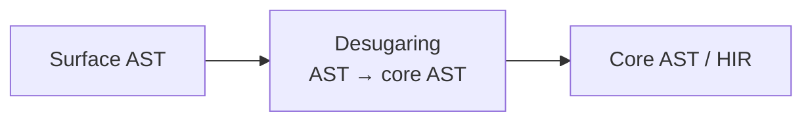

# M02C06 – Concrete vs Abstract Syntax Trees (CST vs AST)

## 0. Learning Objectives

After completing M02C06, you should be able to:

1. Explain how grammars and parsing turn **tokens** into **CSTs** and **ASTs**, and why compilers almost never stop at a naive parse tree.
2. Distinguish **CSTs** and **ASTs** by what they **preserve**, what they **discard**, and which **invariants** each representation is meant to maintain.
3. Relate CST/AST design to the **R–T–S triad** by identifying which representation is typically used as **R** for macros, refactorings, and analysis tools.
4. Describe the role of **pretty-printing** and **round-tripping** (source ↔ tree) as key invariants for meta-systems and tooling.
5. Compare CST/AST usage in **Rust, Python, and C++** at a high level and understand what parts are exposed to ordinary developers.

In the storyline:

* **Backward:** Refines “code as data” from M01C02 into precise notions of concrete vs abstract syntax and plugs into the **R** side of the **R–T–S triad**.
* **Forward:** Sets up M02C07–M02C10 by fixing the **syntax layer**: from here on, “R” is not just “some tree”, but a carefully chosen CST/AST (and later, binding and IR) that your metaprograms will actually manipulate.

---

## 1. Where CST and AST Sit in R–T–S

Recall the **R–T–S triad**:

* **R** – representation of code,
* **T** – transformations over that representation,
* **S** – staging / when those transformations run.

From M01C02 you already have the rough front-end chain:

```text
characters → tokens → CST → AST → IR
```

In this core we are explicitly tightening what “R” is for the **front end**:

* **CST** and **AST** are competing, complementary choices for R.
* Many meta-systems hard-wire themselves to one of them. That choice dominates:

  * what invariants you can rely on,
  * how easy transforms are to express,
  * how well you can preserve formatting and comments.

From Module 2 onward, whenever we say “R” at the syntax level, we mean:

> Some **tree representation** deliberately chosen from:
>
> * CST (+ trivia),
> * surface AST,
> * or a desugared core AST (HIR-like),
>
> with clear invariants and a clear place in the pipeline.

We will also fix a small **running example** that will reappear in M02C07–M02C10.

---

## 2. Running Example and Front-End Chain

### 2.1 Running Example (Rust-like)

We’ll reuse this function across Module 2:

```rust
fn sum(xs: &[i32]) -> i32 {
    let mut acc = 0;
    for x in xs {
        acc += x;
    }
    acc
}
```

You will see this:

* as **CST** vs **AST** (this core),
* with **binding and environments** (M02C07),
* lowered to **IRs** (M02C08),
* as the subject of **rewrite rules** (M02C09),
* and under **correctness conditions** (M02C10).

Keep it in your head as the canonical specimen.

### 2.2 Grammars and Parsing (Recap)

A context-free grammar defines:

* **Nonterminals**: `Fn`, `Block`, `Stmt`, `Expr`, …
* **Terminals**: `FN`, `IDENT`, `LBRACE`, `LET`, `FOR`, …
* **Productions**, e.g.:

```text
Fn    → "fn" IDENT "(" Params? ")" "{" Block "}"
Block → Stmt* Expr?
Stmt  → LetStmt | ForStmt | ExprStmt | ";"
Expr  → Expr "+" Term | Term
Term  → Term "*" Factor | Factor
...
```

Parsing:

1. Consumes a token stream.
2. Applies productions according to the grammar.
3. Builds a **parse tree** organised by these productions.

That parse tree is essentially a **Concrete Syntax Tree (CST)**.

### 2.3 Front-End Pipeline

A simplified front end:

```mermaid
flowchart LR
    src[Source code (text)]
      --> lex[Lexer<br/>chars → tokens]
      --> cst[CST<br/>parse tree, grammar-shaped]
      --> ast[AST<br/>semantics-shaped tree]
      --> hir[Core AST / HIR<br/>desugared, typed]
```

* **Lexer**: tokens; whitespace/comments often treated as “trivia”.
* **Parser**: uses grammar → **CST**.
* **AST builder**: normalises CST → **AST**.
* Later cores: **HIR/MIR** and friends (M02C08).

The key design choice for metaprogramming is: **which of CST or AST do you adopt as R?**

---

## 3. Concrete Syntax Trees (CST)

### 3.1 Definition

A **Concrete Syntax Tree (CST)**:

* Mirrors the grammar nearly **1:1**.
* Contains **all tokens** (keywords, punctuation, literal text).
* Uses nonterminals like `Expr`, `Term`, `Factor` exactly as in productions.
* Encodes precedence and associativity via nested nonterminals.

**Conceptual definition:**

> CST = *“how the parser saw the source according to the grammar”*.

It is faithful to the concrete text.

### 3.2 CST Fragment for the Running Example

We do **not** draw the entire `sum` function; that would be noisy. Instead, look at the `for` line:

```rust
for x in xs {
    acc += x;
}
```

A plausible CST fragment (toy, simplified):

```text
ForStmt
├── ForKw("for")
├── Pat
│   └── Ident("x")
├── InKw("in")
├── Expr
│   └── Ident("xs")
├── LBrace("{")
├── StmtList
│   └── Stmt
│       └── ExprStmt
│           └── Expr
│               └── AssignOp(
│                   lhs = Expr(Ident("acc")),
│                   op  = PlusEq("+="),
│                   rhs = Expr(Ident("x")),
│               )
├── RBrace("}")
```

Characteristics:

* All keywords and braces are present as leaves.
* `ForStmt`, `Expr`, `StmtList` mirror the grammar.
* The tree tells you *exactly* where every token came from.

### 3.3 What CSTs Are Good At

Use CST (plus trivia) when you care about **concrete text**:

* **Parsing and error recovery**

  * You can build partial trees in the face of errors.
  * You can point at “expected `;` here” with precision.

* **Editors / IDEs**

  * syntax highlighting,
  * precise caret positions,
  * underlining the exact token with an error.

* **Formatting and round-tripping**

  * With trivia attached, you can reconstruct source extremely faithfully:

    * comments in the right places,
    * odd spacing preserved if desired.

CST is the right R when T (your transform) is essentially **syntactic surgery** on tokens and layout.

### 3.4 What CSTs Are Bad At

CSTs are structurally noisy:

* Many nodes are there only to satisfy the grammar, not semantics.
* Simple semantic questions (“all additions”, “all loops over slices”) require traversing cumbersome scaffolding.
* Syntactic sugar remains unsimplified; different notations for the same construct are distinct shapes.

For most semantic metaprogramming, **operating directly on CST is the wrong choice**. You want AST.

---

## 4. Abstract Syntax Trees (AST)

### 4.1 Definition

An **Abstract Syntax Tree (AST)**:

* Discards grammar scaffolding that has no semantic role.
* Represents **language constructs directly**:

  * `Fn`, `Block`, `Let`, `For`, `Assign`, `Add`, `Call`, …
* Encodes precedence via tree structure instead of extra layers of `Expr`/`Term`.
* Often attaches **spans** (source ranges) rather than tokens.

**Conceptual definition:**

> AST = *“what the compiler believes the program **is**, structurally”*,
> not “how it was written token-by-token”.

### 4.2 AST Fragment for the Running Example

Same `for` fragment in AST form (still simplified):

```text
For {
    pattern = PatIdent("x"),
    iter    = Name("xs"),
    body    = Block([
        Stmt::AssignOp {
            lhs = Name("acc"),
            op  = AddAssign,
            rhs = Name("x"),
        },
    ]),
}
```

Differences vs CST:

* No explicit `ForKw`, `InKw`, `LBrace`, `RBrace` nodes.
* No generic `Expr`/`StmtList` scaffolding; you have a typed `For` node with fields.
* Operator `+=` becomes an **enum variant** (`AddAssign`) rather than a raw token.

### 4.3 AST as R in R–T–S

From the R–T–S viewpoint:

* **CST** is usually internal to parsing and formatting.
* **AST** is the primary **R** for:

  * library-level macros,
  * static analyses,
  * refactoring tools,
  * code transformations that care about semantics.

This is the standard pattern in serious compilers:

* CST exists,
* AST/HIR is the **first “semantic” R**,
* IRs (M02C08) are lower-level Rs for later passes.

If you try to write non-trivial T (transforms) over raw text or raw CST, you are fighting the system.

### 4.4 CST vs AST: Side-by-Side Summary

| Aspect               | CST                                       | AST                                            |
| -------------------- | ----------------------------------------- | ---------------------------------------------- |
| Shape                | Grammar-shaped parse tree                 | Semantics-shaped construct tree                |
| Tokens               | Preserved as nodes                        | Dropped; usually only spans kept               |
| Trivia (ws/comments) | Often attached to tokens/nodes explicitly | Usually handled separately or via side tables  |
| Node kinds           | `Expr`, `Stmt`, `Factor`, literals, etc.  | `Fn`, `Block`, `For`, `Assign`, `Add`, etc.    |
| Typical use as R     | Parsing, error recovery, formatting       | Metaprogramming, analysis, semantic transforms |
| Cognitive “noise”    | High (grammar scaffolding)                | Lower (closer to programmer intent)            |

Rule of thumb:

* You care about **layout and exact text** → CST.
* You care about **constructs and meaning** → AST.

---

## 5. Desugaring, Core AST, and the Bridge to IR

ASTs are not necessarily the final high-level representation. Many compilers introduce a **core language** by simplifying the surface AST.

### 5.1 Desugaring vs Lowering (Terminology)

We’ll use:

* **Desugaring**: surface AST → **core AST** (still “source-level”, but simpler).
* **Lowering**: AST/HIR → **IR** (control-flow oriented, machine-flavoured).
  (Fully developed in M02C08.)

### 5.2 Desugaring Example on the Running Function

Surface Rust-like:

```rust
for x in xs {
    acc += x;
}
```

Conceptual core AST desugaring:

```rust
{
    let mut iter = IntoIterator::into_iter(xs);
    while let Some(x) = iter.next() {
        acc += x;
    }
}
```

At the representation level:



Design questions:

* Do your macros and refactoring tools see **surface AST** or **core AST**?
* Do you want your R for meta to be **pre**-desugaring (user-friendly) or **post**-desugaring (simpler but less direct)?

Typical pattern:

* **Library macros / user tools**: operate on surface AST (closer to source).
* **Compiler passes**: operate on core AST/HIR (simpler language).

M02C08 will formalise core AST/HIR as the first IR in the pipeline; here we just flag that AST itself has **levels**.

---

## 6. Pretty-Printing and Round-Tripping

Any meta-system that edits code must care about **round-tripping**:

> Source → parse → transform → print → parse again
> should not silently destroy structure, comments, or meaning.

### 6.1 Ideal Round-Tripping Invariants

Let:

* `parse_cst: Source → CST+trivia`
* `parse_ast: Source → AST`
* `print_cst: CST+trivia → Source'`
* `print_ast: AST → Source'` (possibly canonical formatting)

You want variants of:

1. **AST stability**

   ```text
   parse_ast(print_ast(parse_ast(src))) ≡ parse_ast(src)
   ```

2. **CST stability** (for formatters that claim to preserve layout as much as possible)

   ```text
   parse_cst(print_cst(parse_cst(src))) ≈ parse_cst(src)
   ```

   “≈” here means “equivalent up to representation of trivia”.

3. **Comment preservation** if the tool claims to preserve comments.

You will almost never get *perfect* round-tripping in practice; you decide what is guaranteed and document it.

### 6.2 Why This Matters for Metaprogramming

If your macros, code generators, or refactorings:

* drop comments,
* randomise declaration order,
* or reflow code in surprising ways,

developers will simply stop using them.

CST/AST choice is part of this:

* CST+trivia as R gives maximal control over layout,
* AST as R gives clean semantics but requires an explicit mapping back to CST/trivia if you want good formatting.

You must be honest about which invariants you uphold.

---

## 7. Language Snapshots: Rust, Python, C++ (Same Template)

To avoid hand-wavy comparisons, we use a fixed template for each language:

* **CST-like structure** (internal/external),
* **AST-like structure**,
* **What’s officially exposed**,
* **What meta tools actually use as R**.

### 7.1 Rust

* **CST-like**

  * `rustc` has internal parse structures and token streams.
  * Tools like `rust-analyzer` maintain incremental CST-like trees with trivia for IDE features.

* **AST-like**

  * `rustc`’s internal AST, then HIR.
  * Community tools use the `syn` AST as an external abstraction.

* **Officially exposed**

  * No official CST API.
  * AST/HIR exposed indirectly via compiler internals (unstable) and crates like `syn`.

* **Typical R for meta**

  * `macro_rules!`: operates on token streams (between lexer and CST).
  * Procedural macros: use **AST-like** R (`syn::DeriveInput`, etc.).
  * IDEs and refactoring tools: hybrid – CST+trivia internally, with AST/HIR mappings.

Takeaway: **AST (via `syn`/HIR) is the realistic R for library-level Rust metaprogramming.**

---

### 7.2 Python

* **CST-like**

  * The CPython parser is being modernised (PEG), but official APIs do **not** expose a real CST+trivia structure.
  * Third-party libs (`lib2to3`, `parso`, `LibCST`) provide CST-style trees with trivia.

* **AST-like**

  * Official `ast` module: `ast.parse`, `ast.AST` nodes (e.g. `Module`, `Assign`, `BinOp`).

* **Officially exposed**

  * `ast` *is* the official structured R.
  * No official CST API; whitespace is implicit in the source.

* **Typical R for meta**

  * Dynamic AST transforms via `ast.NodeTransformer` + `compile`.
  * Tools that care about comments/formatting (formatters, code mods) use custom CST representations (`LibCST`), not just `ast`.

Takeaway: Python’s official story is “AST as R”. If you care about layout, you move to a CST-like third-party library.

---

### 7.3 C++ (Clang)

* **CST-like**

  * Clang maintains token streams and parse structures internally.
  * It also maintains detailed source locations for every token.

* **AST-like**

  * Rich Clang AST (`FunctionDecl`, `VarDecl`, `BinaryOperator`, etc.), accessible via LibTooling.

* **Officially exposed**

  * AST dumps (`-Xclang -ast-dump`),
  * LibTooling and Clang’s C++ API for AST traversal and transformation.

* **Typical R for meta**

  * Refactoring tools, code analyzers, and linters use Clang AST as R.
  * Formatters (clang-format) operate on tokens/CST-like internals to respect layout and comments.

Takeaway: Again, AST is the semantic R; CST+tokens is the formatting/diagnostics R.

---

## 8. Choosing CST or AST as R for a Transform T

You need a disciplined heuristic for which representation to adopt as R in R–T–S.

### 8.1 CST as R

Use **CST(+trivia)** when:

* T cares about **concrete layout**:

  * reindentation,
  * brace placement,
  * alignment of chained calls.

* T must handle **broken or incomplete code**:

  * IDE features while the user is typing,
  * partial parses where AST would not exist.

* T promises **high-fidelity round-tripping**:

  * formatters whose main contract is “don’t break your code or comments”.

In R–T–S terms:

* **R** = CST(+trivia),
* **T** = grammar-respecting, layout-aware rewrite,
* **S** = front-end / tooling stage, typically before type-checking.

### 8.2 AST as R

Use **AST** (surface or core) when:

* T reasons about **semantic constructs**:

  * add logging to every function body,
  * enforce invariants about loops, matches, async/await,
  * implement derive-like boilerplate from field structure.

* T needs to be **binding- and type-aware** (M02C07/M02C08):

  * ensure no shadowing in certain scopes,
  * rewrite patterns in a type-directed way.

In R–T–S terms:

* **R** = AST (plus binding/types once we add them),
* **T** = AST→AST transform (macros, refactorings, analyses),
* **S** = usually compile-time or build-time.

### 8.3 Hybrid Designs

Robust systems maintain **both**:

* CST(+trivia) for:

  * IDE, formatting, error reporting,
  * precise mapping back to text.
* AST/HIR for:

  * semantics, name resolution, type checking,
  * meta-passes (macro expansion, transformations).

The important point: **you must design and document the mapping** between them, and be clear which one each tool or pass uses as R.

---

## 9. Structural Invariants and Failure Modes at the Syntax Level

M01C02 introduced three broad invariant families:

* **Structural**,
* **Hygiene/binding**,
* **Type-level**.

Here we focus on **structural invariants** at the CST/AST level.

### 9.1 Structural Invariants in AST

An AST-based transform T must preserve:

* **Well-formedness**:

  * node arities are respected (`Add` always has two children),
  * required fields are present (no missing `body` for a `For`).

* **Grammar consistency**:

  * no invented constructs (e.g. illegal `for` forms),
  * no injecting nodes in places where they’re not allowed.

Good AST libraries encode this in the **type of R**:

* constructors that cannot create malformed nodes,
* enums with fixed variants and fields.

If you are generating AST via string concatenation and re-parsing, you’re giving up this structural safety and going back to textual hacks.

### 9.2 Round-Tripping Invariants in CST

CST-level transforms must preserve:

* **Grammar validity**:

  * all required tokens present,
  * tokens in legal order.

* **Trivia contracts**:

  * comments not silently dropped unless you explicitly intend to,
  * stable or controlled reflow of whitespace and newlines.

Violation patterns:

* “Formatter ate my comments.”
* “Running the tool produced a huge meaningless diff.”
* “Tool refuses to run on partial code.”

In practice, these are why developers become hostile to meta-tools.

### 9.3 Mapping Back to R–T–S

* **R** encodes structural invariants via its schema (CST, AST).
* **T** must be written so it never leaves R’s schema:

  * if your T can produce a malformed tree, your R choice is failing you.
* **S** influences error handling:

  * early stages (CST) must be robust to broken code,
  * later stages (AST/HIR) can assume well-formedness.

---

## 10. Micro-Checkpoints

The answers should be immediate.

1. You are writing a **formatter** that only changes whitespace and indentation, never code structure.

   * R choice? → **CST + trivia**.

2. You are writing a **lint** that forbids `return` inside `finally` blocks.

   * R choice? → **AST** (you care about control structures, not spaces).

3. You are writing a **macro** that builds a small expression DSL and doesn’t care about original parentheses as long as precedence is correct.

   * R choice? → **AST** (or parse tokens into AST first).

If you find yourself solving AST-level problems with raw text or CST-only tooling, you are almost certainly building something brittle.

---

## 11. Exercises

1. **CST vs AST Construction**

   For this snippet from the running example:

   ```rust
   let mut acc = 0;
   ```

   a. Sketch a plausible CST fragment, including nonterminals (`LetStmt`, `Pat`, `Expr`) and tokens (`"let"`, `"mut"`, `"="`, `";"`).
   b. Sketch the corresponding AST node(s) (`Let { pattern, mutable, init }`).
   c. List three pieces of information present in the CST that the AST discards.

2. **Choosing R**

   You are designing:

   a. A refactoring that **renames a function** and updates all call sites.
   b. A code formatter that **aligns chained method calls** on new lines.
   c. A lint that forbids **`for` loops over non-iterable types**.

   For each:

   * Choose CST vs AST as R.
   * Justify your choice in 1–3 sentences.

3. **Round-Trip Guarantees**

   You build a Rust code generator that:

   * takes a JSON schema and produces `.rs` files,
   * and those files **will be edited by humans**.

   a. Internally, do you model your target as CST or AST? Why?
   b. What round-tripping guarantees do you want between “generator → human edits → reparse”?
   c. How would your answer change if generated code is **never** meant to be edited manually?

4. **Desugaring Awareness**

   In a language where:

   * `for` loops desugar into `while` + iterators,
   * `match` desugars into nested `if`/`else` chains.

   a. If you write a lint that enforces rules about `match` exhaustiveness, should it operate on surface AST or core AST (post-desugaring)? Why?
   b. If you write an optimisation that treats all loops uniformly, is it simpler to run pre-desugaring or post-desugaring? Explain.

---

## 12. M02C06 Glossary (Compact Reference)

| Term                     | Definition                                                                                                              |
| ------------------------ | ----------------------------------------------------------------------------------------------------------------------- |
| **Concrete Syntax Tree** | Grammar-shaped parse tree that preserves all tokens and, with trivia, the exact concrete layout of the source.          |
| **Abstract Syntax Tree** | Semantics-shaped tree representing language constructs (functions, loops, expressions) rather than raw tokens.          |
| **Trivia**               | Non-semantic syntactic material (whitespace, comments) attached to tokens or nodes, used for formatting and round-trip. |
| **Desugaring**           | Rewriting surface AST into a simpler core AST while preserving program behaviour.                                       |
| **Core AST / HIR**       | Simplified, often typed AST used internally by compilers after desugaring.                                              |
| **Pretty-printing**      | Converting CST/AST back to source text according to a formatting policy.                                                |
| **Round-tripping**       | Property that parse → transform → print preserves structural meaning (and, optionally, layout and comments).            |
| **Front-end pipeline**   | Chain: characters → tokens → CST → AST → core AST/HIR, forming the high-level Rs for later transforms.                  |

---

**Bridge to M02C07**

You now have a precise picture of **syntax representations**:

* CST vs AST,
* their invariants and trade-offs,
* and how they serve as R in the R–T–S triad.

M02C07 moves from **“shape of code”** to **“meaning of names”**:

* how variables and functions bind,
* what environments and symbol tables add on top of AST,
* how α-conversion and capture arise,

and why any serious meta-system must treat **binding** as a first-class part of R, not an afterthought bolted on to syntax.
