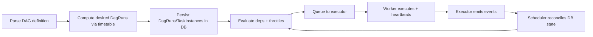
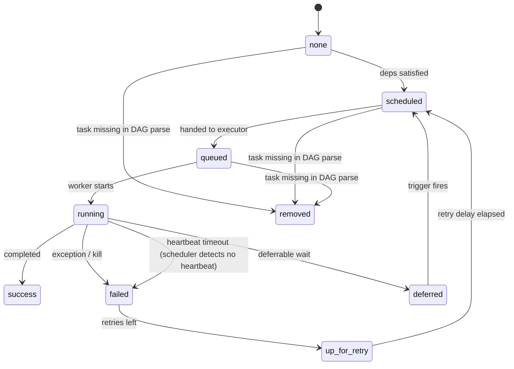

# Module 01 — First Principles: Correctness, Scheduling Semantics, Runtime Model

>**Target:** Apache Airflow **3.1.5** (released **2025-12-12**).  
>**Outcome:** you can predict **what will run, when, and why**—across retries, backfills/catchup, scheduler downtime, and throttling—by reasoning from first principles (not UI folklore).

---

## 0) The contract you are actually signing

Airflow does **not** guarantee “exactly-once execution”. It guarantees a scheduler-driven **state machine** stored in the **metadata DB**. Your DAG must make repeated executions safe.

Three non-negotiables:

1. **Deterministic DAG definition**
   Same DAG graph every parse: stable `dag_id`, stable `task_id`s, stable dependencies.

2. **Scheduling correctness**
   A run is defined by **timetable semantics** (trigger vs data-interval), not your intuition about cron.

3. **Idempotent effects**
   Airflow runs tasks **at least once**; you must ensure the *effect* is **exactly once** per interval/partition.

Airflow is explicit: **don’t** use `logical_date` as “meaning”; use `data_interval_start` / `data_interval_end` for slicing.

---

## Core 1 — Architecture and the orchestration loop

### 1.1 Control plane vs data plane

Airflow is a **control plane**: it schedules, dispatches, and reconciles state. Your computations run in the **data plane** (workers/pods/external systems).

* If the **control plane** decides “not runnable”, nothing runs even with idle workers.
* If the **data plane** runs code but can’t heartbeat/report, the control plane may mark it failed and retry.

### 1.2 Components and responsibility boundaries

**Scheduler**

* Parses DAGs repeatedly.
* Creates/advances DagRuns and TaskInstances in DB.
* Evaluates dependencies + throttles.
* Queues runnable tasks to the executor.
* Reconciles executor events back into DB.

**Metadata DB**

* Canonical truth: all eligibility and state transitions ultimately live here.

**Executor**

* Transport contract between scheduler and workers.
* Scheduler interacts via executor heartbeat and event reconciliation.

**Workers / task jobs**

* Execute task code and heartbeat; loss of heartbeat triggers failure handling.

**Web/UI**

* Viewer of DB truth, not the authority.

### 1.3 The reconciliation loop (“why Airflow snaps back”)

Airflow continuously re-derives “what should be true” and converges DB state to that truth.



**Snap-back intuition:** if you force a state in UI that contradicts dependencies/throttles, the scheduler’s next cycle re-evaluates and restores DB-consistent truth. The UI never “wins”.

### 1.4 Parse-time code is a correctness hazard (and why `removed` exists)

DAG files are executed during parsing; top-level code is effectively scheduler control-plane code.
If parsing is nondeterministic, tasks can appear/disappear across parses. One canonical symptom is the TaskInstance state `removed`—explicitly defined as: the task vanished from the DAG since the run started.

#### 1.4.1 Nondeterminism: bad vs good

**Bad: unstable `task_id` (graph changes every parse)**

```python
from airflow.sdk import dag, task
import pendulum

@dag(schedule="@daily", start_date=pendulum.datetime(2025, 1, 1, tz="UTC"))
def bad():
    @task(task_id=f"extract_{pendulum.now().int_timestamp}")
    def extract():
        return 1
    extract()

bad()
```

**Good: stable IDs, runtime variability inside task**

```python
from airflow.sdk import dag, task
import pendulum

@dag(schedule="@daily", start_date=pendulum.datetime(2025, 1, 1, tz="UTC"))
def good():
    @task
    def extract():
        return 1
    extract()

good()
```

**Parse-time ban list (practical)**

* No DB/API/S3 listing to decide DAG structure.
* No `now()`/randomness to shape IDs or dependencies.
* No heavy I/O at import time.
* No global mutable state that changes graph shape.

**Transition to Core 2:** once your DAG graph is deterministic, scheduling correctness becomes the main risk: what does a run *mean*, and what data window does it own?

---

## Core 2 — Scheduling semantics: data intervals, trigger time, logical date, run_id

### 2.1 The four identifiers you must keep distinct

1. **Trigger time** (`run_after`): earliest time a run may be created (timetable output).
2. **Data interval**: `[data_interval_start, data_interval_end)` when applicable.
3. **Logical date**: run label/identifier; not semantics.
4. **Physical execution time**: when tasks actually run (drifts due to queueing/throttling).

### 2.2 Timetables: trigger vs data-interval (Airflow formalizes this)

Airflow documents two families:

* **Trigger timetables (no interval)**
  `data_interval_start == data_interval_end == trigger time`

* **Data-interval timetables (ETL interval semantics)**
  `data_interval_start != data_interval_end`
  and `data_interval_end` is the trigger time

### 2.3 Airflow 3 cron default: Trigger timetable unless you configure intervals

In Airflow 3, cron schedules default to **CronTriggerTimetable** unless you enable interval creation via the configuration key **`create_cron_data_intervals`** (default **False**).

**Practical consequence:** many ETL mental models assume interval ownership; you must ensure your timetable aligns with that assumption (either via config or explicit timetable selection).

### 2.4 Canonical data-interval diagram (the cornerstone mental model)

This diagram separates **logical date**, **interval**, **trigger time**, and **physical execution drift**.

```mermaid
timeline
  title Run meaning: interval vs trigger vs physical execution
  2025-01-01 00:00 : data_interval_start (often equals logical_date)
  2025-01-02 00:00 : data_interval_end (trigger time for interval timetables)
  2025-01-02 00:03 : run created (scheduler cycle)
  2025-01-02 00:12 : task starts (queueing/throttling drift)
  2025-01-02 00:40 : task finishes (runtime)
```

**Teaching point:** “one day late” is not a bug. It’s the **completion-interval** pattern: the run processes `[start,end)` and is triggered at `end`.

### 2.5 Catchup/backfill: policy, not tuning

Airflow documents that catchup defaults to False and governs whether historical runs are created according to timetable logic.
Backfill is the explicit creation/execution of runs for past schedule intervals.

**Correctness implication:** enable catchup/backfill only when outputs are idempotent by partition (Core 3).

### 2.6 `run_id` is the canonical uniqueness key (don’t fake it with `ds`)

Airflow’s template reference is explicit:

* `logical_date`, `ds`, `ts` are **not unique**.
* **Use `run_id` instead.**

This matters especially with custom timetables and manual triggers, where “logical date uniqueness” assumptions break.

**Rule:** when naming staging outputs and commit manifests, key by **`run_id`** (and optionally by interval partition).

---

## Core 3 — Determinism and idempotency: exactly-once effects under at-least-once execution

### 3.1 The explicit execution truth

Airflow offers no promise of “only once”. Retries, clears, scheduler restarts, worker deaths, and backfills are normal. Therefore:

* **Execution** is at-least-once.
* **Effects** must be exactly-once by design.

### 3.2 Deterministic graph: stable IDs or you will see `removed`

If a task is present in DB for a run but no longer exists in the parsed DAG, Airflow can mark it `removed` (“vanished from the DAG”).
This is a determinism failure, not an executor failure.

### 3.3 The only robust write contract: stage → validate → publish

**Stage (unique per run_id)**

* Write to a staging location like: `.../_staging/dt=.../run_id=.../`
* Never write directly into final partitions during production.

**Validate**

* Existence checks, schema checks, expected file list, optional checksums/counts.

**Publish**

* Make data visible atomically:

  * local/shared FS: rename directory + write commit marker last,
  * object store: write a **manifest/marker last** (no atomic rename).

### 3.4 TaskFlow and XCom: metadata only, never payload data

TaskFlow return values become XCom entries by default; the default backend is fine for small values but causes issues for large values or high volume; Airflow recommends object storage for those cases.
Best practices recommend using XCom for small messages and passing remote storage paths for larger data.

**Rule:** XCom stores **references only** (URIs, keys, IDs, manifests), never datasets.

---

## Core 4 — Metadata DB truth: TaskInstance lifecycle, removed, heartbeats

### 4.1 TaskInstance lifecycle (including retry, deferred, removed, heartbeat failure)

Airflow defines `removed` and other states in its TaskInstance state reference.
Heartbeat timeout behavior is documented: local task jobs heartbeat to DB; absence triggers failure and rescheduling.



### 4.2 State-based triage (with mitigation)

| State                             | What it usually means                 | First checks                                          | Mitigation                                     |
| --------------------------------- | ------------------------------------- | ----------------------------------------------------- | ---------------------------------------------- |
| `scheduled` долго                 | eligible but not queued (constraints) | `max_active_runs`, per-DAG concurrency, pools, paused | tune caps/pools, fix deps, unpause             |
| `queued` долго                    | queued but no capacity / routing      | executor queue, workers, K8s quota                    | scale capacity, fix routing, reduce fan-out    |
| `running` then fails              | runtime failure or kill/oom           | worker logs, resources                                | increase resources, harden code, retry/backoff |
| `running` then fails by heartbeat | task died or stopped heartbeating     | heartbeat timeout settings                            | fix worker stability, idempotent writes        |

---

## Core 5 — Executors and the cost model: why “fast tasks” still choke

### 5.1 Overhead is per TaskInstance

Each TaskInstance implies:

* DB state transitions,
* scheduling evaluation,
* dispatch + startup,
* log/event handling.

This is why “10k microtasks per run” often breaks the platform even if each is 200ms.

### 5.2 Latency decomposition (tie back to Core 1.4)

Total latency = **scheduling latency** + **queue time** + **startup** + **runtime**.

* If **scheduling latency dominates**, you are control-plane bound (Core 1.4): slow parsing, too many tasks, DB contention.
* If **queue time dominates**, you are capacity/self-throttle bound: pools/caps/worker shortage.
* If **runtime dominates**, it’s a compute problem, not Airflow semantics.

### 5.3 Operational stance (strong, because it’s true)

Airflow orchestrates coarse work. If you model “row → task”, you’re using the wrong tool as a compute engine. Batch work or offload fan-out to Spark/Dask/SQL, then orchestrate the batch boundaries.

---

# Lab — ETL DAG with strict output contracts and safe backfill (final, runnable)

## Lab assumptions (explicit)

* Works with LocalExecutor or any environment with a **shared filesystem**.
* With KubernetesExecutor/Celery, local paths are not inherently shared; you need volume mounts or remote storage + manifest publish.

## Input mock (minimum to run)

Create:

* `/opt/raw/events/dt=2025-01-01/events.jsonl` (JSONL)

## Contract

For partition `dt=YYYY-MM-DD`:

* Final: `/opt/warehouse/events/dt=YYYY-MM-DD/`
* Commit marker `_SUCCESS` written **last**
* Rerun is **no-op** if `_SUCCESS` exists
* Dirty partition (dir exists without `_SUCCESS`) fails loudly

## Reference DAG

```python
from __future__ import annotations

import gzip
import json
from pathlib import Path
from typing import Iterable

import pendulum
from airflow.sdk import dag, task
from airflow.models.dagrun import DagRun
from airflow.models.taskinstance import TaskInstance

RAW = Path("/opt/raw/events")
WAREHOUSE = Path("/opt/warehouse/events")


def partition_dt(dag_run: DagRun) -> str:
    # Partition key derived from interval start in UTC (never from "now").
    return dag_run.data_interval_start.in_timezone("UTC").format("YYYY-MM-DD")


def read_jsonl(path: Path) -> Iterable[dict]:
    with path.open("r", encoding="utf-8") as f:
        for line in f:
            line = line.strip()
            if line:
                yield json.loads(line)


def write_jsonl_gz(path: Path, rows: Iterable[dict]) -> None:
    path.parent.mkdir(parents=True, exist_ok=True)
    with gzip.open(path, "wt", encoding="utf-8") as f:
        for r in rows:
            f.write(json.dumps(r, ensure_ascii=False) + "\n")


@dag(
    dag_id="m01_events_etl_contract",
    schedule="@daily",
    start_date=pendulum.datetime(2025, 1, 1, tz="UTC"),
    catchup=True,
    max_active_runs=2,
    default_args={"retries": 3},
    tags=["m01"],
)
def m01_events_etl_contract():
    @task
    def extract(dag_run: DagRun) -> str:
        dt = partition_dt(dag_run)
        inp = RAW / f"dt={dt}" / "events.jsonl"
        if not inp.exists():
            raise FileNotFoundError(f"Missing input partition: {inp}")
        return str(inp)

    @task
    def transform(raw_path: str, dag_run: DagRun, task_instance: TaskInstance) -> str:
        dt = partition_dt(dag_run)

        # Unique staging path per run_id prevents clobbering across retries/reruns.
        stage_dir = WAREHOUSE / "_staging" / f"dt={dt}" / f"run_id={task_instance.run_id}"
        out = stage_dir / "data.jsonl.gz"

        def normalize(rows: Iterable[dict]) -> Iterable[dict]:
            for r in rows:
                yield {
                    "event_id": r.get("event_id"),
                    "ts": r.get("ts"),
                    "type": r.get("type"),
                    "payload": r.get("payload", {}),
                }

        write_jsonl_gz(out, normalize(read_jsonl(Path(raw_path))))
        return str(stage_dir)

    @task
    def publish(stage_dir: str, dag_run: DagRun, task_instance: TaskInstance) -> str:
        dt = partition_dt(dag_run)

        stage_dir_p = Path(stage_dir)
        stage_file = stage_dir_p / "data.jsonl.gz"
        if not stage_file.exists():
            raise FileNotFoundError(f"Missing staged artifact: {stage_file}")

        final_dir = WAREHOUSE / f"dt={dt}"
        success = final_dir / "_SUCCESS"

        # Idempotent: already committed partitions are no-ops.
        if success.exists():
            return str(final_dir)

        # Dirty partition guard: never overwrite silently.
        if final_dir.exists() and not success.exists():
            raise RuntimeError(f"Dirty partition exists without _SUCCESS: {final_dir}")

        tmp_parent = WAREHOUSE / "_publishing" / f"dt={dt}"
        tmp_parent.mkdir(parents=True, exist_ok=True)

        # run_id-scoped tmp prevents collisions if multiple publish attempts occur.
        tmp_dir = tmp_parent / f"run_id={task_instance.run_id}.tmp"
        if tmp_dir.exists():
            raise RuntimeError(f"Dirty tmp publish dir: {tmp_dir}")

        tmp_dir.mkdir(parents=True, exist_ok=False)
        (tmp_dir / "data.jsonl.gz").write_bytes(stage_file.read_bytes())

        # Local FS publish: rename + marker last.
        tmp_dir.rename(final_dir)
        success.write_text("ok\n", encoding="utf-8")
        return str(final_dir)

    publish(transform(extract()))


m01_events_etl_contract()
```

## Object-store publish (S3) — minimal but complete teaching snippet

Note: minimal for illustration; in production add retries/backoff, stronger validation, and idempotent object writes.

```python
from __future__ import annotations

import json
from typing import Optional

import boto3
from botocore.exceptions import ClientError

s3 = boto3.client("s3")


def s3_exists(bucket: str, key: str) -> bool:
    try:
        s3.head_object(Bucket=bucket, Key=key)
        return True
    except ClientError as e:
        code = e.response.get("Error", {}).get("Code")
        if code in ("404", "NoSuchKey", "NotFound"):
            return False
        raise


def put_json(bucket: str, key: str, obj: dict) -> None:
    s3.put_object(Bucket=bucket, Key=key, Body=json.dumps(obj).encode("utf-8"))


def publish_partition_s3(
    *,
    bucket: str,
    dt: str,
    run_id: str,
    stage_prefix: str,  # e.g. "events/_staging/dt=.../run_id=..."
    final_prefix: str,  # e.g. "events"
) -> str:
    manifest_key = f"{final_prefix}/dt={dt}/_MANIFEST.json"
    success_key = f"{final_prefix}/dt={dt}/_SUCCESS"

    # Idempotent: published partitions are no-ops.
    if s3_exists(bucket, manifest_key):
        return f"s3://{bucket}/{final_prefix}/dt={dt}/"

    # Validate stage (illustrative; production should list/validate expected objects).
    # Atomic publish is the single manifest write last.
    manifest = {"dt": dt, "run_id": run_id, "stage_prefix": stage_prefix}
    put_json(bucket, manifest_key, manifest)
    s3.put_object(Bucket=bucket, Key=success_key, Body=b"ok\n")

    return f"s3://{bucket}/{final_prefix}/dt={dt}/"
```

Why this is correct: object stores don’t provide atomic directory rename; the manifest/marker is your atomic commit point.

---

# Appendix — Prediction exercises (15) with grading keys

These are intentionally strict: you must state **timetable type**, **run_id vs logical date**, and the expected **interval fields**.

### A1) `run_id` vs `logical_date` uniqueness

**Q:** Which is unique across runs and should be used for staging keys?
**Key:** `run_id` (logical date/`ds`/`ts` not unique).

### A2) Identify trigger timetable by interval equality

**Setup:** `data_interval_start == data_interval_end == 2025-01-10T09:00Z`
**Key:** Trigger timetable.

### A3) Identify data-interval timetable by interval inequality

**Setup:** `start=2025-01-01T00:00Z`, `end=2025-01-02T00:00Z`
**Key:** Data-interval timetable; trigger time equals `end`.

### A4) Airflow 3 cron default switch

**Q:** What config key controls whether cron schedules create data intervals by default?
**Key:** `create_cron_data_intervals` (default False).

### A5) Contrast cron with `create_cron_data_intervals=False` vs True (interval fields)

**Setup:** Same cron schedule; compare the two modes.
**Key:**

* False → CronTriggerTimetable ⇒ `data_interval_start == data_interval_end` at trigger time.
* True → cron data intervals exist ⇒ `start != end` per schedule window.

### A6) State `removed` root cause

**Q:** What does TaskInstance `removed` usually indicate?
**Key:** Task vanished from parsed DAG since run started (determinism violation / changed `task_id`).

### A7) Staging key correctness

**Setup:** Two manual triggers happen for the same logical date.
**Q:** What prevents staging collisions?
**Key:** include `run_id` in staging path.

### A8) Scheduled vs queued diagnosis

**Setup:** TI stuck `scheduled` 40 minutes; upstream success.
**Key:** throttles/pools/concurrency/paused; not worker capacity.

### A9) Queued diagnosis

**Setup:** TI stuck `queued` 40 minutes.
**Key:** executor routing/capacity.

### A10) Heartbeat timeout: what happens

**Setup:** task process is killed mid-write; heartbeat stops.
**Key:** scheduler marks TI failed and reschedules/retries based on heartbeat timeout behavior.

### A11) Heartbeat + idempotency test

**Q:** Which publish pattern survives “mid-write kill + retry”?
**Key:** stage → validate → publish with commit marker last.

### A12) XCom size discipline

**Q:** Why not return a large dataframe from TaskFlow?
**Key:** XCom backend issues for large values/high volume; store externally and pass reference.

### A13) “One day late” explanation

**Q:** Why does daily ETL run on the next day?
**Key:** completion-interval pattern: run is triggered at `data_interval_end`.

### A14) Dirty partition drill (lab)

**Setup:** create final partition dir without `_SUCCESS`.
**Key:** publish must fail loudly by contract.

### A15) Control-plane bound vs capacity bound

**Setup:** queue time dominates runtime by 10×.
**Key:** capacity/self-throttle bound; check pools/caps/worker capacity.

---

## Final takeaways

* Determinism failures manifest as `removed`.
* Scheduling meaning is defined by timetable type; interval fields tell you which model you’re in.
* `run_id` is your uniqueness key; logical-date-derived values are not unique.
* Heartbeat loss causes failure/retry; design idempotency to survive mid-write death.
* XCom is metadata, not a data plane.
