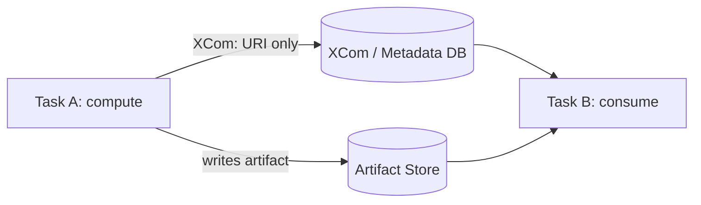

# Module 02 — Authoring Building Blocks: Task SDK, Operators, XCom, Sensors, Mapping

**Outcome:** you can author scalable DAGs that remain predictable under retries/backfills, do not abuse XCom/DB, do not waste worker slots on waiting, and do not melt the scheduler with runaway mapping.

---

## 0. What this module assumes

You already accept Module 01’s core contract:

* Airflow is a **control plane**: it schedules and reconciles state from the metadata DB.
* Task execution is **at-least-once**; your job is **exactly-once effects**.

Module 02 is about *authoring surface area*: the primitives you choose determine whether your DAG is testable, scalable, debuggable, and future-proof.

---

## Core 1 — Public interface and the Task SDK (Airflow 3)

### 1.1 The public contract: use `airflow.sdk` or accept upgrade pain

Airflow 3 introduces a stable, versioned public interface for DAG authoring under `airflow.sdk`. If something is *not* in the Task SDK API reference, you should treat it as internal and unstable. ([Apache Airflow][1])

Practical rule:

* **DAG authoring imports**: prefer `from airflow.sdk import ...` ([Apache Airflow][2])
* **Operators/Sensors**: import from the provider package (e.g., `airflow.providers.standard...`) rather than deprecated legacy paths. ([cwiki.apache.org][3])

### 1.2 What the Task SDK actually is (not marketing)

The Task SDK provides Python-native interfaces for:

* defining DAGs/tasks
* interacting with runtime resources (Connections, Variables, XComs, logs, metrics)
* coordinating task execution communication between worker-side execution and Airflow backend ([Apache Airflow][4])

This matters because it frames the mental model:

* **Parse-time**: you build a deterministic graph.
* **Run-time**: your task code runs with controlled access to Airflow resources via context APIs (not by poking DB models).

### 1.3 Minimal, correct Task SDK skeleton (with the “no parse-time footguns” posture)

```python
from __future__ import annotations

import pendulum
from airflow.sdk import dag, task

@dag(
    dag_id="m02_minimal_task_sdk",
    start_date=pendulum.datetime(2025, 1, 1, tz="UTC"),
    schedule="@daily",  # see Core 2.1 about cron/interval semantics in Airflow 3
    catchup=False,
    tags=["airflow-deep-dive", "m02"],
)
def m02_minimal_task_sdk():
    @task
    def hello() -> None:
        # run-time only: executed on worker/executor, not at DAG parse time
        print("hello from a task")

    hello()

m02_minimal_task_sdk()
```

Key teaching points:

1. Airflow **executes the DAG file** to discover DAG objects. Treat top-level code as “import-time,” not “run-time.” ([Apache Airflow][5])
2. Keep parse-time lightweight: avoid network calls, DB queries, heavy imports at top-level (import locally inside tasks if needed). ([Apache Airflow][6])
3. The `schedule` string is *not* a promise of data-interval semantics unless you know the timetable behavior (Core 2.1). ([Apache Airflow][7])

### 1.4 Runtime access model: context is the gateway, not models

XCom guidance in Airflow 3 explicitly says: operate via task context (e.g., `get_current_context()`), and do not update XCom via DB models. ([Apache Airflow][8])

```python
from airflow.sdk import task, get_current_context

@task
def inspect_context() -> None:
    ctx = get_current_context()
    ti = ctx["ti"]  # TaskInstance handle
    print("run_id:", ctx["run_id"])
    print("logical_date:", ctx["logical_date"])
    print("try_number:", ti.try_number)
```

This is the correct *authoring posture*:

* you use context to read execution identity (`run_id`, data interval, etc.)
* you keep business logic separate from orchestration metadata

---

## Core 2 — Operators vs TaskFlow vs “pure tasks”

### 2.1 Three authoring styles, one question: “where does complexity belong?”

Airflow tasks come in major forms: Operators (including Sensors) and TaskFlow tasks. ([Apache Airflow][9])

Use this decision rule:

* If you need **templated fields**, rich UI rendering, or a provider integration: use an **Operator**.
* If you need **Pythonic composition** and testable functions: use **TaskFlow**.
* If you need **deterministic, side-effect-free compute**: write **pure tasks** and wrap effects carefully.

### 2.2 Operator vs TaskFlow: templating is the real dividing line

Airflow docs explicitly warn: `@task` does **not** support rendering Jinja templates passed as arguments (unlike many Operators with templated fields). ([Apache Airflow][10])

That single fact explains a huge fraction of “why is my DAG weird?” incidents.

#### Example: templating works in Operators (templated fields)

```python
from airflow.providers.standard.operators.bash import BashOperator

print_ds = BashOperator(
    task_id="print_ds",
    bash_command="echo ds={{ ds }} data_interval_start={{ data_interval_start }}",
)
```

BashOperator’s command is a templated field; Airflow renders it at runtime. ([Apache Airflow][11])

#### Example: templating does *not* happen in TaskFlow args (common trap)

```python
from airflow.sdk import task

@task
def show_arg(x: str) -> None:
    print("x =", x)

show_arg("{{ ds }}")  # prints literal "{{ ds }}", not the rendered date
```

**Correct approach in TaskFlow:** read from context inside the function.

```python
from airflow.sdk import task, get_current_context

@task
def show_ds() -> str:
    ctx = get_current_context()
    return str(ctx["logical_date"].date())
```

### 2.3 “Pure tasks” as the scalable default

A “pure task” here means:

* deterministic output for a given `(dag_id, task_id, run_id, map_index)`
* no implicit reads from mutable global state
* no writes except through an explicit artifact contract

This style is what makes dynamic mapping and retries safe.

### 2.4 Params: runtime config without “stringly typed” chaos

Params exist to provide runtime configuration with validation (JSON Schema), and they render a UI form for manual triggers. ([Apache Airflow][12])

```python
from airflow.sdk import dag, task, Param, get_current_context
import pendulum

@dag(
    dag_id="m02_params_demo",
    start_date=pendulum.datetime(2025, 1, 1, tz="UTC"),
    schedule=None,
    catchup=False,
    params={
        "limit": Param(100, type="integer", minimum=1, maximum=10_000),
        "mode": Param("fast", type="string", enum=["fast", "safe"]),
    },
)
def m02_params_demo():
    @task
    def read_params() -> dict:
        ctx = get_current_context()
        # ctx["params"] contains validated runtime params for this DagRun
        return {"limit": ctx["params"]["limit"], "mode": ctx["params"]["mode"]}

    read_params()

m02_params_demo()
```

Teaching point you must internalize: DAG-level defaults live on the DAG object; runtime values live in the DagRun context. Airflow’s Params docs explicitly warn about confusing these. ([Apache Airflow][12])

---

## Core 3 — XCom discipline: metadata only (artifact-store pattern)

### 3.1 The DB is not your data lake

Airflow’s XCom docs are blunt: XComs are designed for **small amounts of data**; do not pass large values like dataframes. ([Apache Airflow][8])

This is not a stylistic preference. It is a scalability boundary:

* large XCom payloads increase DB load
* they degrade scheduler/web responsiveness
* they couple compute payload size to control-plane health (a design failure)

### 3.2 The anti-pattern (what not to do)

```python
from airflow.sdk import task

@task
def bad_extract() -> list[dict]:
    # Pretend this is 50MB+ of data. It will be serialized into XCom.
    return [{"row": i, "value": "..." * 1000} for i in range(10_000)]
```

If this “works,” it is only because you haven’t hit production scale yet.

### 3.3 The canonical pattern: artifact store + references only

You write data to durable storage (filesystem with shared volume, S3/GCS, DB table, warehouse), then return **a reference** (path, URI, table+partition, manifest pointer).

Mermaid diagram (contract, not decoration):



XCom carries **metadata**, not payload. That keeps the control plane healthy and makes retries/backfills safe.

### 3.4 How TaskFlow uses XCom (why serialization matters)

TaskFlow passes arguments via XCom, which means arguments must be serializable (built-ins, dataclasses/attrs, etc.). ([Apache Airflow][13])

Rule:

* TaskFlow is great for passing **small** structured metadata (paths, counts, IDs).
* It is the wrong tool for passing large in-memory objects.

### 3.5 Explicit XCom push/pull (when you need it)

XCom operations should be done via task context methods (`xcom_push`, `xcom_pull`). ([Apache Airflow][8])

```python
from airflow.sdk import task, get_current_context

@task
def push_ref(uri: str) -> None:
    ctx = get_current_context()
    ctx["ti"].xcom_push(key="artifact_uri", value=uri)

@task
def pull_ref() -> str:
    ctx = get_current_context()
    return ctx["ti"].xcom_pull(task_ids="push_ref", key="artifact_uri")
```

### 3.6 Strong opinion: if you “need” big XComs, your DAG is mis-modeled

If tasks need to exchange large payloads, you have a *data plane* problem, not an orchestration problem.

Fix it by introducing:

* an artifact store (object store, warehouse, filesystem volume)
* a manifest/partition contract (Module 01 contract discipline)
* an explicit lifecycle (stage → validate → publish)

---

## Core 4 — Sensors done right: deferrable + triggerer

### 4.1 Waiting is not work (stop burning worker slots)

Sensors are Operators specialized for waiting. ([Apache Airflow][9])

Classic sensor modes:

* **poke**: occupy worker slot while repeatedly checking
* **reschedule**: release slot between checks (still scheduler churn)
* **deferrable**: suspend task, hand off waiting to **triggerer**, resume later

Deferrable operators are now the expectation for external waiting. Airflow’s deferring docs explain the mechanism: the operator defers itself, a trigger runs asynchronously, and the task resumes later. ([Apache Airflow][14])

### 4.2 The triggerer is a capacity-planned component

Triggerers have a capacity setting: how many triggers a single Triggerer runs concurrently (default 1000). ([Apache Airflow][15])

If you deferr everything without triggerer capacity planning, you just moved the bottleneck.

### 4.3 Sensor economics table (what you’re paying for)

| Mode       | Worker slot while waiting | Scheduler churn | Triggerer required | Typical use                              |
| ---------- | ------------------------: | --------------: | -----------------: | ---------------------------------------- |
| poke       |                       yes |          medium |                 no | tiny waits, low scale (rarely justified) |
| reschedule |                        no |            high |                 no | legacy compromise                        |
| deferrable |                        no |             low |                yes | external waits at scale                  |

### 4.4 Correct modern usage example (deferrable sensor)

In standard provider docs, `TimeSensorAsync` is deprecated; prefer `TimeSensor` with `deferrable=True`. ([Apache Airflow][16])

```python
import datetime
import pendulum
from airflow.sdk import dag
from airflow.providers.standard.sensors.time_delta import TimeDeltaSensor

@dag(
    dag_id="m02_deferrable_sensor_demo",
    start_date=pendulum.datetime(2025, 1, 1, tz="UTC"),
    schedule="@daily",
    catchup=False,
)
def m02_deferrable_sensor_demo():
    # Wait 2 minutes after the end of the data interval (example)
    wait = TimeDeltaSensor(
        task_id="wait_2m_deferrable",
        delta=datetime.timedelta(minutes=2),
        deferrable=True,  # triggerer-driven waiting
    )

m02_deferrable_sensor_demo()
```

Note: Deferrable waiting requires triggerer to be running; provider docs for async sensor patterns explicitly call out triggerer requirement. ([Apache Airflow][17])

### 4.5 Failure mode you must predict

If triggerer is unhealthy or underprovisioned:

* deferrable tasks can remain deferred longer than you expect
* your “waiting” becomes a scheduling delay problem

Treat triggerer health as first-class (capacity + heartbeat).

---

## Core 5 — Dynamic task mapping and runtime expansion (without runaway fan-out)

### 5.1 What mapping is (precisely)

Dynamic Task Mapping lets the scheduler create `n` task instances at runtime from upstream task output. The scheduler creates copies right before execution (“map”), and downstream tasks can consume the collected output (“reduce”). ([Apache Airflow][18])

Key point: mapping shifts the “how many tasks?” decision from parse-time to scheduler-managed runtime.

### 5.2 Mapping vs Python loops (the correctness difference)

A Python `for` loop that creates tasks from live data at parse-time is a determinism hazard and often breaks backfills.

Mapping is the correct pattern because:

* upstream task runs at runtime and produces the list
* scheduler expands mapped task instances deterministically from that output

### 5.3 Guardrails you must know: `max_map_length`

Airflow has a configuration limit `max_map_length` to cap how many mapped task instances can be created from one mapping expansion. ([Apache Airflow][15])

Treat this as a safety fuse. If your job “needs” 500k mapped tasks, your design is wrong. Batch.

### 5.4 The templating trap in mapping contexts

Two separate ideas get confused:

1. Operator templating: fields are rendered.
2. TaskFlow args: not templated.

Mapped TaskFlow copies do not change that. If you map over strings containing `"{{ ds }}"`, you will just replicate the literal string.

### 5.5 `max_active_tis_per_dag`: a task-ID global concurrency cap

`max_active_tis_per_dag` is often misunderstood. It is a **global concurrency cap per task_id** across all active DagRuns, applying to both mapped and unmapped instances of that task. ([Apache Airflow][19])

If you forget this, you’ll mis-predict throughput and blame the executor.

---

## Lab — Runtime-discovered N items → mapped fan-out → aggregate via artifact references only

### Lab goal

Build a DAG that:

1. discovers input files for the current data interval
2. dynamically maps processing over those files
3. aggregates results
4. uses XCom only for **references**
5. is restartable under retries and safe under backfill

### Assumptions (explicit)

* Local filesystem paths below assume **shared storage** between tasks. On KubernetesExecutor you need persistent volumes or remote storage; otherwise, downstream tasks won’t see upstream files. (This is a deployment reality, not an Airflow “bug.”)
* The artifact-store pattern is identical on S3/GCS; only the atomic “publish” changes (use manifest/marker patterns).

### 1) Create mock inputs

For a daily DAG with `dt=YYYY-MM-DD`, create:

```
/opt/airflow/raw/events/dt=2025-01-01/part-0.jsonl
/opt/airflow/raw/events/dt=2025-01-01/part-1.jsonl
```

Each file: JSON-lines with a field `event_type` (string). Keep it tiny.

### 2) The DAG (fully runnable)

```python
from __future__ import annotations

import json
import os
import tempfile
from collections import Counter
from dataclasses import dataclass
from pathlib import Path
from typing import Sequence

import pendulum
from airflow.sdk import dag, task, get_current_context


RAW_ROOT = Path("/opt/airflow/raw/events")
ART_ROOT = Path("/opt/airflow/artifacts/m02_events")  # shared volume required


@dataclass(frozen=True)
class PartRef:
    in_path: str
    out_path: str


def _atomic_write_json(path: Path, obj: dict) -> None:
    """
    Atomic on a single filesystem by writing a temp file in the same directory and renaming.
    This is a local-FS technique; object stores require a different publish protocol.
    """
    path.parent.mkdir(parents=True, exist_ok=True)
    with tempfile.NamedTemporaryFile("w", dir=str(path.parent), delete=False) as tmp:
        json.dump(obj, tmp, ensure_ascii=False)
        tmp.write("\n")
        tmp_path = Path(tmp.name)
    tmp_path.replace(path)  # atomic rename on POSIX for same filesystem


@dag(
    dag_id="m02_lab_mapped_artifacts",
    start_date=pendulum.datetime(2025, 1, 1, tz="UTC"),
    schedule="@daily",
    catchup=False,
    tags=["airflow-deep-dive", "m02", "lab"],
)
def m02_lab_mapped_artifacts():
    @task
    def discover_inputs() -> list[PartRef]:
        """
        Discover input parts for the current data interval.
        Returns *references only* (paths), suitable for XCom.
        """
        ctx = get_current_context()
        ds = str(ctx["data_interval_start"].date())  # dt partition key
        run_id = ctx["run_id"]  # unique per DagRun identity

        in_dir = RAW_ROOT / f"dt={ds}"
        if not in_dir.exists():
            return []

        parts = sorted(in_dir.glob("*.jsonl"))
        out_dir = ART_ROOT / f"dt={ds}" / "runs" / run_id / "parts"

        return [
            PartRef(in_path=str(p), out_path=str(out_dir / f"{p.stem}.summary.json"))
            for p in parts
        ]

    @task(retries=2)
    def summarize_one(part: PartRef) -> str:
        """
        Read one JSONL file, write a small summary JSON artifact, return the artifact path.
        Idempotent: if out_path already exists, do not rewrite.
        """
        ctx = get_current_context()
        ti = ctx["ti"]

        in_path = Path(part.in_path)
        out_path = Path(part.out_path)

        # Idempotency: if artifact exists, treat it as completed output
        if out_path.exists():
            return str(out_path)

        # Optional drill: fail on first try if FAIL_ONCE=1 (tests retry + idempotency)
        if os.getenv("FAIL_ONCE") == "1" and ti.try_number == 1:
            raise RuntimeError("Intentional fail-once for retry drill")

        counts: Counter[str] = Counter()
        total = 0

        with in_path.open("r", encoding="utf-8") as f:
            for line in f:
                line = line.strip()
                if not line:
                    continue
                obj = json.loads(line)
                counts[str(obj.get("event_type", "UNKNOWN"))] += 1
                total += 1

        payload = {
            "input": str(in_path),
            "total_rows": total,
            "event_type_counts": dict(counts),
        }
        _atomic_write_json(out_path, payload)
        return str(out_path)

    @task
    def aggregate(parts: Sequence[str]) -> str:
        """
        Reduce step: read summary artifacts, write a final aggregate artifact.
        Still references-only: output is one artifact path.
        """
        ctx = get_current_context()
        ds = str(ctx["data_interval_start"].date())
        run_id = ctx["run_id"]

        out_path = ART_ROOT / f"dt={ds}" / "runs" / run_id / "aggregate.json"

        if out_path.exists():
            return str(out_path)

        total_rows = 0
        merged: Counter[str] = Counter()

        for p in parts:
            with Path(p).open("r", encoding="utf-8") as f:
                obj = json.loads(f.readline())
            total_rows += int(obj["total_rows"])
            merged.update(obj["event_type_counts"])

        payload = {"dt": ds, "run_id": run_id, "total_rows": total_rows, "event_type_counts": dict(merged)}
        _atomic_write_json(out_path, payload)
        return str(out_path)

    @task
    def assert_nonempty(discovered: list[PartRef], aggregate_path: str) -> None:
        """
        Simple correctness check: if there were inputs, the aggregate must exist and be valid JSON.
        """
        if not discovered:
            return

        p = Path(aggregate_path)
        assert p.exists(), f"Missing aggregate artifact: {p}"
        with p.open("r", encoding="utf-8") as f:
            json.loads(f.readline())

    discovered = discover_inputs()
    part_summaries = summarize_one.expand(part=discovered)  # dynamic mapping
    agg = aggregate(part_summaries)
    assert_nonempty(discovered, agg)


m02_lab_mapped_artifacts()
```

Where this lab is intentionally strict:

* XCom payloads are tiny: lists of `PartRef` and strings (paths) only. ([Apache Airflow][8])
* The reducer iterates `parts` without forcing a giant in-memory list (works with Airflow’s mapped-output proxy semantics).
* Retry drill (`FAIL_ONCE=1`) forces you to validate idempotency under at-least-once execution.

---

## Appendix A — Prediction exercises (with grading keys)

These are not “concept checks.” They require exact, operational predictions.

### A1 — TaskFlow templating trap

**Setup:** call `show_arg("{{ ds }}")` inside a `@task` function as shown in Core 2.2.
**Question:** what prints?

**Key:** it prints the literal string `{{ ds }}` (no Jinja rendering in `@task` args). ([Apache Airflow][10])

---

### A2 — XCom payload discipline

**Setup:** a task returns a 50MB JSON list.
**Question:** what breaks first in practice: worker, scheduler, or metadata DB?

**Key:** you are pushing large payload through XCom storage (metadata DB path), degrading the control plane; DB bloat / web UI / scheduler queries suffer. Airflow warns XComs are for small data only. ([Apache Airflow][8])

---

### A3 — Deferrable sensor capacity

**Setup:** 5000 deferrable sensors defer simultaneously; one triggerer runs with default capacity.
**Question:** can one triggerer handle this without backlog?

**Key:** default triggerer capacity is 1000 triggers concurrently; 5000 exceeds capacity → backlog/latency unless you scale triggerers or capacity. ([Apache Airflow][15])

---

### A4 — Mapping expansion point

**Setup:** `summarize_one.expand(part=discover_inputs())`.
**Question:** when is `n` determined (parse-time vs runtime), and who creates the copies?

**Key:** runtime; scheduler expands mapped task instances based on upstream task output shortly before execution. ([Apache Airflow][18])

---

### A5 — `max_map_length` fuse

**Setup:** `discover_inputs()` returns 50,000 items.
**Question:** what happens if `max_map_length` is 1024?

**Key:** expansion is prevented/failed/blocked by the configured cap; you must batch upstream (design fix). `max_map_length` is a core guardrail. ([Apache Airflow][15])

---

### A6 — Retry drill and idempotency

**Setup:** set `FAIL_ONCE=1`, run the lab.
**Question:** on retry, does `summarize_one` rewrite the summary artifact?

**Key:** no; it checks `out_path.exists()` and returns the existing artifact path (idempotent behavior).

---

### A7 — Triggerer health vs “waiting”

**Setup:** triggerer is down; deferrable sensor tasks defer.
**Question:** what state behavior do you expect?

**Key:** tasks remain deferred longer than expected; waiting becomes a triggerer availability/capacity problem. Triggerer health check settings exist because this is an operational dependency. ([Apache Airflow][15])

---

### A8 — `run_id` in artifact paths

**Setup:** rerun the same logical date manually (new DagRun).
**Question:** why does the lab include `run_id` in output paths?

**Key:** different DagRuns for same interval must not collide in staging/output; `run_id` is the unique run identity used to isolate artifacts.

---

### A9 — Heartbeat timeout implication (correctness)

**Setup:** task is killed mid-write; scheduler detects heartbeat timeout.
**Question:** what happens next?

**Key:** scheduler marks TI failed and reschedules/retries; this is why atomic writes and idempotency are mandatory. Airflow documents heartbeat timeout leading to rescheduling. ([Apache Airflow][15])

---

## What you should be able to do after Module 02

* Choose TaskFlow vs Operator based on **templating, debuggability, and integration needs** (not taste). ([Apache Airflow][10])
* Enforce the artifact-store pattern so XCom stays metadata-only. ([Apache Airflow][8])
* Default to deferrable waiting and capacity-plan triggerers. ([Apache Airflow][14])
* Use dynamic task mapping safely with explicit guardrails (`max_map_length`, task-level concurrency caps). ([Apache Airflow][18])

[1]: https://airflow.apache.org/docs/task-sdk/stable/api.html "airflow.sdk API Reference"
[2]: https://airflow.apache.org/docs/apache-airflow/stable/release_notes.html "Release Notes — Airflow 3.1.5 Documentation"
[3]: https://cwiki.apache.org/confluence/display/AIRFLOW/Airflow%2B3%2Buser%2Bfacing%2Bchanges "Airflow 3 user facing changes"
[4]: https://airflow.apache.org/docs/task-sdk/stable/index.html "Apache Airflow Task SDK"
[5]: https://airflow.apache.org/docs/apache-airflow/stable/core-concepts/dags.html "Dags — Airflow 3.1.5 Documentation"
[6]: https://airflow.apache.org/docs/apache-airflow/stable/best-practices.html "Best Practices — Airflow 3.1.5 Documentation"
[7]: https://airflow.apache.org/docs/apache-airflow/stable/configurations-ref.html "Configuration Reference — Airflow 3.1.5 Documentation"
[8]: https://airflow.apache.org/docs/apache-airflow/stable/core-concepts/xcoms.html "XComs — Airflow 3.1.5 Documentation"
[9]: https://airflow.apache.org/docs/apache-airflow/stable/core-concepts/tasks.html "Tasks — Airflow 3.1.5 Documentation"
[10]: https://airflow.apache.org/docs/apache-airflow/stable/core-concepts/operators.html "Operators — Airflow 3.1.5 Documentation"
[11]: https://airflow.apache.org/docs/apache-airflow-providers-standard/stable/_api/airflow/providers/standard/operators/bash/index.html "airflow.providers.standard.operators.bash"
[12]: https://airflow.apache.org/docs/apache-airflow/stable/core-concepts/params.html "Params — Airflow 3.1.5 Documentation"
[13]: https://airflow.apache.org/docs/apache-airflow/stable/core-concepts/taskflow.html "TaskFlow — Airflow 3.1.5 Documentation"
[14]: https://airflow.apache.org/docs/apache-airflow/stable/authoring-and-scheduling/deferring.html "Deferrable Operators & Triggers — Airflow 3.1.5 Documentation"
[15]: https://airflow.apache.org/docs/apache-airflow/stable/configurations-ref.html "Configuration Reference — Airflow 3.1.5 Documentation"
[16]: https://airflow.apache.org/docs/apache-airflow-providers-standard/stable/_api/airflow/providers/standard/sensors/time/index.html "airflow.providers.standard.sensors.time"
[17]: https://airflow.apache.org/docs/apache-airflow-providers-standard/stable/sensors/datetime.html "TimeDeltaSensor — apache-airflow-providers-standard ..."
[18]: https://airflow.apache.org/docs/apache-airflow/stable/authoring-and-scheduling/dynamic-task-mapping.html "Dynamic Task Mapping — Airflow 3.1.5 Documentation"
[19]: https://airflow.apache.org/docs/apache-airflow/stable/faq.html "FAQ — Airflow 3.1.5 Documentation"
