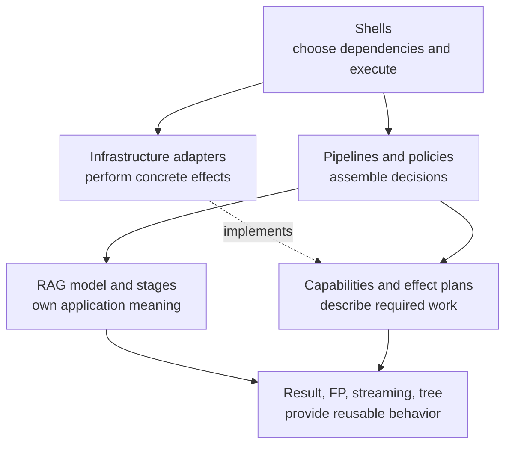
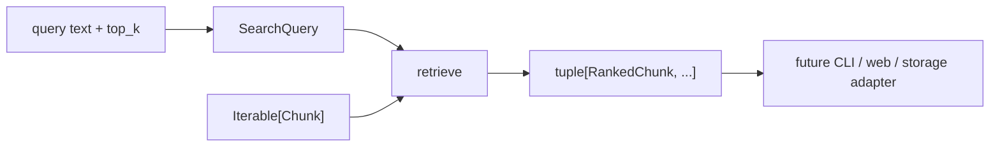

# Understand the Boundaries FuncPipe Earned

FuncPipe’s architecture is a record of learning pressures. It separates values,
transformations, policies, effect descriptions, and effect execution because later
modules need to change one without making every other part harder to reason about.

This guide explains those boundaries. Use the [Capstone File Guide](capstone-file-guide.md)
when you only need a reading route.

## The governing dependency direction

The central rule is:

> Domain meaning and pure decisions must not depend on a concrete runtime edge.



An arrow means “may depend on.” The dashed arrow means an adapter implements a protocol
owned by the inner design. There should be no reverse import from `rag/stages.py` to a
file-storage adapter or CLI shell.

## Values carry decisions inward

`RagConfig`, `RagCoreDeps`, and `RagBoundaryDeps` in `rag/config.py` show three different
kinds of input:

- `RagConfig` is immutable policy data: chunk size, keep rules, cleaning rules, and
  debug choices.
- `RagCoreDeps` contains pure or observational callables used by the RAG core: cleaner,
  embedder, and optional taps.
- `RagBoundaryDeps` adds a `DocsReader`, because reading a path is a boundary concern.

The split lets `full_rag_api_docs` accept already-available `RawDoc` values while
`full_rag_api_path` owns the extra failure route introduced by file reading. The core
does not need a fake filesystem abstraction merely to clean a document.

This is dependency injection in a functional style: dependencies are explicit values,
not ambient globals and not necessarily stateful service objects.

## Pure transformation versus policy

A function can be pure while still making an operational decision. For example:

- `clean_doc` deterministically normalizes text;
- `evaluate_budget` compares an observation with a performance budget;
- `assess_migration` compares two contract shapes; and
- `review_change` composes already-classified evidence.

Purity means the result is determined by explicit values and no effect occurs during
the call. It does not mean the decision is trivial or detached from operations.

The shell must obtain real measurements and available paths. The pure policy receives
those observations afterward. This separation makes a decision replayable in a unit
test without pretending the measurement itself was pure.

## Retrieval is application meaning, not an adapter trick

The preserved Module 09 endpoint produces embedded `Chunk` values. The live Module
10 endpoint adds the missing query-to-ranked-chunks behavior through two inner
surfaces:

- `rag/domain/retrieval.py` owns legal `SearchQuery` and `RankedChunk` values; and
- `rag/retrieval.py` owns query construction, cosine scoring, and deterministic
  ordering.



The shell may obtain query text or load an index. It must not decide cosine
semantics, discard domain validation, or replace the stable tie-break with
backend encounter order. A future vector-store adapter would translate its
response into application-owned ranked values and prove that the observable
ordering contract remains intact.

The local exact-ranking implementation materializes candidate scores because it
must establish a global order. That is an honest small-index contract, not a
claim of streaming or bounded memory. A heap or remote index would be an
implementation alternative only after it preserves score calculation, coordinate
tie-breaking, `top_k`, invalid-vector behavior, and result ranks.

The current indexed `Chunk` does not store an embedding-model identifier.
`SearchQuery.embedding.model` documents the local query model but cannot by
itself prove compatibility with every supplied chunk. Changing models therefore
requires a migration decision, not only a same-dimension check.

## Description versus execution

Module 07 introduces `IOPlan[A]` in `domain/effects/io_plan.py`. The type wraps a delayed
operation that will eventually return `Result[A, ErrInfo]`.

Compare:

```python
plan = io_delay(lambda: storage.write_chunks(path, chunks))
```

with:

```python
result = perform(plan)
```

Constructing `plan` describes work. `perform` executes it. Keeping those moments
distinct allows composition and review before an effect occurs.

The distinction has a limit: `IOPlan` stores a thunk, so inspecting the value does not
reveal every hidden behavior inside that callable. The architecture improves ownership;
it does not turn arbitrary Python effects into fully transparent data.

## Capabilities are narrower than adapters

`domain/capabilities.py` defines protocols such as:

```python
class Clock(Protocol):
    def now(self) -> datetime: ...
```

The domain owns the need for a current time value. `infra/adapters/clock.py` owns a
concrete way to supply it.

A useful capability:

- names one domain need;
- has values the core understands;
- permits deterministic substitutes in tests; and
- does not expose a vendor’s entire API.

An adapter may handle file formats, exceptions, library calls, or runtime state. It
translates those details into the capability contract. The adapter should not decide
RAG ranking semantics simply because it has access to the data.

## Materialization is an architectural decision

FuncPipe provides both iterator-producing and materializing APIs.

`iter_rag_core` yields chunks as demanded. `full_rag_api_docs` calls `list` because it
must calculate final observations, invoke whole-sequence taps, deduplicate, and return a
list contract.

Ask at every collection:

1. Which public promise requires all values now?
2. What upper bound exists?
3. Who owns memory pressure?
4. Could a consumer-specific observation remain outside the core?

Moving `list(docs)` into a low-level stage would silently make all callers eager.
Materializing at a named API edge keeps that trade-off visible.

## Failure ownership follows the boundary

FuncPipe does not force every failure into one universal mechanism.

- Invalid local arguments may raise `ValueError` when the caller has violated a direct
  Python contract.
- Expected application failures use `Result`.
- Optional presence uses `Option`, not an error.
- Boundary exceptions are translated into stable error values where enough context
  exists to name the stage and path.
- Cancellation and cleanup remain runtime concerns that async and resource owners must
  preserve.

A broad `try/except` in a pure stage is suspicious because the stage may not know how to
classify the failure. A boundary adapter can catch broadly when its explicit job is to
translate foreign exceptions and preserve the cause.

## Reject two tempting designs

### Let the shell own all logic

A large CLI function can read, clean, chunk, embed, retry, print, and write. It may be
easy to start, but every behavioral test must now reconstruct the world. Configuration,
failure, and policy become branches hidden inside execution.

### Turn every function into an interface

Protocols around `clean_doc` or a tuple constructor add indirection without effect
pressure. Plain callables and immutable values already provide substitution. FuncPipe
uses capabilities where the application truly needs an external operation.

The architecture is successful when the smallest sufficient mechanism remains obvious.

## Review the dependency direction

For a proposed change, answer:

| Question | Evidence to inspect |
| --- | --- |
| Is this RAG meaning or runtime execution? | input/output values and the package importing the code |
| Can the decision run from already-observed values? | a pure unit test with no adapter fixture |
| Does a concrete dependency cross inward? | imports from `infra` or `boundaries` inside domain and RAG packages |
| Is materialization justified? | return type, observation need, and boundedness test |
| Is failure translated where context is richest? | error code, stage, path, and preserved cause |
| Does async change scheduling without changing value laws? | ordering, bound, cancellation, and cleanup tests |

You understand the architecture when you can explain not only where a behavior lives,
but why moving it one layer inward or outward would weaken a specific contract.
