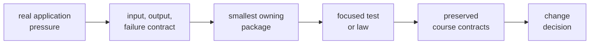

# Extend FuncPipe Without Losing the Course

An extension is valuable when it exposes a real application pressure and preserves the
laws the course has already earned. Adding a framework, abstraction, or directory is not
itself progress.

Use this guide for a learner-owned capstone change after completing the relevant module.
Start with one behavior and one proof surface.

## The extension contract

Before editing, write:

```text
Capability before:
New pressure:
Behavioral change:
Owning source:
New or changed proof:
Earlier law at risk:
Failure route:
Smallest verification:
```

If “behavioral change” is empty, you may be planning a refactor. State the semantic
equivalence claim instead. If “earlier law at risk” is empty, inspect the
[Capstone Map](capstone-map.md); every live surface has history.



Do not choose the package before defining the contract. File placement follows
responsibility.

## Choose a bounded kind of change

| Change kind | Likely owner | Proof emphasis |
| --- | --- | --- |
| new deterministic RAG transformation | `rag/` or `rag/domain/` | input/output values, idempotence or ordering where relevant |
| new validation rule | domain smart constructor or `fp/validation.py` | accumulated errors and valid construction |
| new resource or retry policy | `policies/` | bound, classification, cleanup, and non-retriable route |
| new required external operation | `domain/capabilities.py` plus one adapter | protocol contract, deterministic substitute, adapter failure translation |
| new library integration | `interop/` or `boundaries/adapters/` | translation in both directions and foreign failure |
| new review claim | `review_cli.py` inventory plus owned test | route availability separately from executed behavior |

Reject “make it production-ready” as a change kind. It hides many unrelated contracts
and usually imports infrastructure before the course has named a need.

## Capstone practice: publish the cleaning fixed-point law

This practice connects the first course law to Module 10 governance without inventing
new application behavior.

### Starting context

Module 01 teaches that repeated cleaning reaches a fixed point:

```python
clean_doc(clean_doc(document)) == clean_doc(document)
```

The live capstone preserves that property in:

```text
src/funcpipe_rag/rag/stages.py
tests/unit/rag/test_stages.py::test_clean_doc_is_idempotent
```

The review CLI publishes several evidence routes, but it does not yet publish this
cross-course contract.

### Objective

Add a `cleaning-fixed-point` entry to `EVIDENCE_CLAIMS` in
`src/funcpipe_rag/boundaries/shells/review_cli.py` so a reviewer can discover the owned
source, test, and focused command.

### Constraints

- Do not move or duplicate `clean_doc`.
- Do not reimplement the property in the CLI.
- Do not execute pytest while building the summary.
- Use the existing `EvidenceClaim` and `assess_evidence` flow.
- Preserve the distinction between `route_available` and a passing command.
- Keep existing claim order stable unless you can explain a better review order.

### Expected evidence

The focused inventory route should say the path is available and name the test command:

```bash
funcpipe-rag-review summary \
  --claim cleaning-fixed-point \
  --project-root .
```

Then execute the behavior independently:

```bash
pytest -q tests/unit/rag/test_stages.py -k clean_doc_is_idempotent
```

### Acceptance checks

Your change is complete when:

1. CLI unit tests expect `cleaning-fixed-point` in the inventory.
2. focused text output contains only the selected claim, not unrelated claims;
3. a missing project root makes
   `funcpipe-rag-review check --claim cleaning-fixed-point` return nonzero;
4. the named idempotence property passes;
5. the full CLI unit test file passes; and
6. `review_change` remains pure and unchanged.

The preserved earlier contract is not merely “cleaning still works.” It is:

> any cleaned `RawDoc` or `CleanDoc` reaches the same `CleanDoc` value after another
> cleaning pass.

### Common wrong turns

**Mark the route as executed.**

`build_summary` checks required paths. It has no test result. Keep the language
“available.”

**Add a second cleaning test under `review/`.**

The RAG package owns cleaning semantics. The review inventory should point to that proof,
not clone it.

**Call pytest from the CLI.**

That mixes inventory, process execution, and policy. The Makefile and learner choose
when to pay for execution.

**Publish only the test path.**

A review claim needs the behavior owner and its proof. Otherwise a test could survive
after the implementation moved or disappeared.

### What the practice proves

It proves you can:

- trace a Module 01 law into the live endpoint;
- place governance metadata at a boundary without moving domain behavior;
- test a success and missing-route failure;
- distinguish source discovery from executed proof; and
- preserve a stable CLI contract.

It does not add a new cleaning capability or prove every RAG transformation idempotent.

## Design a behavior extension

For a genuinely new behavior, use this sequence:

1. Add or amend the smallest test that states the public value contract.
2. Run it and observe the expected failure.
3. Implement in the owning pure package when possible.
4. Add the failure or boundary test separately.
5. Run the focused proof.
6. Run the cumulative state or live package suite required by the affected history.
7. Complete the [Capstone Review Worksheet](capstone-review-worksheet.md).

Do not copy the live change backward into reference states automatically. A reference
state changes only if the behavior belongs at that point in the course. If an earlier
state changes, audit every later state and regenerate history through the established
route.

## Decide whether a new abstraction is earned

Ask:

- Does the pressure occur in more than one owned place?
- Would a plain function, immutable value, or existing protocol solve it?
- Can a learner explain the lifecycle and failure cost?
- Does the abstraction preserve a visible RAG behavior?
- Which test becomes simpler or more precise?

If answers are weak, keep the behavior local. FuncPipe is an application for learning
functional judgment, not a catalogue of every functional pattern.

## Extension handoff

Finish with:

```text
Behavior added or preserved:
Owning files:
Proof executed:
Preserved course laws:
Known limit:
Rejected alternative:
```

That note should let another learner review the change without reconstructing your
intent from a diff.
