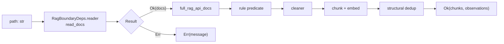

# Read FuncPipe by Behavior, Not Alphabetically

The live capstone contains the accumulated work of ten modules. Reading every file in
tree order hides the important question: **which code owns the behavior I am trying to
understand?**

Use this guide after the [Capstone Map](capstone-map.md) has identified the correct
module state. Paths below describe the live endpoint; the same ownership pattern grows
gradually through the tracked states.

## Begin with one public promise

Choose a behavior before choosing a directory:

| Behavior you want to trace | First test surface | First source surface |
| --- | --- | --- |
| clean, chunk, embed, and deduplicate documents | `tests/unit/rag/` | `rag/stages.py`, `rag/chunking.py`, `rag/rag_api.py` |
| preserve success and failure values in a stream | `tests/unit/result/` | `result/types.py`, `result/stream.py`, `result/folds.py` |
| keep traversal lazy and bounded | `tests/unit/streaming/` and `tests/unit/tree/` | `streaming/`, `tree/`, then the consuming RAG function |
| validate or combine functional values | `tests/unit/fp/` | `fp/` |
| assemble explicit pipeline policy | `tests/unit/pipelines/` and `tests/unit/policies/` | `pipelines/`, `policies/` |
| describe and execute effects | `tests/unit/domain/` and `tests/unit/infra/adapters/` | `domain/effects/`, `domain/capabilities.py`, then `infra/adapters/` |
| translate a library or process boundary | `tests/unit/interop/` and `tests/unit/boundaries/` | `interop/`, then `boundaries/` |
| accept or block a sustainment change | `tests/unit/review/` | `review/`, then `boundaries/shells/review_cli.py` |

Tests come first because they narrow “what does this package do?” into an observable
contract. Source then explains how that contract is achieved.

## Trace a document request

The central live route is `full_rag_api_path` in `rag/rag_api.py`:



Read the route in this order:

1. `rag/config.py` defines `RagBoundaryDeps` and `RagCoreDeps`. Identify which
   dependencies may perform effects and which are plain callables.
2. `rag/rag_api.py::full_rag_api_path` asks the reader for documents and translates the
   boundary result into the core call.
3. `rag/rag_api.py::full_rag_api_docs` materializes at the API edge because it must
   produce counts, samples, taps, and a final list.
4. `rag/stages.py` contains deterministic cleaning, chunking helpers, embedding, and
   deduplication.
5. The matching tests in `tests/unit/rag/` prove values and observations. Boundary tests
   separately prove reader failure.

Do not infer that all RAG routes materialize. `iter_rag` and `iter_rag_core` in the same
API module remain iterator-producing routes. The name and return type tell you which
contract you are reading.

## Identify the functional core

“Core” does not mean one directory. It means code whose result depends only on explicit
inputs and which does not execute external effects.

In FuncPipe, that responsibility spans:

- `rag/stages.py` for deterministic RAG transformations;
- `core/` and `rag/domain/` for application values and predicates;
- `result/` for explicit success and failure flow;
- `fp/` for reusable composition and validation;
- `streaming/` and `tree/` for lazy data structure behavior; and
- pure policy decisions in `policies/` and `review/`.

Check the function signature and body. A module living under `domain/` is not
automatically pure, and a function under `policies/` may still receive already-observed
measurements. Ownership comes from what the code is allowed to do, not from a slogan
about folder names.

## Follow an effect from description to execution

For an I/O question, read inward from the test and outward from the plan:

```text
domain/capabilities.py
domain/effects/
boundaries/
infra/adapters/
```

- A **capability** names the smallest operation the application needs.
- An **effect plan** describes work as a value or delayed computation.
- A **boundary shell** selects dependencies and decides when execution occurs.
- An **infrastructure adapter** performs concrete storage, clock, or runtime work.

If a concrete adapter is imported into a pure RAG stage, ownership has leaked inward.
If a capability mirrors an entire library API, the boundary is too broad to teach or
replace cleanly.

## Separate similarly named packages

Several names are intentionally close:

| Surface | Responsibility |
| --- | --- |
| `core/` | reusable application-level rules and older RAG value contracts |
| `rag/` | RAG assembly, stages, configuration, and current domain types |
| `domain/` | cross-application capabilities, composition, and effect descriptions |
| `rag/domain/` | values specifically owned by the RAG model |
| `boundaries/` | process-facing shells and translation adapters |
| `infra/adapters/` | concrete implementations of effect capabilities |

When two packages appear able to own a change, ask whether the behavior is RAG meaning,
effect description, or concrete execution. That answer is more durable than choosing
the nearest file.

## Use the generated inventory carefully

From the capstone directory:

```bash
funcpipe-rag-review summary --format text --project-root .
```

The output groups packages and tests by review ownership and counts Python files. It is
an inventory, not an architecture proof. A group with many files is not more important;
a listed owner does not prove every import respects the boundary.

Use the inventory to choose a starting group. Confirm actual behavior through source and
tests.

## Stop reading at the right boundary

For one study question, stop when you can name:

- the public input and output values;
- the pure transformation or policy decision;
- the effect owner, if any;
- the matching failure route;
- the test that observes the claim; and
- one neighboring package that should not own the behavior.

Opening more files after those answers are clear usually widens context without
improving judgment. Continue only if a test or import leads across the boundary for a
specific reason.
