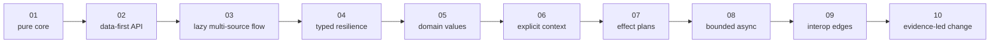

# Map the Course to the Evolving Application

This map answers one question: **what application change belongs to the module I am
studying?** It keeps later abstractions out of earlier lessons and makes preserved
behavior visible.

## Read a module as a delta

For Modules 02–09, compare two sibling directories:

```text
capstone/module-reference-states/module-XX
capstone/module-reference-states/module-YY
```

`XX` is the preceding module and `YY` is the current one. Module 01 starts from the
course problem statement rather than a tracked Module 00 application. Module 10 compares
the Module 09 state with the live capstone.



Each arrow means “add one capability while preserving the earlier contracts.” It does
not mean every file changes or every concept should be generalized.

## Module-by-module application contract

| Module | Capability before | New pressure and earned change | First source to inspect | Learning proof |
| --- | --- | --- | --- | --- |
| 01 — purity | an imperative ingestion idea with no trusted seams | cleaning, chunking, and ranking become substitutable pure functions; the shell owns file I/O | `module-01/src/funcpipe_rag/pipeline_stages.py`, then `full_rag.py` and `rag_shell.py` | `module-01/tests/learning/test_module_01_purity_foundations.py` |
| 02 — data-first APIs | a pure pipeline with arguments scattered across calls | configuration and requests become explicit values; filesystem failures cross the shell as `Result` values | `module-02/src/funcpipe_rag/api/config.py`, `api/core.py`, then `shells/rag_api_shell.py` | `module-02/tests/learning/test_module_02_data_first_apis.py` and `test_module_02_filesystem_boundary.py` |
| 03 — lazy dataflow | one request can be evaluated, but eager collection and multiple sources create memory and scheduling pressure | iterator stages, bounded chunking, fan-in, fan-out, and observation become explicit without changing result order | `module-03/src/funcpipe_rag/api/core.py`, then `streaming/fanin.py` and `streaming/fanout.py` | `module-03/tests/learning/test_module_03_streaming_dataflow.py` |
| 04 — resilient streaming | lazy values can flow, but failures and resource limits still need policy | `Result` streams, folds, retry reports, circuit breakers, and resource-aware traversal make partial failure reviewable | `module-04/src/funcpipe_rag/result/stream.py`, then `policies/retries.py`, `policies/breakers.py`, and `policies/resources.py` | `module-04/tests/learning/test_module_04_resilient_streaming.py` |
| 05 — algebraic modelling | failures are explicit, but important RAG states can still be represented by loose primitives | document, chunk, metadata, and embedding values gain smart construction and validation; accumulated errors remain data | `module-05/src/funcpipe_rag/rag/domain/`, then `fp/validation.py` and `rag/stages.py` | `module-05/tests/learning/test_module_05_data_modelling.py` |
| 06 — explicit context | domain values are safer, but configuration, state, and diagnostics can produce nested plumbing | bind, lifted functions, reader-style configuration, state threading, and writer-style diagnostics compose context without hiding it | `module-06/src/funcpipe_rag/fp/effects/`, then `result/types.py` and `fp/effects/configurable.py` | `module-06/tests/learning/test_module_06_explicit_context.py` |
| 07 — effect boundaries | context is explicit in values, but the application still needs owned execution, cleanup, and transactions | capabilities describe required effects; plans stay inspectable; adapters execute storage, clock, logging, and transactional behavior | `module-07/src/funcpipe_rag/domain/capabilities.py`, `domain/effects/`, then `boundaries/` and `infra/adapters/` | `module-07/tests/learning/test_module_07_effect_boundaries.py` |
| 08 — bounded async | effects have owners, but concurrent work introduces pressure, ordering, cancellation, and fairness questions | async plans, bounded gather, queues, timeouts, and backpressure make scheduling policy explicit and testable | `module-08/src/funcpipe_rag/domain/effects/async_/`, then `infra/adapters/async_runtime.py` | `module-08/tests/learning/test_module_08_async.py` |
| 09 — interop discipline | the internal architecture is coherent, but libraries, dataframe tools, CLI overrides, and distributed backends expose foreign contracts | adapters and compatibility functions translate at named edges; external helpers do not become the domain model | `module-09/src/funcpipe_rag/interop/`, then `pipelines/cli.py`, `pipelines/distributed.py`, and `boundaries/shells/` | `module-09/tests/learning/test_module_09_interop.py` |
| 10 — sustainment | the application works through explicit seams, but change claims need evidence and ownership | semantic equivalence, budgets, migration shape, observation, and published evidence routes compose into review decisions | live `src/funcpipe_rag/review/`, then `boundaries/shells/review_cli.py` | live `tests/learning/test_module_10_sustainment.py` and `tests/unit/review/` |

All paths in the first nine rows are relative to
`capstone/module-reference-states/`. The Module 10 paths are relative to `capstone/`.

## Run the state you are reading

From the repository root, substitute the two-digit module:

```bash
make PROGRAM=python-programming/python-functional-programming \
  capstone-module-state-proof MODULE=04
```

The command runs **all learning tests present in that state**, not only the new Module 04
file. This is intentional. Module 04 is complete only when its resilience behavior
passes while the Module 01–03 promises still pass.

Expected final lines resemble:

```text
...................................................                      [100%]
51 passed
```

The number may grow if that tracked state gains a justified proof. The important signal
is that pytest loaded source from `module-reference-states/module-04/src` and selected
tests from the same state.

An invalid module fails before pytest:

```bash
make PROGRAM=python-programming/python-functional-programming \
  capstone-module-state-proof MODULE=10
```

Module 10 is deliberately not a snapshot command. Its endpoint is the live capstone.
Use:

```bash
make PROGRAM=python-programming/python-functional-programming capstone-test
```

## Compare without drowning in the diff

Suppose you are studying Module 07. Do not begin with a recursive diff of two large
trees. Use this sequence:

1. Read `module-07-effect-boundaries-resource-safety/capstone-delta.md`.
2. Open the new Module 07 learning test and list its imported names.
3. Find those names in the Module 07 source state.
4. Check whether those source paths exist in Module 06.
5. Compare only the relevant definitions and assertions.
6. Run `capstone-module-state-proof MODULE=07`.
7. Re-run one earlier test after temporarily changing only its input data, not source.

That route keeps the comparison attached to a behavioral question. A large file-count
increase is not itself evidence of learning or better design.

## Diagnose three common mismatches

### The lesson names a type absent from the state

Confirm that you opened the matching two-digit directory. If the type exists only in a
later state, the lesson or state is out of sequence; do not silently substitute the live
implementation.

### The state contains a package the lesson never explains

First check the module delta and the new learning test. If neither supplies the pressure,
record the package as unexplained. Passing tests do not make an unexplained abstraction
pedagogically valid.

### A current test passes but an earlier promise disappears

Run the cumulative state proof rather than only the current module file. The state is
incoherent if its new behavior requires an unexplained regression in an earlier law.

## Your exit note

Before returning to the module exercises, write four sentences:

- “Before this module, FuncPipe could …”
- “That became insufficient when …”
- “The module changes …”
- “The cumulative state proves … while preserving …”

If a sentence relies on “more advanced” or merely repeats the module title, the delta is
not yet understood.
