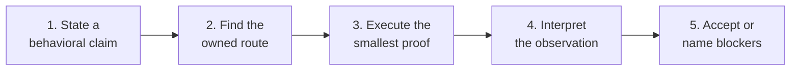

# Prove One FuncPipe Claim at a Time

A proof route is useful only when it answers a stated claim. Running more commands does
not compensate for an unclear claim, and a discoverable test file is not evidence that
the test passed.

This guide separates five activities that are easy to blur:



Skipping from “route exists” to “claim accepted” is a review error.

## Start with a falsifiable sentence

Weak:

> The async pipeline is robust.

Reviewable:

> Gathering async plans with concurrency two never has more than two plans in flight
> and returns successful values in input order.

The second claim names a bound and an ordering rule. A test can construct a counterexample.
It may still need separate cancellation and failure tests; one sentence should not
pretend to cover every property.

## Choose the evidence level

| Level | Question answered | Typical route |
| --- | --- | --- |
| Source inspection | Is the intended implementation or test surface present and owned here? | open named source and test files |
| Focused example | Does one concrete input produce the explained output? | one pytest node or runnable example |
| Property or law | Does the behavior hold across generated or structural cases? | a focused law/property test file |
| Cumulative module state | Does the new module behavior coexist with all earlier learning promises? | `capstone-module-state-proof MODULE=XX` |
| Live package suite | Do all current capstone tests pass together? | `capstone-test` |
| Static and distribution checks | Are imports, types, lint rules, and packaging coherent? | `lint` and `build` |
| Saved review bundle | Can another reviewer inspect the executed report and route inventory? | `capstone-verify-report` |
| Full course confirmation | Do the live tests, types, build, review routes, and bundles pass? | course `test` |

Use the lowest level that can falsify the current claim. Escalate when the claim crosses
more boundaries, not because a larger command feels more serious.

## Prove a tracked module state

For Modules 01–09:

```bash
make PROGRAM=python-programming/python-functional-programming \
  capstone-module-state-proof MODULE=07
```

This selects both source and learning tests from the Module 07 reference state. It
proves that the state’s cumulative learning suite passes. It does not run every unit
test in the live Module 10 package, and that is precisely why it is an honest Module 07
study route.

If one current-module test fails while earlier tests pass, investigate the new delta.
If an earlier learning test fails, the current state has broken a preserved contract.

## Inspect one live sustainment claim

From `programs/python-programming/python-functional-programming/capstone`:

```bash
funcpipe-rag-review summary \
  --claim change-acceptance \
  --project-root .
```

The output names:

- the claim statement;
- required source and test paths;
- whether that route is available; and
- the command that must be executed.

Expected language includes:

```text
claim: change-acceptance
route: available
verify: pytest -q tests/unit/review/test_change.py
interpretation: route availability does not mean the verification command passed
```

Now execute the named command using the course environment:

```bash
../../../../artifacts/venv/python-programming/python-functional-programming/capstone/bin/pytest \
  -q tests/unit/review/test_change.py
```

Only after that command passes may you say the declared change-acceptance route executed
successfully in this checkout.

## Understand the published claims

The live review inventory exposes five narrow routes:

| Claim | Main question | Required interpretation |
| --- | --- | --- |
| `change-acceptance` | do independently assessed blockers compose deterministically? | passing does not prove the input assessments came from real measurements |
| `performance-decision` | does a multidimensional observation satisfy a budget? | passing does not benchmark the application |
| `regression-equivalence` | do pure and optimized embedding modes preserve the named domain contract? | passing does not prove every implementation is equally fast |
| `async-contracts` | do bounded async value laws preserve the declared ordering and result behavior? | passing does not exercise an external service |
| `migration-review` | are contract shape and semantic upcasting reviewed separately? | passing does not prove every historical payload can migrate |

Each route is deliberately smaller than “the capstone is correct.”

## Read a test as an argument

For any selected test, identify:

1. **Given:** the values and collaborators constructed before execution.
2. **When:** the one behavior being invoked.
3. **Then:** returned values, state, demand, ordering, or effects observed.
4. **Counterexample:** the implementation mistake that would make the assertion fail.
5. **Limit:** an important condition outside the test.

For example, `test_review_change_reports_independent_blockers_in_review_order` supplies
semantic, evidence, performance, and migration problems. It expects four stable blocker
names in review order. It proves deterministic composition. It does not run a benchmark,
inspect a repository, or execute a migration.

That limitation is a strength: `review_change` remains a pure policy over already-known
facts.

## Do not confuse these outputs

### Route available

`funcpipe-rag-review check` verifies that published source and test paths exist. It fails
closed when they do not. It does not execute their commands.

### Test passed

Pytest executed selected code and its assertions passed in the current environment. The
result is limited to collected tests and inputs.

### Bundle generated

The command saved reports and reading routes under `artifacts/`. Check the saved
`pytest.txt` and manifest. A directory existing from an older run is not current proof.

### Change accepted

`ChangeDecision.acceptable` is true because all applicable, already-classified evidence
values agree. It says nothing about checks omitted as inapplicable, and it is trustworthy
only if the inputs are trustworthy.

## Escalate without repeating work

Use one route per question:

```text
single test
  → current test file
    → cumulative module-state tests
      → live capstone test suite
        → lint, types, build, and saved evidence
```

Do not run `capstone-test`, `capstone-tour`, `capstone-verify-report`, and the course
`test` command independently in succession. Composite routes reuse a saved pytest report
within one invocation, but separate invocations execute the suite again.

Escalate when:

- the source changed across packages;
- a public type or serialized shape changed;
- concurrency or resource cleanup changed;
- generated module history changed; or
- another reviewer needs a durable artifact.

## Record the result honestly

A useful review note has this form:

```text
Claim:
Route:
Observed result:
What it proves:
What it does not prove:
Remaining risk:
```

If the command did not run, write “route inspected, not executed.” If a broad check was
unnecessary, name the narrower evidence instead of apologizing for not running
everything.

Continue to the [Capstone Review Worksheet](capstone-review-worksheet.md) when several
independent proof results must become one change decision.
