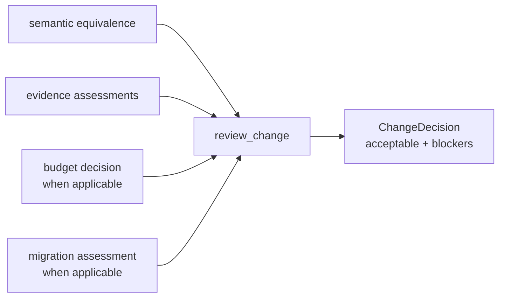

# Review a FuncPipe Change from Claim to Decision

Use this worksheet after you can state the proposed behavior and before you accept a
capstone change. It turns “the tests look good” into an inspectable chain:

```text
proposal → applicable contracts → observed evidence → classified results → decision
```

The worksheet is intentionally reusable. Copy the headings into your study notes or
change review and replace the prompts with concrete values.

## A. Bound the proposal

Write one sentence for each field:

| Field | Your answer |
| --- | --- |
| User-visible or learner-visible behavior | |
| Owning package | |
| Inputs whose meaning changes | |
| Outputs or effects whose meaning changes | |
| Explicitly unchanged behavior | |
| Reason the current design is insufficient | |

Reject a proposal described only as “refactor,” “make faster,” or “use a more functional
pattern.” Those labels do not identify a falsifiable delta.

For a refactor, name the behavior that must remain semantically equivalent. For a new
feature, name the intended difference and do not mark it equivalent by definition.

## B. Locate the course contract

If the behavior was introduced in Modules 01–09:

1. Find its introduction in the [Capstone Map](capstone-map.md).
2. Open the matching reference-state learning test.
3. Identify later states that preserve the same assertion or law.
4. State whether the live change alters that contract.

Fill this preservation ledger:

| Contract | Introduced in | Current proof | Why the proposal could break it |
| --- | --- | --- | --- |
| | | | |
| | | | |

Examples include cleaning idempotence, bounded iterator demand, error position, resource
cleanup, async ordering, and adapter translation. “All earlier behavior” is too vague
for a reviewable ledger.

## C. Decide which checks apply

`ChangeEvidence` does not require every possible check for every change. Record why each
one applies or does not:

| Check | Applies when | Applies here? | Reason |
| --- | --- | --- | --- |
| semantic equivalence | the proposal claims preserved meaning | | |
| declared evidence routes | the change publishes or depends on named code-and-test claims | | |
| performance budget | latency, memory, or throughput is part of the acceptance claim | | |
| migration assessment | a public or persisted shape changes | | |
| async laws | scheduling, bounds, order, cancellation, or cleanup may change | | |
| boundary contract | an adapter, shell, serialization, or exception translation changes | | |

Omitting an applicable check is not the same as passing it. Adding irrelevant checks
also weakens review by making routine evidence look universally required.

## D. Record observed evidence

For each applicable check:

```text
Claim:
Command or observation route:
Observed result:
Classification passed to the decision:
What this result does not establish:
```

Do not put a command in “Observed result.” Record whether it executed, its output, and
the checkout or state it applied to.

`funcpipe-rag-review check` establishes only that a published route’s required files are
available. Run the route’s named command before classifying its behavior as passing:

```bash
funcpipe-rag-review summary \
  --claim change-acceptance \
  --project-root .
pytest -q tests/unit/review/test_change.py
```

## E. Compose the decision

The live capstone’s `review_change` is pure. It receives decisions already made by
specialized assessors:



The arrows carry values, not callbacks. `review_change` must not run pytest, benchmark
the pipeline, read Git history, or execute a migration.

Record the result:

```text
acceptable:
blockers:
checks intentionally absent:
follow-up needed before another review:
```

An empty blocker list is meaningful only if the applicability table and observations
are trustworthy.

## Worked review: faster but over budget

Proposal:

> Use the hybrid batch embedding implementation while preserving the pure
> implementation’s embedding values and staying within the declared memory budget.

Assume the equivalence property passes. A measured observation is faster and meets
throughput, but uses 48 MiB against a 32 MiB limit.

The decision can be replayed without rerunning the property test or measurement:

```python
from funcpipe_rag.review.change import ChangeEvidence, review_change
from funcpipe_rag.review.evidence import EvidenceClaim, assess_evidence
from funcpipe_rag.review.performance import (
    PerformanceBudget,
    PerformanceObservation,
    evaluate_budget,
)

claim = EvidenceClaim(
    name="embedding-equivalence",
    statement="Pure and hybrid modes preserve embedding values.",
    required_paths=(
        "src/funcpipe_rag/rag/domain/perf.py",
        "tests/unit/rag/domain/test_perf_equivalence.py",
    ),
    command="pytest -q tests/unit/rag/domain/test_perf_equivalence.py",
)
assessment = assess_evidence(claim, frozenset(claim.required_paths))
budget = PerformanceBudget(
    max_latency_ms=80,
    max_peak_memory_mb=32,
    min_throughput_per_second=25,
)
observation = PerformanceObservation(
    latency_ms=60,
    peak_memory_mb=48,
    throughput_per_second=30,
)

decision = review_change(
    ChangeEvidence(
        semantic_equivalent=True,
        claims=(assessment,),
        budget=evaluate_budget(budget, observation),
    )
)

assert decision.acceptable is False
assert decision.blockers == ("performance:peak_memory",)
```

Why this is the correct rejection:

- equivalent values satisfy the semantic claim;
- the declared source-and-test route is available;
- latency and throughput satisfy their limits;
- peak memory violates an applicable budget; and
- no migration check is needed because no public shape changed.

The decision does not say the hybrid implementation is universally bad. It says this
proposal fails the budget it asked reviewers to accept.

Run the executable decision proof from the capstone directory:

```bash
pytest -q tests/learning/test_module_10_sustainment.py \
  -k change_review_composes_only_applicable_application_evidence
```

## Review a failure route, not only success

Before acceptance, choose one likely wrong implementation and show which evidence catches
it:

| Wrong turn | Evidence that should fail |
| --- | --- |
| optimize by materializing the entire iterator | bounded-demand or peak-memory proof |
| catch an adapter exception and return an empty success | boundary failure assertion |
| reorder async output by completion time | input-order property |
| add a required serialized field without an upcaster | migration assessment and fixture |
| rename a published evidence file without updating inventory | route-availability check |
| benchmark inside `review_change` | pure unit test and ownership review |

If no evidence would catch the wrong turn, the review is not finished.

## F. Make the judgment explainable

A reviewer should be able to answer:

- Why does this package own the change?
- Which earlier module law remains at risk?
- Which observations came from execution and which came from inspection?
- Why is each omitted check truly inapplicable?
- Which blocker is actionable?
- What result would be needed to reverse a rejection?

For self-study, compare your answers with the relevant module exercise answer only after
you have completed the table. The answer key can show a defensible route; it cannot make
the applicability judgment for your proposal.

## Completion condition

The worksheet is complete when the proposal is either:

- accepted with every applicable result named and every limit stated; or
- rejected with stable blockers and a smaller next investigation.

“Needs more testing” is not a completed review. Name the missing claim, route, and
observation.
