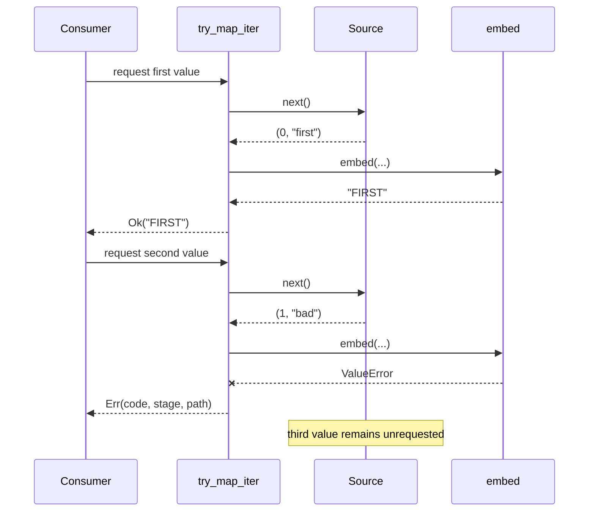

# Walk One Failure Through FuncPipe

This walkthrough teaches a code-reading method by following one Module 04 behavior:
embedding a stream can fail at one position without erasing earlier values or demanding
unread input.

The point is not to learn every resilience helper. The point is to connect a design
pressure to a returned value, source implementation, test, and preserved streaming law.

## Before Module 04

Module 03 has already made the RAG flow lazy. It can traverse multiple document sources,
chunk on demand, and preserve source boundaries. That creates a new question:

> If embedding the second chunk fails, must the entire lazy traversal raise, and how
> much upstream input may it consume?

An exception escaping the iterator loses useful facts:

- which stage failed;
- which input position failed;
- whether earlier values remain valid; and
- how far upstream traversal advanced.

Module 04 earns a `Result`-valued stream. Success and failure now occupy the same lazy
sequence, while demand remains bounded.



The final note is part of the contract. Returning an `Err` would not be enough if the
combinator eagerly consumed the whole source.

## Set your reading boundary

You need only two Module 04 files:

```text
capstone/module-reference-states/module-04/
├── src/funcpipe_rag/result/stream.py
└── tests/learning/test_module_04_resilient_streaming.py
```

Open the test and find:

```python
def test_result_stream_keeps_failure_position_and_bounds_demand() -> None:
```

Read that test before `try_map_iter`. Treat its assertions as the public promise for this
walkthrough.

## Predict the trace

The test’s source yields three labelled values:

```python
("first", "bad", "unrequested")
```

Its embedding function uppercases normal text and raises `ValueError` for `"bad"`. The
consumer takes only two outputs with `islice`.

Before running it, write predictions for:

| Observation | Your prediction |
| --- | --- |
| type and value of output 0 | |
| type of output 1 | |
| failure code | |
| failure stage | |
| failure path | |
| number of requested source items | |

The important decision is the last one. If you predict three, revisit how `islice` pulls
from an iterator.

## Read the implementation

Now open `src/funcpipe_rag/result/stream.py` in the same Module 04 state and find
`try_map_iter`:

```python
def try_map_iter(
    fn: Callable[[T], U],
    xs: Iterable[T],
    *,
    stage: str,
    key_path: Callable[[T], tuple[int, ...]] | None = None,
    code: str = "PIPE/EXC",
) -> Iterator[Result[U, ErrInfo]]:
    for x in xs:
        try:
            yield Ok(fn(x))
        except Exception as exc:
            p = key_path(x) if key_path is not None else ()
            yield Err(make_errinfo(code, str(exc), stage, p, exc))
```

Trace one loop iteration at a time:

1. `for x in xs` requests exactly one upstream item.
2. `fn(x)` executes only for that item.
3. A returned value is wrapped in `Ok`.
4. An exception is translated at this named boundary into `ErrInfo`.
5. `yield` gives control back to the consumer before another source item is requested.

The combinator catches broadly because translating stage exceptions is its declared
boundary responsibility. That choice would be dangerous in an arbitrary helper. Here,
the structured error preserves the original cause as well as the stable domain fields.

## Execute the smallest proof

From the capstone directory:

```bash
PYTHONPATH=module-reference-states/module-04/src \
  ../../../../artifacts/venv/python-programming/python-functional-programming/capstone/bin/pytest \
  -q module-reference-states/module-04/tests/learning/test_module_04_resilient_streaming.py \
  -k result_stream_keeps_failure_position_and_bounds_demand
```

If the course environment has not been installed yet, run the published state command
from the repository root instead:

```bash
make PROGRAM=python-programming/python-functional-programming \
  capstone-module-state-proof MODULE=04
```

The focused test should report one pass. The state command should report all cumulative
Module 01–04 learning tests passing.

## Interpret the assertions

The expected observations are:

```text
Ok("FIRST")
Err(code="EMBED/INVALID", stage="embed", path=(1,))
requested == 2
```

They establish four separate properties:

- earlier successes remain available;
- failure is a value at the same stream position;
- stable domain context identifies the failure; and
- downstream demand controls upstream consumption.

They do **not** establish that retrying is correct, that the error should be ignored, or
that parallel execution preserves order. Those are different policies with different
proofs later in the Module 04 state.

## Inspect a wrong design

Consider this eager alternative:

```python
def eager_try_map(fn, xs):
    materialized = list(xs)
    return [attempt(fn, item) for item in materialized]
```

It can still return an `Ok` and an `Err`, so a test checking only output types may pass.
But `list(xs)` requests `"unrequested"` before the consumer asks for it. The change
breaks the Module 03 bounded-demand promise while appearing to add Module 04 failure
values.

This is why the current state runs all earlier learning tests. A cumulative capstone
delta must preserve the earlier law, not merely demonstrate the new vocabulary.

## Follow the behavior forward

In the live Module 10 endpoint, the same responsibility remains in:

```text
capstone/src/funcpipe_rag/result/stream.py
```

Later modules add domain values, effect plans, async coordination, and review evidence.
None grants permission to erase the bounded-demand behavior. Search the live tests for
`try_map_iter`, `bounded`, or `requested` and verify that later structure still makes the
law observable.

## Apply the method to another module

Choose one test from the next module and make the same six-part trace:

1. capability before the module;
2. new pressure;
3. input value;
4. returned value or observable effect;
5. failure or boundary route; and
6. earlier law that must remain true.

Use the [Capstone Map](capstone-map.md) to choose the correct state. If you cannot name
all six parts, read the module delta again before opening more source files.
