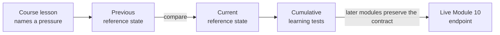

# Learn Functional Python Through FuncPipe

FuncPipe is not an assignment saved for the end of the course. It is the running
application in which each module earns its abstractions. The coursebook explains the
idea; a tracked capstone state shows what changed at that point; tests make the new
promise observable.

Use this shelf when you need to turn a lesson into code reading, execution, or a design
decision. You do not need to understand the whole repository before beginning.

## The three capstone surfaces

The repository contains three related views of one application:

| Surface | What it represents | When to use it |
| --- | --- | --- |
| `capstone/module-reference-states/module-01` through `module-09` | the application exactly as each tracked module leaves it | while studying or reviewing Modules 01–09 |
| `capstone/_history/worktrees/module-01` through `module-10` | generated comparison worktrees | when comparing states or validating history |
| `capstone/src/funcpipe_rag` and `capstone/tests` | the live Module 10 endpoint | after Module 09 or when reviewing the completed design |

Do not study Module 04 by opening only the live application. The live code contains
concepts that Module 04 has not taught yet. Start from the Module 04 reference state,
compare it with Module 03, and move to the live endpoint only after you can explain the
delta.



The diagram is a reading order, not a build pipeline. A lesson makes sense when you can
describe the pressure between two states and point to the test that keeps the resulting
behavior alive.

## Choose one learning job

| Your job now | Start here | Leave with |
| --- | --- | --- |
| Reconnect a module to the application | [Capstone Map](capstone-map.md) | one state, one source route, and one proof command |
| Follow one request through the completed system | [Capstone Walkthrough](capstone-walkthrough.md) | a trace from input value to effect boundary |
| Find the owning source and test package | [Capstone File Guide](capstone-file-guide.md) | a narrow set of files, not a repository tour |
| Understand why the package boundaries exist | [Capstone Architecture Guide](capstone-architecture-guide.md) | an ownership and dataflow explanation |
| Decide what evidence a claim needs | [Capstone Proof Guide](capstone-proof-guide.md) | the smallest proof that answers the claim |
| Review a proposed change | [Capstone Review Worksheet](capstone-review-worksheet.md) | an accepted decision or named blockers |
| Place and prove a new behavior | [Capstone Extension Guide](capstone-extension-guide.md) | a bounded change plan tied to preserved laws |
| Run a known command correctly | [Command Guide](command-guide.md) | output you can interpret |
| Resolve unfamiliar capstone language | [FuncPipe Capstone Glossary](glossary.md) | a precise term you can reconnect to its owning lesson |

The pages are not a second linear course. Enter through the job that is blocking you,
then return to the module lesson.

## First independent-study session

From the repository root:

```bash
make PROGRAM=python-programming/python-functional-programming \
  capstone-module-state-proof MODULE=01
```

This runs the learning tests inside the first tracked state with that state’s source on
`PYTHONPATH`. A successful run means the Module 01 application contracts passed in your
environment. It does not mean you understand why they matter.

After the command:

1. Open
   `capstone/module-reference-states/module-01/tests/learning/test_module_01_purity_foundations.py`.
2. Choose one test whose name you can explain.
3. Find the source function exercised by that test.
4. Change one input value mentally and predict the assertion before running anything.
5. Run that single test if your prediction is uncertain.

Your evidence of learning is the explanation connecting the input, returned value, and
law. A green suite is necessary execution evidence, not a substitute for that
explanation.

## The capstone study loop

For each substantive module:

1. Read the module’s `capstone-delta.md` before its detailed cores.
2. Name the capability already present in the preceding state.
3. Name the new pressure. Avoid naming the abstraction alone.
4. Inspect only the source files listed in the [Capstone Map](capstone-map.md).
5. Read the new module learning test before reading its implementation.
6. Predict one passing case and one failure or boundary case.
7. Run `capstone-module-state-proof MODULE=XX`.
8. Return to the exercises and use the state as evidence, not as an answer to copy.

For Module 10, use the live capstone and the named evidence routes described in the
[Capstone Proof Guide](capstone-proof-guide.md).

## What the application teaches

FuncPipe is a deterministic local RAG system so that functional design remains visible.
It does not need network model calls to create real design pressure.

Across the course it grows from pure document transformations into:

- explicit document, chunk, configuration, and result values;
- bounded streaming and controlled materialization;
- typed validation and failure accumulation;
- policies for retries, resources, and idempotent effects;
- capability-owned I/O and replaceable adapters;
- bounded asynchronous coordination;
- explicit interoperability seams; and
- evidence-based refactoring and change acceptance.

Each addition has a cost. Containers add vocabulary, laziness adds lifecycle concerns,
protocols add indirection, and concurrency adds ordering pressure. The capstone earns
those costs only when the corresponding module exposes a problem that simpler code no
longer handles well.

## A completed capstone review

You are ready to leave this shelf when you can produce all four statements for the
current question:

1. **Behavior:** “The application promises …”
2. **Ownership:** “That promise belongs in … because …”
3. **Evidence:** “This test or command observes …”
4. **Limit:** “The evidence does not establish …”

If one statement is vague, choose the page matching that gap. Do not run the broad test
suite merely because the next reasoning step is unclear.
