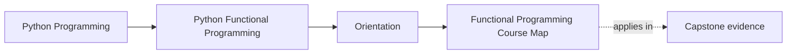

# Functional Programming Course Map

<!-- page-maps:start -->
## Page Maps

```mermaid
flowchart LR
  pure["01: deterministic values"] --> config["02: data-first configuration"]
  config --> stream["03: lazy streaming"]
  stream --> failure["04: resilient failures"]
  failure --> model["05: valid domain states"]
  model --> context["06: explicit context"]
  context --> effects["07: effect boundaries"]
  effects --> async["08: bounded async"]
  async --> interop["09: ecosystem adapters"]
  interop --> sustain["10: reviewable change"]
```

<!-- page-maps:end -->

Use this page when you need the whole course visible on one screen before you commit to a
reading route. The goal is to stop the course from feeling like a stack of advanced
topics and keep it legible as one design journey.

## The four course arcs

### Arc 1: semantic clarity

Modules 01 to 03 build the semantic floor for the rest of the course.

- Module 01 teaches purity, substitution, and local reasoning so you can tell which code can be trusted as dataflow.
- Module 02 teaches data-first APIs and expression style so configuration and composition stay explicit.
- Module 03 teaches iterators, laziness, and streaming dataflow so execution timing stops being accidental.

Leave this arc able to explain where materialization happens and why.

### Arc 2: survivable failure and modelling

Modules 04 to 06 turn functional style into something that can survive domain pressure.

- Module 04 teaches folds, streaming failures, retries, and resource-aware flows.
- Module 05 teaches algebraic modelling, smart construction, and validation as explicit value design.
- Module 06 teaches explicit context, layered containers, and law-guided composition.

Leave this arc able to represent failure and validation without hiding them inside control flow.

Read [Mid-Course Map](mid-course-map.md) when you want the shortest bridge from the
semantic floor into this arc and the next one.

### Arc 3: effect boundaries and async pressure

Modules 07 to 08 move from local reasoning to system boundaries.

- Module 07 teaches ports, adapters, capability protocols, and resource safety.
- Module 08 teaches async coordination, backpressure, fairness, and deterministic async proof.

Leave this arc able to explain where effects begin, which contracts govern them, and how async work stays reviewable.

### Arc 4: interop and long-lived sustainment

Modules 09 to 10 ask whether the design can survive a real team and a real codebase.

- Module 09 teaches interop with ordinary Python libraries, CLIs, and distributed boundaries.
- Module 10 teaches refactoring, performance, observability, governance, and sustained review standards.

Leave this arc able to improve an existing system without dissolving the functional boundaries you built earlier.

## Use this map to choose a route

If your pressure is mainly about:

- local reasoning, start with Modules 01 to 03
- explicit failures or domain states, start with Modules 04 to 06 after confirming Modules 01 to 03 feel stable
- ports, adapters, retries, or resources, start with Modules 07 to 08 after confirming the earlier semantic floor
- interop, migration, or sustainment, start with Modules 09 to 10 after checking the earlier arcs first

## Capstone alignment

The capstone is one cumulative application. Read each row as a change from the previous
state, not as a new example:

| Module | Capability entering the module | Pressure and earned change | Earlier behavior that remains |
| --- | --- | --- | --- |
| 01 | no tracked implementation | make cleaning, chunking, embedding, and deduplication deterministic value transforms | establishes immutable inputs, exact configuration, fixed-point cleaning, complete chunks, text-derived embeddings, and canonical output |
| 02 | one fixed pure pipeline | make configuration and composition explicit data rather than hidden choices | the Module 01 values and pure result remain equivalent |
| 03 | eager data-first pipeline | stream bounded prefixes and make materialization deliberate | document and chunk meaning remain stable; any order-policy change is explicit |
| 04 | lazy streaming stages | represent record failures, retries, cleanup, folds, and bounded evidence without collapsing the stream | bounded demand, successful values, and resource closure remain reviewable |
| 05 | typed stream outcomes | reject ambiguous primitive states and accumulate independent validation failures | previously valid input produces the same domain meaning, order, and metadata |
| 06 | explicit domain values | compose dependent failure, configuration, state, logs, and traces without repeated branching | container layers preserve payloads and keep context order visible |
| 07 | pure descriptions with explicit context | move files, clocks, logs, retries, transactions, and resources behind capabilities and interpreters | planning remains pure and earlier success/failure meanings survive interpretation |
| 08 | synchronous effect boundaries | coordinate waiting work with bounds, order, fairness, cancellation, and deterministic scheduling evidence | resource limits and at-most-once effect policy remain explicit |
| 09 | bounded async application | adapt CLIs, libraries, serialization, dataframes, and distributed plans without leaking them into the core | typed values, effect descriptions, and backpressure rules remain owned by the core |
| 10 | integrated endpoint | make refactoring, performance, migration, scaling, and operational claims reviewable through saved evidence | Module 09 behavior remains the baseline; sustainment changes how proposals are judged |

This table tells you what to look for in a reference-state comparison. It does not
replace the module's capstone delta, where source files, tests, exceptions, and proof
limits are stated precisely.

## Choose the state before the file

- For Module 01, begin with [First Capstone Proof](first-capstone-proof.md) and
  `capstone/module-reference-states/module-01/`.
- For Modules 02 through 09, compare adjacent tracked states before inspecting the live
  endpoint.
- For Module 10, compare the Module 09 state with the live capstone and its review
  evidence. There is no separate tracked `module-10` directory.
- Use generated `_history/worktrees/` only after `history-refresh`; the tracked
  `module-reference-states/` remain the source of truth.

## Best companion pages

- `index.md`
- `first-contact-map.md`
- `first-capstone-proof.md`
- `mid-course-map.md`
- `mastery-map.md`
- `../guides/start-here.md`
- `../guides/proof-matrix.md`
- `../capstone/capstone-file-guide.md`
