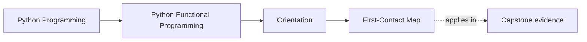
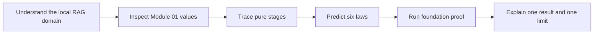

# First-Contact Map

<!-- page-maps:start -->
## Page Maps




<!-- page-maps:end -->

Use this page for your first honest session with the course. The goal is not to cover as
much ground as possible. The goal is to make the first hour coherent enough that later
reading choices feel deliberate instead of random.

## What you are trying to establish

By the end of first contact, you should be able to make one narrow claim:

> The tracked Module 01 state represents document cleaning, chunking, embedding, and
> deduplication as deterministic value transformations, and six focused tests check the
> laws introduced with that state.

You are not trying to understand the live endpoint, every functional abstraction, or
the entire test suite.

## Before you start

Work from the repository root. If the Python environment has not been prepared, read
[Platform Setup](../guides/platform-setup.md). Installing the environment may take
longer than the proof itself; that setup cost does not make a broader test command more
honest.

## The first-contact route

Take this route in order:

1. Read [Orientation and Study Practice](index.md) through “How modules and cores
   work.” Confirm that the prerequisites are reasonable for you.
2. Read [First Capstone Proof](first-capstone-proof.md) through “The first application
   delta.” State why Module 01, rather than the live endpoint, owns this session.
3. Open `capstone/module-reference-states/module-01/src/funcpipe_rag/rag_types.py`.
   Find `RawDoc`, `ChunkWithoutEmbedding`, `Chunk`, and `RagEnv`. Identify which values
   are immutable and which configuration fails at construction.
4. Open `capstone/module-reference-states/module-01/src/funcpipe_rag/pipeline_stages.py`.
   Trace one abstract through `clean_doc`, `chunk_doc`, `embed_chunk`, and
   `structural_dedup_chunks`. Stop at each return value; do not jump to the live package.
5. Read
   `capstone/module-reference-states/module-01/tests/learning/test_module_01_purity_foundations.py`.
   Predict the owner of each assertion before executing it.
6. Run:

   ```bash
   make PROGRAM=python-programming/python-functional-programming capstone-foundation-proof
   ```

7. Choose one passing test and write two sentences: what behavior it supports, and what
   remains outside its scope.

That is enough for a first session.

## Interpret the output

A successful run ends with `6 passed`. The count matters only because this target is
deliberately bounded to the six first-state laws. It does not mean “the capstone is
done.”

If a test fails, use its name to choose the first source file:

| Failed claim | First owner to inspect |
| --- | --- |
| exact positive chunk configuration | `rag_types.py` |
| frozen input values | `rag_types.py` |
| deterministic cleaning and fixed point | `pipeline_stages.py` → `clean_doc` |
| reconstructed chunk text and offsets | `pipeline_stages.py` → `chunk_doc` |
| text-derived embedding | `pipeline_stages.py` → `embed_chunk` |
| preserved input and canonical output | `full_rag.py` and structural deduplication |

Do not widen to the full suite until you know the focused failure is caused by a broader
contract.

## What you should know before Module 01

Before you start the first content module, you should be able to answer:

- What problem is this course trying to solve in real Python systems?
- Why is the capstone part of the course surface instead of an optional side project?
- Why is the Module 01 reference state more appropriate than live Module 10 code for the
  first proof?
- Which source function owns each of the six foundation claims?
- What does the foundation command prove, and which claims require a broader route?

## What not to do on the first pass

- do not jump straight into async material because it feels more advanced
- do not treat the capstone as a separate project that can be ignored until the end
- do not browse every guide before you have one stable starting route
- do not inspect only the live endpoint, where later abstractions obscure the first delta
- do not run the full confirmation route to avoid deciding what you are trying to prove
- do not confuse "I recognize the terminology" with "I can explain the boundary"

## Study rhythm for the first week

Use the same rhythm each time you sit down:

1. read until the current design pressure is clear
2. inspect one matching reference-state surface immediately
3. predict the focused evidence before running it
4. run one bounded command
5. stop once you can state one design rule, one failure owner, and one proof limit

If you cannot do that yet, stay on the current boundary instead of widening the route.

## Best companion pages

- `course-map.md`
- `index.md`
- `first-capstone-proof.md`
- `../guides/start-here.md`
- `../capstone/index.md`
