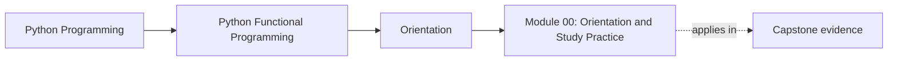
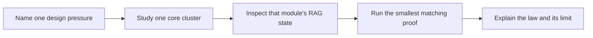

# Module 00: Orientation and Study Practice

<!-- page-maps:start -->
## Page Maps

<!-- page-maps:end -->

This course teaches functional programming in Python as a discipline for making dataflow,
effects, and operational risk easier to reason about. The goal is not to imitate another
language. The goal is to make real Python systems clearer under testing, refactoring,
integration, and growth.

## The question this course owns

Keep one question in view while reading:

> Which part of this system is pure dataflow, which part is effectful coordination, and
> can another engineer tell the difference by reading the code?

If the answer is vague, the system will get harder to reason about as it grows.

## Who should take this course

This course is for Python engineers who can already build and test ordinary programs
but want stronger judgment about state, composition, failure, and effects. It is
especially useful when a pipeline or service works yet remains difficult to review
because configuration, mutation, I/O, retries, or async coordination can happen
anywhere.

It is not a first Python course. If writing functions, importing modules, reading a
traceback, or running pytest still consumes most of your attention, strengthen those
skills first. Functional design becomes useful when syntax is no longer the main
problem.

## Learning outcomes

- explain the course boundary: functional programming here means clearer Python systems, not imitation of another language
- identify the prerequisites that must already feel routine before the later modules become productive
- explain how core pages, module states, exercises, and proofs form one learning unit
- choose the smallest honest proof for the claim you are making
- describe how the capstone evolves from semantic floor to long-lived sustainment evidence

## What this course is not

- It is not a syntax-first introduction to `lambda`, `map`, or list comprehensions.
- It is not a tour of abstractions detached from production code.
- It is not an excuse to rename imperative complexity with functional vocabulary.

## What this course is

- A design guide for separating pure transforms from effectful boundaries
- A pipeline guide for lazy dataflow, typed failures, and explicit coordination
- A systems guide for ports, adapters, async pressure control, and long-lived refactoring
- A review guide for judging whether an abstraction improves or hides the code

## Prerequisite check

Use this as a diagnostic, not as an entrance exam:

| You should already be able to... | Why the course depends on it | If it is not stable yet |
| --- | --- | --- |
| write functions, modules, exceptions, and small pytest tests | lessons discuss contracts rather than reteaching syntax | rehearse with one small tested module before Module 01 |
| trace a list comprehension and a generator | Module 03 distinguishes eager and lazy execution | write both forms and mark when each body runs |
| read type hints and frozen dataclasses | types and value semantics carry design intent from Module 01 onward | review annotations, unions, protocols, and `@dataclass(frozen=True)` |
| separate a calculation from file or console I/O | the whole course depends on recognizing an effect boundary | rewrite one helper so data enters and leaves explicitly |
| use a shell from a repository root | every executable route assumes you can run a bounded Make target | read [Platform Setup](../guides/platform-setup.md) before the first proof |

You do not need category theory, another functional language, async expertise, or RAG
experience. The capstone domain is deliberately local and deterministic; the course
teaches the functional concepts when the application pressure requires them.

## How modules and cores work

Module 00 teaches the study method. Modules 01 through 10 each add one coherent set of
capabilities to the same FuncPipe RAG application.

Within a substantive module:

1. the module home and capstone delta name the previous capability and new pressure
2. core lesson pages introduce concepts in a deliberate order
3. the matching tracked reference state shows the application after that module
4. learning tests state the important behavior as executable claims
5. exercises ask you to change or review that state without breaking earlier laws
6. answers explain the decision, evidence, wrong turns, and proof limits
7. the refactoring guide closes the module by asking whether the design earned its cost

A **core** is therefore a bounded teaching unit inside a module, not a separate mini
course. A **reference state** is the cumulative application after the whole module, not
a fresh example written only for one page. Modules 01 through 09 have tracked states;
the live capstone is the Module 10 endpoint.

## Study rhythm

Use the same evidence loop all the way through the course:

1. State the pressure in application language before naming an abstraction.
2. Read one core cluster until you can predict a concrete code change.
3. Inspect the matching reference-state source and locate that change.
4. Read the focused test before running it; predict what a failure would mean.
5. Run the smallest command that can support your claim.
6. Complete one exercise and review your reasoning against the answer.
7. Record one preserved law and one thing the evidence does not prove.

If a module does not leave you with one design rule, one capstone surface, and one
failure mode you can name, slow down instead of widening the route.

## Orientation path

- Read the [Functional Programming Course Map](course-map.md) to see the four course arcs on one page.
- Read the [First-Contact Map](first-contact-map.md) if you want the shortest stable first session.
- Use [First Capstone Proof](first-capstone-proof.md) to inspect and execute the first cumulative RAG state.
- Read the [Mid-Course Map](mid-course-map.md) when Modules 01 to 03 feel stable or when you are resuming after a break and need the last trustworthy boundary again.
- Read the [Mastery Map](mastery-map.md) when you are returning with a design or review pressure.
- Keep the [FuncPipe Capstone Guide](../capstone/index.md) open from the beginning, and keep [Start Here](../guides/start-here.md) available when you need the short entry route again.

## Capstone roadmap

The FuncPipe RAG capstone matures with the course:

- Modules 01 to 03 establish purity, configuration, and lazy pipeline shape.
- Modules 04 to 06 introduce typed failures, algebraic modelling, and lawful composition.
- Modules 07 to 08 move effects and async coordination behind explicit boundaries.
- Modules 09 to 10 focus on interop, review standards, and long-lived sustainment.

## Exercises

Complete [Orientation Exercises](exercises.md) after the first proof. They ask you to
choose honest evidence, route a focused failure, distinguish a tracked state from the
endpoint, and recover after time away. Compare decisions—not wording—with
[Orientation Exercise Answers](exercise-answers.md).

## Closing criteria

- You can explain why purity, effects, and failure handling are treated as design contracts instead of style preferences.
- You can explain the relationship among a module, its core pages, its reference state,
  its learning tests, and its exercises.
- You know which orientation page to revisit when you need first contact, recovery, or pressure-led review.
- You can choose a focused proof without claiming that it verifies the whole endpoint.
- You can describe how Modules 01 to 10 change the capstone, not just what topics they mention.

## Stable vocabulary

Use [Reference Glossary](../reference/glossary.md) when you want the recurring language in
this course kept stable while you move between orientation, modules, guides, and capstone
proof.
