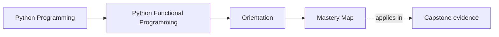
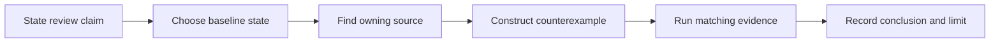

# Mastery Map

<!-- page-maps:start -->
## Page Maps




<!-- page-maps:end -->

Use this page when you are returning to the course after the first full pass or when the
open question already lives in interop, governance, or long-lived sustainment. The goal
is to turn "I read this before" into a repeatable mastery route: name the pressure,
revisit the smallest set of pages that own it, and leave with executable evidence.

## Build a review packet

At mastery level, “I inspected the capstone” is not enough. Leave a compact packet:

```text
claim:
baseline state:
owning source:
counterexample or failure route:
test or saved evidence:
command:
conclusion:
proof limit:
```

Choose the baseline before the source. For a Module 06 context claim, compare Modules
05 and 06. For a Module 10 sustainment claim, compare Module 09 with the live endpoint.
The latest code is not automatically the clearest evidence for when a decision entered
the application.

## Return by engineering pressure

### "My pure core keeps leaking coordination concerns"

Revisit:

- Module 01 for substitution and local reasoning
- Module 02 for data-first APIs and configuration as data
- Module 07 for capability and boundary discipline

Then inspect:

- `src/funcpipe_rag/fp/`
- `src/funcpipe_rag/pipelines/`
- `src/funcpipe_rag/boundaries/`

Challenge the design with a transform that appears pure but reads configuration or logs
internally. Use focused tests to determine whether the dependency is explicit or merely
hidden behind a helper.

### "I can model failures, but the flow is still hard to read"

Revisit:

- Module 04 for Result and Option style error handling
- Module 05 for explicit domain states and validation
- Module 06 for law-guided composition and explicit context

Then inspect:

- `src/funcpipe_rag/result/`
- `src/funcpipe_rag/fp/validation.py`
- `tests/unit/result/`

Challenge the flow with two independent invalid fields. If only one failure survives,
the question belongs to validation accumulation rather than prettier chaining.

### "Our async or retry story is making the code magical"

Revisit:

- Module 07 for effect boundaries and idempotent effects
- Module 08 for async pipelines, backpressure, and deterministic async testing

Then inspect:

- `src/funcpipe_rag/domain/effects/`
- `src/funcpipe_rag/domain/effects/async_/`
- `tests/unit/domain/test_async_backpressure.py`

Challenge the boundary with a cancelled or slow operation. Record whether bounds,
ordering, cleanup, and at-most-once effects are separate claims; one passing async test
does not establish all four.

### "We are integrating with ordinary Python libraries and losing the design"

Revisit:

- Module 09 for interop and distributed boundary discipline
- Module 10 for sustainment, governance, and proof expectations

Then inspect:

- `src/funcpipe_rag/interop/`
- `src/funcpipe_rag/boundaries/shells/cli.py`
- [Capstone Proof Guide](../capstone/capstone-proof-guide.md)

Challenge the adapter with invalid external data and a library-specific exception.
Determine where each becomes a stable application value and whether the functional core
can still run without importing the ecosystem dependency.

## Worked review: does the CLI own only boundary work?

Claim:

> CLI parsing and console output remain outside the pure RAG core.

Build the packet:

1. Use Module 09 and the live endpoint as the relevant comparison.
2. Read `boundaries/shells/cli.py` for argument and output ownership.
3. Read `pipelines/cli.py` for the data passed inward.
4. Search core RAG and FP packages for CLI imports or direct console writes.
5. Read `tests/unit/pipelines/test_cli_overrides.py` and identify the boundary behavior
   it checks.
6. Run the focused test before widening to `capstone-test`.

From the repository root:

```bash
make PROGRAM=python-programming/python-functional-programming \
  capstone-test PYTEST_ARGS=tests/unit/pipelines/test_cli_overrides.py
```

A useful counterexample is a pure pipeline function that reads `sys.argv` or prints a
warning. That would make substitution depend on process state even if the function's
name still sounded functional.

The focused test can support override behavior. Source inspection can support import
direction. Neither alone proves every CLI path is effect-free, so state the conclusion
at the level your evidence earns.

## Match claims to evidence

| Claim type | First evidence | Widen when... |
| --- | --- | --- |
| one tracked module law | that state's learning test | the change crosses another module contract |
| adjacent-state application delta | source comparison plus both relevant learning proofs | generated history or downstream preservation is in doubt |
| generated state integrity | `history-verify` | behavior inside the states is also claimed |
| one live package behavior | focused live unit test | public types, packaging, or cross-package behavior changed |
| operational or review claim | saved report and the code that creates it | the report depends on broader build or test health |
| whole endpoint readiness | full course `test` | no narrower route can cover the stated conclusion |

## What mastery should feel like

You are using the course at a mastery level when you can do the following quickly:

- name the lowest-cost module or guide that owns the current pressure
- explain the boundary in plain Python engineering language, not only FP vocabulary
- choose the correct baseline state before inspecting the endpoint
- produce a counterexample that could disprove your claim
- find one capstone file and one proof surface that either support or challenge your claim
- state exactly what the evidence does not establish
- reject an abstraction when it increases review cost more than it improves clarity

## Best companion pages

- `course-map.md`
- `first-contact-map.md`
- `../guides/proof-matrix.md`
- `../guides/proof-ladder.md`
- `../reference/self-review-prompts.md`
