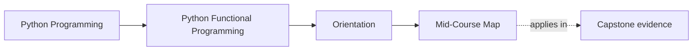
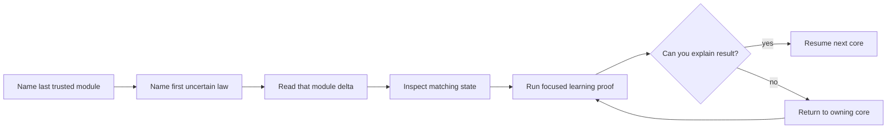

# Mid-Course Map

<!-- page-maps:start -->
## Page Maps




<!-- page-maps:end -->

Use this page when Modules 01 to 03 no longer feel like the blocker, but the second half
of the course still feels too large to enter cleanly. The goal is to turn the middle of
the course into a readable bridge from semantic clarity to system pressure.

## Resume from the last stable boundary

Do not measure recovery by the last page you remember seeing. Measure it by the last
application contract you can still explain and support with evidence.

Write this record before opening several modules:

```text
last trusted module:
preserved law I can still explain:
first uncertain law:
state that owns the uncertainty:
focused evidence:
move-forward condition:
```

If you are returning after a break, re-anchor with:

1. [Orientation](index.md)
2. [Functional Programming Course Map](course-map.md)
3. [Module Promise Map](../guides/module-promise-map.md)

Then use the last boundary you still trust:

| If you still trust yourself through... | Re-enter with... | Keep open... |
| --- | --- | --- |
| Modules 01 to 03 | this page and Module 04 | [Proof Matrix](../guides/proof-matrix.md), [Capstone Map](../capstone/capstone-map.md) |
| Modules 04 to 06 | Module 07 and [Pressure Routes](../guides/pressure-routes.md) | [Boundary Review Prompts](../reference/boundary-review-prompts.md), [Review Checklist](../reference/review-checklist.md) |
| Modules 07 to 08 | [Mastery Map](mastery-map.md) and Module 09 | [Proof Matrix](../guides/proof-matrix.md), [Capstone](../capstone/index.md) |

Choose evidence for the uncertain law:

| Uncertainty | First evidence |
| --- | --- |
| Module 01 values or pure-core laws | `make PROGRAM=python-programming/python-functional-programming capstone-foundation-proof` |
| A Module 02–09 behavior | the focused learning-test command in that module's capstone delta |
| Whether generated worktrees still match tracked states | `make PROGRAM=python-programming/python-functional-programming history-verify` |
| A cross-package live endpoint behavior | `make PROGRAM=python-programming/python-functional-programming capstone-test` |
| Saved review or documentation evidence | the matching tour, report, or strict documentation route |

`capstone-tour` and `capstone-verify-report` are not generic recovery commands. Use
them when the uncertainty concerns the saved evidence they produce.

## Recover after one missed class

When one module was taught while you were away:

1. Read its home page and capstone delta. Write the previous capability, new pressure,
   changed source, proof, and preserved law.
2. Compare its tracked state with the preceding state before reading the live endpoint.
3. Read the core cluster that owns the largest source change.
4. Predict the focused learning test, then run it.
5. Complete one decision-based exercise and review the answer's reasoning.

Resume the next module only when you can explain why the application changed and which
earlier behavior the new state retains. A passing test without that explanation is not
recovery.

## Recover after a long break

A long break creates a different risk: vocabulary may feel familiar while execution
timing, failure ownership, or effect boundaries are no longer trustworthy.

1. Start from the last law you can explain without opening the book.
2. Read its test before its lesson and predict the result.
3. If the prediction is sound and the focused proof passes, keep that module trusted.
4. At the first bad prediction or unexplained assertion, stop and revisit that module's
   delta and owning core.
5. Widen one module at a time. Do not restart from Module 01 unless its laws are the
   first uncertain ones.

[Orientation Exercises](exercises.md) includes a re-entry problem with a worked review
route in [Orientation Exercise Answers](exercise-answers.md).

## Modules 04 to 06: survivable failure and modelling

Use this stretch when the main pressure is no longer "what is pure?" but instead:

- how failures should become explicit values instead of hidden control flow
- how domain states should stay legible under validation and branching
- how context should remain visible while dependent work composes

Capstone check:

- inspect `src/funcpipe_rag/result/`
- inspect `src/funcpipe_rag/fp/validation.py`
- read `tests/unit/result/` and `tests/unit/fp/`

## Modules 07 to 08: effect boundaries and async pressure

Use this stretch when the design pressure moves outward into real system boundaries:

- resource handling, retries, and idempotent effects
- adapters, protocols, and capability boundaries
- async backpressure, fairness, and deterministic coordination proof

Capstone check:

- inspect `src/funcpipe_rag/boundaries/`
- inspect `src/funcpipe_rag/domain/effects/`
- inspect `src/funcpipe_rag/domain/effects/async_/`
- read `tests/unit/domain/`

## How to know you are ready for Module 09

Move into interop and sustainment when you can answer:

- where your pure core ends
- where failures become values instead of implicit branching
- where effects enter and how those boundaries are tested
- which capstone file you would open first for a resource, retry, or async review question

Support each answer with a matching state or test. Recognition of the terms is not a
move-forward condition.

## Best companion pages

- [Functional Programming Course Map](course-map.md)
- [Mastery Map](mastery-map.md)
- [Pressure Routes](../guides/pressure-routes.md)
- [Capstone Map](../capstone/capstone-map.md)
