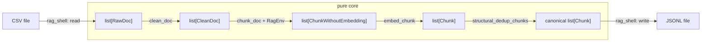

# Module 01 FuncPipe Delta: Establish a Substitutable RAG Core

Orientation explains how to study the course, but it does not provide an earlier
application implementation. Module 01 therefore creates FuncPipe's first reference
state. The useful comparison is not old code versus new code in two snapshots. It is
an unstructured ingestion script versus a small application whose domain values,
transformations, laws, and effect boundary can be inspected independently.

## Previous capability

Before Module 01, the application capability is only a problem statement:

```text
CSV rows -> normalize text -> split text -> derive local embeddings -> JSONL
```

An imperative implementation could perform that work in one loop. It would still be
hard to answer:

- which inputs determine each output;
- whether a helper mutates a document or shared accumulator;
- whether a repeated call returns the same value;
- which transformations may be safely reordered or replaced;
- where file I/O stops and domain behavior starts.

There is no `module-00` reference state to diff. The pedagogical "before" is
`impure_chunks` and `impure_full_rag` in Module 01's `full_rag.py`; they remain
beside the pure implementation so one state can support an honest behavior
comparison.

## New design pressure

The RAG behavior must be reviewable without running file I/O, and later modules need
a stable meaning to preserve while they change API shape, evaluation strategy,
failure handling, and execution policy.

Module 01 introduces the semantic floor:

- frozen domain values make data changes explicit;
- a valid `RagEnv` represents a positive, exact integer chunk size;
- `clean_doc`, `chunk_doc`, and `embed_chunk` are deterministic transforms;
- `docs_to_embedded` names the stage sequence;
- `structural_dedup_chunks` produces a canonical fixed point;
- `full_rag` composes the pure behavior;
- `rag_shell` owns CSV and JSONL effects.

The application gains deterministic local ingestion and transformation. It does not
yet gain configurable cleaning rules, lazy traversal, typed failure values, retry
policy, or asynchronous execution.

## Source changes

| Responsibility | Module 01 surface | Behavior established |
| --- | --- | --- |
| immutable values and configuration | `rag_types.py` | inputs, intermediates, outputs, and chunk size have explicit value contracts |
| pure transformations | `pipeline_stages.py` | normalization, chunking, embedding, and deduplication can be tested by input and output |
| readable orchestration | `full_rag.py` | legacy and pure forms can be compared without pretending they have identical representations |
| minimal composition | `fp.py`, `rag_pipe.py` | functions are values; `fmap`, `flow`, and `RagPipe.then` expose composition choices |
| effect ownership | `rag_shell.py` | file reads and writes stay outside `full_rag` |
| executable laws | `tests/test_laws.py`, `tests/learning/test_module_01_purity_foundations.py` | the teaching claims are checked against the tracked state |

All paths are relative to:

```text
capstone/module-reference-states/module-01/src/funcpipe_rag/
```

The snapshot is one completed module state, not a succession of hidden per-core
implementations. A lesson may show a counterexample locally, but it must not claim
that the counterexample or an invented helper exists in the snapshot.

## Application dataflow



The two shell arrows are effects. Every arrow inside the pure core is replaceable by
its returned value when its explicit inputs are fixed.

## Proof and laws

The Module 01 learning proof checks claims a learner should use in review:

- invalid boolean chunk sizes cannot masquerade as integers;
- frozen input values reject field reassignment;
- cleaning is deterministic and reaches a normalization fixed point;
- chunk offsets reconstruct the cleaned abstract without gaps;
- embedding depends on chunk text rather than identity or position;
- the full pipeline leaves its inputs unchanged;
- reversing unique input documents does not change canonical output;
- applying canonical deduplication again does not change completed output.

From the program root:

```bash
PYTHONPATH=capstone/module-reference-states/module-01/src \
  python -m pytest -q \
  capstone/module-reference-states/module-01/tests/learning/test_module_01_purity_foundations.py
```

Property-based coverage remains in `tests/test_laws.py`. The learning proof is the
short, named route; the law suite explores a wider input space.

## Preserved behavior

There is no earlier reference-state contract to preserve. Module 01 instead defines
the baseline every later state must carry:

- normalization collapses whitespace and lower-cases only the abstract;
- chunking covers the normalized abstract in non-overlapping slices;
- embedding is deterministic and local;
- canonical output is independent of unique document input order;
- pure stages perform no file or process I/O;
- the shell calls the same pure `full_rag` used by tests.

The legacy comparison proves chunk metadata preservation. It does not claim that the
legacy dictionary representation equals the immutable `Chunk` representation.

## Reference state

`capstone/module-reference-states/module-01` represents the completed module. Inspect
the tracked source directly:

```bash
find capstone/module-reference-states/module-01/src/funcpipe_rag \
  -maxdepth 1 -type f -print
```

After the course history has been refreshed, the generated comparison route is:

```text
capstone/_history/worktrees/module-01
```

That worktree is generated evidence, not the editing source.

## Downstream states

Modules 02 through 09 and the live Module 10 capstone inherit Module 01's value and
purity contract. A correction to a baseline invariant or learning proof must be
carried through all of them. Later modules may move files into clearer packages or
change collection strategy, but they must not silently discard these laws.

## Move-forward boundary

Module 01 proves deterministic value transformation, explicit configuration, local
composition, canonicalization, and a thin effect shell. It does not yet prove:

- data-first configuration or boundary parsing;
- bounded consumption of large sources;
- failures represented as domain values;
- retry and resource cleanup policy;
- asynchronous fairness or backpressure;
- adapter compatibility.

Move to Module 02 when you can trace one document from `RawDoc` to `Chunk`, classify
every step as value transformation or effect, and point to a test that would fail if
the baseline meaning changed.
