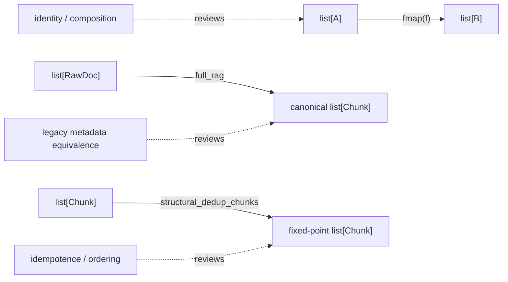

# Combinator Laws and Trade-Offs

A small helper earns its place when its contract is easier to review than every
expanded use. Module 01 deliberately offers only three functional helpers:
`identity`, `fmap`, and `flow`. The RAG pipeline also supplies a domain
canonicalizer, `structural_dedup_chunks`. They do not share one universal law.
Each helper needs the law appropriate to its input domain and purpose.

## Read laws at the right boundary



The first review question is therefore not “is this functional?” Ask:

1. What values are admitted by the law?
2. What observation is expected to remain equal?
3. Does the implementation preserve order, multiplicity, and representation where
   the contract requires them?
4. Which test searches for a counterexample?

## `fmap`: identity and composition over lists

Module 01 defines:

```python
def fmap(func: Callable[[A], B]) -> Callable[[Iterable[A]], list[B]]:
    def mapped(items: Iterable[A]) -> list[B]:
        return [func(item) for item in items]

    return mapped
```

Its teaching laws are tested with list inputs:

```text
fmap(identity)(xs) == xs
fmap(g_after_f)(xs) == fmap(g)(fmap(f)(xs))
```

The second equation means the same element transformations occur in the same order
whether they are composed before lifting or mapped in two passes. It does **not**
claim equal evaluation cost: the right side allocates an intermediate list.

The input annotation accepts any iterable, but the output is always a list. For a
generator, `fmap(identity)(generator)` equals `list(generator)`, not the original
generator object. State the law over list values, as `test_fmap_identity_law` does,
rather than silently widening it to every iterable representation.

## `flow`: substitution before vocabulary

`flow(f, g, h)(x)` expands to `h(g(f(x)))`. That expansion is its most useful review
tool. A two-stage example can be checked without special notation:

```python
normalize_length = flow(str.strip, len)

assert normalize_length("  rag  ") == len("rag")
```

`flow()` with no functions returns its input, and adding `identity` should not change
a pure pipeline's value. Module 01 does not give `flow` a dedicated property test,
so treat those as derivable source-review claims, not as evidence already executed
by `tests/test_laws.py`.

Do not force the entire RAG workflow through `flow`. `chunk_doc` also needs
`RagEnv`, and flattening a list of per-document chunk lists is domain orchestration.
`docs_to_embedded` spells those steps out directly. That is clearer than hiding
configuration capture and flattening behind point-free vocabulary.

## Canonicalization has three distinct claims

`structural_dedup_chunks` sorts chunks by `(doc_id, start)` and then removes repeated
structural keys `(doc_id, text, start, end)`. The property suite separates claims
that are easy to conflate:

| Claim | Equation or observation | Executable proof |
| --- | --- | --- |
| idempotence | `dedup(dedup(xs)) == dedup(xs)` | `test_structural_dedup_is_idempotent` |
| canonical order | result equals sorting itself by `(doc_id, start)` | `test_structural_dedup_produces_canonical_order` |
| uniqueness | result has no repeated structural key | `test_structural_dedup_no_duplicates` |
| completed fixed point | `dedup(full_rag(docs, env)) == full_rag(docs, env)` | `test_full_rag_reaches_fixed_point_in_one_pass` |

These tests belong separately because idempotence alone says nothing about order. A
stable first-seen deduplicator can be idempotent while returning different orders for
reversed inputs.

Likewise, `list(set(chunks))` is not a valid shortcut. A set discards input order and
does not establish the domain's required `(doc_id, start)` order. It also deduplicates
according to complete object equality, which is not automatically the same as the
explicit structural key.

The canonicality claim for `full_rag` is deliberately narrower than “all imaginable
chunk lists have one order.” `test_full_rag_is_canonical` generates unique input
documents, reverses their order, and expects the same completed output. Review the
generator precondition before generalizing the result.

## Refactor equivalence chooses an observation

The legacy function returns dictionaries and the pure pipeline returns frozen domain
values. Whole-object equality would reject the refactor even when chunk meaning was
preserved. `test_refactor_preserves_chunk_structure` therefore compares only:

```text
(doc_id, text, start, end)
```

That is an explicit observation boundary. It proves normalization and chunk
metadata survived the rewrite. It does not prove representation equality,
canonical ordering, or embedding equality; other tests own those claims.

This is the useful pattern for behavior-preserving refactors:

```text
name the observation -> compare old and new under that observation
                     -> prove new guarantees separately
```

## Avoid laws that do not apply

Several attractive statements are too broad for this module:

- Applying a filter twice is idempotent only when the predicate is stable for the
  observed values. Module 01 does not provide a filter combinator.
- Associativity belongs to the combining operation, not to “left fold” in general.
  Module 01 intentionally defers folds.
- Determinism, purity, and idempotence are different. A deterministic function may
  mutate its argument; a pure function need not be idempotent.
- Equal output does not prove equal cost or evaluation strategy.

Keeping unsupported laws out of the lesson is part of making the combinator surface
reviewable.

## Run the evidence

The short foundation proof names the core learning contract:

```bash
make PROGRAM=python-programming/python-functional-programming \
  capstone-foundation-proof
```

The broader property suite lives at:

```text
programs/python-programming/python-functional-programming/
  capstone/module-reference-states/module-01/tests/test_laws.py
```

When running it directly, set `PYTHONPATH` to the matching Module 01 snapshot so the
tests cannot accidentally import the live Module 10 package. The course verification
gate performs that snapshot isolation across the full history.

## Trade-off review

Keep a helper when its name exposes a repeated transformation and its law can be
stated precisely. Prefer direct Python when the helper:

- obscures configuration or flattening;
- changes collection representation without saying so;
- hides order or failure timing;
- saves fewer lines than its contract requires to explain;
- has no consumer beyond one already-readable expression.

For Module 01, `fmap` is justified as a small law-bearing teaching surface, `flow`
demonstrates left-to-right composition, and `full_rag` remains explicit where domain
steps matter more than combinator symmetry.

## Review checkpoint

Explain why these pairs are not interchangeable:

- `fmap(identity)(xs) == xs` for lists versus identity over every iterable object;
- deduplication idempotence versus canonical ordering;
- legacy metadata equivalence versus whole-result equivalence;
- source-level substitution for `flow` versus property evidence already in the suite.

Then continue with [Typed Pipelines](typed-pipelines.md).
