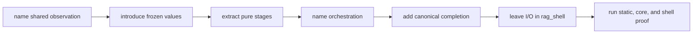

# Module 01 Refactoring Guide

Module 01's refactor is complete when domain meaning can be tested without files,
effects have one visible owner, and the adapter is proven to preserve successful core
values. “More functions” or “fewer loops” is not an exit condition.

## Establish the comparison before changing code

The snapshot keeps two honest comparison surfaces in `full_rag.py`:

| Surface | Representation | Observation worth preserving |
| --- | --- | --- |
| `impure_chunks` | dictionaries | `(doc_id, text, start, end)` |
| `docs_to_embedded` | frozen `Chunk` values | the same structural metadata plus deterministic embedding |
| `full_rag` | canonical `list[Chunk]` | pure pipeline meaning plus structural deduplication and order |

Do not compare the legacy dictionaries and new dataclasses as whole objects. Choose
the shared observation first, then prove new guarantees independently. Otherwise an
intentional representation improvement looks like a regression, or a real metadata
regression hides behind conversion code.

Record the refactor pressure in one sentence:

```text
We need to change normalization and chunking without opening files or mutating
caller-owned values.
```

If the pressure also includes retries, streaming, typed failures, or atomic output,
split that work. Those contracts belong to later modules.

## Refactor in reviewable boundaries



### 1. Introduce values without changing behavior

Use `RawDoc`, `CleanDoc`, `ChunkWithoutEmbedding`, `Chunk`, and `RagEnv` to expose
state transitions. Preserve:

- document identity, title, and categories;
- exact positive integer chunk configuration;
- normalized abstract content;
- half-open `[start, end)` offsets.

Run strict typing after this boundary. A type error here is cheaper to diagnose than
one mixed with orchestration changes.

### 2. Extract one pure transform at a time

Each function should make its dependencies and returned value explicit:

```text
clean_doc:   RawDoc | CleanDoc -> CleanDoc
chunk_doc:   CleanDoc × RagEnv -> list[ChunkWithoutEmbedding]
embed_chunk: ChunkWithoutEmbedding -> Chunk
```

After each extraction, ask:

- Can the call be replaced by its returned value without losing observable behavior?
- Is any caller-owned value mutated?
- Did evaluation order, collection order, or materialization change?
- Does the stage name describe domain intent rather than implementation technique?

The comprehension form is not the evidence. Input preservation and the stage laws
are.

### 3. Keep collection semantics explicit

`docs_to_embedded` names mapping, one-to-many chunk expansion, and embedding:

```python
cleaned = [clean_doc(doc) for doc in docs]
chunked = [chunk for doc in cleaned for chunk in chunk_doc(doc, env)]
embedded = [embed_chunk(chunk) for chunk in chunked]
```

Do not hide flattening or configuration capture merely to fit `flow` or `RagPipe`.
The typed wrapper is useful for unary stages; this application boundary is clearer as
direct Python.

### 4. Add new meaning as a separate operation

`structural_dedup_chunks` is not formatting. It defines uniqueness, canonical order,
and a fixed point. Prove those properties separately from legacy equivalence so a
reviewer can tell preserved behavior from new behavior.

### 5. Narrow the shell without redesigning it

`rag_shell` should retain this operation order:

```text
open input -> parse all rows -> full_rag -> open output -> serialize lines
```

Moving normalization or chunking into the shell duplicates domain meaning. Moving
file access into `full_rag` makes the core depend on external state. Both are rollback
signals for this refactor.

## Use the proof that matches the risk

| Changed responsibility | Minimum focused evidence | Failure interpretation |
| --- | --- | --- |
| annotations or stage adjacency | `capstone-foundation-types` | declared source relationships no longer compose |
| values, normalization, chunking, embedding, canonicalization | `capstone-foundation-proof` | a named pure-core invariant changed |
| CSV parsing, delegation, JSONL writing, boundary exceptions | `capstone-shell-proof` | adapter meaning or failure ownership changed |
| legacy loop replacement | `tests/test_laws.py` refactor-equivalence property | shared structural behavior changed over generated inputs |

From the repository root:

```bash
make PROGRAM=python-programming/python-functional-programming \
  capstone-foundation-types
make PROGRAM=python-programming/python-functional-programming \
  capstone-foundation-proof
make PROGRAM=python-programming/python-functional-programming \
  capstone-shell-proof
```

Run the smallest applicable route while developing. Before closing Module 01, run all
three. The broader course verification gate checks the snapshot and generated
history in context.

## Diagnose failures without broadening the refactor

### Reconstructed text differs

Inspect normalization and chunk range boundaries. Do not compensate in embedding or
serialization. The chunk coverage law owns this failure.

### Legacy structure differs

Compare `(doc_id, text, start, end)` before looking at new fields. Determine whether
the change is an intended contract decision or an accidental metadata regression.

### Reversed inputs change completed output

Inspect canonical sorting and the unique-document precondition. Do not replace the
result with a set; a set does not establish the required order.

### Core proof passes but shell proof fails

The domain meaning is intact. Review CSV row construction, JSON conversion, exception
translation, and operation order at `rag_shell`. Avoid changing pure stages to repair
an adapter-only failure.

### Mypy passes but a law fails

The values fit their annotations, but the implementation is behaviorally wrong.
Typing does not prove normalization, coverage, determinism, or purity.

## Review scope before accepting the change

Reject or split a proposed Module 01 refactor when it:

- introduces unused clocks, loggers, readers, or protocol bundles;
- changes eager lists to lazy iterators without a resource-pressure requirement;
- invents a typed error model while exceptions remain the stated contract;
- adds retries or atomic output without corresponding policy and failure proof;
- copies the historical `rag_shell` API into downstream states that already use
  different adapters;
- changes unrelated module snapshots to make a local test pass.

These may be worthwhile designs later. Combining them here makes equivalence harder
to review and weakens the course sequence.

## Exit record

A defensible completion note answers:

1. What shared legacy observation was preserved?
2. Which new invariants were introduced?
3. Which file owns pure transformation?
4. Which file owns CSV and JSONL effects?
5. Which command proves static composition?
6. Which command proves the pure-core contract?
7. Which command proves boundary equivalence and failure ownership?
8. What remains intentionally unproved?

Move to Module 02 only when the answers distinguish static compatibility, pure
behavior, and adapter behavior. Module 02 changes the API and adapter shape; it must
preserve the Module 01 meaning without preserving every Module 01 filename.
