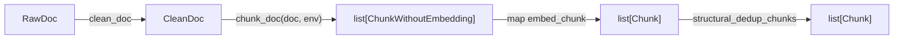

# Typed Pipeline Review

A typed pipeline review is a boundary audit, not a count of annotations. Module 01
uses distinct domain values to make illegal stage order visible, `RagPipe` to preserve
unary composition types, and direct orchestration where collection shape would make a
generic chain less clear.

## Trace the actual shapes



Review both the element type and the container shape:

| Boundary | Producer | Consumer requirement | Review result |
| --- | --- | --- | --- |
| raw to clean | `clean_doc: RawDoc \| CleanDoc -> CleanDoc` | `chunk_doc` needs `CleanDoc` plus `RagEnv` | element types fit; configuration remains explicit |
| clean to chunks | `chunk_doc` returns `list[ChunkWithoutEmbedding]` | `embed_chunk` needs one `ChunkWithoutEmbedding` | direct composition is invalid; mapping is required |
| embedded to canonical | mapped embedding returns `list[Chunk]` | dedup accepts `list[Chunk]` | container and element types fit |

The one-to-many transition is the important pressure. A wrapper that records only
`A -> B` cannot invent flattening semantics. `docs_to_embedded` therefore uses named
list comprehensions rather than pretending every stage is a unary value transform of
the same shape.

## Check what the generic wrapper actually guarantees

`RagPipe[A, B].then` accepts `Callable[[B], C]` and returns `RagPipe[A, C]`. For a
genuinely unary chain, this rejects a wrong adjacent value:

```python
from collections.abc import Callable

from funcpipe_rag import CleanDoc, RagEnv, RawDoc, chunk_doc, clean_doc
from funcpipe_rag.rag_pipe import RagPipe


def chunk_count(env: RagEnv) -> Callable[[CleanDoc], int]:
    def count(doc: CleanDoc) -> int:
        return len(chunk_doc(doc, env))

    return count


count_chunks = RagPipe(clean_doc).then(chunk_count(RagEnv(chunk_size=8)))
result: int = count_chunks(
    RawDoc("paper", "Types", "typed pipelines", "cs.PL")
)
```

The invalid adjacency is shorter:

```python
broken = RagPipe(clean_doc).then(embed_chunk)
```

`clean_doc` produces `CleanDoc`; `embed_chunk` requires
`ChunkWithoutEmbedding`. A static checker should reject construction before the
pipeline is called. By contrast, Module 01's `flow` uses
`Callable[[Any], Any]`, so this same mismatch can escape static checking:

```python
broken = flow(clean_doc, embed_chunk)
```

That difference is a real benefit of `RagPipe`, but it does not justify using the
wrapper where direct orchestration is clearer.

## Separate static, runtime, and behavioral evidence

No one proof route establishes the whole contract:

| Evidence | Establishes | Does not establish |
| --- | --- | --- |
| strict mypy | the seven tracked source files satisfy their declared static relationships | valid runtime configuration, purity, or correct output |
| frozen dataclass validation | `RagEnv.chunk_size` is an exact positive integer and values reject reassignment | correct stage order or chunk coverage |
| foundation tests | normalization, chunk coverage, embedding locality, canonical behavior, and input preservation | absence of every type mismatch in unexecuted code |
| source review | effects and `Any` escapes are visible to a reviewer | laws over a broad generated input space |

This matters for the cleaning fixed-point law:

```python
clean_doc(clean_doc(raw)) == clean_doc(raw)
```

The runtime expression requires `clean_doc` to accept its own `CleanDoc` output.
Typing the parameter only as `RawDoc` would make the executable law and the public
annotation disagree even if Python happened to run it successfully.

## Run the two independent routes

From the repository root:

```bash
make PROGRAM=python-programming/python-functional-programming \
  capstone-foundation-types
make PROGRAM=python-programming/python-functional-programming \
  capstone-foundation-proof
```

The type target uses strict mypy, points `MYPYPATH` at the Module 01 snapshot, and
writes its cache under `artifacts/`. Snapshot isolation is essential: resolving
imports from the live Module 10 package could produce a green result for the wrong
source state.

The behavior target runs the six-test learning proof against the same snapshot. A
review should require both results rather than treating passing runtime tests as a
static check or treating mypy as proof of domain behavior.

## Review the annotation cost

Keep the typed wrapper when:

- adjacent intermediate types differ and a mismatch is plausible;
- a unary chain is reused as one callable;
- the inferred public result remains understandable;
- strict checking is part of the executable review path.

Prefer a direct function when:

- a stage expands one value into many;
- mapping or flattening policy must remain visible;
- configuration would need hidden capture solely to fit the wrapper;
- `Any` would erase the guarantee the abstraction claims to add.

Types also stop at effect behavior. `Callable[[str], int]` can describe both a pure
length function and one that writes to a global audit list. Purity still needs source
review and behavioral evidence.

## Compact review route

Before accepting a typed pipeline change:

1. Write each stage as `input -> output`, including containers.
2. Mark every one-to-many, flattening, and configuration boundary.
3. Search public helper signatures for `Any`.
4. Identify one realistic invalid adjacency the checker rejects.
5. Run `capstone-foundation-types`.
6. Run `capstone-foundation-proof`.
7. Explain what remains a source-review claim.

Move to [Isolating Side Effects](isolating-side-effects.md) once you can explain why
`RagPipe(clean_doc).then(embed_chunk)` is statically invalid, why `flow` cannot prove
that, and why neither fact establishes purity.
