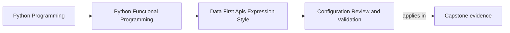

# Configuration Review and Validation

<!-- page-maps:start -->
## Page Maps




<!-- page-maps:end -->

Configuration becomes useful domain data only after an untyped caller has been
checked. A frozen dataclass prevents mutation after construction; it does not prove
that a JSON mapping, command-line token, or rule name is valid.

Module 02 therefore has two distinct responsibilities:

- `boundary_rag_config` validates untyped RAG policy and constructs `RagConfig`;
- `boundary_app_config` parses CLI concerns, delegates RAG policy to that shared
  validator, then adds paths and debug flags.

The important review question is not merely “is config immutable?” It is “can every
entry route construct the same valid policy or return at the same boundary?”

## Follow a valid value

The canonical parser lives in
`capstone/module-reference-states/module-02/src/funcpipe_rag/api/config.py`.
For this input:

```python
raw = {
    "chunk_size": 4,
    "clean_rules": ["strip", "upper"],
}
```

the parser checks the raw fields, converts the rule sequence to a tuple, and only
then constructs:

```text
RagConfig(
  env=RagEnv(chunk_size=4),
  clean=CleanConfig(rule_names=("strip", "upper")),
)
```

The result is frozen, structurally comparable policy. `get_deps` later interprets
the cleaning names by looking them up in `RULES` and binds them into a cleaner.

This split gives each value a precise role:

| Value | Meaning | Must not own |
| --- | --- | --- |
| raw mapping | untrusted boundary representation | domain invariants |
| `CleanConfig` | ordered cleaning policy names | filesystem or CLI parsing |
| `RagEnv` | validated numeric run policy | coercion from arbitrary objects |
| `RagConfig` | complete pure-core policy | dependency execution |
| `RagCoreDeps` | selected callable implementations | validation of raw names |

## Validate in dependency order

`boundary_rag_config` uses this order:

1. retrieve `chunk_size`, using the public default when absent;
2. require an actual integer and reject `bool` explicitly;
3. require a positive value before calling `RagEnv`;
4. retrieve `clean_rules`, using the default ordered tuple when absent;
5. require a list or tuple whose every element is a string;
6. reject names absent from the `RULES` registry;
7. convert the accepted sequence to a tuple;
8. construct frozen config and return `Ok`.

Each earlier check protects a later operation. Range validation protects
`RagEnv`; registry validation protects `make_cleaner`.

## Python's boolean trap is an API issue

Python reports:

```python
isinstance(True, int)  # True
```

This check is therefore too weak:

```python
if not isinstance(chunk_size_raw, int):
    return Err(...)
```

The boundary needs both conditions:

```python
if not isinstance(chunk_size_raw, int) or isinstance(chunk_size_raw, bool):
    return Err(...)
```

Otherwise `True` can silently mean a chunk size of one. Type annotations do not
protect a value that entered through `Mapping[str, object]`.

## Do not coerce by accident

The mapping boundary deliberately does not call `int(value)`. These values carry
different information:

| Raw value | Mapping-boundary result | Reason |
| --- | --- | --- |
| `4` | `Ok` | exact accepted runtime type and range |
| `True` | `Err` mentioning `bool` | boolean policy is ambiguous |
| `0` or `-1` | `Err` requiring positive integer | range fails before construction |
| `"4"` | `Err` requiring integer | string coercion is not this API's contract |
| missing field | `Ok` with `512` | an explicit default is part of the contract |

Silent coercion would make `True`, `3.8`, and `"4"` look like variations of the
same request and would remove the information needed for a useful error.

## Rule names require semantic validation

`CleanConfig` stores names in order so a learner can inspect and compare policy.
The dataclass alone cannot know whether a name has an implementation.

```python
CleanConfig(("strip", "unknown"))
```

That value is structurally valid but cannot be interpreted by `make_cleaner`;
direct lookup in `RULES` would raise `KeyError`. The boundary must compare names
with the registry first and return an `Err` that includes the unknown names and
available choices.

| Raw cleaning policy | Outcome |
| --- | --- |
| `["strip", "upper"]` | `Ok(CleanConfig(("strip", "upper")))` |
| `("upper", "lower")` | `Ok`; order is preserved |
| `"strip,upper"` | `Err`; the mapping API requires a sequence |
| `["strip", 1]` | `Err`; every item must be a string |
| `["strip", "unknown"]` | `Err`; dependency selection cannot succeed |

## The CLI must share the policy parser

`shells/rag_main.py` owns command-line syntax. `argparse` converts
`--chunk_size 4` to an integer and the shell splits comma-separated rule names.
The shell then calls:

```python
config_result = boundary_rag_config(
    {
        "chunk_size": ns.chunk_size,
        "clean_rules": rule_names,
    }
)
```

Only after `Ok` does it use `dataclasses.replace` to add debug policy and wrap the
result with input and output paths in `AppConfig`.

This delegation prevents drift. A former direct-construction route could accept an
unknown name, return `Ok(AppConfig)`, and fail later while `get_deps` selected the
cleaner. That was not a Result-bearing boundary; it was deferred failure.

`argparse` still owns malformed command-line syntax. For example,
`--chunk_size nope` produces its normal parser error rather than an `Err` value.
Once CLI tokens have been parsed, range and rule policy belong to the shared
validator.

## Executable evidence

The focused data API proof covers valid construction, boolean rejection, and both
nonpositive ranges. It also proves that two different cleaning orders produce
different, deterministic results:

```bash
make PROGRAM=python-programming/python-functional-programming \
  capstone-data-api-proof
```

The concrete shell proof covers the cross-entry-point law: an unknown CLI cleaning
rule returns `Err` before reading input or selecting dependencies.

```bash
make PROGRAM=python-programming/python-functional-programming \
  capstone-data-shell-proof
```

The exact tests are in the completed Module 02 reference state under
`tests/learning/`. The same range and CLI validation source corrections are carried
through every later reference state and the live capstone.

## Review checklist

Before accepting a configuration change, answer:

1. Is the new field boundary syntax, domain policy, debug policy, or dependency
   selection?
2. Which constructor invariant or registry lookup requires validation first?
3. Do all entry points delegate to one semantic parser?
4. Is defaulting explicit, and is coercion either documented or rejected?
5. Does a focused test observe both the returned result and whether execution
   started?
6. Has the public law been carried into every cumulative later state?

Configuration-as-data is justified when these answers make variants easier to
inspect and test. A plain parameter remains better when there is only one local,
already typed value and no boundary policy to coordinate.

Continue with [Callbacks to Combinators](callbacks-to-combinators.md).
