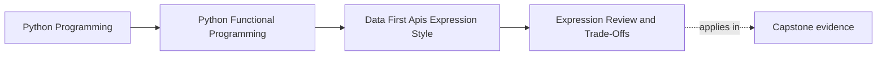

# Expression Review and Trade-Offs

<!-- page-maps:start -->
## Page Maps




<!-- page-maps:end -->

Expression-oriented code is valuable when it exposes dataflow more clearly than
mutable flags and callback bookkeeping. It is not automatically safer because it
is shorter. A rewrite can preserve final values while changing order, cardinality,
evaluation timing, or failure timing.

Module 02 provides two deliberately different application shapes:

- `iter_rag_core` composes lazy iterator stages and yields chunks on demand;
- `full_rag_api_docs` materializes named intermediates to produce complete
  observations and stable tap points.

Neither is the universal “functional” answer. Their contracts serve different
callers.

## Begin with the smallest equivalence

`pipe` threads one value through unary functions from left to right:

```python
pipe(values, normalize, keep_nonempty)
```

The first learning test compares it directly with:

```python
keep_nonempty(normalize(values))
```

That assertion proves both forms return the same value for the example. It does not
prove that arbitrary stages are pure, total, or safe to reorder. `pipe` preserves
the order it is given.

This is the right scale for reviewing a syntax helper: compare it with ordinary
Python before using it to explain a domain pipeline.

## Read iterator combinators by cardinality

The helpers in `capstone/module-reference-states/module-02/src/funcpipe_rag/fp.py`
lift element functions into iterable stages.

| Combinator | Element function | Outputs per input | Evaluation |
| --- | --- | --- | --- |
| `ffilter` | `A -> bool` | zero or one `A` | when the iterator is consumed |
| `fmap` | `A -> B` | exactly one `B` | when the iterator is consumed |
| `flatmap` | `A -> Iterable[B]` | zero or many `B` values | outer and inner iteration on demand |

Cardinality is part of meaning. Replacing `fmap` with `flatmap` is not an aesthetic
change; it changes the shape of the stream.

The tracked iterator test records source, filter, and expansion calls. Immediately
after composing the stages, the record is empty. Requesting the first item produces
exactly:

```text
source(0) -> filter(0) -> expand(1)
```

This proves deferred work and stage order for the taught combinators. It does not
yet prove bounded traversal of the complete RAG application; Module 03 takes
ownership of that stronger streaming contract.

## Trace the lazy core

`iter_rag_core` names four domain stages:

```text
RawDoc
  -> ffilter(keep_rule)
  -> fmap(cleaner)
  -> flatmap(chunker)
  -> fmap(embedder)
  -> Chunk
```

The returned iterator does no stage work until consumption. Each consumed document
may be rejected, cleaned once, expanded into zero or more chunks, and embedded once
per chunk.

The function intentionally does not:

- open an input source;
- structurally deduplicate the complete output;
- calculate complete observations;
- return a list.

Those omissions preserve its iterator contract. Adding a `list`, global sort, or
whole-stream deduplication inside it would move the materialization boundary.

## Trace the observation API

`full_rag_api_docs` chooses complete observations over streaming:

1. `list(docs)` establishes total input count and replayable traversal;
2. a list comprehension materializes kept documents;
3. another list materializes cleaned documents;
4. `list(iter_chunks_from_cleaned(...))` materializes pre-dedup chunks;
5. structural deduplication returns the final chunk list;
6. counts and samples are calculated from those complete values.

This is not accidental eagerness. `RagTaps` observe completed stage values, and
`Observations` reports complete totals. A caller that wants incremental demand
should use the iterator shape rather than pretend this API is streaming.

| Question | `iter_rag_core` | `full_rag_api_docs` |
| --- | --- | --- |
| first work occurs | first demand | at the call |
| input retained | iterator frame/current value | complete input list |
| complete counts | unavailable | returned in `Observations` |
| stage taps | lazy trace/probe wrappers | tuples of completed stage values |
| deduplication | caller responsibility | canonical structural dedup |
| return | `Iterator[Chunk]` | `tuple[list[Chunk], Observations]` |

## Observation must not become control flow

`instrument_stage` can wrap lazy stages with tracing or a probe. Tracing emits a
representation and yields the same value. A probe checks an invariant and yields
the same value when the check passes. Both run on consumption.

The eager API invokes optional taps with tuples after its kept, cleaned, and chunk
stages. The test
`test_taps_observe_stage_values_without_changing_api_output` compares a tapped run
with an untapped baseline and requires equal return values.

A proposed observer is not observation-only if it filters, replaces, reorders, or
consumes values that the application would otherwise return.

## Prove application meaning with the real baseline

The executable preservation test is
`test_default_api_preserves_module_01_rag_values`. It constructs the Module 01
baseline from the tracked pure stages:

```text
clean_doc -> chunk_doc -> embed_chunk -> structural_dedup_chunks
```

It then compares complete chunks from `full_rag_api_docs` under default Module 02
policy. Equality includes dataclass fields and list order, not merely counts or set
membership.

The test also checks observation totals, but it does not claim that the eager and
lazy APIs have identical evaluation timing.

Run the proof from the repository root:

```bash
make PROGRAM=python-programming/python-functional-programming \
  capstone-data-api-proof
```

## Review an expression rewrite

Use this sequence before accepting one:

1. name the direct or previous implementation that serves as the oracle;
2. state each stage's input, output, and cardinality;
3. mark every `list`, comprehension, fold, sort, deduplication, and first demand;
4. compare structural values and order on the same input;
5. use a counted source when evaluation timing matters;
6. compare tapped and untapped values when adding observation;
7. reject the rewrite if names no longer express domain decisions.

Expression style is a win when it localizes decisions and makes composition
reviewable. Named intermediate values remain the better choice when complete stage
state, debugging, or observation is part of the public contract.

Continue with [Introducing Laziness](introducing-laziness.md).
