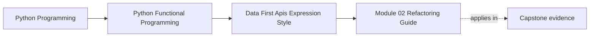

# Module 02 Refactoring Guide

<!-- page-maps:start -->
## Page Maps




<!-- page-maps:end -->

This guide treats Module 02 as one refactoring of the Module 01 application, not as
a collection of detached functional-programming examples. The goal is to add
configurable policy, expression stages, and explicit boundary outcomes while
preserving successful RAG values.

## Establish the contract before changing structure

Module 01 supplies the oracle:

| Existing capability | Value that must remain stable |
| --- | --- |
| cleaning | normalized `CleanDoc` fields |
| chunking | text, document ID, start, end, and order |
| embedding | deterministic tuple for each chunk |
| deduplication | canonical first-occurrence result |
| filesystem success | JSONL decodes to the pure-core chunk values |

Run the Module 01 proof routes before using its behavior as a baseline:

```bash
make PROGRAM=python-programming/python-functional-programming \
  capstone-foundation-proof
make PROGRAM=python-programming/python-functional-programming \
  capstone-shell-proof
```

Module 02 is allowed to add filtering policy, observation values, and `Result`
wrappers. It is not allowed to silently change those successful default values.

## Compare the completed source states

From the repository root:

```bash
diff -qr \
  programs/python-programming/python-functional-programming/capstone/module-reference-states/module-01/src \
  programs/python-programming/python-functional-programming/capstone/module-reference-states/module-02/src
```

Classify the additions by ownership before editing:

```text
api/config.py       frozen policy, capability protocols, dependency selection
api/core.py         configurable document and iterator APIs
api/types.py        observations and tap policy
core/rules_*.py     inspectable or composable filtering policy
fp.py               expression and iterator combinators
result.py           minimal explicit boundary outcome
shells/             concrete filesystem and CLI adapters
```

If a proposed file cannot be assigned one of those responsibilities, its boundary
is probably unclear.

## Introduce policy without replacing domain stages

First wrap existing choices in frozen values:

```text
RagConfig = RagEnv + RulesConfig + CleanConfig + DebugConfig
```

Keep behavior supplied by the composition root in a separate dependency value:

```text
RagCoreDeps = cleaner + embedder + optional taps
```

This distinction is reviewable:

- config says which stable policy was selected;
- dependencies say which callable implementations will interpret it;
- input documents remain arguments to each run.

`make_rag_fn` may capture config and dependencies. It must not capture the document
list. The tracked configurator test calls the returned function twice with the same
input and requires independent equal results.

Stop if a config field stores mutable run state, an input value, or a filesystem
handle. That would make equal config values an unreliable description of behavior.

## Add expression stages with a cardinality ledger

Introduce one lifted stage at a time:

```text
ffilter  A -> bool          gives zero or one A
fmap     A -> B             gives exactly one B
flatmap  A -> Iterable[B]   gives zero or many B values
```

For each replacement:

1. compare complete values and order with direct Python;
2. record whether work happens at construction or demand;
3. name any new materialization point;
4. retain a domain name for each decision.

The learning proof records that composing `ffilter`, `fmap`, and `flatmap` performs
no source work. Its first demand then records the exact source-filter-expand order.
Do not infer whole-application streaming from that local law.

Stop if a rewrite removes useful stage names, changes cardinality, or requires set
equality to hide order changes.

## Keep eager observation explicit

`full_rag_api_docs` is the stable, eager API. It materializes documents, kept
documents, cleaned documents, and pre-dedup chunks because it returns complete
observations and supports completed-stage taps.

Add taps only after returned values are stable. Then compare tapped and untapped
runs. A tap may record a tuple of stage values; it may not filter, reorder, replace,
or consume values that the caller expects.

`iter_rag_core` is the separate lazy shape. Do not force complete observation into
it by hiding a list conversion inside the iterator.

## Add boundary outcomes around the document API

Keep `full_rag_api_docs` free of paths. Add a narrow `Reader` capability and compose
it in `full_rag_api_path`:

```text
read path -> Err
          -> Ok(docs) -> full_rag_api_docs -> Ok(chunks, observations)
```

Prove a failing reader returns its exact `Err` and skips later work. Then prove the
concrete filesystem adapter separately; a fake reader cannot establish CSV parsing
or JSONL writing behavior.

The real shell must preserve this sequence:

```text
FSReader -> pure document API -> JSONL writer
```

Load failure occurs before output creation. Write failure occurs after core work.
The module does not promise atomic replacement or cleanup of partially written
output.

## Make every entry point share semantic validation

Untyped config must be checked before `RagEnv`, `CleanConfig`, or dependency
selection:

- reject `bool` as a chunk size even though Python treats it as an integer;
- reject zero and negative sizes before `RagEnv`;
- reject malformed rule collections;
- reject unknown rule names before `get_deps`.

The CLI may own token syntax, paths, and debug flags. It must delegate chunk and
cleaning policy to `boundary_rag_config`. Direct construction creates a second,
weaker contract and can defer an unknown rule to a later `KeyError`.

## Evidence matrix

| Claim | Source owner | Focused executable evidence |
| --- | --- | --- |
| expression threading preserves direct value | `fp.py` | `test_expression_pipeline_matches_direct_threading` |
| iterator stages defer and retain order | `fp.py` | `test_iterator_combinators_defer_work_and_preserve_stage_order` |
| cleaning order is policy | `api/clean_cfg.py` | `test_cleaning_configuration_is_ordered_data` |
| raw config rejects invalid type and range | `api/config.py` | boundary config tests in `test_module_02_data_first_apis.py` |
| taps do not change return values | `api/core.py` | `test_taps_observe_stage_values_without_changing_api_output` |
| reader failure skips the core | `api/core.py` | `test_reader_failure_short_circuits_the_pure_rag_core` |
| default API preserves Module 01 chunks | `api/core.py` | `test_default_api_preserves_module_01_rag_values` |
| real shell preserves core values | `shells/rag_api_shell.py` | `test_filesystem_shell_preserves_the_configured_core_values` |
| load and write failures remain distinct | `shells/rag_api_shell.py` | filesystem failure tests |
| CLI rejects unknown policy before execution | `shells/rag_main.py` | `test_app_config_rejects_unknown_clean_rule_before_execution` |

Run the complete Module 02 evidence:

```bash
make PROGRAM=python-programming/python-functional-programming \
  capstone-data-api-proof
make PROGRAM=python-programming/python-functional-programming \
  capstone-data-shell-proof
```

## Carry the law through cumulative states

Modules 03–09 and the live Module 10 capstone inherit Module 02 configuration and
CLI behavior. When this public contract changes:

1. update the Module 02 completed state;
2. carry the exact source correction into every affected later state;
3. carry cumulative learning laws where those files are designed to accumulate;
4. refresh generated module history;
5. verify generated history against tracked snapshots;
6. run focused evidence before the broad course gate.

The real-filesystem proof remains in the introduction state because it names the
adapter contract where it is introduced. Later states must preserve the behavior,
but they do not need duplicate copies of that exact test file when their own
boundary lessons add distinct evidence.

## Exit record

Before moving to Module 03, record:

- the Module 01 value oracle;
- the exact Module 02 source owners added;
- the first materialization point in each public API;
- expected boundary failures versus invariant exceptions;
- focused proof results;
- every later state changed to preserve the public law.

A refactor is complete when that record can be reconstructed from tracked source,
tests, and commands—not from the memory of the person who performed it.
