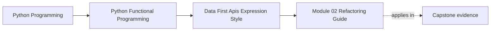

# Module 02 Refactoring Guide


<!-- page-maps:start -->
## Page Maps




<!-- page-maps:end -->

Read the first diagram as a placement map: this page is one concept inside its parent module, not a detached essay, and the capstone is the pressure test for whether the idea holds. Read the second diagram as the working rhythm for the page: name the problem, study the example, identify the boundary, then carry one review question forward.

This guide closes Module 02. The goal is to make configuration and composition explicit
enough that changing behavior does not require hidden globals or callback archaeology.

## Stable comparison route

From the program root:

1. run the cumulative learning proof:

   ```bash
   PYTHONPATH=capstone/module-reference-states/module-02/src \
     python -m pytest -q \
     capstone/module-reference-states/module-02/tests/learning/test_module_02_data_first_apis.py
   ```

2. compare the tracked source states:

   ```bash
   diff -qr \
     capstone/module-reference-states/module-01/src \
     capstone/module-reference-states/module-02/src
   ```

3. read [FuncPipe Delta](capstone-delta.md) to classify the structural additions;
4. inspect `api/config.py`, `api/core.py`, `core/rules_pred.py`, `result.py`, and
   `shells/`;
5. read the learning tests as claims about ownership, value preservation, and
   boundary timing.

## What to refactor toward

- function signatures that accept data directly instead of fishing values out of globals
- closures and partial application only when they make configuration clearer
- composition helpers that expose intermediate values without mutating flow
- tests that show the public API contract, not only the internal helper sequence

## Refactoring sequence

### Freeze the Module 01 oracle

Materialize the existing clean, chunk, embed, and canonical-dedup pipeline over
representative documents. Preserve complete structural values and order, not only
counts.

### Separate policy from capabilities

Move stable choices into frozen values:

```text
RagConfig = chunk environment + rules + cleaning + debug selection
```

Move behavior supplied by the composition root into dependencies:

```text
RagCoreDeps = cleaner + embedder + optional taps
```

Reject a grouping if its fields do not share ownership or lifecycle.

### Bind policy without capturing input

Use `make_rag_fn` to construct configuration and dependencies once. Verify the
returned function accepts documents per invocation and produces independent equal
runs for replayable input.

### Introduce expression stages one at a time

Review cardinality:

```text
ffilter: 0..1 output per input
fmap:    exactly 1 output per input
flatmap: 0..many outputs per input
```

After each change, compare fully consumed values with the oracle and use a counted
source when evaluation timing matters.

### Add boundary outcomes last

Keep the pure document API intact. Add a `Reader` protocol and
`full_rag_api_path` around it. Translate expected read failure into `Err` and prove
the core does not run on that route.

### Add observation without control

Inject `RagTaps` only after returned values are stable. Compare tapped and untapped
runs. A tap may record; it must not filter, replace, or reorder domain values.

## Review worksheet

| Surface | Input owner | Retained policy/state | Failure route | Preservation proof |
| --- | --- | --- | --- | --- |
| `make_rag_fn` | caller supplies docs per run | frozen config and deps | constructor invariant | independent equal runs |
| `iter_rag_core` | caller | iterator frames | invariant exception at demand | fully consumed equality |
| `full_rag_api_docs` | caller | complete lists and observations | pure capability failure | Module 01 oracle |
| `full_rag_api_path` | reader capability | boundary result | `Err` short-circuit | failing-reader trace |
| `parse_rule` | boundary string | parsed AST in closure | whitelist rejection | accepted and forbidden cases |

If a row cannot be completed, inspect the matching source before refactoring.

## Downstream coherence

Modules 03 through 09 and the live Module 10 endpoint inherit configuration,
rules, and boundary behavior. When changing a Module 02 public contract:

1. carry the source correction through all affected states;
2. keep the Module 02 learning proof identical downstream;
3. refresh generated history;
4. verify source states and history manifests;
5. run the strict docs build;
6. run the broad course gate once after focused checks pass.

## Exit standard

Before Module 03, you should be able to show where configuration enters, how it flows,
and why the API stays inspectable under change. You should also be able to state
which test proves default Module 01 compatibility and what that test does not prove.
