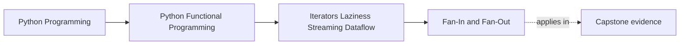

# Fan-In and Fan-Out

<!-- page-maps:start -->
## Page Maps




<!-- page-maps:end -->

Module 02 accepted one collection of documents. Earlier Module 03 cores made that
route lazy and complete. The next pressure is ordinary application work: one
ingestion run may receive documents from a priority corpus and a background
corpus, while final chunks must reach both an index writer and an audit consumer.

The iterator code for merging and splitting is short. The design decision is not.
You must state:

- which source advances next;
- which order remains stable;
- when a source is opened;
- what state is retained while consumers advance at different speeds;
- whether a failure happens before or after another upstream value is requested.

## Prerequisites and outcome

Before this lesson, be able to explain `Iterable`, `Iterator`, `Source[T]`,
`stream_rag_chunks`, and a final unique-output fence.

After it, you should be able to:

1. choose sequential, round-robin, or sorted fan-in from an ordering requirement;
2. predict a requested prefix across multiple document sources;
3. explain how encounter order affects first-seen deduplication;
4. choose lockstep or bounded multicast from a consumer-cardinality requirement;
5. prove the choice with the Module 03 source-scheduling laws.

## A source is a replay policy

The module defines:

```python
Source = Callable[[], Iterator[T]]
```

A source is not an iterator. It is a zero-argument function that starts a fresh
iterator. That distinction lets a configured pipeline run again without capturing
an exhausted cursor.

```python
from funcpipe_rag import as_source, make_chain

priority = as_source(("p1", "p2"))
background = as_source(("b1",))
merged = make_chain(priority, background)

assert list(merged()) == ["p1", "p2", "b1"]
assert list(merged()) == ["p1", "p2", "b1"]
```

Passing `priority()` instead would pass one iterator traversal, not the restartable
source contract expected by `make_chain`.

## Fan-in chooses encounter order

Module 03 supplies three generic factories:

| Factory | Encounter order | Required precondition | Retained merge state |
| --- | --- | --- | --- |
| `make_chain` | exhaust source A, then B | none | current source iterator |
| `make_roundrobin` | one item from each active source per cycle | none | one iterator per active source |
| `make_merge` | global key order | every source is already sorted by the same key | one frontier item per source |

All three preserve order within each source. They differ only in how those local
orders are combined.

### Sequential scheduling expresses priority

```python
from funcpipe_rag import as_source, make_chain

priority = as_source(("p1", "p2"))
background = as_source(("b1", "b2"))

assert list(make_chain(priority, background)()) == [
    "p1",
    "p2",
    "b1",
    "b2",
]
```

The background source does not start until the priority source is exhausted.
This is useful when source order is policy, but a long or infinite first source
can delay every later source indefinitely.

### Round-robin limits turn-taking delay

```python
from funcpipe_rag import as_source, make_roundrobin

priority = as_source(("p1", "p2"))
background = as_source(("b1", "b2"))

assert list(make_roundrobin(priority, background)()) == [
    "p1",
    "b1",
    "p2",
    "b2",
]
```

Round-robin is “fair” only in the narrow synchronous sense that each active
iterator gets one `next()` attempt per cycle. A blocking source can still block
the whole thread. Async scheduling and backpressure arrive in Module 08.

### Sorted merge does not sort its inputs

```python
from funcpipe_rag import as_source, make_merge

left = as_source((("left-1", 1), ("left-3", 3)))
right = as_source((("right-2", 2), ("right-4", 4)))

ordered = make_merge(left, right, key=lambda item: item[1])

assert [label for label, _ in ordered()] == [
    "left-1",
    "right-2",
    "left-3",
    "right-4",
]
```

`make_merge` assumes each source is already non-decreasing under the same key.
It cannot detect every local-order violation, and it does not repair one. Enforce
that precondition at the adapter that creates the source.

## The RAG application owns a narrower policy

The generic factories can merge any values. The application entry point accepts
only the two policies it can apply without another domain precondition:

```python
stream_rag_sources(
    sources,
    config,
    deps,
    schedule="sequential",  # or "round_robin"
    max_chunks=None,
)
```

The complete dataflow is:

```text
Source[RawDoc] values
  -> selected fan-in schedule
  -> filter
  -> clean
  -> chunk
  -> embed
  -> structural dedup across every source
  -> optional final unique-output fence
  -> Iterator[Chunk]
```

The scheduler changes encounter order, not the downstream stages.

```python
from funcpipe_rag import (
    RagConfig,
    RagEnv,
    RawDoc,
    as_source,
    get_deps,
    stream_rag_sources,
)

sources = (
    as_source(
        (
            RawDoc("a1", "title", "alpha", "cs.AI"),
            RawDoc("a2", "title", "beta", "cs.AI"),
        )
    ),
    as_source((RawDoc("b1", "title", "gamma", "cs.AI"),)),
)
config = RagConfig(env=RagEnv(chunk_size=100))

sequential = stream_rag_sources(
    sources,
    config,
    get_deps(config),
    schedule="sequential",
)

assert [chunk.doc_id for chunk in sequential] == ["a1", "a2", "b1"]
```

Changing the schedule to `"round_robin"` yields `["a1", "b1", "a2"]`.
Both results contain complete embedded `Chunk` values.

## Prefix demand depends on the schedule

Consider two source factories and `max_chunks=1`.

For sequential scheduling:

```text
request first unique Chunk
  -> open source A
  -> request A1
  -> clean, chunk, embed, deduplicate A1
  -> emit first unique Chunk
  -> stop; source B was never opened
```

For round-robin scheduling, creating the merged iterator creates an iterator for
each source when demand first reaches the scheduler. The first output still comes
from source A, but every source factory has been opened so it can participate in
the cycle.

This distinction is why “lazy” is too vague. Both routes defer work until demand,
but they defer different units of work.

The final fence remains after deduplication. If A1 and B1 produce the same
structural chunk, requesting two unique outputs may scan later documents or later
sources to find the second unique value.

## First-encounter deduplication is global

`stream_rag_sources` merges raw documents before the complete RAG chain.
Consequently, structural deduplication sees one shared chunk stream. A duplicate
from source B is removed if the equivalent chunk from source A arrived first.

Changing from sequential to round-robin may change which duplicate arrives first.
That is not a generic iterator curiosity; it can change which source provenance is
represented by the surviving value. Choose the schedule with the same care as a
ranking or conflict-resolution policy.

## Fan-out chooses a consumer contract

After RAG processing, final chunks may need two consumers:

- an index consumer that stores the value;
- an audit consumer that records derived metadata.

Module 03 offers two distinct contracts:

| Helper | Branch contract | Retained state | Failure |
| --- | --- | --- | --- |
| `fork2_lockstep` | each transform produces exactly one output per input | `tee` skew plus current pair | `ValueError` on cardinality mismatch |
| `multicast` | independent iterators receive identical upstream values | one bounded queue per consumer | `BufferError` when another pull would exceed `maxlen` |

Use `fork2_lockstep` only when both transforms are cardinality preserving. A
filtering audit branch does not satisfy that contract.

### One traversal, two RAG consumers

```python
chunks = stream_rag_sources(sources, config, get_deps(config))
index_chunks, audit_chunks = multicast(chunks, 2, maxlen=1)

indexed = next(index_chunks)
audited = next(audit_chunks)

assert indexed == audited
```

The consumers see the same `Chunk` object from one upstream traversal. Alternating
their requests keeps skew within one buffered item.

### Overflow must happen before another upstream pull

With two consumers and `maxlen=1`:

```text
index asks -> pull chunk 0 -> queues [0], [0] -> index gets 0
audit asks -> audit gets 0
index asks -> pull chunk 1 -> queues [1], [1] -> index gets 1
index asks -> audit queue is full -> BufferError
             no request for chunk 2
```

The implementation checks every queue's capacity before `next(upstream)`. Pulling
first would lose demand information and could distribute a value to only some
consumers.

An exception escaping a generator closes that subscriber generator. Catching
`BufferError` outside `next(index_chunks)` does not make it resumable. Treat
overflow as failure of the synchronous fan-out route and rebuild or abort the
whole operation.

## Space claims must name retained state

Fan-in itself can be bounded while the composed application is not:

- chain retains the current source iterator;
- round-robin retains all active source iterators;
- sorted merge retains one frontier value per source;
- streaming dedup retains every unique structural key seen;
- multicast retains up to consumer skew per branch;
- a final fence limits outputs, not necessarily raw document pulls.

Do not summarize this pipeline as “constant memory.” State each retained structure
and what input property bounds it.

## Failure routes worth testing

| Mistake | Observable consequence | Better evidence |
| --- | --- | --- |
| pass exhausted iterators instead of source factories | a second run is empty | call the merged source twice |
| choose chain for an infinite first source | later sources never advance | counted sources plus a bounded prefix |
| call `make_merge` on locally unsorted inputs | global order can be wrong silently | adapter test for each source's order |
| assume round-robin handles blocking I/O | one blocking `next()` stalls all sources | keep synchronous adapters bounded; use Module 08 for async |
| consume one multicast branch too far ahead | `BufferError` closes that subscriber | assert upstream pull count at overflow |
| use lockstep with a filtering branch | cardinality mismatch raises | prove each branch is one-to-one or choose multicast |

## Executable evidence

Run the smallest source-scheduling route from the repository root:

```bash
make PROGRAM=python-programming/python-functional-programming \
  capstone-source-scheduling-proof
```

It owns six cases in
`capstone/module-reference-states/module-03/tests/learning/test_module_03_streaming_dataflow.py`:

- sorted fan-in over preordered sources;
- sequential and round-robin RAG encounter order;
- a sequential fence that never opens the later source;
- structural deduplication across source boundaries;
- index and audit consumers receiving equal final chunks.

For all Module 03 demand, chunking, observation, and complete-RAG laws, run:

```bash
make PROGRAM=python-programming/python-functional-programming \
  capstone-streaming-rag-proof
```

The first command proves the selected synchronous policies for deterministic local
sources. It does not prove thread safety, recoverable multicast overflow,
non-blocking I/O, or async fairness.

## Review before moving on

Given two document sources and two final consumers, you should now be able to
write down:

1. the encounter order under each candidate schedule;
2. which source factories are opened for a requested prefix;
3. which duplicate survives and why;
4. the maximum tolerated consumer skew;
5. the exact `next()` call where overflow appears;
6. the test that proves no extra upstream value was requested.

Apply that judgment in [Exercises](exercises.md), then compare your reasoning with
[Exercise Answers](exercise-answers.md).

**Continue with:** [Time-Aware Streaming](time-aware-streaming.md)
