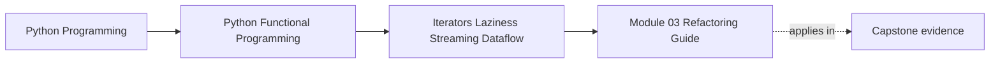

# Module 03 Refactoring Guide


<!-- page-maps:start -->
## Page Maps




<!-- page-maps:end -->

Read the first diagram as a placement map: this page is one concept inside its parent module, not a detached essay, and the capstone is the pressure test for whether the idea holds. Read the second diagram as the working rhythm for the page: name the problem, study the example, identify the boundary, then carry one review question forward.

This guide closes Module 03. The point is not to celebrate generators on their own. The
point is to know when computation happens, when memory grows, and how to observe a stream
without quietly destroying laziness.

## Stable comparison route

From the repository root:

1. run the focused learning proof:

   ```bash
   make PROGRAM=python-programming/python-functional-programming \
     capstone-streaming-rag-proof
   ```

2. isolate the multi-source policy when that is the current pressure:

   ```bash
   make PROGRAM=python-programming/python-functional-programming \
     capstone-source-scheduling-proof
   ```

3. compare Module 02 with Module 03:

   ```bash
   git diff --stat \
     capstone/module-reference-states/module-02 \
     capstone/module-reference-states/module-03
   ```

4. inspect `api/core.py`, `api/config.py`, `pipeline_stages.py`,
   `core/structural_dedup.py`, `streaming/fanin.py`, and `streaming/fanout.py`;
5. use [FuncPipe Delta](capstone-delta.md) to map each new source surface to its
   behavior and preservation law;
6. read the tests as demand traces, not only pass/fail gates.

Generated history is the integrity route, but the tracked reference states are the
source of truth for lesson inspection.

## What to refactor toward

- iterators and generators that expose demand clearly
- bounded chunking and fan-out choices that are visible in code and tests
- observability helpers that wrap streams without mutating yielded values
- explicit materialization points with a stated reason

## Refactoring sequence

### 1. Freeze values before changing execution

Record the fully materialized Module 02 output for representative documents,
including chunk text, document IDs, offsets, order, and deterministic embedding.
This is the preservation oracle.

### 2. Replace one intermediate boundary

Change one list-producing stage to an iterator. Do not simultaneously change chunk
policy, ordering, and observation. Prove:

- the complete chain still reaches embedding and deduplication;
- fully consumed values equal the oracle when canonical input order makes the order
  policies equivalent;
- construction performs no source work;
- a bounded prefix requests no extra upstream item.

Do not compare a complete factory only with `gen_bounded_chunks`; that helper stops
before embedding and deduplication.

### 3. State retained memory

Inventory state by helper:

| Helper | Retained state |
| --- | --- |
| generator map/filter | suspended frame and upstream |
| sliding window | at most window width |
| streaming dedup | every unique key seen |
| `tee` or multicast | consumer skew |
| trace lens | count plus bounded prefix sample |

Do not claim “constant memory” for the whole pipeline because one stage has a deque.

### 4. Introduce source scheduling as policy

When one document iterable becomes several, do not concatenate them wherever they
happen to enter the code. Introduce `Source[RawDoc]` factories and name the
cross-source schedule at the RAG entry point.

Refactor in this order:

1. wrap each replayable input as a source factory;
2. prove sequential output matches the previous explicit concatenation;
3. add round-robin as a separate policy, not a silent replacement;
4. count source-factory calls and document yields independently;
5. keep deduplication and the final fence after fan-in;
6. reject sorted merge until every adapter proves the same local-order contract.

Do not add `fair=True`. A boolean cannot state whether fairness means one turn per
cycle, weighted source priority, non-blocking I/O, or async task scheduling.

### 5. Make overflow and exhaustion reviewable

For fan-out, test the precise upstream request count at overflow. For a custom
iterator, test `iter(cursor) is cursor`, encounter order, and stable exhaustion.
For a resource-backed iterator, add separate lifecycle evidence; Module 03's cursor
proof does not supply it.

### 6. Materialize only at an owned boundary

A boundary may return a list because callers need replay, length, serialization, or
multiple passes. Name that reason. Avoid hidden `list(...)` inside reusable
transforms because it changes failure timing and prevents early stop.

## Review trace

For each stage, fill one row:

| Stage | One output requests | Retains | Failure appears | Order policy |
| --- | --- | --- | --- | --- |
| filter | one or more inputs | current input | when demand reaches bad predicate/input | encounter |
| chunk flat-map | part or all of one document | current document/chunker | when requested chunk is computed | document then offset |
| raw-chunk fence | exactly one raw chunk per output | iterator and count | only within requested prefix | prefix |
| sequential fan-in | current source until exhausted | current source iterator | when demand reaches that source | source priority |
| round-robin fan-in | one item from each active source per cycle | every active source iterator | on the selected source's turn | per-source order plus cyclic turns |
| sorted fan-in | smallest frontier item | one frontier per source | when comparing or advancing a frontier | global key order, if every source is locally sorted |
| streaming dedup | one or more raw chunks per unique output | all unique keys seen | when demand scans a duplicate or failing item | first encounter |
| unique-output fence | one unique chunk per output | iterator and count | only while filling requested unique prefix | prefix |
| multicast | one shared upstream value | per-consumer skew | capacity check before pull | identical per subscriber |

If a row cannot be completed, inspect code before refactoring it.

## Downstream coherence

Module 03 is inherited by Modules 04 through 09 and the live Module 10 endpoint.
When shared behavior changes:

1. apply the smallest coherent correction to every affected state;
2. keep the Module 03 learning proof identical downstream;
3. refresh generated history;
4. verify manifests and history;
5. run the broad course gate once after focused checks pass.

This prevents a later snapshot from silently losing an earlier execution contract.

## Exit standard

Before Module 04, you should be able to explain where work starts, where it pauses,
which source factories open under each schedule, why a two-output unique fence can
request three documents, and which tests prove both multi-source policy and final
Module 02 meaning under the stated ordering condition.
