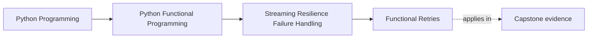

# Functional Retries


<!-- page-maps:start -->
## Page Maps




<!-- page-maps:end -->

This lesson makes retries feel controlled rather than hopeful. Retrying is not just "do it again." It is a bounded policy choice with fairness, cleanup, and final provenance requirements.

## Start With the Retry Smell

The common anti-pattern here is easy to recognize: a nested retry loop that blocks the whole stream around one slow item. Replace that picture quickly.

- If retries are unbounded, the policy is no longer safe.
- If one item can monopolize the whole pipeline while retrying, the engine is not fair.
- If final errors do not record attempts and policy context, the retry layer has hidden important operational evidence.

> **Core question:**  
> How do you implement pure, bounded, fair retries over a `Result` stream using policies as ordinary data — guaranteeing termination, no side effects, and perfect composability with breakers and resource managers?

This lesson introduces retries as explicit policy plus engine design:

- represent retry decisions as data rather than hidden loop logic
- keep retries bounded and fair across items
- preserve composability with breakers and resource managers instead of fighting them

The motivating flaky-embedder example matters because it captures the real case where retries are valuable: transient failure, not permanent bad input.

The naïve solution is a manual retry loop:

```python
for chunk in chunks:
    r = None
    for attempt in range(5):
        r = safe_embed(chunk)   # returns Result
        if isinstance(r, Ok):
            embedded.append(r.value)
            break
        time.sleep(2 ** attempt)   # blocks everything
    if isinstance(r, Err):
        embedded.append(fallback_chunk(chunk))
```

This blocks the entire stream on one slow chunk, leaks resources on early breaker termination, and is duplicated everywhere.

The production solution applies a pure retry combinator that separates policy from execution and keeps the stream behavior reviewable.

Use this when you call flaky external services inside RAG pipelines and need per-chunk resilience without sacrificing throughput or resource safety.

**Outcome:**  
1. You will define retry policies as pure data and apply them with a single combinator that works on any `Result` stream.  
2. You will get bounded, fair retries with full provenance on final errors.  
3. You will ship a RAG pipeline that automatically retries transient failures while respecting breakers and resource cleanup.

This section formalises exactly what you should review in retry code: bounded execution, fairness, purity, completion guarantees, and clean composition with the rest of the resilience stack.

---

## Concrete Motivating Example

Same 100 000 chunk tree from previous cores:

- 95 000 embed successfully on first try.
- 4 800 hit transient network timeout → succeed on retry 2–3.
- 200 are genuine failures (invalid content).

Desired behaviour:

```python
embedded = retry_map_iter(
    safe_embed,                  # returns Result[Chunk, ErrInfo]
    chunks_with_path,
    classifier=is_transient_err,
    policy=exp_policy(total_attempts=5, base_ms=100, cap_ms=5000),
    inflight_cap=128,
)

# → Iterator[Result[Chunk, ErrInfo]]
# Retries happen fairly; total work ≈ 100k + ~10k retries
# Final Errs annotated with attempt count, next_delay_ms, etc.
```

---

## 1. Laws & Invariants (machine-checked)

| Law                          | Formal Statement                                                                                            | Enforcement |
|------------------------------|-------------------------------------------------------------------------------------------------------------|-------------|
| **Bounded Execution**        | At most `max_attempts` calls per input item (engine cap overrides policy).                               | `test_bounded_attempts`, `test_engine_cap_overrides_policy`. |
| **Purity**                   | Deterministic on (inputs, policy); no side effects, no sleeps, no mutation.                               | Reproducibility + no global state. |
| **Fairness**                 | No item is starved; progress guaranteed within `inflight_cap` window (round-robin priming).               | `test_fairness_interleaving`. |
| **Completion**               | All items eventually complete under bounded retries; completion order is implementation-defined (fair within window). | `test_retry_completion`. |
| **Provenance**               | Final `Err` annotated with `attempt`, `max_attempts`, `policy`, `next_delay_ms` when E supports it.        | `test_final_err_annotation`. |

These laws guarantee retries are safe, observable, and composable.

---

## 2. Decision Table – Which Policy Do You Actually Use?

| Failure Pattern                        | Need Backoff? | Need Jitter? | Recommended Policy |
|----------------------------------------|---------------|--------------|--------------------|
| Simple transient (network blip)        | No            | No           | `fixed_policy(3)` |
| Rate-limited API                       | Yes           | Optional     | `exp_policy(7, base_ms=200, cap_ms=30000)` |
| Very flaky service                     | Yes           | Yes          | Custom policy with jitter |
| Custom logic (e.g. retry only 5xx)     | –             | –            | User-defined `Policy` |

**Always** combine with engine `max_attempts` cap and Core 7 breakers for global safety.

---

## 3. Public API Surface (end-of-Module-04 refactor note)

Refactor note: retries live in `funcpipe_rag.policies.retries` (`capstone/src/funcpipe_rag/policies/retries.py`) and are re-exported from `funcpipe_rag.api.core`.

```python
from funcpipe_rag.api.core import (
    RetryCtx,
    RetryDecision,
    exp_policy,
    fixed_policy,
    is_retriable_errinfo,
    restore_input_order,
    retry_map_iter,
)
```

---

## 4. Reference Implementations

### 4.1 Core Retry Engine (fair, bounded, pure)

```python
from collections import deque

def _annotate_err(
    e: E,
    *,
    attempt: int,
    max_attempts: int,
    policy: str,
    next_delay_ms: int | None = None,
) -> E:
    """Annotate error if it supports _replace and ctx (ErrInfo does)."""
    if hasattr(e, "_replace") and hasattr(e, "ctx"):
        ctx = dict(e.ctx) if e.ctx else {}
        ctx.update({
            "attempt": attempt,
            "max_attempts": max_attempts,
            "policy": policy,
        })
        if next_delay_ms is not None:
            ctx["next_delay_ms"] = next_delay_ms
        e = e._replace(ctx=MappingProxyType(ctx))  # type: ignore
    return e

def retry_map_iter(
    fn: Callable[[X], Result[Y, E]],
    xs: Iterable[X],
    *,
    classifier: Classifier,
    policy: Policy,
    stage: str,
    key_path: Callable[[X], tuple[int, ...]] | None = None,
    max_attempts: int = 10,
    policy_name: str | None = None,
    inflight_cap: int = 64,
) -> Iterator[Result[Y, E]]:
    """Pure, fair, bounded retry over a Result-returning fn."""
    if max_attempts < 1:
        raise ValueError("max_attempts >= 1")
    if inflight_cap < 1:
        raise ValueError("inflight_cap >= 1")

    name = policy_name or getattr(policy, "__name__", "anonymous")
    it = iter(xs)
    work: deque[tuple[X, int]] = deque()  # (item, attempt)

    def prime() -> None:
        while len(work) < inflight_cap:
            try:
                work.append((next(it), 1))
            except StopIteration:
                break

    prime()

    while work:
        x, attempt = work.popleft()
        r = fn(x)

        if isinstance(r, Ok):
            yield r
            prime()
            continue

        e = r.error
        if not classifier(e):
            yield Err(_annotate_err(e, attempt=attempt, max_attempts=max_attempts, policy=name))
            prime()
            continue

        p = key_path(x) if key_path is not None else ()
        ctx = RetryCtx(item=x, attempt=attempt, error=e, stage=stage, path=p, policy_name=name)
        try:
            dec = policy(ctx)
        except Exception as pe:
            dec = RetryDecision(retry=False, next_delay_ms=None)

        if dec.retry and attempt < max_attempts:
            work.append((x, attempt + 1))
        else:
            yield Err(_annotate_err(
                e,
                attempt=attempt,
                max_attempts=max_attempts,
                policy=name,
                next_delay_ms=dec.next_delay_ms,
            ))
        prime()
```

### 4.2 Policies (pure data → decision)

```python
def fixed_policy(total_attempts: int) -> Policy:
    def p(ctx: RetryCtx[Any, Any]) -> RetryDecision:
        return RetryDecision(retry=ctx.attempt < total_attempts, next_delay_ms=None)
    p.__name__ = f"fixed_policy[{total_attempts}]"
    return p

def exp_policy(total_attempts: int, base_ms: int, cap_ms: int) -> Policy:
    def p(ctx: RetryCtx[Any, Any]) -> RetryDecision:
        delay = min(cap_ms, base_ms * (2 ** (ctx.attempt - 1)))
        return RetryDecision(retry=ctx.attempt < total_attempts, next_delay_ms=delay)
    p.__name__ = f"exp_policy[{total_attempts},{base_ms},{cap_ms}]"
    return p
```

### 4.3 Default Classifier

```python
def is_retriable_errinfo(e: Any) -> bool:
    code = getattr(e, "code", None)
    return code in {"RATE_LIMIT", "TIMEOUT", "CONN_RESET", "EMBED/UNAVAILABLE", "TRANSIENT"}
```

### 4.4 Resequencer (restore input order when needed)

```python
def restore_input_order(
    tagged: Iterable[tuple[int, Result[Y, E]]],
) -> Iterator[Result[Y, E]]:
    """Restore input order from (idx, result) pairs. Assumes indices are 0-based consecutive integers."""
    buffer: dict[int, Result[Y, E]] = {}
    expect = 0
    for idx, r in tagged:
        buffer[idx] = r
        while expect in buffer:
            yield buffer.pop(expect)
            expect += 1
```

### 4.5 Idiomatic RAG Usage

```python
embedded = retry_map_iter(
    safe_embed,                  # returns Result[Chunk, ErrInfo]
    chunks_with_path,
    classifier=is_retriable_errinfo,
    policy=exp_policy(total_attempts=5, base_ms=100, cap_ms=10000),
    stage="embed",
    key_path=lambda cp: cp[1],
    inflight_cap=128,
    max_attempts=10,   # hard engine cap
)

# Optional: restore input order if downstream requires it
embedded = restore_input_order(enumerate(embedded))

for r in circuit_breaker_rate_emit(embedded, max_rate=0.2):
    if isinstance(r, Err) and isinstance(r.error, BreakInfo):
        report_circuit_break(r.error)
        break
    process(r)
```

---

## 5. Property-Based Proofs (`capstone/tests/test_retries.py`)

```python
from hypothesis import given, strategies as st
from collections import defaultdict

@given(items=st.lists(st.integers()))
def test_bounded_attempts(items):
    attempts = defaultdict(int)
    def fn(x: int) -> Result[int, str]:
        attempts[x] += 1
        return Ok(x) if attempts[x] >= 3 else Err("TRANSIENT")
    out = list(retry_map_iter(
        fn, items,
        classifier=lambda e: e == "TRANSIENT",
        policy=fixed_policy(5),
        stage="test",
        max_attempts=10,
    ))
    assert all(a <= 5 for a in attempts.values())

@given()
def test_engine_cap_overrides_policy():
    attempts = [0]
    def fn(_):
        attempts[0] += 1
        return Err("TRANSIENT")
    def always_retry(_): return RetryDecision(True, None)
    out = list(retry_map_iter(
        fn, [0],
        classifier=lambda _: True,
        policy=always_retry,
        stage="test",
        max_attempts=4,
    ))
    assert attempts[0] == 4

@given(items=st.lists(st.integers(), min_size=10))
def test_fairness_interleaving(items):
    attempts = defaultdict(int)
    def fn(x: int):
        attempts[x] += 1
        return Ok(x) if attempts[x] >= 2 else Err("TRANSIENT")
    out = list(retry_map_iter(
        fn, items,
        classifier=lambda _: True,
        policy=fixed_policy(3),
        stage="test",
        inflight_cap=4,
    ))
    # Every item gets at least one chance before any gets a third
    assert max(attempts.values()) <= min(attempts.values()) + 1

@given(items=st.lists(st.integers()))
def test_retry_completion(items):
    tagged = list(enumerate(items))
    attempts = defaultdict(int)
    def fn(iv: tuple[int, int]):
        i, v = iv
        attempts[i] += 1
        needed = (v % 5) + 1
        return Ok(iv) if attempts[i] >= needed else Err("TRANSIENT")
    results = list(retry_map_iter(
        fn, tagged,
        classifier=lambda _: True,
        policy=fixed_policy(10),
        stage="test",
        inflight_cap=32,
    ))
    # All items eventually complete
    assert len(results) == len(items)

@given(items=st.lists(st.integers()))
def test_final_err_annotation(items):
    def fn(x: int) -> Result[int, str]:
        return Err("TRANSIENT")
    out = list(retry_map_iter(
        fn, items,
        classifier=lambda _: True,
        policy=fixed_policy(3),
        stage="test",
        max_attempts=5,
    ))
    for r in out:
        assert isinstance(r, Err)
        e = r.error
        assert e == "TRANSIENT"  # annotation skipped for str errors
```

---

## 6. Big-O & Allocation Guarantees

| Variant         | Time                          | Heap                                 | Laziness |
|-----------------|-------------------------------|--------------------------------------|----------|
| retry_map_iter  | O(N × max_attempts) worst-case | O(inflight_cap)                      | Yes      |

Work is bounded by `max_attempts` and queued state by `inflight_cap`.
`retry_map_iter` primes that bounded queue before its first output, so it can
request ahead. The policy functions are pure decisions; the attempted function
may still perform effects.

---

## 7. Anti-Patterns & Immediate Fixes

| Anti-Pattern                            | Symptom                     | Fix                                      |
|-----------------------------------------|-----------------------------|------------------------------------------|
| Infinite retries                        | Non-termination             | Always bound via policy + engine cap     |
| Blocking sleep in retry                 | Pipeline stalls             | Policy returns delay only; schedule async |
| Head-of-line blocking                   | One slow item delays all    | Bounded `inflight_cap` + fair priming   |
| Mutable retry state                     | Nondeterminism              | Policy as pure data                      |

---

## Trace classification, fairness, and order separately

Retry is not “try the same thing again.” It is a policy chain:

```text
Err
 |
 +-- classifier says permanent --> emit final Err
 |
 +-- classifier says transient --> ask policy
                                  |
                                  +-- retry and under engine cap --> requeue
                                  +-- otherwise ------------------> emit final Err
```

The learning proof submits `("transient", "stable", "permanent")` with an
in-flight cap of three:

| Attempt | Item | Outcome | Queue/output consequence |
| ---: | --- | --- | --- |
| 1 | `transient` | `EMBED/UNAVAILABLE` | Classified retryable; requeued |
| 1 | `stable` | success | Emit `STABLE` |
| 1 | `permanent` | `EMBED/INVALID` | Classified permanent; emit `Err` |
| 2 | `transient` | success | Emit `TRANSIENT` |

The completion order is therefore `STABLE`, permanent failure, `TRANSIENT`.
Fair scheduling prevents the first item's retry from blocking every later
item, but it does not preserve source order.

Run:

```bash
course=programs/python-programming/python-functional-programming
state="$course/capstone/module-reference-states/module-04"
venv=artifacts/venv/python-programming/python-functional-programming/capstone

PYTHONPATH="$state/src" \
  "$venv/bin/pytest" -q \
  "$state/tests/learning/test_module_04_resilient_streaming.py" \
  -k retry_classification
```

The permanent failure's context records `attempt == 1`, proving that
classification prevented a retry. The transient call count proves one retry.
Neither assertion proves real time passed between attempts.

`exp_policy` returns `next_delay_ms` as data. The synchronous Module 04 engine
does not sleep. A scheduler can interpret that decision later; silently adding
`sleep()` here would mix time effects into a reusable policy loop and stall all
queued work.

Review retries in this order:

| Question | Required answer before enabling retry |
| --- | --- |
| Is the failure transient according to stable domain evidence? | A narrow classifier |
| Is the operation safe to repeat? | Idempotency key, transaction rule, or proof it is read-only |
| Which limit is authoritative? | Policy limit and hard engine cap |
| Can one item monopolize progress? | Fair bounded scheduling |
| Does downstream require source order? | Explicit resequencing and its buffer bound |
| Who performs delay? | A named time/scheduling boundary |
| What evidence survives final failure? | Attempt, policy, stage, path, and optional delay |

For embedding, deterministic computation is safe to repeat. A remote provider
request may also need a request identity to avoid duplicate billing or writes.
Retrying a non-idempotent index mutation just because its error code looks
transient is not safe.

## 8. Pre-Core Quiz

1. Which errors reach the policy? → **Only errors the classifier marks
   retryable.**
2. What wins if policy keeps retrying past `max_attempts`? → **The engine cap.**
3. Does `next_delay_ms` cause waiting? → **No; it is decision data for a
   scheduler.**
4. What does fairness cost? → **Completion order may differ from source order.**
5. What must be established before retrying an effect? → **That repeating it is
   safe under the operation's idempotency or transaction contract.**

## 9. Post-Core Exercise

Add a second transient item that needs three attempts.

- Predict completion order before running.
- Prove the permanent item still receives exactly one attempt.
- Lower the engine cap below the policy limit and prove the cap wins.
- Record the final attempt metadata on an exhausted `ErrInfo`.
- State whether source order matters for the next FuncPipe stage and, if so,
  what must be tagged and buffered to restore it.

Move forward when retryability, repeat safety, attempt count, fairness, and
delay ownership are separate review decisions.

**Continue with:** [Structured Error Reports](../module-04-streaming-resilience-failure-handling/structured-error-reports.md)

The final core folds terminal record failures and policy events into bounded
evidence that an operator can inspect.
