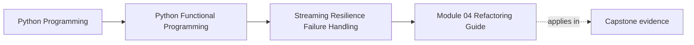

# Module 04 Refactoring Guide


<!-- page-maps:start -->
## Page Maps




<!-- page-maps:end -->

Read the first diagram as a placement map: this page is one concept inside its parent module, not a detached essay, and the capstone is the pressure test for whether the idea holds. Read the second diagram as the working rhythm for the page: name the problem, study the example, identify the boundary, then carry one review question forward.

This guide closes Module 04. The goal is to leave the module knowing how a streaming
pipeline fails, retries, and cleans up without making those choices invisible.

## Name the contract before moving code

Module 03 already has valuable behavior:

- document normalization and chunking are deterministic;
- successful chunks retain encounter order;
- iterator stages can be consumed by prefix;
- bounded helpers do not require full materialization; and
- the live application remains a recognizable document-to-chunk pipeline.

Module 04 adds resilience around that flow. It does not authorize a rewrite of
the successful path or a conversion of every exception into `Err`.

Write the preservation statement before editing:

> For accepted Module 03 inputs with no injected failures, Module 04 emits the
> same successful RAG values in the same order and requests no more input than
> its consumer or declared bound requires.

Then write the intentional additions separately:

- hierarchical documents can be traversed without recursive call-stack growth;
- expected record failures can travel beside successes;
- aggregation and early termination have named policies;
- partial consumption has an explicit resource owner;
- transient failures can receive bounded fair retries; and
- terminal outcomes can be summarized as bounded structured evidence.

This separation matters because the Module 03→04 diff also splits the large
`api/core.py` surface into `api/chunking.py`, `api/rag_api.py`, and
`api/streaming_rag.py`. File movement is not proof of new behavior.

## Stable comparison route

From the repository root:

```bash
make PROGRAM=python-programming/python-functional-programming history-refresh

course=programs/python-programming/python-functional-programming
before="$course/capstone/_history/worktrees/module-03"
after="$course/capstone/_history/worktrees/module-04"

diff -ru "$before/src/funcpipe_rag" "$after/src/funcpipe_rag"
```

Read the comparison in this order:

1. `rag_types.py` for the new `TextNode` and `TreeDoc` input shape;
2. `tree/` for traversal and folds;
3. Module 03 `result.py` versus Module 04 `result/` for the expanded failure
   data and stream operations;
4. `policies/` for memoization, breakers, resources, retries, and reports;
5. `api/rag_api.py` and `api/streaming_rag.py` for preserved RAG behavior after
   the file split; and
6. tests, especially the cumulative learning proof, before drawing conclusions
   from implementation details.

## Before and after

The unsafe refactor puts policy inside one loop:

```python
for chunk in chunks:
    try:
        value = embed(chunk)
        index(value)
    except Exception:
        sleep(1)
        # retry, log, or stop depending on hidden local state
```

It is difficult to tell:

- which exceptions are retryable;
- whether indexing is safe to repeat;
- how many attempts are possible;
- whether later chunks receive a chance;
- what happens to source order;
- who closes `chunks` after `break`; or
- which evidence reaches the final report.

The Module 04 target keeps those decisions visible:

```text
managed source
    -> typed embedding outcomes
    -> retry classifier + bounded policy
    -> emitting breaker
    -> structured terminal report
```

This is not necessarily fewer lines. It is a reviewable ownership change:
domain-aware adapters classify failures, pure policies decide, the iterator
engine controls demand, the context owns lifetime, and the report consumes
terminal evidence.

## Refactor in behavior-preserving cuts

### Characterize the successful path

Run the existing RAG API and streaming tests in Modules 03 and 04 before
changing failure behavior. Compare complete chunk values, not only counts.

Do not combine a normalization change, an API file split, and failure
translation in one cut. A difference would have three possible causes.

### Introduce hierarchy beside flat ingestion

Add `TreeDoc` traversal as a new accepted shape and compare its shallow output
with the recursive specification. Keep the flat `RawDoc` route working. A
stack-safe implementation is an addition; silently changing every document
into a tree is a separate application contract.

### Expand `Result` without changing all exceptions

Move the small Module 03 result surface into the Module 04 package while
preserving public imports used by the RAG API. Translate only expected
record-level failures at named boundaries. Keep invariant violations and
process-level control exceptions outside the value stream.

### Add one policy at a time

Use this dependency order:

1. carry `Result` values without dropping position;
2. choose fail-fast, collect, or partial-success aggregation;
3. add a breaker only when a terminal threshold is defined;
4. put resource ownership around the consumer;
5. add retry only after classification and repeat safety are explicit; and
6. build the report from final outcomes and terminal policy events.

The order prevents circular reasoning. A retry classifier needs typed failure.
A breaker needs observable failures. Cleanup needs a real early-termination
path. A report needs stable codes from all earlier decisions.

### Treat memoization as an independent optimization

Memoization is not failure recovery. Characterize uncached output, define a key
that includes every observed semantic input, and compare complete cached and
uncached values. Keep this cut separate from retries; otherwise a lower call
count could be caused by caching, early termination, or changed attempt
policy.

## Preservation versus deliberate tightening

| Change | Preservation expectation |
| --- | --- |
| Split `api/core.py` into owned RAG files | Same accepted successful outputs and public behavior |
| Replace recursive production traversal | Same preorder values and paths on finite valid trees |
| Add fused fold | Same observations as separate folds |
| Memoize deterministic embedding | Same values for every semantic input represented by the key |
| Wrap expected failure in `ErrInfo` | Same success value; failure now has explicit provenance |
| Add fair retries | Same value after eventual success; completion order may deliberately change |
| Add an emitting breaker | Consumed prefix preserved; one terminal policy value deliberately added |
| Manage the source with a context | Same consumed values; cleanup now guaranteed for cooperative iterators |
| Cap report samples | Counts preserved for consumed values; excess sample bodies deliberately omitted |

Do not label a change “preserved” if its output order, demand, or error meaning
changed. State the tightening explicitly and give it a separate test.

## Runnable review route

From the repository root:

```bash
course=programs/python-programming/python-functional-programming
state="$course/capstone/module-reference-states/module-04"
venv=artifacts/venv/python-programming/python-functional-programming/capstone

# Ten decision-focused examples.
PYTHONPATH="$state/src" \
  "$venv/bin/pytest" -q \
  "$state/tests/learning/test_module_04_resilient_streaming.py"

# The complete Module 04 reference-state proof.
PYTHONPATH="$state/src" \
  "$venv/bin/pytest" -q \
  "$state/tests"
```

Read a failure by layer:

| Failed assertion | First surface to inspect |
| --- | --- |
| Tree text, depth, or path differs | `tree/_traversal.py` |
| Fused and separate observations differ | `tree/folds.py` |
| Cache calls or values differ | `policies/memo.py` and the semantic key |
| `ErrInfo` loses stage/path | Boundary translation and `result/types.py` |
| Source demand exceeds prefix | `result/stream.py` or the parallel in-flight bound |
| Trigger output is off by one | `policies/breakers.py` threshold semantics |
| Cleanup flag remains false | Context ownership and `policies/resources.py` |
| Attempts exceed policy/cap | Classifier, policy, and `policies/retries.py` |
| JSON conversion fails | Nested error normalization in `policies/reports.py` |

The report serialization regression deserves special attention. `BreakInfo`
can contain an `ErrInfo` whose retry context is a `mappingproxy`. Serializing
the breaker field by field preserves that nested evidence; blindly applying
`dataclasses.asdict()` attempts a deep copy and fails.

## Downstream continuity

Module 04 establishes the `tree`, `result`, and `policies` contracts used by
Modules 05 through 10. After changing any of those source contracts:

1. replay `test_module_04_resilient_streaming.py` against Modules 04 through 09
   and the live capstone;
2. propagate the source repair through every affected state;
3. run history refresh and verification;
4. inspect Module 05's delta so it still begins from the behavior Module 04
   actually owns; and
5. verify Module 10 remains the cumulative endpoint.

Passing only the Module 04 snapshot is insufficient when a later snapshot
silently drops cleanup, retry metadata, or report serialization.

## Review checklist

- [ ] The previous successful RAG output is characterized before refactoring.
- [ ] Behavioral additions are separated from the API file split.
- [ ] Tree traversal preserves preorder and bounded prefix demand.
- [ ] Fold fusion preserves each separately computed observation.
- [ ] Memo keys include every input the cached operation observes.
- [ ] Expected absence, record failure, invariant failure, and cancellation are
      not collapsed into one representation.
- [ ] Result streams retain position and provenance.
- [ ] Aggregation states both result semantics and source demand.
- [ ] Breaker thresholds define whether the crossing error is retained.
- [ ] Resource acquisition and consumption occur inside one owning context.
- [ ] Retry classification, repeat safety, policy limit, engine cap, delay
      ownership, fairness, and order are reviewed separately.
- [ ] Reports distinguish record errors from terminal policy events and bound
      the intended dimensions.
- [ ] Nested breaker error context survives JSON conversion.
- [ ] Every affected downstream reference state passes the Module 04 proof.

## Exit standard

Before Module 05, you should be able to narrate one run from hierarchical source
to terminal report:

1. which input was requested;
2. which deterministic work was reused;
3. which outcomes were absent, failed, or exceptional;
4. how far each aggregation or breaker consumed;
5. which failed items were retried and in what completion order;
6. why the source closed;
7. which final evidence was counted or sampled; and
8. which Module 03 successful behavior remained unchanged.

Finish the [Module 04 Exercises](exercises.md), review your work with
[Exercise Answers](exercise-answers.md), and run the focused proof before
moving on. If any answer depends on “the helper handles it,” trace the helper
and its test until the contract is observable.
