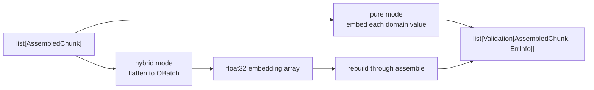

# ADT Performance: Prove Meaning Before Claiming Speed

Algebraic data types create ordinary Python objects. In some workloads, a flat
or array-backed representation may reduce interpreter overhead or make a
numeric library usable. That possibility does not justify replacing clear
domain values on suspicion.

Module 5 therefore treats optimization as two separate questions:

1. Does another representation preserve the behavior we care about?
2. Is it measurably better for a representative workload?

The checked-in FuncPipe evidence answers the first question. It does **not**
currently contain a benchmark proving the hybrid path faster.

## The reference path and experimental path

The focused assembly lab has a clear per-value operation:

```python
def pure_embed(
    chunk: AssembledChunk,
) -> Validation[AssembledChunk, ErrInfo]:
    model = chunk.metadata.embedding_model or "unknown"
    embedding = Embedding(
        vector=_embed_one(chunk.text.content),
        model=model,
    )
    return assemble(chunk.text, chunk.metadata, embedding)
```

The hybrid route temporarily flattens a batch:

```text
list[AssembledChunk]
    -> OBatch(rows, embeddings=None)
    -> OBatch(rows, embeddings=float32 array)
    -> list[Validation[AssembledChunk, ErrInfo]]
```

`OChunk` stores scalar and list fields convenient for batch work. `OBatch`
stores all embedding vectors in one NumPy array. Neither type is exported as
the public result of `process_batch_hybrid`; values return through `assemble`.



The shared output type makes comparison possible. It does not make the two
implementations equivalent automatically.

## Build a preservation ledger

Before comparing code, list the observables that representation conversion
must preserve:

| Observable | Pure/hybrid expectation |
| --- | --- |
| batch length | equal |
| item order | equal |
| `AssembledChunk.id` | equal |
| text content | equal |
| source and tags | equal after the same assembly normalization |
| expected model and dimension | equal |
| success versus failure | corresponding variant |
| failure errors | equal and in the same order |
| embedding model | equal |
| embedding vector | numerically equal within declared tolerance |

This ledger prevents an attractive vector comparison from hiding reordered
items, replaced IDs, or discarded metadata.

## Run the application-level comparison

From `programs/python-programming/python-functional-programming`:

```bash
PYTHONPATH=capstone/module-reference-states/module-05/src \
../../../artifacts/venv/python-programming/python-functional-programming/capstone/bin/python \
  - <<'PY'
from funcpipe_rag.fp.validation import VSuccess
from funcpipe_rag.rag.domain import (
    AssembledChunk,
    ChunkMetadata,
    ChunkText,
    process_batch_hybrid,
)

chunk = AssembledChunk(
    text=ChunkText("representation proof"),
    metadata=ChunkMetadata(
        source="lesson",
        tags=("typed",),
        embedding_model="local",
    ),
)
pure = process_batch_hybrid([chunk], mode="pure")
hybrid = process_batch_hybrid([chunk], mode="hybrid")

assert isinstance(pure[0], VSuccess)
assert isinstance(hybrid[0], VSuccess)
print(pure[0].value.id == hybrid[0].value.id)
print(pure[0].value.metadata == hybrid[0].value.metadata)
print(pure[0].value.embedding.vector == hybrid[0].value.embedding.vector)
PY
```

Expected output:

```text
True
True
True
```

For this deterministic implementation and input, vectors compare exactly.
Tests still use `pytest.approx`/`numpy.allclose` because the representation is
explicitly `float32` and future numeric implementations may take different
rounding paths.

## Trace the conversion, field by field

`to_optimized_batch` changes representation:

- UUID remains a UUID;
- `ChunkText.content` becomes a string field;
- tuple tags become a mutable list internal to `OChunk`;
- metadata constraints become scalar fields;
- embeddings are initially absent from the array.

After `embed_many`, `from_optimized_batch` reverses the shape:

- list tags become a tuple;
- the NumPy row becomes a tuple of Python floats;
- model metadata and the vector create `Embedding`;
- `assemble` rechecks model/dimension agreement;
- `dataclasses.replace` restores the original UUID.

That final UUID replacement is easy to overlook. Without it, output text and
vectors could be correct while identity changed.

The internal mutability of `OBatch` is a scoped compromise. It is acceptable
only while callers cannot mistake the intermediate object for a validated
domain result.

## What the implementation does not prove

The name `embed_many` may suggest vectorized computation, but the current code
uses a Python list comprehension around `_embed_one` and then calls
`numpy.asarray`. It consolidates representation; it does not demonstrate that
the hash calculation itself runs as one vectorized numeric kernel.

Therefore these claims would be unsupported:

- “the hybrid path is 30–100 times faster”;
- “NumPy always allocates less memory here”;
- “the path is zero-copy”;
- “property tests prove performance”;
- “using an array makes execution parallel.”

A benchmark must measure both modes with representative batch sizes, warm-up,
repeat policy, Python/NumPy versions, and memory method. Only then can a change
make a quantified performance claim.

## Correctness evidence and performance evidence

| Question | Appropriate evidence |
| --- | --- |
| Are IDs, order, metadata, variants, and vectors preserved? | example tests and property-based equivalence tests |
| Does an invalid metadata/embedding agreement fail the same way? | paired failure tests |
| Is float drift within an accepted tolerance? | numeric comparison with documented `rtol`/`atol` |
| Is hybrid faster for the target batch distribution? | benchmark with representative data |
| Does hybrid use less peak memory? | repeatable memory measurement |
| Is the extra representation worth maintaining? | profile plus code-review judgment |

Do not let a benchmark replace equivalence tests, or equivalence tests replace
a benchmark. They answer different questions.

## Property tests strengthen, but bound, the claim

`test_perf_equivalence.py` generates batches of `AssembledChunk` values and
compares pure and hybrid results. Read the strategy before summarizing the
proof:

- batch size is bounded;
- text and metadata strings are bounded;
- starting embeddings are absent;
- `expected_dim` is `None`;
- numeric comparisons use explicit tolerance.

The property test covers many values inside that domain. It does not quantify
all Python values or every future metadata rule.

The application-level learning test uses one deliberately readable value:

```bash
PYTEST_DISABLE_PLUGIN_AUTOLOAD=1 \
PYTHONPATH=capstone/module-reference-states/module-05/src \
../../../artifacts/venv/python-programming/python-functional-programming/capstone/bin/pytest \
  -q capstone/module-reference-states/module-05/tests/learning/test_module_05_data_modelling.py \
  -k hybrid_embedding
```

Use the readable example to understand the ledger, then the generated test to
broaden confidence.

## Guard the intermediate representation

`from_optimized_batch` assumes the embeddings array has one row per `OChunk`.
An externally constructed `OBatch` with mismatched row counts can fail with an
index error. The current route is safe because `process_batch_hybrid` creates
both pieces together.

If `OBatch` becomes a public or persisted boundary, it will need explicit
shape validation:

```text
embeddings.shape == (len(rows), expected_dimension)
```

That is a good example of optimization expanding the invariant surface. A
private intermediate can rely on construction discipline; a public value needs
validation and useful failures.

## Decide whether the compromise is earned

Before retaining an optimized representation, answer:

1. Which profile identifies representation as a bottleneck?
2. Which public observables form the equivalence ledger?
3. Which numeric tolerance is acceptable, and why?
4. Where is mutable or untyped state confined?
5. Can the clear reference path remain executable?
6. What new invalid intermediate states have been introduced?
7. Which benchmark demonstrates a worthwhile gain?

For this course state, the honest conclusion is: the hybrid route is a useful
representation-equivalence exercise, while its performance benefit remains to
be measured.

## Check your understanding

1. Why is comparing only embedding vectors insufficient?
2. Which conversion step restores `AssembledChunk.id`?
3. Why does `numpy.asarray` not itself prove vectorized speedup?
4. What domain does the property strategy actually generate?
5. What validation would be required if `OBatch` became public?

Continue to the [Refactoring Guide](refactoring-guide.md) when you can separate
semantic equivalence, numeric tolerance, measured speed, and maintenance cost.
