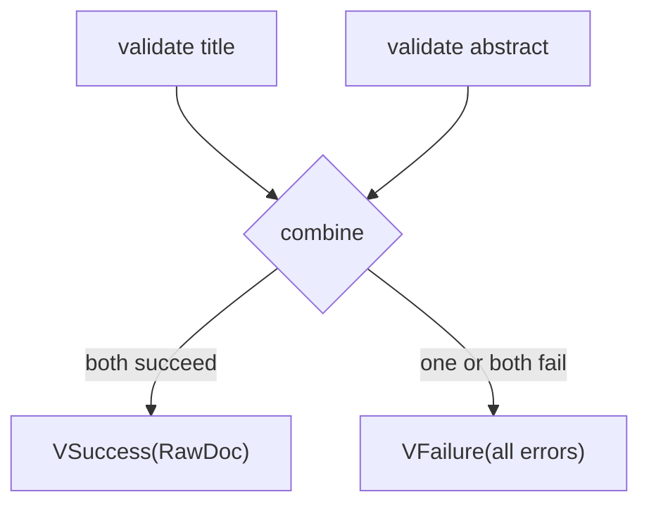

# Applicative Validation: Report Independent Problems Together

A `Result` normally stops at the first failure. That is correct when the next
operation needs the previous value: there is no reason to embed a chunk if
reading its source failed.

But some checks do not depend on one another. A title can be checked without a
valid abstract, and an embedding's model can be checked without a matching
dimension. Reporting only one of those problems makes a learner or API client
repeat the same validation cycle.

Applicative validation gives independent checks a different contract:

> Run every check, preserve every successful value needed for construction,
> and combine all failures in a deliberate order.

## Independence is the deciding question

Consider two checks for a `RawDoc`:

```python
def title(raw: str) -> Validation[str, str]:
    return v_success(raw) if raw.strip() else v_failure(("title required",))

def abstract(raw: str) -> Validation[str, str]:
    return (
        v_success(raw)
        if len(raw.split()) >= 2
        else v_failure(("abstract too short",))
    )
```

Neither check needs the other's successful output. They should both run.

```python
def build(good_title: str, good_abstract: str) -> RawDoc:
    return RawDoc("validation-1", good_title, good_abstract, "fp")

validated = v_liftA2(build, title(" "), abstract("brief"))
```

The result is:

```python
VFailure(errors=("title required", "abstract too short"))
```

`v_liftA2` means “lift a two-argument plain function so it can receive two
independently validated arguments.” If both inputs succeed, it calls `build`.
If either fails, it does not call `build`; it returns all collected errors.

## The two possible shapes

FuncPipe's `Validation[T, E]` is a sum:

```python
Validation[T, E] = VSuccess[T, E] | VFailure[E]
```

`VFailure.errors` is a non-empty tuple. An empty failure would say “construction
failed, but nothing was wrong,” so the smart constructor rejects it.



Notice what the diagram does not contain: an arrow from title validation to
abstract validation. That absence represents independence.

## Run the complete example

From `programs/python-programming/python-functional-programming`:

```bash
PYTHONPATH=capstone/module-reference-states/module-05/src \
../../../artifacts/venv/python-programming/python-functional-programming/capstone/bin/python \
  - <<'PY'
from funcpipe_rag.core.rag_types import RawDoc
from funcpipe_rag.fp.validation import v_failure, v_liftA2, v_success

def title(raw):
    return v_success(raw) if raw.strip() else v_failure(("title required",))

def abstract(raw):
    return (
        v_success(raw)
        if len(raw.split()) >= 2
        else v_failure(("abstract too short",))
    )

def build(good_title, good_abstract):
    return RawDoc("validation-1", good_title, good_abstract, "fp")

print(v_liftA2(build, title(" "), abstract("brief")))
print(v_liftA2(build, title("ADTs"), abstract("typed values")))
PY
```

Expected output:

```text
VFailure(errors=('title required', 'abstract too short'))
VSuccess(value=RawDoc(doc_id='validation-1', title='ADTs', abstract='typed values', categories='fp'))
```

Read the output as two distinct guarantees. The first reports both independent
problems in stable left-to-right order. The second constructs a domain value
only after both inputs are available.

## How accumulation works

The central operation, `v_ap`, combines a validated function with a validated
argument:

```python
def v_ap(vf, vx, *, combine=lambda left, right: left + right):
    if isinstance(vf, VSuccess) and isinstance(vx, VSuccess):
        return v_success(vf.value(vx.value))

    left_errors = vf.errors if isinstance(vf, VFailure) else ()
    right_errors = vx.errors if isinstance(vx, VFailure) else ()
    return v_failure(combine(left_errors, right_errors))
```

The default error operation is tuple concatenation. Its behavior matters:

- order is deterministic;
- duplicates remain visible;
- `()` is the identity used when one side succeeded.

FuncPipe also provides `dedup_stable` for contexts where repeated equal errors
would add no information. Choosing it is a product decision, not a universally
better default. If two distinct checks emit the same message, deduplication may
hide useful evidence.

## The application pressure: assembling a chunk

The focused `rag.domain` model checks two independent agreements before adding
an embedding:

- the metadata's expected model matches the embedding model;
- the metadata's expected dimension matches the embedding dimension.

```python
from funcpipe_rag.rag.domain import ChunkMetadata, ChunkText, Embedding, assemble

result = assemble(
    ChunkText(content="composable chunk"),
    ChunkMetadata(
        source="lesson",
        tags=("typed", "typed", "rag"),
        embedding_model="expected-model",
        expected_dim=3,
    ),
    Embedding(vector=(0.25, 0.75), model="actual-model"),
)
```

The result contains both `EMB_MODEL_MISMATCH` and `EMB_DIM_MISMATCH`. It also
normalizes duplicate tags before constructing `AssembledChunk`. That explicit
name marks a focused assembly exercise; it does not replace the cumulative
`core.rag_types.Chunk` used by the main pipeline.

Run the proof directly:

```bash
PYTEST_DISABLE_PLUGIN_AUTOLOAD=1 \
PYTHONPATH=capstone/module-reference-states/module-05/src \
../../../artifacts/venv/python-programming/python-functional-programming/capstone/bin/pytest \
  -q capstone/module-reference-states/module-05/tests/learning/test_module_05_data_modelling.py \
  -k "applicative_validation or domain_assembly"
```

## `Result` and `Validation` answer different questions

| Situation | Dependency | Desired failure behavior | Type |
| --- | --- | --- | --- |
| read, then clean, then embed | each step needs the previous value | stop when progress is impossible | `Result` |
| check title and abstract | checks inspect independent fields | report both problems | `Validation` |
| compare model and dimension | agreements are independent | report both mismatches | `Validation` |
| parse a number, then check its range | range check needs parsed value | parse must succeed first | sequence `Result` or validations in stages |

“Validation should show every error” does not mean every possible check can run
at once. A dependent check has no input until an earlier check succeeds. A good
validator may therefore have applicative groups separated by sequential
boundaries.

## The laws in practical language

Applicative laws constrain how construction and error accumulation behave:

- **identity:** applying a validated identity function preserves a validation;
- **homomorphism:** lifting a pure function and a pure value is the same as
  applying the function first and lifting its result;
- **composition:** regrouping applicative construction does not change the
  answer;
- **interchange:** a validated function applied to a pure value behaves
  consistently whichever side is lifted first.

You do not need to manipulate the symbolic formulas to use the API. You do need
to preserve their consequences: constructors run only with successful inputs,
errors combine associatively, and the error identity is empty.

That last condition explains why a custom `combine` function must not discard
all errors. FuncPipe raises if it returns an empty tuple for a failing
combination.

## Inspect before extending

Read the implementation:

```bash
sed -n '1,220p' \
  capstone/module-reference-states/module-05/src/funcpipe_rag/fp/validation.py
```

Look for `v_liftA2`, `v_liftA3`, `v_sequence`, and `v_traverse`. They are the
same construction idea at different arities and collection shapes. There is no
`bind` operation on this validation API: arbitrary dependency would restore
fail-fast sequencing and obscure why errors accumulate.

## Check your understanding

1. Why are title and abstract checks safe to evaluate independently?
2. Under what condition does `v_liftA2` call its construction function?
3. Why must a `VFailure` contain at least one error?
4. When might `dedup_stable` remove information you wanted to retain?
5. Why should a parse-and-range workflow have a sequential boundary?

Continue to [Monoids](monoids.md) when you can explain that applicative
validation is about the dependency graph of checks, not merely a preference for
longer error messages.
