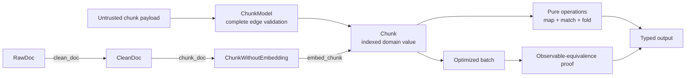

# Module 05 Capstone Delta

Module 04 left FuncPipe able to stream documents while representing recoverable
failures with `Result`, absence with `Option`, and operational failures with
structured `ErrInfo` values. Those containers make failure visible, but they do
not decide which domain states are legal, how independent validation errors
should accumulate, or how a stored value retains its meaning across a boundary.

Module 05 makes those decisions against the same RAG values. It sharpens the
distinction between a prepared and indexed chunk, reuses `Result` as the
success-or-failure sum, adds lawful mapping and aggregation, accumulates
independent validation errors, validates complete indexed chunks at the edge,
and tests representation equivalence.

## The application delta

| Delta question | Module 05 answer |
| --- | --- |
| Previous capability | Lazy and bounded RAG traversal with typed per-record failure, absence, retry, resource, and reporting policies |
| New pressure | Stage guarantees and boundary invariants are easy to lose when chunks are treated as loose fields or partial transport dictionaries |
| Concept introduced | Existing RAG products and sums made explicit, stage-typed transitions, functor mapping, applicative validation, monoidal aggregation, exhaustive matching, explicit codecs, and representation equivalence |
| Source surfaces | `core/rag_types.py`, `rag/stages.py`, `result/types.py`, `fp/functor.py`, `fp/validation.py`, `fp/monoid.py`, `rag/domain/`, and `boundaries/adapters/` |
| Proof surfaces | Module 05 law and boundary tests plus `tests/learning/test_module_05_data_modelling.py` |
| Preserved behavior | Module 04 cleaning, chunking, embedding, lazy order, bounded traversal, typed failures, retries, and resource cleanup |
| Completed state | `capstone/module-reference-states/module-05/` |
| Learner route | Run one named learning test, inspect the exact constructor or operation it exercises, then complete the matching exercise |
| Later states affected | Modules 06–09 and the live Module 10 capstone retain these value, validation, boundary, and equivalence contracts |

## Read the delta as ownership



The arrows are ownership boundaries:

- the boundary validates document identity, text, offsets, metadata, and the
  complete embedding before handing an ordinary immutable value inward;
- stage signatures make each added guarantee visible without a mutable status
  field;
- domain constructors own cross-field invariants;
- `map` changes a successful value without inventing a failure policy;
- applicative validation evaluates independent checks and preserves every
  reported problem in declared order;
- monoids aggregate only when an associative operation and identity are honest;
- pattern matching consumes a closed set of variants; and
- an optimized representation is accepted only after its public observables
  agree with the clear reference path.

## Focus the reference-state comparison

The Module 04→05 snapshot includes a broad package reorganization. The meaningful
new teaching surface is narrower:

```text
src/funcpipe_rag/
├── core/
│   └── rag_types.py
├── fp/
│   ├── functor.py
│   ├── validation.py
│   └── monoid.py
├── rag/
│   ├── stages.py
│   └── domain/
│       ├── chunk.py
│       ├── text.py
│       ├── metadata.py
│       ├── embedding.py
│       └── perf.py
├── result/
│   └── types.py
└── boundaries/adapters/
    ├── pydantic_edges.py
    └── serde.py
```

`core/rag_types.py` and `rag/stages.py` remain the primary application path.
`rag/domain/` is a later focused lab for cross-field assembly and alternative
representation; it does not replace the pipeline values. Do not read its
second `Chunk` name as another pipeline stage. The early Module 5 lessons and
proofs use the cumulative values first, so the lab has explicit context instead
of appearing as an unexplained parallel application.

`boundaries/adapters/` owns external validation and serialization so Pydantic
and transport envelopes do not leak into the core. Its `ChunkModel` converts
without discarding the document ID, offsets, metadata, or embedding.

These ownership paths begin in Module 05 and remain stable downstream. Package
movement that previously appeared only in the Module 05→06 comparison is not a
Module 06 flow concept and should not distract from that later delta.

## What changed in the RAG application

FuncPipe's Module 5 evidence now lets a learner:

- trace `RawDoc → CleanDoc → ChunkWithoutEmbedding → Chunk`;
- use the existing `Ok | Err` result instead of a parallel chunk outcome;
- prove that embedding preserves document identity, text, and offsets;
- transform successful typed values without manual unboxing;
- report all independent construction errors in one validation result;
- aggregate chunk metrics with an explicit identity and associative operation;
- reject inconsistent offsets, non-finite values, and any embedding dimension
  other than 16 at the external boundary;
- round-trip a complete indexed chunk without field loss;
- handle closed variants with structural pattern matching;
- preserve failure provenance through a versioned serialization envelope;
- assemble text, metadata, and embedding subsystems with cross-field checks; and
- choose a hybrid NumPy representation only when it preserves the clear pure
  path's observable results.

## What did not change

Module 05 does not turn the complete RAG application into one large algebraic
framework. Existing streaming and resilience behavior remains in place.
It does not add a `Pending | Running | Done | Failed` job model: the application
has no persisted job lifecycle or progress events that would justify it. The
real transformations are represented by their input and output product types.
`Result` is still the right model for dependent fail-fast work; accumulating
`Validation` is for independent checks. Pydantic remains at the edge. A monoid
is not justified for every collection, and the NumPy path is not the default
merely because it is optimized.

## Working route

1. Compare `module-reference-states/module-04/` with
   `module-reference-states/module-05/`.
2. Read this page before interpreting the broad file diff.
3. Open the current lesson and its named test in
   `tests/learning/test_module_05_data_modelling.py`.
4. Run that one test with the Module 05 `src/` directory on `PYTHONPATH`.
5. Inspect the matching law or boundary test in the Module 05 test directory.
6. Complete the exercise and state what the evidence does not prove.
7. Confirm the learning proof remains present in every downstream state.

## Preservation checklist

Before accepting a modelling change, confirm that:

- previously valid RAG input still produces the same pipeline output;
- each stage adds its guarantee without mutating the earlier value;
- embedding preserves document identity, text, offsets, and metadata;
- invalid states are rejected by the narrowest responsible constructor;
- `Result`, `Option`, and `Validation` keep distinct meanings;
- accumulated errors retain deterministic order and provenance;
- matching handles every declared variant;
- external schemas and codecs do not become core domain dependencies or discard
  domain fields during conversion;
- serialization round-trips the public value, not incidental object layout;
- an optimized representation preserves identity, order, metadata, and numeric
  results within the declared tolerance; and
- later snapshots still satisfy the Module 05 learning proofs.

Continue with [Product and Sum Types](product-and-sum-types.md).
