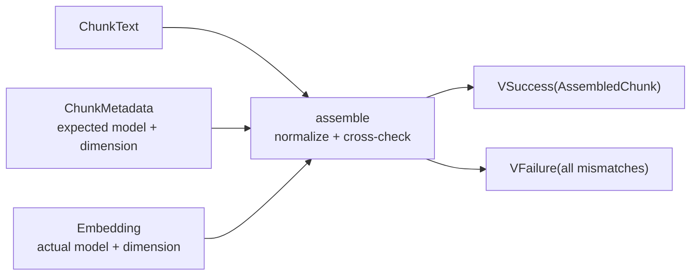

# Compositional Domain Models: Put Cross-Field Rules at the Join

The cumulative pipeline uses `core.rag_types.Chunk`. This lesson does not
replace it. Instead, Module 5 includes a focused model under `rag/domain/` to
answer one design question:

> If text, metadata, and an embedding can be understood independently, where
> should rules involving more than one of them live?

The answer is an explicit assembler. The small records own their local shape;
the assembler owns agreements that become visible only when records meet.

## The rule no subsystem can check alone

FuncPipe's focused records are:

```python
@dataclass(frozen=True, slots=True)
class ChunkText:
    content: str

@dataclass(frozen=True, slots=True)
class ChunkMetadata:
    source: str
    tags: tuple[str, ...]
    embedding_model: str | None = None
    expected_dim: int | None = None

@dataclass(frozen=True, slots=True)
class Embedding:
    vector: tuple[float, ...]
    model: str
    dim: int = field(init=False)
```

`Embedding` can prove that its values are finite and derive its dimension.
`ChunkMetadata` can record an expected model and dimension. Neither value can
decide whether those expectations agree, because neither owns the other value.

Putting the check in both classes would introduce coupling and duplicate the
policy. Deferring it until arbitrary downstream code reads the fields would
leave no clear owner.

## `assemble` is the integration boundary

The assembled product has a name that explains its scope:

```python
@dataclass(frozen=True, slots=True)
class AssembledChunk:
    id: UUID = field(default_factory=uuid4)
    text: ChunkText = field(default_factory=lambda: ChunkText(content=""))
    metadata: ChunkMetadata = field(
        default_factory=lambda: ChunkMetadata(source="", tags=())
    )
    embedding: Embedding | None = None
```

Construction goes through:

```python
def assemble(
    text: ChunkText,
    meta: ChunkMetadata,
    emb: Embedding | None = None,
) -> Validation[AssembledChunk, ErrInfo]:
    ...
```

The return type tells the reader that cross-field construction can report more
than one independent problem.



The arrows locate ownership. Text does not import metadata. Embedding does not
know the assembled product. The integration module imports all three.

## Run both assembly outcomes

From `programs/python-programming/python-functional-programming`:

```bash
PYTHONPATH=capstone/module-reference-states/module-05/src \
../../../artifacts/venv/python-programming/python-functional-programming/capstone/bin/python \
  - <<'PY'
from funcpipe_rag.fp.validation import VFailure, VSuccess
from funcpipe_rag.rag.domain import (
    ChunkMetadata,
    ChunkText,
    Embedding,
    assemble,
)

text = ChunkText("composable chunk")
invalid = assemble(
    text,
    ChunkMetadata(
        source="lesson",
        tags=("typed", "typed", "rag"),
        embedding_model="expected-model",
        expected_dim=3,
    ),
    Embedding((0.25, 0.75), "actual-model"),
)
print(type(invalid).__name__)
if isinstance(invalid, VFailure):
    print([error.code.value for error in invalid.errors])

valid = assemble(
    text,
    ChunkMetadata(
        source="lesson",
        tags=("typed", "typed", "rag"),
        embedding_model="local",
        expected_dim=2,
    ),
    Embedding((0.25, 0.75), "local"),
)
print(type(valid).__name__)
if isinstance(valid, VSuccess):
    print(type(valid.value).__name__, valid.value.metadata.tags)
PY
```

Expected output:

```text
VFailure
['EMB_MODEL_MISMATCH', 'EMB_DIM_MISMATCH']
VSuccess
AssembledChunk ('typed', 'rag')
```

Three behaviors are visible:

1. independent model and dimension mismatches are both reported;
2. successful assembly constructs the combined product;
3. repeated tags are removed without changing first-occurrence order.

## Assign each invariant to one owner

| Invariant | Owner | Reason |
| --- | --- | --- |
| embedding values are finite | `Embedding.__post_init__` | needs only the vector |
| `dim` equals vector length | `Embedding.__post_init__` | derived locally |
| tags have tuple representation | `ChunkMetadata` construction/type | local metadata shape |
| tags are unique in stable order | `assemble` | normalization policy for the combined value |
| expected model equals actual model | `assemble` | needs metadata and embedding |
| expected dimension equals actual dimension | `assemble` | needs metadata and embedding |

This is more precise than “put validation in the domain.” The narrowest owner
that has all required information should enforce the rule.

The current local products do not validate every conceivable invariant.
`ChunkText` permits an empty string and `ChunkMetadata` permits an empty source.
That may be acceptable for the focused lesson, or it may reveal missing product
pressure. Do not claim assembly makes every value globally valid.

## Updates must re-enter the boundary

Frozen dataclasses prevent direct mutation, but `dataclasses.replace` can still
create inconsistent combinations if callers use it carelessly. FuncPipe
provides checked operations:

```python
def try_set_embedding(
    chunk: AssembledChunk,
    embedding: Embedding | None,
) -> Validation[AssembledChunk, ErrInfo]:
    return assemble(chunk.text, chunk.metadata, embedding)

def map_metadata_checked(
    chunk: AssembledChunk,
    transform: Callable[[ChunkMetadata], ChunkMetadata],
) -> Validation[AssembledChunk, ErrInfo]:
    return assemble(chunk.text, transform(chunk.metadata), chunk.embedding)
```

Both routes send the new combination through the same rules. That is the
practical value of an assembler: construction and later replacement share one
integration policy.

## Why this is not the pipeline `Chunk`

The two values model different teaching surfaces:

| Cumulative pipeline | Focused assembly lab |
| --- | --- |
| `core.rag_types.Chunk` | `rag.domain.AssembledChunk` |
| document ID, text span, offsets, metadata, required 16-value embedding | `ChunkText`, structured metadata, optional model-specific embedding |
| produced by `embed_chunk` | produced by `assemble` |
| supports the RAG application from early modules onward | isolates cross-field assembly and representation equivalence in Module 5 |

Earlier versions called both classes `Chunk`, forcing aliases such as
`ModelChunk` in learning tests. `AssembledChunk` removes that accidental
collision. A learner can now see from the import which surface is being used.

The focused lab still has to earn its maintenance cost. It is justified here
because the cumulative span type does not model expected embedding model and
dimension as independent subsystem records. If those ideas later become real
pipeline requirements, convergence should happen through an explicit module
delta and preservation tests—not by silently swapping types.

## Versioning one subsystem

`ChunkMetadataV1` and `upcast_metadata_v1` illustrate a narrow evolution:

```python
@dataclass(frozen=True, slots=True)
class ChunkMetadataV1:
    source: str
    tags: list[str]

def upcast_metadata_v1(value: ChunkMetadataV1) -> ChunkMetadata:
    return ChunkMetadata(source=value.source, tags=tuple(value.tags))
```

The conversion is explicit because a mutable list representation crosses into
the current immutable tuple representation. This function proves only that
small conversion; it is not a complete persistence migration system.

## Inspect and verify

Read the small source files before the property suite:

```bash
sed -n '1,130p' \
  capstone/module-reference-states/module-05/src/funcpipe_rag/rag/domain/chunk.py

PYTEST_DISABLE_PLUGIN_AUTOLOAD=1 \
PYTHONPATH=capstone/module-reference-states/module-05/src \
../../../artifacts/venv/python-programming/python-functional-programming/capstone/bin/pytest \
  -q capstone/module-reference-states/module-05/tests/learning/test_module_05_data_modelling.py \
  -k domain_assembly
```

Then inspect `tests/test_composition.py`. Its generated examples strengthen the
evidence for stable tag normalization and agreement checks. They do not prove
that the type split matches every future RAG requirement.

## Check your understanding

1. Why can neither `ChunkMetadata` nor `Embedding` own the model-agreement
   check alone?
2. Why does `assemble` return `Validation` instead of a plain product?
3. Which operation preserves first-occurrence tag order?
4. Why should metadata replacement call `assemble` again?
5. What does the name `AssembledChunk` clarify about the cumulative pipeline?

Continue to [ADT Performance](adt-performance.md) when you can identify each
local invariant, each cross-field invariant, and the narrowest owner of both.
