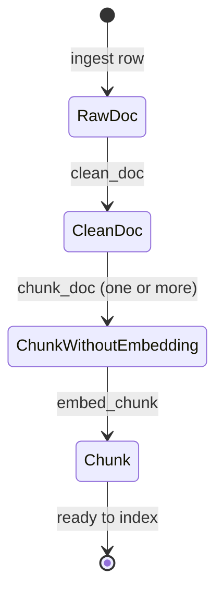

# Domain States Without an Invented State Machine

The previous lesson separated products (“these fields together”) from sums (“one of these cases”). That idea often leads to an enthusiastic next move: define `Pending`, `Running`, `Done`, and `Failed` for every workflow.

That is not the goal.

The goal is to make invalid application states difficult to express. Sometimes a state-machine ADT does that. In FuncPipe’s indexing path, the honest model is smaller: each transformation consumes one product type and produces the next.

## Start from the application pressure

At the end of Module 4, FuncPipe can clean documents, split them lazily, embed chunks deterministically, and represent failures with `Result`. Module 5 needs to make this pipeline easier to reason about without creating a second workflow beside it.

The actual state transitions are:

| Current value | Operation | Next value | New guarantee |
| --- | --- | --- | --- |
| `RawDoc` | `clean_doc` | `CleanDoc` | abstract is normalised |
| `CleanDoc` | `chunk_doc` | `list[ChunkWithoutEmbedding]` | each value has a text span |
| `ChunkWithoutEmbedding` | `embed_chunk` | `Chunk` | embedding has 16 values |

These types are snapshots of domain knowledge. There is no persistent job that moves through pending and running states, no progress event stream, and no recovery command that resumes such a job. Adding those variants would model an imaginary system.

## Read a transition from its signature

```python
def clean_doc(doc: RawDoc | CleanDoc) -> CleanDoc:
    ...

def chunk_doc(doc: CleanDoc, env: RagEnv) -> list[ChunkWithoutEmbedding]:
    ...

def embed_chunk(chunk: ChunkWithoutEmbedding) -> Chunk:
    ...
```

Each arrow tells us:

- which facts the operation requires;
- which facts it preserves;
- which guarantee it adds;
- which later operation may now run.



This diagram is a learning map, not a claim that the implementation stores a mutable state enum. Each node is a distinct immutable value.

## Run and inspect one document

From the Functional Programming directory:

```bash
PYTHONPATH=capstone/module-reference-states/module-05/src \
../../../artifacts/venv/python-programming/python-functional-programming/capstone/bin/python \
  - <<'PY'
from funcpipe_rag.core.rag_types import RagEnv, RawDoc
from funcpipe_rag.rag.stages import chunk_doc, clean_doc, embed_chunk

raw = RawDoc("states-1", "States", "  ONE   value, then another.  ", "fp")
cleaned = clean_doc(raw)
prepared = chunk_doc(cleaned, RagEnv(chunk_size=12))
indexed = [embed_chunk(chunk) for chunk in prepared]

for before, after in zip(prepared, indexed, strict=True):
    print(
        type(before).__name__,
        "->",
        type(after).__name__,
        repr(after.text),
        len(after.embedding),
    )
PY
```

Expected shape:

```text
ChunkWithoutEmbedding -> Chunk 'one value, t' 16
ChunkWithoutEmbedding -> Chunk 'hen another.' 16
```

The exact chunk boundaries follow `chunk_size=12`. The important observations are that every prepared span becomes a different type, the text survives the transition, and every final vector satisfies the domain dimension.

## Illegal routes become visible

With one loose object, calling stages in the wrong order is easy to hide. Stage-specific types make the mistake reviewable:

```python
raw = RawDoc("states-2", "Wrong order", "text", "fp")
embed_chunk(raw)  # a type checker rejects RawDoc here
```

Python will still attempt the call at runtime. Type annotations do not create a runtime gate, and the resulting attribute error is not a friendly boundary response. This is why FuncPipe also:

- validates external payloads at adapters;
- tests constructor invariants;
- keeps the pure stage functions inside a typed core;
- converts predictable boundary failures into `ErrInfo`.

The evidence is layered. Static checking catches a class of bad composition before execution; constructors reject malformed values at runtime; tests prove behavior on representative and generated inputs.

## State is not the same as mutation

Functional programs still have state in the ordinary sense: information differs before and after an operation. The important choice is how to represent change.

Here, `clean_doc(raw)` does not alter `raw`. It creates a `CleanDoc`. `embed_chunk(prepared)` does not attach a vector to `prepared`; it creates a `Chunk`.

That gives a useful local reasoning rule:

> If a function returns a later-stage value, the earlier input still means what it meant before the call.

The Module 5 learning proof checks this by comparing document ID, text, and offsets before and after embedding, and by checking the original raw abstract after cleaning.

## When an explicit state-machine ADT is earned

An explicit sum such as `Queued | Running | Completed | Failed` becomes useful when the application really has long-lived process state. Look for pressure such as:

- process status is persisted and later reloaded;
- commands are legal only in particular states;
- events may arrive out of order;
- retry policy depends on the previous attempt;
- users observe progress;
- terminal states must reject further transitions.

Then a transition function can centralise the rules:

```python
def transition(state: JobState, event: JobEvent) -> JobState:
    ...
```

But that abstraction brings work: identifiers, timestamps, serialization, illegal-event behavior, persistence semantics, and tests. Without the corresponding application behavior, it is ceremony that competes with the real RAG pipeline.

## A decision test

Before adding a state ADT, answer these in order:

1. What real operation or user-visible lifecycle has these states?
2. Where is the current state stored?
3. Which transitions are legal and illegal?
4. What must survive each transition?
5. What does a terminal state do with later events?
6. Which application test proves those rules?

If the first two answers are unclear, stage-specific input and output products are probably the better model.

## Inspect the proof

Run:

```bash
make capstone-module-state-proof MODULE=05
```

Then read `test_rag_stage_types_make_embedding_transition_explicit` in:

```text
capstone/module-reference-states/module-05/tests/learning/
└── test_module_05_data_modelling.py
```

The test proves:

- the normalisation, preparation, and embedding route is executable;
- each result has the expected stage type;
- embedding preserves identity, text, and offsets;
- the final representation has a 16-value vector;
- the original value is not mutated.

It does not prove that all external data is valid or that all effects are reliable. Boundary validation and typed failures address those separate concerns.

## Ready to continue?

Continue when you can:

- explain the current RAG state flow from function signatures;
- distinguish immutable state transitions from object mutation;
- identify what the learning proof does and does not establish;
- give a concrete reason to reject `Pending | Running | Done | Failed` here;
- name application pressures that would justify adding such a machine later.

Next, [Pydantic Smart Constructors](pydantic-smart-constructors.md) shows how untrusted data crosses into these domain states without turning Pydantic into the domain model.
