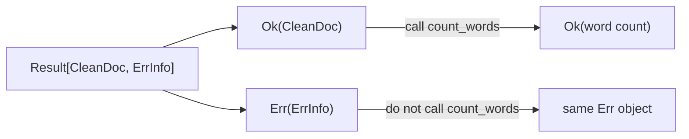

# Functors: Change the Value, Preserve the Context

The word *functor* sounds more exotic than the job it names. In this course, a
functor is a container with a lawful `map` operation:

> Apply a function to a value that may be present, successful, or part of a
> collection without changing what that surrounding context means.

For FuncPipe, the most important example is `Result`. A successful value may be
transformed. A failure must pass through untouched.

## The repetition that `map` removes

Suppose a source read has already produced `Result[CleanDoc, ErrInfo]`, and the
next calculation merely counts words:

```python
def count_words(result: Result[CleanDoc, ErrInfo]) -> Result[int, ErrInfo]:
    if isinstance(result, Err):
        return result
    return Ok(len(result.value.abstract.split()))
```

Nothing is wrong with this function in isolation. The problem appears when
every small transformation repeats the same `Err` branch. The business
operation—counting words—becomes harder to see than the container plumbing.

FuncPipe expresses the stable part once:

```python
def result_map(f):
    def _inner(result):
        if isinstance(result, Ok):
            return Ok(f(result.value))
        return result
    return _inner
```

Now the caller supplies only the changing part:

```python
word_count = result_map(lambda doc: len(doc.abstract.split()))
```

`word_count(Ok(clean_doc))` produces `Ok[int]`. Passing an `Err` returns that
same error object without calling the lambda.

## Read the shape before the syntax

Mapping changes the type inside a context:

```text
Result[CleanDoc, ErrInfo] --map(count_words)--> Result[int, ErrInfo]
```

The success type changes from `CleanDoc` to `int`. The error type and the fact
that the operation may have failed do not change.



This diagram is the whole contract. `map` is appropriate when the inner
function is a plain transformation. It is not a general replacement for
branching or sequencing.

## Run the real FuncPipe example

From `programs/python-programming/python-functional-programming`:

```bash
PYTHONPATH=capstone/module-reference-states/module-05/src \
../../../artifacts/venv/python-programming/python-functional-programming/capstone/bin/python \
  - <<'PY'
from funcpipe_rag.core.rag_types import RawDoc
from funcpipe_rag.fp.functor import result_map
from funcpipe_rag.rag.stages import clean_doc
from funcpipe_rag.result.types import Err, ErrInfo, Ok

calls = []

def count_words(doc):
    calls.append(doc.doc_id)
    return len(doc.abstract.split())

clean = clean_doc(RawDoc("map-1", "Mapping", " One  TWO three ", "fp"))
unavailable = Err(ErrInfo(code="SOURCE_DOWN", msg="read failed", stage="read"))
count = result_map(count_words)

print(count(Ok(clean)))
print(count(unavailable))
print(calls)
PY
```

Expected output:

```text
Ok(value=3)
Err(error=ErrInfo(code='SOURCE_DOWN', msg='read failed', stage='read', path=(), cause=None, ctx=None))
['map-1']
```

The final line is evidence, not decoration: the transformation ran exactly
once, for the successful value.

## Why laws matter

Any function with a name like `map` could be implemented. A *functor* promises
two laws that make refactoring predictable.

### Identity

Mapping the identity function changes nothing:

```python
identity = lambda value: value
assert result_map(identity)(result) == result
```

If this fails, merely observing a value through `map` changes the program.

### Composition

Mapping two functions in sequence must equal mapping their composition:

```python
normalise = lambda text: " ".join(text.split())
word_count = lambda text: len(text.split())
composed = lambda text: word_count(normalise(text))

left = result_map(word_count)(result_map(normalise)(result))
right = result_map(composed)(result)
assert left == right
```

This law lets you combine or split pure transformation steps without changing
success and failure behavior. Python has no built-in `>>` operator for ordinary
function composition; spelling the composition as a lambda keeps the example
honest.

The laws assume pure functions. If `normalise` writes a file or increments a
counter, equal returned values do not prove equal observable behavior.

## The same idea in three contexts

Module 5 supplies mapping functions for three useful shapes:

| Context | Mapping behavior | Preserved case |
| --- | --- | --- |
| `Option[T]` | transform a `Some` value | `NONE` remains absent |
| `Result[T, E]` | transform an `Ok` value | the original `Err` passes through |
| `Iterable[T]` | transform each item lazily | order and item count |

```python
from funcpipe_rag.fp.functor import list_map, option_map
from funcpipe_rag.fp.core import NONE, Some

assert option_map(str.upper)(Some("rag")) == Some("RAG")
assert option_map(str.upper)(NONE) is NONE
assert list_map(len)(["typed", "data"]) == (5, 4)
```

These are separate functions because Python does not have higher-kinded types
or type classes built into its type system. The shared concept is still useful:
the caller changes values while each function preserves its own context.

## Know when not to use `map`

The type of the inner function is the fastest guide:

| Inner function | Needed operation |
| --- | --- |
| `T -> U` | `map` |
| `T -> Result[U, E]` | result sequencing/`bind`, introduced earlier |
| `T -> U` that may raise | first make the exception policy explicit; `result_try_map` is available at exception boundaries |
| several independent validations | applicative validation, in the next lesson |

If a function passed to `result_map` returns a `Result`, the output becomes
`Result[Result[U, E], E]`. That nesting is a design warning: the operation is
fallible, so plain mapping is the wrong composition tool.

Likewise, `result_try_map` is not permission to catch exceptions throughout
domain code. It is useful at a deliberate boundary where an exception is
translated into `ErrInfo` with a stage and path.

## Inspect the implementation and proof

The implementation is intentionally small:

```bash
sed -n '1,180p' \
  capstone/module-reference-states/module-05/src/funcpipe_rag/fp/functor.py
```

The application-level learning proof is in:

```text
capstone/module-reference-states/module-05/tests/learning/
└── test_module_05_data_modelling.py
```

Find `test_result_functor_transforms_success_without_running_failure_work`.
Before moving on, explain why the test checks both the returned value and the
`calls` list.

## Check your understanding

1. In `Result[T, E] -> Result[U, E]`, which type parameter may `result_map`
   change?
2. Why should mapping an `Err` return it without calling the transformation?
3. What bug does the composition law protect against during a refactor?
4. Why is `result_map(parse)` wrong when `parse` already returns a `Result`?
5. Which FuncPipe test proves that failure work is skipped?

You are ready for [Applicative Validation](applicative-validation.md) when you
can distinguish transforming one successful value from combining several
independent checked values.
